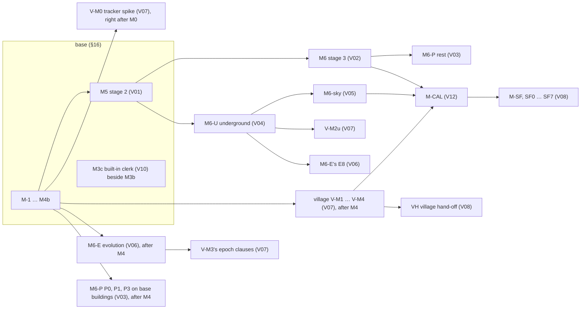

## 3 The dependency graph

| milestone | may start after | runs beside | its hard dependencies inside (the volume's own §8) |
|---|---|---|---|
| M5 (V01) | M4 | the village, M6-E, M6-P's first rungs | W15's V04-reading parts land inert until M6-U |
| V-M0 (V07) | M0, on M0's kernel, M0 (b)'s tables and its own fixtures | M1 | none from M2b |
| V-M1 (V07) | M4 | M5 | file g's barrier closure (fallback: VG's water cut) |
| V-M2 (V07) | V-M1 | M5 | file f item 202's registration hooks (fallback: V07 risk (9)) |
| V-M3 (V07) | V-M2 | — | its epoch clauses exit with M6-E's E2–E4 |
| V-M2u (V07) | V04's tail (M6-U) | — | fallback: no cavern or ruin under a village until then |
| M6-E (V06) | M4 | M5, the village | E4 after item 105's S10b changes land; E8 after V04's U5; E7 after E1–E6 |
| M6 (V02) | M5 | M6-U | volume 4's access draw and M6-U before T-V2-36's crypt part |
| M6-P (V03) | P0, P1, P3 after M4 on base buildings; the rest after M6 | M6 | P2 once V04's access records exist |
| M6-U (V04) | M5 (or beside it with a second pair: U3's distinctness and U4's undercity parent wait on V01's W15) | M6 | U4 carries the crypt derivation |
| M6-sky (V05) | M6-U; its P0 spike may run beside M5 | — | V01's unit run |
| M3c (V10) | M3a (C1 inside M3a) | M3b | V09's AP8 screens |
| M-CAL (V12) | M6-sky; its inputs M4, M5, M6 and V-M4 | — | the corpus interface (§13.9) |
| M-SF (V08) | M-CAL (SF0–SF3 may start earlier; VH when the village lands) | — | SettlementForge's own side (SettlementForge's program) |
