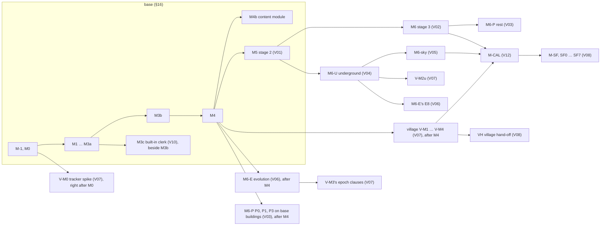

# Repair round 2 — scope (title, summary, §0, §1, §13–§17, Delegated decisions, Judgment calls, Staged, Appendix A, INDEX.md) — lane coherence/repair-scope-r2

> PENDING FABLE REVIEW — written by opus standing in for the Fable seat coherence/repair-scope-r2; covered by the whole-design retrovalidation (J84).

# Block file per the BLOCK PROTOCOL (docs/validation/amendments-b/apply-blocks.py): text before the first block header is
# ignored; the FILE line routes the last block to docs/volumes/INDEX.md, every block above it to docs/ARCHITECTURE.md.
# Live targets (assemble-r1's install, unchanged at landing): base 137ecc0e4fe12c44…, rationale 630da95935076a85…,
# INDEX 9efc19e34883b520…. Every REPLACE body is the live section with count-asserted substitutions (generator
# docs/validation/coherence/work/repair-scope-r2/build.py over edits_a.py … edits_h.py: 165 substitutions, each asserted
# to match exactly its count, each tagged with its issue or ruling in build-log.json); every untouched line is verbatim.
# Blocks: 16 — 13 REPLACE on the base (the one-page summary; §0.2, retitled; §1.1; §13.1; §13.2; §13.4; §13.8; §14;
# §16; Delegated decisions; Judgment calls; Staged; Appendix A), J-ROWS (9 rows), RATIONALE-A (15 rows: 9 new, 6
# restated), and one REPLACE of INDEX.md's title section (the whole file, its intro sitting under the title). Ruling
# requests: 0. Binding rulings applied: adjudication-r2's R2-05, R2-06, R2-07, R2-08, R2-14, R2-17, R2-18, R2-19, R2-20,
# R2-26, R2-27, R2-30, R2-32, R2-35, R2-36, R2-37, R2-38, R2-40, R2-41 (Part H · scope), with R2-09 and R2-11 where they
# reach §13.2 (the pins' kinds; DR41 – DR44 cited by number).
#
# PROGRESS
# - P0 brief read whole (33 issues; ROUND-2 NOTES, NEW OWNER RULES, ORCHESTRATION NOTES); adjudication-r2's TOC, Part H ·
#   scope and R2-05 – R2-42 read whole: done
# - P1 issue sources (round2-work JSON, verify-*-r1t), canon routings 120–126 with 126 (a2), file g items 120–126 with
#   122 (h)–(i) whole, the landed round-2 files of every sibling (model, kernel, pipeline, determinism, rendering, V01–V12)
#   for the names and ids this unit cites and their hand-offs to scope, every live section concerned read whole: done
# - P2 count-asserted edits, everything but the prices (edits_a – edits_g): done
# - P3 PRICES LAST (R2-06 (b)): after all twelve volume seats logged LANDED (V02 07:30, V06 07:35, V09 07:39, V04 07:43,
#   V10 08:03, V12 08:05, V01 08:09, V11 08:17, V07 08:18, V05 08:19, V08 08:27, V03 08:41 — no poll was needed past
#   08:41), §16, D-20, J-A568.01 and INDEX §1 written from each volume's round-2 §8 total (edits_h; prices.py): done
# - P4 dry run on copies, references, document checks, result saved, LANDED: done (CHECKS below)
#
# WHERE EACH VOLUME'S FIGURE WAS READ (R2-06 (b), (c)): every volume's round-2 repair file states its §8 total in its first
# lines, and every one of them replaces its §8 (or the subsection holding the total) — so each figure is the round-2
# file's: V01 27.5–36.75 (repair-r2-V01.md l.5; W10 +0.25–0.5); V02 23–33.5 (l.5; M6 18.75–28.5 + spikes 2.25, 2–2.75 at
# M3a); V03 19–26 (l.5; M6-P 18.25–25, PE 0.75–1, item 123 at P4 and P5); V04 28.5–39.5 (l.5; U5); V05 18–24.75 (l.5,
# unchanged); V06 31–44 (l.5; E2 +1–1.5, E6 +0.25); V07 30.5–43 (l.5; V-M3 +0.25–0.5); V08 18.5–25.25 (l.5; SF3, SF4);
# V09 23.75–34.75 (l.5; its §8.1: base line 16.0–23.5, staged 3.25–5.0, AP11 4.5–6.25 itemised); V10 14.75–20.25
# (l.5; M3c 11.25–15, C1 and the transcript 3.5–5.25 unchanged); V11 13.6–19.1 (l.5; its §8: first-total share
# 11.75–16.5 = 8.25–10.75 non-g + C2's g share 1.0–2.0, C4a 0.5, C3b 0.75–1.25, C9 1.25–2.0; staged C4b 1.1–1.6 + C8
# 0.75–1.0 = 1.85–2.6); V12 7.25–11 base side (l.5; W1–W6 6–9, W7 1.25–2; M-CAL 4.75–8 unchanged).
# THE RESULT (prices.py, re-summed from the new text): the milestone rows = the first total 230.75–315.25 (was
# 225.5–307); the base lines 203.25–278.5; the staged lines 187.85–264.1 (was 182.5–255.75); the whole program
# 418.6–579.35 (was 408–562.75); the calendar about 115–158 weeks (the first total ÷ 2 implementers); the cuts leave
# ≈ 213.75–287.25. Row changes: M2b −0.25/−0.25 (C2's g share 1.75–2.75 → 1.0–2.0, + C4a 0.5; the ladders' rows are C4b,
# staged); M3b +1.5/+2.5 (items 122 and 124's base parts, 0.75–1.25 each, item 122's with V01's `campLand` ≈ 0.25); M4
# +0.75/+1.25 (item 121's base parts); the carried row 10.75–16.25 → 13.75–20.5 (V09 7.75–11.5 → 7.5–11, narrowed by item
# 126; AP11's base parts 1.25–1.75 → 3.5–5; C9 0.75–1.25 → 1.25–2; W6 0.25–0.5; W7 0.75–1.25 → 1.25–2); M5 = V01's total.
# Line changes: O12 8.5–13 → 10.75–16.75 (items 121, 122, 124); the content line 13.75–19.75 → 14–20.25 (VV1112-r1-01's
# split: C4b off the first total; C9 up); the reference app 17.5–25.75 → 19.5–28.5; the rig 16.25–23.25 → 16.75–24.
#
# ISSUES → WHERE FIXED (33 routed ids, 31 distinct; all FIXED in text or written as NEW DESIGN; 0 INVALID; 0 parked)
#  VAL-R1-01 (FIX)  §14's `StrategyRegistry.underground` comment names the stages in V04 §3.1's order — the systems, the
#        access pass (U-ACCESS), II.7.3's sewer-front neighbourhoods (U-FRONT), the undercity, the connection stage — the
#        V04 pointer written "(V04 §3.1)" in place of "in V04 §3.1's order" so the comment's own "§4.1's order" stays the
#        base's (the resolver read the open V04 list as ambiguous; the meaning is the issue's).
#  VAL-R1-04 (FIX per R2-06 (a))  §13.2's *The underground layer built* reads "Every T-V4 test (V04 §7)"; the take-over
#        row's family cell "every T-V4 test (V04 §7)"; item 120's group names T-V4-81 (T120-4, T120-5) per R2-35.
#  VAL-R1-13 (FIX per R2-06 (b), R2-07)  §16's M6-sky row and effort line 18–24.75; the village row "items 111, 113–120 and
#        122 at the village rungs | 30.5–43 pw" (V07 §8 as round 2 leaves it; V07 applies items 119, 120 and 122 at its
#        rungs: T-V7-67 – T-V7-69); INDEX §1's V05 and V07 cells.
#  VAP-r1-09 (FIX per R2-08)  the stage-3 take-over row adds T119-2's stage-3 clauses (T-V2-22, T-V2-24), the sky row
#        T119-2 – T119-5's island clauses (T-V5-18); item 119's runs list names volumes 1, 2, 3, 4, 5 and 7's waits.
#  VAP-r1-15 (FIX per R2-17)  §16's staged row "(V11: C4b at M-SF, C8 at M6-U)"; INDEX §1's V11 cell is VAP-r1-15's text.
#  G126-scope (NEW DESIGN per R2-41, R2-35, R2-36)  §1.1 *Where the map is seen* (no phone view of any kind; the narrow
#        class retired; a smaller window keeps the medium layout at 600 × 480 and scrolls; M2a); §13.2's group T126-1 –
#        T126-3 with its volume ends (T-V9-22, T-V8-62, T-V12-59); §13.8's row (M2a); §13.4's sessions on tablets and
#        desktops only; §16's reference-app line "touch and the two layout classes (wide and medium; item 126 retires the
#        narrow class)" priced with V09's narrowed base line, M2a's row naming the layout; §0.2's row; J-A126.01 with its
#        Part A entry; the summary's sentence. No phone screen, notice, catalogue row or Send button is written (126 (a2)).
#  VDC1-16 = VEL0-06 = VPC-R1-26 (ONE FIX per R2-20, VEL0-06's text)  J-A113.61's index row and Part A entry read
#        `0x8000_0000 + r`, the u32 range's upper half (live epochs 1 … 2³¹ − 1).
#  VDC1-17 (FIX per R2-18 (d), R2-19)  T20-2's undo clause and T20-6's revert and undo clauses read VDC1-17's text, each
#        citing "§7.4 *Replay semantics*"; its fixtures are T20-14 – T20-16 (with VEL0-01).
#  VDC1-18 (FIX per R2-27 (d))  T114-9 in the item-114 group, its head naming §5.3; §13.8's row (M4; the village clause
#        with V07's T-V7-59); the village take-over row names it.
#  VDC1-19 = VEL0-01's Part A clauses (ONE FIX per R2-18 (e))  J-DET-11's and J-A20.71's Part A entries restated as VEL0-01
#        words them (swap: NOTE FOR ASSEMBLE (1)); R25 in Part F (scripted substitution: NOTE (2)).
#  VEL0-01 (FIX per R2-18 (d), (e))  T20-14, T20-15 and T20-16 in the T20 group (R2-18 (d)'s ids and texts, T20-16 the
#        all-locked fall); §13.8: T20-14 PR on B-DOSSIER-lite from M3a, T20-15 and T20-16 from M4; Part A as above.
#  G120-scope (NEW DESIGN per R2-35, R2-32, R2-07)  §13.2's *Find* group T120-1 – T120-6 with every volume end R2-35 names
#        (T-V9-83, T-V12-52, T-V1-59, T-V3-38, T-V4-81, T-V5-36, T-V7-68, T-V8-58, T-V10-51); §13.8's rows from M5; the
#        convention reads "of the owner items" (R2-07 for "items 8–125"); §16's M5 row names Find's base parts, V09's panel
#        and V01's services, the carried row's AP11 list "Find (M5)"; §0.2's row; J-A120.01 with its Part A entry.
#  G121-scope (NEW DESIGN per R2-35, R2-36)  the *resolution adjuster* group T121-1 – T121-8 (T-V9-84, T-V12-53); §13.8's
#        rows at M4; §16's M4 row and the O12 line (0.75–1.25 pw); §0.2's row; J-A121.01.
#  G122-scope (NEW DESIGN per R2-35, R2-36, R2-37)  the *Crisis looks* group T122-1 – T122-7, item 122 (h)–(i)'s four bars
#        left V12's (T-V12-55), the volume ends (T-V12-54, T-V11-46, T-V8-59, T-V9-85, T-V6-75, T-V7-69, T-V3-40); §13.8's
#        rows (M3b; T122-4 and the dossier's fixtures with M-SF); §16's M3b row and the O12 line (0.75–1.25 pw, V01's
#        `campLand` among it); §0.2's row; J-A122.01.
#  G123-scope (NEW DESIGN per R2-35, R2-36, R2-38)  the *ruined building's plans* group T123-1 – T123-7 (T-V3-39, T-V4-82,
#        T-V2-59, T-V6-76, determinism §6.5 (9), T-V12-56); §13.8's row at volume 3's P4 (V03 §8), the decay level with
#        M6-E; §16's M6-P row (P4 and P5, with §2.6 step 7, §6.3 and §8.6's base parts, priced in V03 §8); §0.2; J-A123.01.
#  G124-scope (NEW DESIGN per R2-35, R2-36; MOOT in part, R2-41)  the *Light weather* group T124-1 – T124-9, T124-5
#        without phones (the low tier and reduced motion); the volume ends (T-V11-48, T-V9-87, §6.5 (9), T-V12-57); §13.8's
#        rows at M3b; §16's M3b row and the O12 line (0.75–1.25 pw); §0.2; J-A124.01.
#  G125-scope (NEW DESIGN per R2-35, R2-36, R2-40)  the *dossier the only data input* group T125-1 – T125-3 (T-V8-61,
#        T-V12-58); §13.8: T125-n at M-SF and T117-6's row "births whose dossier carries a stamped tick … and one with
#        none"; T117-6's bar reads the dossier's latest stamped tick (§4.11 *The clock*; DR42); §14 (R2-40 (2)'s receiving
#        end): `HostContext` keeps `audience`, `displayNames`, `line` with R2-40's comments, loses `week`, `realm`,
#        `customLibrary`; `RealmBlock`, the client's `realmBlockFrom` and the `realm_block_used` note retire, `field_fallback`
#        joins `PortNote` (V08's hand-off); item 4 dates by §4.11 *The clock* (2)'s rungs; item 5 rewritten; the Staged
#        section drops "the realm block's supply"; §0.2's row; J-A125.01 (it amends J-A20.79, J-A73.02, J-A77.72,
#        supersedes J-A77.06) and J-A76.41 restated (pipeline's hand-off, VPC-R1-27's note).
#  VM-R0S-14 (FIX)  §13.1's *stretch-state writes* bar (§2.2 rule 5's *Write*) with its negative control.
#  VM-R0S-17 (FIX)  §14's comment: "FabricStrategyId is §2.5's: the id of a registered fabric — `bent-cut`, a
#        hood.templates row (V01 §2.2) or V07's `village-ways`".
#  VM-R1T-10 (FIX per R2-26 (b))  T110-2 gains the obstacles and the clear-span bound (a square, a grove, a 200 m river:
#        dropped generated, bent declared); T110-5 the moat-bridge deck-plot case; R2-26 (c)'s receiving end in the same
#        clause: VEW-r1-03's two fixtures (a moated c15 aqueduct, a timber viaduct on a gate's line), the crossing's one
#        station on the trace as the wall's band. VM-R1T-10's "aqueduct across a wall strip, 0 piers" is that fixture
#        under R2-26 (c) — the station on the band is the wall's own masonry, no pier in setback, glacis, berm or moat.
#  VRC1T-09 (FIX per R2-06 (a))  §13.2: "the T-ER rows of §8.11, §9.7 and §11.6"; §13.8's row likewise (it also registers
#        and schedules rendering's T-ER-22 – T-ER-29 by their rows' milestones — rendering's hand-off).
#  VCS-08 (FIX per R2-06 (b))  §16's staged rows, effort lines, totals and calendar, D-20 and J-A568.01 (index and
#        Part A, restated) from the round-2 figures above, not the issue's.
#  VCS-10 (FIX per R2-06 (a), R2-08)  every "T-Vn-1 – T-Vn-m" naming a whole volume reads "every T-Vn test (Vnn §7)" in
#        §13.2 and §16 (M5's exit); the groups' runs lists (items 115, 117, 118, 119) and the take-over base-bar column as
#        the issue words them, with every round-2 volume test that takes a clause (V01 – V12's hand-offs).
#  VCS-18 (FIX per R2-06 (b))  INDEX §1's price column, every cell from the round-2 figures.
#  VCS-r1-01 (FIX per R2-07)  §0.2's heading "file g's items", its prose "102 onward" and "113–126", rows 120–126;
#        Appendix A's two lists brought to item 126 (subsets, explicit); §13.2's convention "of the owner items" and the
#        group head "File g's items"; INDEX's intro "file g's items, the owner's rules"; the summary's sentence on items
#        120–124 with items 125 and 126.
#  VCS-r1-02 (FIX)  the summary's item-114 and item-115 clauses as the issue words them.
#  VCS-r1-03 (FIX per R2-14)  T115-2 is VCS-r1-03's text with R2-14's gloss; T115-3's retired "hall or similar record"
#        reads "a grand building the dossier specifies (V08 §3.16 (3))" (R2-14 retires the wording everywhere).
#  VV12-r1-09 (FIX)  §14's @plat/hood services as the issue lists them, with V01 r2's `disasterSource` /
#        `disasterDistricts` and `campLand` (V01 §8.3) and the package's first landing at M3b for `campLand` (V01 §8.1).
#  VV56-r1-09 (FIX)  INDEX §2's V05 row "V01 (the island's unit inputs)".
#  VV78-12 (FIX per R2-06 (b))  §16's village row and effort line, INDEX's V07 cell: 30.5–43 (V07 r2), items as above.
#  VV1112-r1-01 (FIX per R2-06 (b), R2-17)  §16's content line split as the issue words it — C2's g share 1.0–2.0 and C4a
#        0.5 (and C3b 0.75–1.25, which J-A568.02 had placed in the same figure) in the first total, C4b and C8 on the staged
#        line — M2b's row carrying C4a and no C4b; the staged row "C4b at M-SF"; INDEX's V11 cell.
#
# RECEIVING ENDS AND SIBLING HAND-OFFS CLOSED HERE (R2-05)
#  R2-26 (c) T110-2's two fixtures; R2-27 (a) T114-10 — VEW-r1-02's CITY fixture (the welded stretch's profiles equal at
#  every commit, one drawn state, one battle-map answer per edge), §13.8 M2b, its epochs with M6-E; R2-30 T116-1 and
#  T116-4 "or stop 0 where the bounds are wider than the window at stop 0" (and the crisis framing's bounds), J-A116.02
#  recording the narrowing (J122); R2-32 / R2-36 §16's M5, M3b, M4, M2a, M6-E, M6-P, M6, M6-U, M-SF and carried rows and
#  §13.8's rows; R2-40 (2) §14; R2-07 INDEX. Sibling hand-offs: pipeline (T66-2's enclosed basement, VPC-R1-23; B-EDGE
#  "its EP rows"; J-A76.41 restated), determinism (§14 item 5's realm and `realm_block_used`; J-A77.72 amended by
#  J-A125.01), model (§14 `HostContext`), rendering (the T-ER rows registered and scheduled), V01 (`campLand` in M3b's
#  line), V04 (the underground row), V05 (the sky row), V06 (T122-1's and T123-4's clauses), V07 (the village row), V08
#  (§14's port types; the SettlementForge row), V09, V10, V11, V12 (their rows; V12's convention (6) note), V03 (its row).
#
# NOTES FOR ASSEMBLE
# (1) RATIONALE-A's last six rows RESTATE existing Part A entries — J-DET-11, J-A20.71, J-A113.61, J-A114.01 (T114-1 –
#     T114-10), J-A568.01 (stage 3's round-2 split) and J-A76.41 (the week's source): swap each into its older row's
#     place (the precedent of J-A73.06, assemble-r1's handoff.py), so Part A keeps one row per id. Their index rows are
#     changed in place by this file's REPLACE of the judgment index. Simulated: Part A 797 rows = the index's 797, 0
#     duplicate ids, 0 ids in one and not the other.
# (2) R2-18 (e) / VEL0-01 also name R25 in the rationale's Part F (a verbatim record, by judgment id, which no block kind
#     reaches): replace, once, the quoted sentence under "#### R25 — §7.7 → J-DET-11"
#       OLD: > *Chose the lock above the assignment because the owner's hook asks for precedence over the generator's own
#            class rules, not over the user's locks; a host that must override a lock sends an unlock first, and the log
#            records it.*
#       NEW: > *Chose the lock above the assignment because the owner's hook asks for precedence over the generator's own
#            class rules, not over the user's locks; a host's map event that must override a lock sends an unlock first,
#            which the log records; a dossier event is never refused by a lock — it supersedes the lock on what it changes,
#            the lock reported orphaned (§7.7's precedence; items 20, 22).*
#     (each one line in the file; dryrun.py's R25_OLD / R25_NEW hold the exact strings; asserted once.)
# (3) The §0.2 REPLACE retitles its heading ("102–119 (file g)" → "file g's items", R2-07); nothing cites the heading's text.
# (4) The INDEX block follows the FILE line and replaces INDEX.md's level-1 title section, i.e. the whole file (its intro
#     lies under the title): apply-blocks reports its title block changed — the intro's R2-07 range, intended.
# (5) DOCUMENT CHECKS: append the 19 reviewed rows below to docs/validation/doc-checks-allow.tsv (grep '^# ALLOW ' <this
#     file> | sed 's/^# ALLOW //'): each a C3 run of this file's new text made only of our own section pointers, item and
#     volume numbers and person-week figures with one ordinary word.
#
# INTERPRETATIONS AND JUDGMENT CALLS (vetoable; J122 where new design; each an addition, no other decision changed)
#  1. Pricing items 120–126's base parts under §16's rule (J-A120.01 – J-A126.01, J-A568.05; PLAUSIBLE): items 121, 122 and
#     124 widen the O12 line by 0.75–1.25 pw each (the Auto loop with its ultra tier and split composition; the crisis
#     looks over item 118's engine with V01's `campLand`; the weather layer), placed in M4's and M3b's rows; items 120,
#     123 and 125 are absorbed — Find's base parts (key, roles, listing, export) by the O11 and O12 lines, its overlay
#     provider and panel being V09's AP11; item 123's by V03's P4 and P5, with which they land (V03 §8 prices them);
#     item 125's by the O10 and O11 lines (V08's SF3 prices the port's side).
#  2. AP11's split (V09 gives the parts' prices, not their milestone split): 3.5–5 with the application line — items
#     111–119's base parts (J-A568.04's 1.25–1.75), Find 1.25–1.75 (M5), the resolution setting 0.25–0.5 (M4), the crisis
#     looks' screens 0.5–0.75 (M3b, their dossier numbers with M-SF as AP5b's host step is) and the weather switch 0.25
#     (M3b) — and 1–1.25 on the staged-screens line (items 111–119's staged 0.75–1, the damage lines 0.25 with P4).
#  3. J-A76.41 is restated (pipeline's hand-off asks its row to read the dossier's tick) rather than marked amended; the
#     other rows item 125 touches keep their text and carry *amended by J-A125.01* (J-A20.79, J-A73.02, J-A77.72) or
#     *superseded by J-A125.01* (J-A77.06), the convention's form, since their index text stays true.
#  4. T20-16 (R2-18 (d)'s third bar) states the suffix order and the orphan reports; T122-2 keeps item 122 (e)'s "a
#     condition the viewer's key withholds is not drawn" inside R2-35's T122-2 (no id is added).
#  5. The convention's (5) names the pins' three new off forms (`view`, `input`, `entityScope`) by V12 §3.7.8 (5) so every
#     pin of items 120–126 has a stated off form; (6) names items 120–126's statistics as conformance clauses (V12 §3.15).
#  6. Seven phrasings were changed only to clear C3 hits on ordinary words (no meaning changed): "the device's pixel
#     ratio", T114-9's "and nowhere else", T110-2's "; the support step's", §14 item 5's "no field of the three", T123-5's
#     "an opening in its roof … an open stretch of the footprint's edge", T123-7's "keeps its plan byte for byte".
#
# HAND-OFFS (R2-05 (3): ends no ruling names, for round 3's verifiers; none is open wording in the design text)
#  - rendering: its round-2 judgments 1–11 (the split composition, the 60 s hold, the ultra bar, the ring) are recorded in
#    its report, not as J-A12x.8x index rows; the judgment index may take them as rendering's rows (part digit 8).
#  - V08: its judgment 2 — `line` can decide between two registered lines' readings of one dossier — meets R2-40 (2)'s
#    "none able to change a document a dossier makes" and T125-2; §14 states R2-40's words (the adjudicator's to weigh).
#  - V01: `campLand` in `@plat/hood` lands at M3b before the package's M5 (V01 §8.1); §14 states the first landing creates
#    the package with that one service (the precedent of `@plat/buildings` and M6-P).
#
# CHECKS (executed on copies; receipts in docs/validation/coherence/work/repair-scope-r2/: dryrun.py → dryrun.json,
# fullstate.py, prices.py, build-log.json)
#  - apply-blocks.py (two-pass, unchanged): alone on the live base + rationale 15 found, 15 applied, 0 skipped, audit not-OK
#    0, headings 153 → 153, fences balanced, title block unchanged; notes: the §0.2 retitle and RATIONALE-A's six restated
#    ids (NOTE (1)). INDEX 1/1, audit 0, the rationale untouched. Combined with the landed base r2 files of determinism,
#    kernel, model, pipeline and rendering (assemble's name order): 71/71 applied, audit 0, headings 153 → 153, and every
#    section this file replaces byte-identical to the alone run (no sibling block touches them).
#  - With NOTE (1)'s swap and NOTE (2)'s R25 substitution simulated: Part A 797 rows = the judgment index's 797, 0 duplicate
#    ids in either, 0 ids in one only.
#  - §16 re-summed from the new text: the milestone rows 230.75–315.25 = the first total; the base lines 203.25–278.5 =
#    the base subtotal; the staged lines 187.85–264.1 = the staged total; whole 418.6–579.35; each staged row's estimate
#    equals its effort line; INDEX §1's cells equal §16's and the volumes' §8 totals.
#  - References (assemble-r1's refs.py over a mirror of the full post-round-2 set: base = the five landed base r2 files +
#    this one, each volume with its landed r2 file, INDEX with this one): 0 BROKEN (53 896 resolved; every id this file
#    cites — T-V1-59/60, T-V2-58/59/60, T-V3-37 – T-V3-40, T-V4-32/81/82, T-V5-18/34/35/36, T-V6-75/76, T-V7-59/67/68/69,
#    T-V8-58 – T-V8-62, T-V9-22/81 – T-V9-87, T-V10-51 – T-V10-53, T-V11-46/48, T-V12-52 – T-V12-59, V06 §3.23 — resolves;
#    and the sibling cites of T20-14 – T20-16, T114-9, T120-n – T126-n now resolve); the base's ambiguous forms 24 → 14
#    (none in this file's new text; §1.1's one, l. 300, predates it); 2 FIX are V12's own (§3.15.16 in its X-V12-20 and §13).
#  - doc_checks.py --sections "The whole design,0,1,13,14,15,16,17,Delegated decisions,Judgment calls,Staged,Appendix A"
#    — WARNING printed: reference corpus INCOMPLETE (captures, research/patreon, research/devlogs, research/ftg-docs,
#    research/external) — NOT authoritative, provisional. Live: C1 5/0, C2 1/0, C3 403/0, C4 1/0, S1 0/0, S2 183/0, exit 0.
#    New (alone): C1 5/0, C2 1/0, C3 384/19 → 0 with the 19 rows below, C4 1/0, S1 0/0, S2 187/0. (On the combined copy
#    S2 shows 4 unreviewed hits in rendering's and pipeline's new lines — their proposed rows, not this unit's.)
#
# WORDS (wc-style, before → after; principle (9)): summary 1 860 → 2 008; §0.2 2 632 → 3 159; §1.1 1 908 → 2 039; §13.1
#  3 088 → 3 214; §13.2 17 074 → 19 814; §13.4 1 076 → 1 088; §13.8 2 165 → 2 617; §14 9 214 → 9 371; §16 9 138 → 9 750;
#  Delegated 3 138 → 3 139; the index 16 506 → 16 558 (+567 in J-ROWS); Staged 1 296 → 1 290; Appendix A 571 → 575;
#  INDEX.md 4 026 → 4 049 — 73 692 → 78 671 (+4 979, +6.8 %), Part A +1 925 (9 new entries, 6 restated). The unit grows:
#  what holds it is the new design owner items 120–126 require of this unit (seven bar groups ≈ 2 750 words, their
#  §13.8 rows, §0.2 rows, §1.1's statement, §16's placements and prices, eight index rows) and the round's defined edges
#  (T20-14 – T20-16, T110-2's and T110-5's cases, T114-9, T114-10, T66-2's enclosed basement, §13.1's write bar); the words
#  removed are restatement only — every restated upper test id (R2-06 (a)), the retired realm block's interface and the
#  host inputs item 125 retires — no rule, value, case, bar or decision dropped.
#
# ALLOW C3	0 25 0 5 time	§16's reference-app line (coherence/repair-scope-r2): "narrowed by item 126's 0.25–0.5; time's screens" — our own person-week figures, digit runs, not text
# ALLOW C3	0 5 0 75 the	§16's reference-app basis (coherence/repair-scope-r2): "0.25–0.5, the crisis looks' screens 0.5–0.75, the weather switch's 0.25" — our own person-week figures
# ALLOW C3	1 0 2 0 the	§16's content line (coherence/repair-scope-r2): "V11 §8's C2 g share, 1.0–2.0), the wall rows" — a person-week figure and ordinary words
# ALLOW C3	1 2 3 6 7 8 9	§0.2's item-122 row (coherence/repair-scope-r2): "volumes 1, 2, 3, 6, 7, 8, 9, 10, 11 and 12" — volume numbers, not text
# ALLOW C3	1 3 4 5 7 8 9	§0.2's item-120 row (coherence/repair-scope-r2): "volumes 1, 3, 4, 5, 7, 8, 9, 10, 11 and 12" — volume numbers, not text
# ALLOW C3	1 5 2 5 and	§16's components paragraph (coherence/repair-scope-r2): "their looks' itemised 1.5–2.5, and items 121, 122 and 124" — our own figures and item numbers
# ALLOW C3	11 3 11 4 14	§13.2's item-125 group head (coherence/repair-scope-r2): "(item 125; §11.3, §11.4, §14, …)" — digits of our own section pointers
# ALLOW C3	2 7 5 3 7 1 7 4	§13.2's item-114 group head (coherence/repair-scope-r2): "(item 114; §2.7, §5.3, §7.1, §7.4, …)" — digits of our own section pointers
# ALLOW C3	2 8 2 8 8	§13.2's item-122 group head (coherence/repair-scope-r2): "§10.2, §8.2, §8.8, §11, §12.5" — digits of our own section pointers
# ALLOW C3	2 9 6 1 8 2 8 4 8 8	§13.2's item-124 group head (coherence/repair-scope-r2): "(item 124; §2.9, §6.1, §8.2, §8.4, §8.8, …)" — digits of our own section pointers
# ALLOW C3	25 2 0 25 0 5 and	§16's carried row (coherence/repair-scope-r2): "(7.5–11, 3.5–5, 1.25–2, 0.25–0.5 and 1.25–2)" — our own person-week figures, digit runs
# ALLOW C3	3 13 2 the two	§1.1's item-126 paragraph (coherence/repair-scope-r2): "T126-1 – T126-3 (§13.2)." before "The two ladders" — a bar id, a section pointer and the next heading's words
# ALLOW C3	6 11 1 the plan	§13.2's item-123 group head (coherence/repair-scope-r2): "(item 123; §2.6 step 7, §6.3, §8.6, §11.1) — the plan as built" — section pointers and ordinary words
# ALLOW C3	6 9 10 11 and 12 2	§0.2's item-123 row (coherence/repair-scope-r2): "volumes 2, 3, 4, 6, 9, 10, 11 and 12 | §2.6" — volume numbers and a section pointer
# ALLOW C3	7 5 11 3 5 5 1	§16's carried row (coherence/repair-scope-r2): "13.75–20.5 pw (7.5–11, 3.5–5, 1.25–2, …)" — our own person-week figures, digit runs
# ALLOW C3	7 6 3 8 6	§13.2's item-123 group head (coherence/repair-scope-r2): "§2.6 step 7, §6.3, §8.6" — digits of our own section pointers
# ALLOW C3	7 8 5 6 a	§13.2's convention (coherence/repair-scope-r2): "(V12 §3.7.8 (5)); (6) a bar that compares" — a section pointer and the convention's next clause number
# ALLOW C3	9 10 11 and 12 2	§0.2's item-120 row (coherence/repair-scope-r2): "volumes 1, 3, 4, 5, 7, 8, 9, 10, 11 and 12 | §2.9" — volume numbers and a section pointer
# ALLOW C3	9 10 11 and 12	§0.2's items 120 and 122 rows (coherence/repair-scope-r2): "… 9, 10, 11 and 12" — volume numbers, not text

=== REPLACE ## The whole design in one page (plain words) ===
## The whole design in one page (plain words)

We are building one program that draws believable medieval settlements — the map layer of SettlementForge
(`docs/DEFINITION.md`). The base (PART I) makes towns, cities and metropolises, the size inside each set by the
requested population (§1.1). It works the way watabou's Medieval Fantasy City Generator (MFCG) and Thomas Allerton's
Fantasy Town Generator (FTG) do, takes the better idea from each at every step and adds our own measured improvements
(§1.4). Twelve design volumes take everything else the owner asked for to build depth on the same engine: the detailed
neighbourhood close-up (volume 1, stage 2), buildings composed of wings, towers and courts (volume 2) and their floor
plans (volume 3), the underground (volume 4), floating islands (volume 5), the settlement's evolution over decades
(volume 6), the village product from thorp to village (volume 7), the live SettlementForge connection (volume 8), the
application (volume 9), the AI clerk (volume 10), the content tables (volume 11) and calibration (volume 12).
`docs/volumes/INDEX.md` is the map; §16 is the one build plan. Nothing is postponed without a milestone.

**How a town is made** (§4). *Ground:* a real heightfield in metres with water that flows downhill, so rivers reach the
sea and coasts agree with the contours; a dry site may hold an oasis, and water pulls the town toward it (item 111).
*Demand:* from the population, our own tables decide the houses, workshops, inns, churches and institutions the town
needs and the land they take, before any street is drawn. *Big decisions:* the markets — a principal market where trade
meets, usually the plaza, and secondary markets by size, as MFCG and FTG have them — the castle and the large precincts
are reserved; the main roads to the gates are solved first; the first wall follows the town's edge measured along them,
and each later ring is traced before the streets it encloses grow, with a gate wherever a main road crosses it, using
cliffs, gorges, marsh and the sea where they close the circuit (item 106), and a wall long safe weathers through
worn runs to breaches, a poor one under threat patches its gaps in cheaper material and a rich one rebuilds in stone,
recovering when the need and the means return (item 114); rivers, moats and canals are
bridged where roads cross them; a strip along every wall stays free of houses and lanes. *Streets:* main roads run between real
destinations over the terrain; inside the walls the lanes are cut by the "bent cut" that gives watabou's maps their
charm (one bend, arriving square) — Neighbourhood 1.2.2's recipe restated in metres, its recordings the test it must
pass; outside the walls side streets grow along the main roads as FTG's do. *Districts:* groups of blocks named for
their market, gate, harbour or castle and merged into quarters at city zoom, shaped by a prosperity field — a smooth
gradient that rises near the centre, the markets, water in dry country and high, dry, sunny ground and falls near
tanneries, walls and damp or shaded low ground. A neighbourhood earns its character and its name from what stands in
it — a few churches outweigh many lodging houses — and its prosperity sets the floor and the ceiling of every building
in it. *Plots:* every block is divided from its street frontage into parcels; rich quarters join plots into fewer,
larger ones with courts and gardens, poor quarters split them and get alleys; some plots sit behind passages and courts,
reachable yet unseen from any street, and a place's name can be known only locally or secretly while the place itself
is always drawn (§4.6, §9.2). *Placement:* one solver places every institution by rules of attraction and
repulsion — noxious trades downstream, shops on streets that feed the market, supply links pulling both ends, coverage
spreading daily services (items 16, 103–107); some institutions hide behind a front, a thieves' guild behind a
tavern; a neighbourhood mixes a few classes of house, the richer its end of the scale the more large houses; a
building whose designation changes mutates instead of re-rolling (§4.7). *Buildings:* each plot gets a site plan — a row house with party walls, a
manor behind its yard, a detached house, a hovel, or a cluster of shacks each with its own door — and every building
stores its heights, so the shadows — on by default — floor plans and the 3-D export read real geometry; it gets
several doors when its plot gives it a lane or a yard, and a cellar where its class, its ground and its wealth say
(§2.6); below a town a dwelling stays a single range, an L or a T, with no court, tower or turret, a thorp or hamlet
has no manor and a village at most one, with a lord — unless the dossier or the user asks (item 115). When a quarter grows rich or poor its stock persists — use and occupancy change first, tenure and yards later,
geometry only on vacancy, ruin or redevelopment — and a plot's geometry never reads poorer than the middle band once it
was built to that band or above (§4.11); the interior has no such floor: the same shells are re-cut inside for the
households that live there, down to single rooms off a corridor (§2.6). A thriving institution's surplus is kept as
pressure that lifts its neighbourhood over the years until the neighbourhood itself moves up (§4.5; J-C3). Buildings
can be shown half-built, half-demolished or falling into ruin, week by week (§4.11). *Finishing:*
towers, bridges, the harbour, fields and woods sized to the population, greenery by rules that read prosperity, and
names and curved labels that never cover a gate or a keep. Below cities the underground holds sewers with their
neighbourhoods, catacombs, caverns, quarries, vaults, ruins and at most one to three undercity neighbourhoods; adding a
way down builds everything it needs (II.7, §7.3, volume 4). The rules are data tables that can be read, edited and
calibrated; every default imitates what MFCG or FTG does, and our extensions ride on top as table values the parity
presets switch off (§7.6).

**What you see** (§8, §11, §12). One display list draws the town as a clean ink map (the default, in MFCG's family), as
a textured lit map like FTG's, or as a hatched close-up like Neighbourhood's — all on one drawing path — and exports it
to SVG, PNG, GeoJSON, virtual-tabletop scenes and 3-D; a large print is made in the background without holding up the
map. The default ink map takes the warmer paper and brown-black ink measured on the owner's own map collection (§8.2;
J-C2). By day the mouse pointer is the sun and every shadow falls by the
real heights; by night torches and lanterns light the streets (§8.4); the default ink map casts its shadows gently in
its own ink, and only the setting that imitates MFCG draws none (J-C1). Every style that encodes meaning in colour
carries a second cue and has colour-blind-checked variants (item 112). The first picture is always the complete map,
never a rough preview, its light following within a moment (§8.5); §12.5 states how fast it appears at each size and
§12.3 how fast the model is built — targets met as fast as possible, every one-time wait within ten seconds (§1.1) —
with the two declared target misses at the largest sizes, inside the ten-second comfort level (D-18; item 119). The same map
dresses for the season SettlementForge's calendar gives and for its festivals — ice on still water, autumn's many
colours, the fields through the year, bunting and banners in a festival's weeks — a look only, never a change of the
map (items 117, 118), and it never zooms out past its own land (item 116). Find makes what a user picks glow across
every zoom and layer until it is closed; the view's resolution adjusts itself (Auto, up to 4K) or is set by hand; a
SettlementForge crisis is drawn while it lasts and its aftermath arrives through time; a ruined building's plans are
its own plans, damaged; and light weather comes and goes by season and region, switchable — each a look or a view,
never a change of the map (items 120–124). The map is seen on tablets and desktops only; a phone is offered no map
view (item 126).

**Editing** (§7). Every element and every rule table can be changed, and names, functions or shapes can be assigned.
Anyone — a person with the canvas tools, an AI clerk through the tool API, or a hand-written skeleton file — builds or
copies a town with one set of twelve tools: place a few points and the shape is worked out, with handles afterwards
(§7.1, §14). Edits are events on permanent addresses: they survive regeneration and version upgrades, every author's
undo is their own and works after the file is reopened, and the generator repairs around an edit locally instead of
re-rolling the town — moving a river or dragging the ground changes nothing outside the blocks the edit names
beforehand, and names follow the things they name and change only after you confirm. The bridge that lets a host, its
assistant and the editor write one document keeps each author's undo their own (§11.3); the product offers no
simultaneous editing of one map by two people (J122). A saved town is editable as soon as a quick fingerprint check passes, while a full check runs in
the background (§2.9).

**Guarantees** (§5, §6). The same seed gives the same town on every machine; adding a new kind of decoration,
re-rolling one block or growing the town never reshuffles what already exists; a release that changes how a step works
declares the change, stage by stage. There is no whole-map retry: every step that can fail has a short, bounded
fallback ladder, and the report says for every requested feature whether it was delivered in full, simplified or left
out.

**SettlementForge** (§7.7, §14, volume 8). SettlementForge's dossier is the map's only fixed truth and its only data input: the
map never edits it and reads nothing else of SettlementForge, whatever it does not say the map works out by its own
rules (item 125), and a dossier change mutates the existing map with the
least disruption. A map delete of a dossier element is a rejection the solver re-places. One adapter reads SettlementForge's file and
hands the map only what it needs, so no other part of the program learns SettlementForge's field names; the module is a
separate program talking to its host through data alone (§11.3). Settlements below
1 500 people are the village product's (volume 7); hosting, accounts, the assistant and similar product questions follow
SettlementForge's own decisions (J121).

**How we know it works** (§13, §16). The riskiest part — whether grown streets and bent-cut lanes fit together within
the speed budget — is measured first, in a spike, and again on real terrain and water at the first milestone. Every
acceptance number says whether it checks that a rule was followed, compares us with a measured MFCG or FTG number, or
shows that the town is better. The owner judges side-by-sides through a written, blind protocol at matched sizes; a
milestone the owner has not rated keeps building but never claims "at parity" or "mastered". The first product
milestone is a viewable town; editing comes directly after it, because the owner ranks editability first. The effort
is computed once in §16: the base with stage 2, and the whole program with every volume's milestone.

**Clean room** (§17). We read the references' programs to understand how they work, never copying them. The
programmers work from this design set and a cleaned digest of the research — never from the references' code, word
lists or palettes — and every library is permissively licensed, so the licence of our own code, private for now, stays
the owner's to choose (§17.3).
=== END ===

=== REPLACE ### 0.2 Where the owner's late rules land — items 1–7 (`docs/AMENDMENTS-2026-09-25.md`), 8–31 (`AMENDMENTS-2026-09-25b`), 32–88 and 101 (`AMENDMENTS-2026-09-27c`, `-d`, `-e`), 102–119 (file g) and the base change requests 200–585 (file f) ===
### 0.2 Where the owner's late rules land — items 1–7 (`docs/AMENDMENTS-2026-09-25.md`), 8–31 (`AMENDMENTS-2026-09-25b`), 32–88 and 101 (`AMENDMENTS-2026-09-27c`, `-d`, `-e`), file g's items and the base change requests 200–585 (file f)

Every clause of every rule is checked at its landing; where a rule has several clauses its home carries a clause map.
Each row names the home that states the mechanism; the sections that carry a pointer, a hook field or one line of the
rule, and the item's tests (§13.2's `T⟨item⟩-⟨n⟩` bars), cite the item by number. Items 1–7 are
`docs/AMENDMENTS-2026-09-25.md`, 8–32 `AMENDMENTS-2026-09-25b` (item 32 landed with 33–72), 32–72 `AMENDMENTS-2026-09-27c`,
73–88 `-27d`, 101 `-27e`, 102 onward `docs/AMENDMENTS-2026-09-28g.md` (file g) and 200–585
`docs/AMENDMENTS-2026-09-28f.md` (file f). Items 33–62 come from reading the references' compiled code (§17.1 (1)): each
adopts a mechanism re-derived in our own terms, keeps ours with its reason, or calibrates a default to a read fact with
its `(code)` provenance (§17.1 (6)); a part a reader only inferred entered only as Fable's evidence gate released it,
labelled as an inference, and the gate's one rejection (item 49's deletion) is honoured. Items 63–72, 101, 102–111 and
113–126 are the owner's rules, 20 (h) the owner's refinement of item 20 and 112 a program rule under the owner's delegation
(J122): the owner's words are the authority, their mechanisms the program's vetoable interpretation. Items 73–88, the
dossier port and its seam, extend 20 (h) under the owner's rulings of 2026-09-28 (the first SettlementForge line, door 1
closed, a dossier below 1 500 people refused while no village product is registered, a resettled site one map, the
placeholder direction phrase, SettlementForge's own district names never matched).

| item | home — the mechanism | clause map |
|---|---|---|
| 1 greenery by prosperity | §4.9 S12b's rule table (the prosperity field and the district kind; yard planting by plot class); §15.2 O19 | §4.9 |
| 2 floating islands (a toggle) | II.6 (the staged layers' hooks) with §2.7's `SkyIsland`; built by volume 5 | II.6 |
| 3 heights for shadows | §2.6's heights and ground datum on every building, wing, tower and roof; §8.4's projected shadows (`shadowPass`) | §2.6 |
| 4 size ladders | §1.1 (both ladders; `RungProfile`; size within a rung follows population); §12.2; PART III and volume 7 (the village ladder) | §1.1 |
| 5 everything editable | §7.1 (the edit targets and their table), §7.2–§7.6, §2.8's registry paths | §7.1 |
| 6 prosperity a gradient and a band | §4.5 (the field, its drivers, bands only where a table needs one, continuous interpolation) | §4.5 |
| 7 adopted defaults | D-1–D-7, each tied to its mechanism | D-1–D-7 |
| 8 decline and regrowth | §4.11 — the decline table, the persistence order, the salvage ledger, the dwell lag, the regrowth-first siting, `DeclineOp`; T8-1 – T8-7; the engine volume 6 | §4.11 |
| 9 size set by population within each tier | satisfied by §1.1 (size within a rung follows population; every budget a law of the building count) and §13.6 (3) (pairs matched by building count); no change (J-A9.01) | §1.1 |
| 10 floating islands a product of prosperity | II.6 — the island rule's two supplies, supported area and altitude, re-read at each epoch; T10-1; volume 5 | II.6 |
| 11 the underground fades like the walls | II.6 — the tunnel ladder, never demolished by the engine, reopened by growth; T11-1; volumes 4 and 6 | II.6 |
| 12 underground neighbourhoods along the sewers | II.7.3 — the owner's three rules as invariants U1–U3; T12-1; volume 4 | II.7.3 |
| 13 islands only in cities and metropolises | II.6 (2) — the rung gate `RungProfile.layers.islands` (§1.1); T13-1 | II.6 (2) |
| 14 sewers by tier | II.7.1 — existence by tier, the toggle as visibility, the `drain` rule; `RungProfile.layers.sewers`; T14-1 | II.7.1 |
| 15 not every city has islands | II.6 (1), (4) — a model setting off by default; the count 0–3 by ordered slots; T15-1 | II.6 |
| 16 assignments obey spatial and supply-chain rules | §4.7 S10b — the one placement solver; T16-1 – T16-4 | §4.7 S10b |
| 17 uses move as the city grows and declines | §4.11 — the epoch's use step, `UseConversionOp`; T17-1 – T17-3; volume 6 | §4.11 |
| 18 a plot's buildings mutate to match a new designation | §4.7 S11 — the designation mutator; T18-1 – T18-4 | §4.7 S11 |
| 19 every designation scales with prosperity | §4.7 S11 — the designation-template table by class and band; §2.6's material rule; T19-1 – T19-4 | §4.7 S11 |
| 20 one-way data flow; the dossier is the authority | §7.7 — dossier-backed existence, rejection and its lapse, positive placement, re-application, precedence (a dossier event supersedes a lock on what it changes); T20-1 – T20-6 and T20-14 – T20-16; **(h)** (2026-09-27): §7.7 items 9–11 — two tiers of fact, derive before invent, the coherence rows and the "dossier-owned" refusal, `factTier` (§2.8); T20-7 – T20-13; **the port and its seam (items 73–88):** `@plat/port` (§14), §7.7 items 1–16, the frozen fixtures and B-DOSSIER-lite (§13.2); volume 8 | §7.7 |
| 21 licence | satisfied by the owner's ruling of 2026-09-27 (private for now; J-A21.01): §17.3 and D-22; the licence for users' maps follows SettlementForge's terms (J121); the separate program with its data-only bridge (§11.3) retained by choice; §3.1's skeleton row keeps CGAL's licence ground (J-A21.31) | §17.3 |
| 22 dossier changes mutate the existing map | §7.7 — dossier events as least-disruption mutations, `DisruptionBudgetRow`, the report; T22-1 – T22-4 | §7.7 |
| 23 emulation-first defaults | §7.6 — the defaults layer is the emulation baseline, extensions marked, the parity presets `MFCG` and `FTG`; T23-1 | §7.6 |
| 24 several markets | §4.2 — S2's market demand and S3 (12)'s principal-market score; T24-1 – T24-3 | §4.2 |
| 25 terrain and water change slowly | §4.11 — `reclaim`, `siltReach`, `shiftCourse`, `digCanal`; T25-1 | §4.11 |
| 26 the hinterland decided with the town, drawn after it | §4.9 — FTG's order and `FarmModeRow`; T26-1 – T26-3 | §4.9 |
| 27 prosperity maps onto the references' wealth models | §4.5 — the default band set and `FieldBands.middle`; T27-1, T27-2 | §4.5 |
| 28 floor plans and elaboration by click; (f) the interior has no floor | §2.6 — the fourth rung `plan`, the interior ladder, `ElaborationRecord`; T28-1 – T28-19; built by volume 3 | §2.6 |
| 29 entrances and basements | §2.6 — `entrances` under the five rules, `Basement`; T29-1 – T29-5 | §2.6 |
| 30 hidden plots and clandestine places | §4.6 — hidden shares, exposure, passages; §9.2 — the knowledge label policy; T30-1 – T30-5 | §4.6; §9.2 |
| 31 prosperity change drives fusion and splitting | §4.11 — the DUE trigger, the three rungs, churn caps, `LadderOp`, the geometry floor; T31-1 – T31-12 | §4.11 |
| 32 the compiled code read to understand it | §17.1 (1); §0.3; D-29; Appendix A | §17.1 (1) |
| 33 the bent cut's citations; the slope term ours | §4.6's recipe and step 1's slope term (provenance `own`) | §4.6 |
| 34 the stop test | §4.6 step 1 — `τ = e_lo · (e_hi / e_lo)^g` per face on `cut.stop`; T34-1 | §4.6 step 1 |
| 35 where the cut falls | §4.6 step 2 with its holed law; II.2's slit | §4.6 step 2 |
| 36 a deterministic start | §4.6 step 3; `cut.side` retired (§6.1); T36-1 | §4.6 step 3 |
| 37 the corner first, the far side from it | §4.6 steps 4–5 — `cut.bendMode`, `cut.flattenM` 0.7 m (an inference Fable released); `cut.farSideAlt` retired; T37-1 | §4.6 steps 4–5 |
| 38 the fillet by deflection and leg | §4.6 step 6; T38-1 | §4.6 step 6 |
| 39 rung (a): a turned frame | §4.6 step 8; F-CUT (§5.2); T39-1 | §4.6 step 8 |
| 40 the lane width | §4.6 step 9 — a saturating power law; T40-1 | §4.6 step 9 |
| 41 the streams and the parity rows | §13.5's bent-cut row with the fillet share; T41-1 | §13.5 |
| 42 NG's frontage-less lot leaves are its courts | §4.7 S10 (10) | §4.7 S10 (10) |
| 43 the front line | §4.7 S11 — an area-scaled, floored recession; T43-1 – T43-5 | §4.7 S11 |
| 44 the compound enclosure is ours | §4.7 S11's set-back compound row (provenance `own`, an extension); T44-1 | §4.7 S11 |
| 45 the castle repair | §4.8's compactness — a thinness bloat, then the fitted regular polygon (`regularFit`, §3.4); T45-1 | §4.8 |
| 46 the gate law's waterfront reduction; three smoothing passes | §4.2 S3 (4) and §4.4's trace; T46-1 | §4.2 S3 (4) |
| 47 district growth rates by seed kind | §4.5's grower; T47-1 | §4.5 |
| 48 MFCG's population is six people for every lot | §13.5's population row | §13.5 |
| 49 FTG's "lots" were ground-cover patches | §13.5's blocks and plot-area rows, their 441 m² figures withdrawn; the 49 % share kept, cited to its source | §13.5 |
| 50 FTG's "entrance" is its night-light anchor | §2.6's *Entrances* — the main door by the owner's rule; §13.5's entrance row, class C | §2.6 |
| 51 the retry and stream citations | §5.1 (1) | §5.1 (1) |
| 52 session-history independence | §6.5 (9)'s test | §6.5 (9) |
| 53 the Poisson annulus | §8.10's sampling; D-11 | §8.10 |
| 54 the raised under-copy by class | §8.2's class ratios and `raised(offset, classRatio)`; T54-1 | §8.2 |
| 55 the horizontal spine | §9.3's area labels; T55-1 | §9.3 |
| 56 the MFCG naming row | §15.1's MFCG D1 | §15.1 |
| 57 the sector look's two sources; fields claimed outward | §4.9; T57-1 | §4.9 |
| 58 stage 2: ring courses, greens, pins, render notes | II.2's `RingFabric` and II.3; volume 1 | II.2 |
| 59 the stage-3 hook: Fantasy Manor's layout families | §2.6's stage-3 hook; volume 2 | §2.6 |
| 60 the plan rung's Dwellings baselines | §2.6's basements note and plan step 5; §13.5's entrances-and-basements row | §2.6 |
| 61 VG 1.6.9's observations | PART III item 2; volume 7 | PART III |
| 62 the `(code)` provenance form | §17.1 (6) and (8) | §17.1 (6) |
| 63 clandestine institutions: a front and a hidden function | §4.7's *Concealed institutions*; T63-1 – T63-4 | §4.7 |
| 64 basement access to the sewer grid | II.7.3's *Basement accesses*; T64-1 – T64-3; volume 4 | II.7.3 |
| 65 the underground as a family of systems; the undercity | II.7.5 and II.7.6; `RungProfile.layers.undercity` (§1.1); the geology flag and relief toggle (§4.2 S0, S1); T65-1 – T65-8; volume 4 | II.7.5, II.7.6 |
| 66 an access edit generates everything it needs | §7.3 item 9 — the closure rule; T66-1 – T66-6 | §7.3 item 9 |
| 67 transitions on a weekly clock | §4.11's *Works*; T67-1 – T67-6; volume 6 | §4.11 |
| 68 light: day and night, the cursor sun, point lights, height-aware shadows | §8.4 — the lighting model, the light pass and its fallback ladder; `LightSource` (§2.7); T68-1 – T68-9; the default ink map casts its gentle shadows in its own ink and only the `MFCG` preset none (J-A68.81; decided J-C1) | §8.4 |
| 69 the corpus's measured colour targets | §8.2's palette targets; §13.4's bar; the `ink` plate chroma 20–30 (J-A69.82; decided J-C2) | §8.2 |
| 70 informal clusters | §4.7 S11's *Informal clusters*; T70-1 – T70-6 | §4.7 S11 |
| 71 mixed classes inside a band | §4.7 S10b's *Class mix inside a band*; T71-1 – T71-4 | §4.7 S10b |
| 72 what defines a neighbourhood, and names it | §4.5's *Neighbourhood character* — the character vector, identities, dials, band range, pressure (the surplus-pressure reading decided J-C3); T72-1 – T72-9 | §4.5 |
| 101 the authoring toolkit — declare, then derive | §7.1's *The authoring toolkit*; §14's surfaces and interaction contract; T101-1 – T101-9 and §13.4's first-five-minutes test; volumes 9 and 10 | §7.1 |
| 102 sunlight a soft driver of prosperity | §4.5 (the daylight driver and its order); T102-1 – T102-4 | §4.5 |
| 103 the siting rulebook | §10.2 (siting profiles, relation families, signature pairs, coverage); §4.7 S10b; T103-1 – T103-3 | §10.2 |
| 104 generic siting for custom content | §7.7 and §10.2 (the resolution order, archetype rows, delta tables, fallback); T104-1 – T104-4 | §10.2 |
| 105 the supply web | §10.2 (goods, orientation, splits); §4.7 S10a–S10b; T105-1 – T105-4 | §4.7 S10b |
| 106 walls that use natural barriers | §2.7, §4.2 S3 (9), §4.4 S5a, §4.8; T106-1 – T106-5 | §4.4 S5a |
| 107 spread and pull in balance | §10.2 (the balance profile, `comfortM`, spacing); §4.7 S10a–S10b; T107-1 – T107-4 | §10.2 |
| 108 institution ladders | §7.7 (DR9; V08 §2.6's `distribution` row set), §10.2 (step types), §4.2 S2; T108-1 – T108-4 | §7.7 |
| 109 caverns, underground ruins, catacombs | §2.7, §4.2 S1, II.7.5, II.7.6, §7.7's DR rows; T109-1 – T109-6; built with volume 4 | II.7.6 |
| 110 four authoring gaps; a second known-city fixture | §2.7 (`RetainingWall`, raised ways, deck plots), §3.4, §4.3, §4.6, §4.7 S10–S11, §5.3; T110-1 – T110-7 and T101-6 | §2.7 |
| 111 water in dry country | §4.2 S0–S1 (the oasis and spring), §4.2 S3 and §4.4 (the water pull), §4.5 (the water term, item 102's climate cell), §4.7 S10b; T111-1 – T111-5 | §4.2 S1 |
| 112 colour-blind-safe maps; a game-master trial before launch | §8, §9 (second cues, checked variants); §13.4's style check T112-1 and the release gate T112-2 (§16) | §8.2 |
| 113 history shapes the map at generation | §4.2 S0 (the history option), §4.11 and §7.7 (the replay; DR36 onward), II.7.6 (the buried former settlement); T113-1 – T113-7; volumes 6, 4 and 8 | §4.11 |
| 114 walls decay into gaps and patchwork, and recover | §2.7 (`Enceinte.condition`, each run's material and the epoch of its last change), §5.3 (the wall-crossing row), §7.1 and §7.4 (`repairWall`'s material, `wearWall`), §7.7 (DR41), §8.2 (the state rows, the legend), §11 (exports); T114-1 – T114-10; volumes 6, 7, 8 and 11 | §2.7 |
| 115 a ceiling on grandeur by tier | §4.7 S10b (the rung ceiling on the class mix), §10.2 (the ceiling table's shape); T115-1 – T115-4; volumes 2, 7 and 11 | §4.7 S10b |
| 116 a zoom-out limit | §8.8 (the per-map limit on the pyramid), §9.5 (framing), §12.5 (fewer stops); T116-1 – T116-4; volumes 7 and 9 | §8.8 |
| 117 seasons, a look only | §2.9 (the year position, "follow SettlementForge"), §7.7 (DR42), §4.2 S0 and §10.2 (the climate row's season columns), §8.2 (the season rows), §11, §12.5; T117-1 – T117-8; volumes 7, 8, 9 and 11 | §8.2 |
| 118 festival decorations, a look only | §2.9 (festival display), §7.7 (`traditions` consumed, DR43), §10.2 (the decoration and staging tables), §8.2 (the decoration rows), §11, §12.5; T118-1 – T118-6; volumes 7, 8, 9 and 11 | §8.2 |
| 119 as fast as possible; the ten-second comfort level | §12 (the targets, the comfort level, the measured-gain and progress rules; D-18), §1.1 (the performance statement); T119-1 – T119-5; volumes 9 and 12 | §12 |
| 120 Find, a view only | §2.9 (the per-viewer key `find`: its chips and Show gaps, outside the document, its hash and the log), §8.2 (the veil, halo, outline, pin, count-bubble, ghost-pin and gap marks; each chip's colour and second cue), §9.5 (the tool and the legend's chips), §11.1 (picture exports draw it), §11.2 (the gazetteer's class counts and match listing under knowledge admission), §12.5 (the overlay's budget); T120-1 – T120-6; built at M5; volumes 1, 3, 4, 5, 7, 8, 9, 10, 11 and 12 | §2.9 |
| 121 the resolution adjuster | §8.8 (the Resolution ladder with its two steps below 1, the 4K live-view ceiling, the ultra tier, the live Auto loop and its settle rule), §8.4 (g) (what Auto gives up, in order; labels, chrome and overlays at the device's pixel ratio), §12.1 (calibration picks ultra), §12.5 (the frame budgets the loop holds), §12.8 (memory per tier); T121-1 – T121-8; built at M4; volumes 9 and 12 | §8.8 |
| 122 crisis looks, a look only | §2.7 (`ConditionOverlay` read for the look; the aftermath only by the epoch path), §2.9 (the per-viewer key `crises`; the crisis framing), §7.7 (DR44), §10.2 (`RosterTables.crisis`: the look rows, the closed map, the settings and item 122 (h)'s rates), §8.2 (the look rows), §8.8 (the ring's massed marks), §11 (exports), §12.5; T122-1 – T122-7; built at M3b, the dossier's reading at M-SF; volumes 1, 2, 3, 6, 7, 8, 9, 10, 11 and 12 | §10.2 |
| 123 a ruined building's plans damaged, never redrawn | §2.6 step 7 (the damage layer over the same plan), §6.3 (`plan.damage`: one keyed threshold per plan element, no new id), §8.6 (the damaged plan's drawing), §11.1 (battle maps' line of sight); T123-1 – T123-7; built with volume 3's P4 and P5, the decay level with M6-E; volumes 2, 3, 4, 6, 9, 10, 11 and 12 | §2.6 |
| 124 light weather, a view layer | §2.9 (the switch as device state, the spell session-transient, `weather` the cover), §6.1 (the session-seeded `view.weather` stream), §8.2 (the effects' marks; no snow where winter does not freeze), §8.4 (the shower's dimming, fog's scattering, night halos), §8.8 (the effects layer, never in the tile key), §11 (exports leave it out), §12.5 (≈ 1 ms a frame); T124-1 – T124-9; built at M3b; volumes 9, 11 and 12 | §8.2 |
| 125 the dossier the only data input | §11.3 and §11.4 (the doors take no data input beside the dossier; the view commands kept as commands), §14 (`HostContext` without `week`, `realm` or `customLibrary`), §7.7 (DR1, DR3, DR19, DR29 and DR42 re-sourced to the dossier or the generator's fallback), §4.11 and §2.9 (the week's one source); T125-1 – T125-3, from M-SF; volumes 8, 9 and 12 | §11.4 |
| 126 the map on tablets and desktops only | §1.1 (the supported devices; no phone view), §13.2 and §13.4 (bars; sessions on tablets and desktops), §16 (the narrow class never built); T126-1 – T126-3; built at M2a; volumes 4, 8, 9 and 12 | §1.1 |
| 200–585 (file f) | each item at the base section whose heading file f files it under; the requesting volume cites the applied item | file f's headings |
=== END ===

=== REPLACE ### 1.1 What is built, in what order; the two size ladders ===
### 1.1 What is built, in what order; the two size ladders

| stage | what | depth and home | built at (§16) |
|---|---|---|---|
| **STAGE 1 — the BASE** | one general town/city generator on the ladder **TOWN → CITY → METROPOLIS**, fusing MFCG-class and FTG-class generation plus O1–O19 (§15.2): the plot model, plot granularity, the prosperity field, greenery, heights, editability, permanent addresses, layers, drainage, every owner hook, the dossier port's creation and absorb halves, and the optional content module `@plat/sim` | build-ready: §2–§14; the application's line (volume 9), the clerk's oracle (volume 10, C1), the content tables (volume 11) and the calibration rig (volume 12) inside its milestones | M-1 – M4b |
| **STAGE 2** — neighbourhood composition | the same town composed of NG-class neighbourhood close-ups with consistent seams, shared seeds and one style system | build depth: PART II with volume 1 (`docs/volumes/V01-neighbourhoods.md`); what the base must already carry is a base requirement (§2.5, §4.12) | M5 |
| stage 3 — building composition | wings, towers, courts, roofs, the crypt ladder, stepped massing, deck-plot buildings | volume 2 (§2.6's stage-3 interface) | M6 (its item-110 building part at M3a) |
| the plan rung | floor plans of every building, elaborated by click | volume 3 (§2.6's fourth rung) | M6-P (its eager plan facts inside M2b and M3a) |
| the underground layer | the sewers with their neighbourhoods, catacombs, caverns, quarries, ruins and the undercity | volume 4 (II.6, II.7) | M6-U |
| the sky layer | floating islands | volume 5 (II.6) | M6-sky |
| the evolution engine | epochs: decline and regrowth, use relocation, the wealth ladder, the works on the weekly clock, slow terrain change, history | volume 6 (§4.11's hook; the one built path, grow-by-stage, is the base's) | M6-E |
| the village product | THORP → HAMLET → VILLAGE and the small-town edge | volume 7 (PART III) | V-M0 – V-M4, V-M2u |
| the SettlementForge connection | the host client, the port leader and adapters, persistence in the host, the players' view | volume 8 (§7.7, §11.2–§11.4, §14's `@plat/port`) | M-SF (SF0 – SF7, VH) |
| the built-in clerk | the assistant driving the tool API | volume 10 (§11.2, §14) | M3c |
| corpus calibration | the reconciliation against the historical corpus | volume 12 (§13.9) | M-CAL |

§16 orders them (J122's combined order) and prices each; `docs/volumes/INDEX.md` maps the hooks each volume plugs into.

**Where the map is seen** (item 126 (a2); J140). The map is seen on tablets and desktops only: SettlementForge presents
no map entry on a phone, and the product designs nothing for one — no phone layout, screen, notice, catalogue row,
default or test. The application's layout classes are wide and medium (V09 §4.12); the narrow class is retired and
never built. A tablet or desktop window smaller than the medium class (600 × 480 CSS px) keeps the medium layout at
that minimum and the page scrolls, the document, the view and the selection unchanged across the resize — nothing
is lost or re-generated. Tablets keep every tool, under touch and pen (V09 §4.12). It lands at M2a with the medium
layout (§16); its bars are T126-1 – T126-3 (§13.2).

**The two ladders.** The town/city generator scales **TOWN → CITY → METROPOLIS**; the village product scales
**THORP → HAMLET → VILLAGE** (volume 7). The ladders meet without a gap or an overlap: the village ceiling and the base
floor are both **1 500 inhabitants** (D-33). **Size within a rung follows population:** the request's population
chooses the rung whose band contains it — bands include their lower bound and exclude their upper one: TOWN [1 500,
10 000), CITY [10 000, 30 000), METROPOLIS [30 000, 120 000] — and every quantity below it (roster, stage budgets,
district count, frame, plots) is computed from that population, never from the rung's target; a request that names a
rung without a population takes the rung's target. All three rungs generate from M1 — a rung is a `ladder.json` row on
the one pipeline, not a separate build — so M1's goldens, B-CITY runs, determinism tests and diagnostic side-by-side
include METROPOLIS; M2b measures and tunes it (§16).

**The rung profile.** Everything the owner's rule defines per rung lives in one versioned data table, `ladder.json` in
`@plat/tables`, one `RungProfile` row per rung, calibratable like every table (§7.6):

```ts
type Rung = 'TOWN'|'CITY'|'METROPOLIS'|'THORP'|'HAMLET'|'VILLAGE';   // the base's three rows and the village product's three (V07 §2.1)
interface RungProfile {
  rung: Rung;
  populationBand: [number, number]; populationTarget: number;           // the band chooses the rung; the target is the default request
  frameAreaKm2AtTarget: number; aspect: [number, number] /* 0.5–2; square by default */;   // the frame scales with the requested population (§3.2 (9))
  frameLaw?: 'base'|'territory';                                        // absent: 'base'; the village rows 'territory' — V07 §3.2 (1)'s land law with its minKm2
  stageRows: StageRowRef;                                               // stage count, regimes and walled shares (§4.2 S2)
  budgets: BudgetRef;                                                   // model, first-map and memory budgets (§12.3, §12.5, §12.8)
  granularity: { frontageScale: number; depthScale: number; joinMaxDelta: Record<ProsperityBand, number> };   // scales the §4.7 rows
  greenery: { parkPer1000Scale: number; edgeGreenProb: number; privateGreenShift: number /* points */ };       // scales the §4.9 rows; the context vector (§2.5) indexes both scales
  districtCountLaw: LawRef; gateLaw: LawRef;                            // §4.5, §4.8
  matched: { mfcgSize: number; ftgSize?: FtgSize /* §13.5 */; vg?: { size: 'small'|'medium'|'large'; density: 'sparse'|'normal'|'dense' } /* the village rows' side-by-side reference */ };   // §13.6
  layers: { islands: 'none'|'possible'; sewers: SewerExistenceRow; undercity: UndercityExistenceRow };   // the rules: II.6 (2), II.7.1, II.7.5
}
```

| rung | population band (default target) | buildings at the target | frame at the target (area; side at the default aspect 1, §3.2 (9); + 30 % margin per side) | stage rows (§4.2 S2) | granularity (frontage × / depth × / rich join max +) | greenery (parks per 1 000 × / edge green or orchard probability / private green shift) | matched references (§13.6) | layers: islands / sewers / undercity |
|---|---|---|---|---|---|---|---|---|
| THORP | [1, 80) (40) | 15–25 | 1.1 km² (1.1 km), V07 §3.2 (1)'s territory law at V07 §3.9 (1)'s derived 2.275 ha a head; minimum 0.36 km² | 1 stage, unwalled; the village growth path at epochs (V07 §3.12) | V07 §2.2's toft rows × 1.0 / 1.0 / 0 | 1.0 / 1.0 / +10 points | VG small map, `sparse` | none / never / never |
| HAMLET | [80, 400) (200) | 60–90 | 5.7 km² (2.4 km), the territory law; minimum 1.0 km² | as THORP | × 1.0 / 1.0 / 0 | 1.0 / 1.0 / +8 points | VG medium map | none / never / never |
| VILLAGE | [400, 1 500) (700) | 200–300 | 19.9 km² (4.5 km), the territory law; minimum 4.0 km² | as THORP | × 0.95 / 0.95 / 0 | 1.0 / 0.8 / +5 points | VG large map, `dense` | none / never / never |
| TOWN | [1 500, 10 000) (5 000) | 1 200–1 500 | 4 km² (2.0 km) | 2 stages; walled core 0.90 of buildings, ribbon 0.10 | 1.10 / 1.10 / 0 | 0.8 / 1.0 / +5 points | MFCG size 40; FTG BIG_TOWN (≈ 5 600) | none / `law` / `law`: at most 1, above 6 000 people, chance 0.2 |
| CITY | [10 000, 30 000) (20 000) | 4 500–6 000 | 25 km² (5.0 km) | 3 stages; 0.55 / 0.33 walled, ribbon 0.12 | 1.00 / 1.00 / 0 | 1.0 / 0.6 / 0 | MFCG size 80; FTG BIG_CITY (24 500) | possible / `always` / `law`: at most 2 |
| METROPOLIS | [30 000, 120 000] (50 000) | 12 000–15 000 | 64 km² (8.0 km) | 4 stages; 0.30 / 0.30 / 0.28 walled, ribbon 0.12 | 0.90 / 0.95 / +1 | 1.2 / 0.4 / −3 points | MFCG size 130; FTG METROPOLIS per D-31 | possible / `always` / `law`: at most 3 |

The village rows are volume 7's (its §2.1 gives their households and dwellings, J-V7.1); the THORP floor of 1 admits
SettlementForge's smallest thorps. **The layers column** (items 13, 14, 65; J-A13.01, J-A65.01) holds each rung's data
for three rules stated at their homes: the islands' rung gate (II.6 (2)), the sewers' existence by tier (II.7.1) and
the undercity's (II.7.5, whose bound the owner set at one to three neighbourhoods); D-33 keeps every per-rung fact in
`ladder.json`.

**Budgets inside a rung.** Because size follows population, a rung's budgets are laws of its building count, never one
number per rung: model time §12.3, the first map §12.5, memory §12.8, the ratios to MFCG at matched sizes §12.9. **As
fast as possible, within ten seconds** (item 119; §12): §12's laws are the targets the build works to meet and beat;
every wait a user sits through once — generate, regenerate, open from SettlementForge, a dossier change applied, advance
time and item 113's history replay, an export, a migration — takes at most ten seconds from the click to the complete
result on §12.1's reference hardware at every size up to the metropolis cap, the comfort level past which a wait fails;
a step runs slower than its target only for a recorded measured gain inside the comfort level; a wait beyond about one
second shows progress; the interaction budgets (frame, pan, zoom, drag, preview, hover, inspect, undo, the season and
festival switches) are unchanged. The two declared misses are target misses inside the comfort level (D-18). The
village rungs' budgets are V07 §6's.

**The rung modifiers** — wider and deeper plots and more private green in a town; narrower frontages, larger joined
rich plots and more public parks in a metropolis — are PLAUSIBLE defaults with provenance "architecture 2026-09-25"
(J-S13). **Confirmation (M2b, B-CITY):** the modest band's median frontage orders TOWN > CITY > METROPOLIS and park
area per 1 000 inhabitants orders TOWN < CITY < METROPOLIS. **Pre-decided fallback:** if an ordering fails, that
modifier's distance from 1 is doubled once and re-measured; if it still fails, the modifier is set to neutral (1.0 / 0)
and the ordering is reported as not produced.

**Requests at the ends of the ladder.** A request below 1 500 inhabitants is routed by `LadderRouter.route(population)
→ { product: 'base' | 'village', rung }` to the village product registered in `StrategyRegistry.products` (§4.12;
PART III): `LadderRouter` reads that registration — a registered product's rung for a population inside that product's
range, the base's clamp otherwise. While no village product is registered the base builds a 1 500-person TOWN for a
request that carries no dossier and `requestedVsBuilt` reports the clamp; a dossier whose population lies below 1 500
is refused by the dossier port (`E_RUNG_UNAVAILABLE`, naming the village product), because a dossier's population is a
dossier fact that a clamped town would contradict (§7.7 item 15, §14; owner, J80 Q3; J-A81.71). With the village
product registered, the port asks `LadderRouter` at `creation` and at every `absorb`: a population inside the village
range takes the village product's rung, an absorb whose population is 0 routes to THORP and runs volume 7's desertion
(V07 §3.12; an outcome, not a refusal), and a creation below 1 stays refused (file f item 202). A dossier's rung
follows its population by these bands at creation and, at each epoch's target, by §4.11's rung at an epoch (inside the
hand-off band item 322 brings to §4.11 from V07 §2.1, the previous product's edge row), while its own tier word
titles the map (§9.5). A request above 120 000 that carries no dossier is clamped to 120 000 and reported; a dossier
above it is refused by the port the same way, `E_RUNG_UNAVAILABLE` naming the population cap, at creation and at every
absorb — a case SettlementForge's pinned line, whose metropolis band ends at 100 000, never produces at birth (§7.7
item 15, §14; J-A81.01). A request that names both a rung and a population outside that rung's band is an F-EDIT
conflict whose dry run offers the rung the population belongs to.
=== END ===

=== REPLACE ### 13.1 Kernel property tests (fast-check; B-FUZZ) and the ladder coverage test ===
### 13.1 Kernel property tests (fast-check; B-FUZZ) and the ladder coverage test

Every kernel primitive is fuzzed with two input families, held to one bar — **0 crashes, 0 hangs (hard timeout), 0
invalid outputs** (no self-intersecting output, no undeclared sliver) — at the sizes of §13.8's tiers.

1. **Random inputs** (`fast-check`): concave, holed, thin, near-collinear, self-touching, snapped, duplicated-vertex,
   ≥ 300-vertex and zero-area polygons and chains.
2. **Constructive degeneracies.** Random sampling almost never lands on an exact degeneracy — a line across a 2²⁴ frame
   holds at most 2²⁴ of its 2⁴⁸ lattice points, so a random third point is collinear with probability ≤ 2⁻²⁴ — so every
   degenerate class is built on purpose from random parameters:
   * *geometry classes:* lattice points exactly on a segment, placed by gcd stepping (`p₀ + k · d / gcd(dx, dy)`);
     collinear triples and collinear overlapping edges (shared runs from 1 cm to the whole edge, same and opposite
     direction); cuts through a vertex and cuts grazing a reflex vertex (through it, and offset by 0 and ± 1 lattice
     unit); antennae (chains dangling into a face) and chains touching a boundary at one point; coincident typed chains
     — a wall on a bank, a quay on a shore, a street on a district boundary, a track on a field boundary; rectangles,
     squares and regular n-gons (n = 3 … 12) rotated by random angles and snapped; holes touching the outer ring at a
     vertex and along an edge, and holes touching each other; simultaneous skeleton events (regular polygons,
     equal-sided rectangles, symmetric notches); star rings of radius 2²³ − 2 (`area2` exact);
   * *quantisation:* half-centimetre ties before snapping and ± (2²³ − 1); values `snap` must refuse (± 2²³, NaN, ± ∞);
   * *attraction and moves:* a vertex at (20, 20) against the edge (0, 0)–(1 000, 0) moves onto (0, 0), leaving no
     sub-`minEdge` edge; a chain crossing an edge next to a vertex standing 25.0–25.7 cm from it; a stretch whose join
     point lies within `attractCm` of an edge endpoint; a `pinch` that would shorten an edge below `minEdge` and a step
     that would put two vertices on one lattice point (both halve); a `warp` with `fromLevel = 1` over a street ending
     on a shore (the junction slides along the shore and the step commits); a warp moving a kerb beside a vertex 25.3 cm
     from it — the kerb (0, 0)–(1 000, 9) past (517, 30) — commits, its re-seated vertex placed by the placement rule
     (`fixall_kernel_r3_checks.out` A); a warp re-seating two Steiner vertices whose projections lie within `minEdge` +
     1 cm of each other gives identical output after a slot renumbering (the two placement orders differ in 6.8 % of
     such pairs, `fixall_kernel_r4_checks.out` B); a warp over a locked plot and over a pinned building holds every
     corner (a neighbour's footprint corner on the locked plot's line slides); a `warp` with `fromLevel = 1` over
     finished fabric gives 0 `E_KEPT`, and over a generated and an edited water gate moves neither gate's bank vertices;
     a warp over a spine carrying a same-level T-junction, and one moving the spine's vertices around the unmoved
     junction, then the lane removed — the junction stays a shape vertex of the warped spine; a warp that re-seats a
     Steiner vertex, then `clearFiner` — the vertex dissolves and the coarser edge is restored exactly;
   * *kept content, carves and water edits* (§3.3's clear regions, §4.11's footprints): an L1 lane into a face holding
     kept L3 content of an earlier stage (`E_KEPT`); a canal across a CITY district that cuts a lane whose remainder is
     pruned and re-routes a `primary` — every face outside its footprint (the channel buffer ∪ every L1 cell its way
     rule touches) byte-identical except the seam exception at its boundary, its L0 channel attracting onto exactly its
     prepared vertices (each promoted, no other finer vertex promoted), each deck carrying `deck` beside `way` in §2.2
     rule 7's form (the kept way's own L1 edge, no L0 edge across the channel); a course-knot move and a river move
     across a street grid, with the same footprint and contact assertions (§7.3 (b)); a canal crossing a walled CITY's
     wall between two towers — no `E_KEPT`, no `E_LEVEL`, every face outside the footprint (the old run's strip-line
     stretches and the new strips' ground included) byte-identical less the seam exception, every way the new strips
     meet cut at their boundary, the water gate's `Gate.banks` on its two `gate_end` vertices; an outer moat carved at
     S5a (§4.4) — every face outside its footprint byte-identical less the seam exception, attraction onto exactly its
     prepared vertices, every indexed role unique per ordinal and no contact name left; a carve chain that touches a
     finer edge away from its prepared vertices (`E_LEVEL` inside the clear region, `E_KEPT` outside); a canal across an
     open enceinte's glacis line and a river moved through a walled town — every indexed role unique per ordinal
     (§3.10), `Gate.banks` resolving to its two `gate_end` vertices, no `anchor` contact name left; a river moved away
     from a quay-lined and a walled bank — the quay and wall edges back at L1, the L0 view land and water only, a deck
     left over land at the way's level after F-REDERIVE (before it, at the level of its `deck_end` rows, with no L0 edge
     at it), its bank vertices unpinned; a deck whose bank vertex also carries a width knot, removed by F-REDERIVE — the
     vertex ends unpinned, its knot kept; new water across a corner of the frame — the border's stretch between its two
     contact points, the corner included, unchanged and closed; a declared preparation batch placing two contact names
     on one entity, its ops permuted — identical ordinals;
   * *removals, profiles and neighbour steps:* a lane removed from a spine it ended on — the spine's chain restored
     exactly, its own shape vertices untouched (the `split` flag, §2.2 rule 3); an S8 T-junction on a spine with a
     width profile — every sampled half-width unchanged; a way split between two width knots — every sampled half-width
     within 10⁻⁹ cm of its value before — then re-joined, giving the original profile bit for bit; a stretch of a way
     removed between two junctions and a stretch of a ring removed between two anchors — the rest of each chain
     unchanged, every remaining profile sample within 10⁻⁹ cm of its value before and every other role unchanged
     (`fixall_kernel_r4_checks.out` C); a removal that leaves a way in two parts without a `rekey`, refused by role
     consistency; II.1 (3)'s neighbour step beside finished plots — a plot-line end within `attractCm` of the foot
     (promoted; every plot ring unchanged) and one farther (a kerb split; each ring equal to its prior ring with the
     vertex removed) — then the street removed again, by an undo and by a reroll, at a promoted plot-line end and at a
     promoted footprint corner: the kerb's L2 route, index and digest and the block's, the plot's and the wing rings
     equal to those before the step; two neighbour steps on one kerb edge, the first street removed by a reroll — its
     plot-line end back at L3 and the kerb's L2 route equal to the route with only the second step
     (`fixall_kernel_r5_checks.out` A); a promotion that leaves another finer vertex 1.2 cm from its new route edge
     commits with no `E_INVARIANT`, and every index query whose box meets that vertex returns it;
   * *stretch-state writes* (§2.2 rule 5's *Write*): random writes on open and closed chains that already carry a
     profile — each `StretchRef` inside an existing run, across one or more existing knots, ending on an existing
     knot's vertex, and over the whole chain — for `RetainingWall.state` and for an enceinte's three parallel profiles
     (`condition`, `conditionMaterial`, `conditionEpoch`) written in one batch: after every write each profile's knot
     rows lie on the chain in ordinal order from 0, no ordinal is held by two vertices at any step, no knot vertex
     dissolves, the canonical form holds, §3.10's stored-reference row passes at stage end and at save, and the undo
     restores every profile byte for byte; a negative control — the dropped knots stripped last — fails the bar;
   * *indexes, slots and the pool:* a pool overlay writing outside its district (`E_SCOPE`); a logged `moveVertex`
     replayed after an upgrade that puts an unrelated vertex 20 cm from its position — bound to the signature-matching
     vertex or orphaned, never to the unrelated one; a slot freed and reused inside a stage — the query returns the new
     item; a slot freed in one district and reused in another, the second district's partition rebuilt before the
     first's — returned as its new item, never as its old one; after a neighbour step and its removal by a reroll with
     no partition rebuilt in between, level-2 and level-3 queries over the kerb return exactly what they return after a
     rebuild; a `drawBoundary` that moves a kept block from district A to district B, B's partitions rebuilt before
     A's — every L3 query over the block returns each plot once, before and after A's rebuild; an L3 query in a block
     before and after S11 derives L4 there (two plots sharing their lowest-leftmost vertex with an L4 vertex on their
     shared edge) returns its results in the same order (`fixall_kernel_r3_checks.out` C); a pooled district beside
     the settlement perimeter commits plot lines ending on the backland part's inner edge with 0 unresolved crossings
     at pool sizes 0 and 3, and every freeze finds every dynamic grid and tombstone set empty after its rebuild (§3.3
     pool step 1); the frozen copy sent to a pool worker holds typed arrays only — no `Map` or `Set` reachable from the
     message;
   * *straight-skeleton fixtures (M0):* squares and rectangles at every centidegree 0°–90°; regular n-gons n = 3 … 64;
     equal-width strips; rotated L, T and U shapes; near-rectangles with a notch on a long side, which take the skeleton
     path and pass the validator (a 20 × 10 m rectangle with a 3 × 2 m notch: no roof line outside); 1 000 holed
     polygons; snapped rotated squares; plus B-CITY-lite's irregular footprints and district and water faces;
   * *the kernel at its limits (§3.11):* every case its rows name — no input, one item, the caps, degenerate geometry,
     missing or contradictory data, every rung from THORP to the METROPOLIS cap, every toggle and preset, and save, load,
     undo, redo, regenerate and migrate — each built on purpose and returning the outcome and tier its row states;
   * *expectations (§3.3 *Expectations*):* a batch whose `expect` carries a class floor its result breaks, under each
     `onFail` — `reject` (the version kept, the `E_BELOW_MIN_WIDTH`, `E_BELOW_MIN_AREA` or `E_BELOW_MIN_ANGLE` code
     returned to the stage's class), `repair` (a sliver below its width or area floor absorbed by `absorbSliver`, re-checked
     and the batch committed; a face below its angle floor still rejected after the repair) and `downgrade` (the version
     kept, the code returned for the ladder's simpler rung) — and a batch whose failed entry is not a class floor
     (`E_INVARIANT`); and
   the kernel's further limits: `buffer` with `miter` and `square` joins and `flat` ends (§3.7); `insetRing` at 0 (the
   face's ring), below 0 (outward, never collapsing) and on a non-convex face (`E_NON_CONVEX`, the caller taking
   `offsetFace` or a buffer union; §3.7 *Insets*); an arena holding only its outer ring saved and loaded (one face,
   §3.9); a frame growth whose frame and arena would be no larger (nothing runs) and a village → town fold (the frame
   kept, the arena by the new law's margin, neither shrinking; §3.2 (9)); a part-0 warp under a raised way (its feet
   held, §3.6); a raised way crossing part-0 ways (no junction, the two parts sharing no topology; §3.4, §3.10).

**Properties** (checked after every operation): output simple; nesting by index (every face inside its parent); no edge
shorter than `minEdge` from any writer, after every insertion and every warp step, and clearance ≥ `minEdge`; Euler
characteristic after every insertion; `remove(insert(x)) ≡ id` on the topology; **`splitFace` children tile the parent
exactly at the child level (integer `area2` equality)**; `mergeFaces ∘ splitFace` restores the ring and the id;
`corridorUnion` faces disjoint and covering; `offset(−d) ∘ offset(+d)` ⊆ original and `insetRing` empties monotonically;
**every straight-skeleton output passes the §3.8 validator — a connected graph inside the face whose number of
independent cycles equals the number of holes — or is a reported downgrade**; OBB contains the hull and collinear input
returns `E_DEGENERATE`; LIR inside the face; snap rounding idempotent and terminating within its bound; the `orient2d`
sign equal to a BigInt reference on adversarial triples; Poisson minimum distance ≥ r; differential agreement with the
CI oracles (Clipper2-WASM in Node, `polygon-clipping`) on booleans, `tileRings` (each ring's pieces against the oracle's result for that ring less every earlier ring, and a refusal — detail `overlap` — exactly where that result has a hole on a case whose rings keep §2.6's composition contract, at least `attractCm` apart except at their joints, so the overlay moves no vertex (§3.4); on any other case a refusal only where that result has a hole or two of its boundary parts lie within `attractCm` of each other, which attraction may join (§3.7)) and buffers, split by attraction (§3.7) — unattracted
cases with equal face counts and symmetric difference ≤ perimeter × 1 cm, attracted cases valid and within perimeter ×
√2 · `attractCm`, the harness reporting both shares per operation and drawing ≥ 10⁵ unattracted cases per operation;
roles preserved on coincident chains (a sliver between a spine and a shore keeps both); a declared batch's result
identical under any permutation of its ops (the callback-form test is §13.2's); renumbering the arena's slots gives
identical output; `clearFiner` after a refinement restores the coarser level exactly; mandatory chains never rejected
for precision; 0 stale references after every batch; every index query's answer identical before and after a rebuild of
the partitions it reads (§3.3); after every removal each edge's level is the lowest among its rows and no vertex is
coarser than every edge and role at it (§3.10's level-consistency row); save → load → save byte-identical and the loaded
arena passing every hard invariant (§3.9, §3.10); a 3 000 m relief fixture with a hill-acropolis site stores without a
clamp and D8 is defined on 100 % of the hydrology grid's land cells over frame and margin (§2.3); every routine returns
a typed result on the pathological corpus.

**Ladder coverage:** every rung of every ladder in §5.2 is reachable by a fixture, and each downgrade (medial axis, the
plain-roof downgrade, straight cut, substitution) is exercised; no roof line lies outside its footprint; 0 crashes on
the 1 000 holed polygons; a skeleton failure is never a crash and never a visual surprise. The fixtures hold, per
failure class, one degenerate input of each kind — zero-length, zero-area, self-touching, collinear and coincident (§5.1
(9)) — and a fault-injection hook forcing each of the three bug aborts on B-CITY-lite: the batch rolls back, the report
holds one `bugs` entry with a replayable key, the entity takes tier 6 and every other entity's leaf digest equals the
run without the fault (§5.1 (8)). **`bugs` empty:** every CI run fails on a `bugs` entry outside those fixtures.

**Fixtures of items 12 and 28 (the kernel's rows in §3.4, §3.7 and §3.10).** *The underground
arena* (II.7): `corridorUnion` over a fixture of `tunnel` chains, where the kerb is the tunnel's external wall — a plot
line ending on it lands by attraction, and a tunnel junction yields wedges like a street junction. *The transient arena*
(the composition rungs', §3.4): the seed-tiling `area2` identity after random partitions of rect, L, T and curved-quad rings, a
rotated T's two wings, its stem crossing one side of the bar twice, clipped to tile as the faces of one overlay
(§3.4's seed clip) — every crossing vertex a vertex of both rings, the joint shared vertex for vertex, and the seeds
accepted; `tileRings` on a ring the earlier rings cover (no piece), on one they cut in two (two pieces, each simple and
counter-clockwise) and on an earlier ring wholly inside a later one (refused, `E_DEGENERATE`, detail `overlap`, naming
a vertex of the hole); a side two seed rings share becoming one edge; a seed vertex within the hot pixel
of another ring's side splitting that side, and one 20 cm from it refused with `E_DEGENERATE` (detail `seed`), the
construction moving nothing; overlapping seed rings, and a fixed ring outside the seeds or across a seed ring's side,
refused with `E_DEGENERATE` (detail `overlap`); a fixed bay with a slit and a cut; `mergeFaces` across a seed edge
refused with `E_STRUCTURAL`; the `readBack` order identical after a slot renumbering. *The re-cut* (item 28 (f)): the arena opened from the same seed rings with three kept
rooms and a chimney-stack ring on a partition wall passed as `fixed` — the kept rings and the stack ring come back as the
same polygons — every input vertex unmoved and in order, any added vertex within the hot pixel of one of their
sides — including a kept vertex split 25.3–25.9 cm from a seed corner in the earlier arena (the exact insertion,
§3.4) and a kept room on a rotated rect wing whose outer side four unkept walls split in the earlier arena
before the room's corners were placed on it, accepted with every corner within the hot pixel of that side's straight
line (the input sides as the arena's routes, §3.4); where a kept room's side lies along a joint, an unkept wall ending
on it, its end within the hot pixel of each of the three input sides it lies on; the faces' `area2` sum equals the seed rings' sum and the
stack's wall segment survives; a second call with no kept rooms reproduces the first cut.

**Fixtures of items 45, 53 and 65 (the kernel's rows in §3).** *The regular
fit* (item 45's castle repair): regular n-gons (n = 3 … 12, radius ≥ 5 m), rotated and snapped, return every target
within 1 cm of its vertex and a compactness within 10⁻³ of that n-gon's own; every rotation of a ring's vertex order
and its reversal (clockwise input) return identical targets bit for bit; a thin rectangle (sides 1 : 3 or thinner) falls
below compactness 0.75, its targets lying on a square; a side split into many short edges leaves the centre unchanged; fewer
than three vertices, a zero-area ring and a vanishing first component return `E_DEGENERATE` (detail `fit`); the
service's doubles are identical under §6.5 (10)'s cross-implementation test. *The sampler* (item 53): every accepted
point lies within [r₀, (1 + a) r₀] of the active point it was drawn from, beside the existing Poisson minimum distance
≥ r. *The underground parts* (item 65): two systems crossing in plan without meeting commit in two parts with no vertex
at the crossing in either, each part passing every hard invariant; a link record resolves one vertex in each part; a
transaction on one part handed a slot of another asserts in a debug build; `corridorUnion` over a gallery chain gives
its kerb at `widthCm ÷ 2 + wallCm`; a chamber outline at L1 separates floor from rock, and S10's frontage cut lands on
the floor.
=== END ===

=== REPLACE ### 13.4 Visual regression, B-ZOOM and the app harness ===
### 13.4 Visual regression, B-ZOOM and the app harness

* **Visual regression.** Playwright renders the golden suite per preset, LOD and backend; SSIM / `pixelmatch` against
  the stored PNG with a per-preset threshold; the draw-style census of §8.3 per preset; a "no fills" and a "no outlines"
  render must remain legible (IMPROVEMENTS R13).
* **B-ZOOM** (from each map's zoom-out limit, §8.8, to 1:500; the default view of every rung): legibility floors and no feature popping more than once
  (footprint hash identical across bands), the pops checked at the band entry stops 0, 16, 20 and 24 (§8.8; at M1 and
  M2b); §8.3's checks — hairline fidelity, decoration stability, role continuity
  across band switches, no tree mark over a tier-1/2 casing, no casing pixels in junction mouths, the contrast matrix on
  the rendered city band; §9.4's label checks (the pin-pass fixture of §9.2 among them); §8.3's draw-order census and
  render-key identity; §8.5's figure-ground metrics; and §8.2's role-continuity rule for each family from the milestone
  that ships its four bands (§16); T112-1's style check on every checked variant (§13.2).
* **The app harness** (Playwright, the reference machine of §12.1):
  * **Scripted tasks (O16 c)** — share a view link, export a layered SVG, change the coast side, see five variants of
    one kind, recover from a mistaken regenerate, measure a street with the ruler, find a named building through the
    gazetteer: each passes when it completes in the stated number of UI actions (one action where a reference needs a
    detour; recovery = one undo) with every app response ≤ 1 s, run on every PR.
  * **Accessibility** — axe-core on every screen and panel of `@plat/app` reports 0 serious or critical violations;
    every control is reachable and operable by keyboard alone in a scripted run with visible focus; every scripted task
    above also passes keyboard-only; the gazetteer list and search and the "features in view" list reach every
    building, plot, district and pinned person without the canvas.
  * **Input scheme** — every binding of the default `keymap.json` (§14) fires its action while the map has focus and
    none fires while a text field has focus; a user-edited keymap round-trips through save and load.

* **The light pass (item 68; §8.4).** The GPU pass is held to the CPU reference: on the golden suite's day and night
  stills with the cursor sun at nine fixed pointer positions, per pixel of each lit tile the absolute difference per
  8-bit channel is ≤ 2 at the 99.9th percentile and ≤ 0.5 on average (provenance "architecture 2026-09-28"; J-A68.02), from M2b
  for the day view and from M3b for the night view; **pre-decided fallback** — a tier whose GPU pass misses takes §8.4 (g)'s full-precision surface
  — the traversal unchanged — and is re-measured; still missing, that tier draws rung 3 of §8.4's
  ladder and the miss enters `known-defects.json`. B-ZOOM runs its legibility floors, §9.4's label checks and §8.2's
  contrast matrix on the night view as well as the day view, every label composed after the pass (§9.4), and checks that
  each rung of the fallback ladder draws a legible map (a forced rung-3 run per preset).
* **The palette acceptance bar (item 69; §8.2; J-A69.01).** On §8.2's fixed measurement render, every shipped family
  lies inside its targets — paper luma and warmth, darkest-ink luma and warmth, and plate chroma, §8.2's targets — measured by our own code from §8.2's definitions, no corpus instrument in
  `plat/`; it runs in B-ZOOM from the milestone that ships each family's bands (`ink` from M1, where its values ship;
  `lit` at M2b; the ink-family variants at M3b; `hatched` at M5). A family outside a target fails the bar; §8.2's
  scripted chroma sweep re-finds that family's scale on the render and the bar repeats — a re-signing of role values by
  their own rule, never of the targets, which are the owner's (§13.7).
* **The first-five-minutes test (item 101 (f′); J-A101.03).** Inside M3a — on its midpoint build, once T5 `quarter`'s and
  T6 `place`'s events have landed, and again at its exit — five to eight casual game masters who have never seen the
  product (five per round, recruited from SettlementForge's existing community and thanked by credit and early access,
  no payments; J122) each receive a generated town and complete, without help, a *quarter* task (declare a named quarter
  of a given kind), a *place* task (put a named place near a named landmark), a *dress* task (change the style and add a
  compass) and one *New random* that keeps what they declared, within their first five minutes with the product; the test passes when every participant, or all but one, completes all four, each
  failure recorded with its task and the step where it stuck. The result is an exit criterion of the milestone's
  `MilestoneRecord` (§13.3); no amount of review reading replaces it. At M3c's exit a clerk session of five such
  participants, the built-in clerk connected, runs T-V10-26's clerk task — "a walled harbour town with a temple quarter",
  then one follow-up change — under the same pass rule, its result an exit criterion of M3c's `MilestoneRecord`. **Pre-decided fallback:** a task two or more
  participants fail gets its tool's first-screen placement and first-use hint revised (§14's contract) and is re-run
  with new participants before the milestone exits. The same sessions measure the three questions the UX survey left
  open, each with its pre-decided fallback: *touch editing* — two participants per session work on a tablet, and every session
  runs on tablets and desktops only (item 126; §1.1); every tool
  takes touch, and if they fail where the pointer users pass, touch is kept for the intent, ground-and-bones and programme
  layers (intend, ground, wall, road, quarter, place, roster) and the fabric and finish layers become pointer-only, stated in the guide; *a preview-first clerk* — where a clerk is
  connected, its proposals arrive as previews, and if participants find them slow an apply-then-undo mode is offered as a
  user setting (V10 §4.4; each applied proposal shown with its one undo; never silent), off by default; *declared means held* —
  if the re-roll task surprises participants who expected everything to change, each re-roll shows a visible
  "keep / change" toggle on the declared entities in its scope. At the M2a exit a pipeline session of three to five such
  participants runs the tasks the M2a build can express — a New random that keeps a locked thing, a shape task, going back
  in the history and adding a compass — recorded and not gating, its findings feeding M3a (V09 §7.3).
=== END ===

=== REPLACE ### 13.2 Per-stage invariants, statistics, cost-model tests, contract tests, B-EDIT ===
### 13.2 Per-stage invariants, statistics, cost-model tests, contract tests, B-EDIT

* **Invariants.** The §5.3 suite runs by scope — batch-local invariants per batch, stage-end invariants per stage,
  save / load invariants per document, CI-only invariants (§5.3's digest-maintenance oracle among them, on every
  B-CITY-lite city) in the harness — on B-CITY: 1 000 seeds × the 4 `WaterSetting`s of §13.3 × 3 rungs — seed i of a setting
  `H32("bcity/<rung>/<water>/<i>")`, B-CITY-lite its first 50, rehashed by V12 §2.4's collision rule, and every
  measurement family disjoint from them by that rule — in the nightly tier, 50 seeds per rung in the PR tier (§13.8), all three rungs from M1 (§1.1). Each invariant has an id, a severity,
  a count in the report and a CI threshold: hard = 0 per 1 000 cities; soft within its band.
* **The statistics record.** The **core record** is O(n) and is emitted by every generation within 4 ms at CITY
  (§12.4): counts per entity kind and class; areas per class and band; fixed-bin histograms per district and band of
  plot area, frontage, depth, footprint area and storeys; way length per class; the junction-degree histogram; turning
  per 100 m on ways resampled at 10 m; the walled share and built extent; ladder uses per cause and rung; every
  requested feature's delivery tier (§5.1 principle 7); stage timings. The **bench metrics** — detour index over sampled
  destination pairs, Moran's I, KS distances, junction-to-junction runs, orientation coherence and wall alignment,
  figure-ground metrics on renders (§8.5), tree nearest-neighbour and pair-correlation statistics computed from §8.10's
  stamped scatter — run through `stats(doc, { level: 'bench' })` on demand or in the bench, never on the one-click path.
* **Cost-model tests.** Each stage is timed on **nine sizes — three per rung: the band's bottom, its target and its
  top** — 1 500, 5 000 and 9 900 (TOWN); 10 000, 20 000 and 29 900 (CITY); 30 000, 50 000 and 120 000 (METROPOLIS)
  inhabitants, five seeds each, nightly (the METROPOLIS sizes reported from M1, gating from M2b). A stage's log-log
  slope of time against its declared work measure (its work-limit laws, §5.1 (5), §14) must not exceed **1.15** for a
  stage declared linear and **1.25** for one declared n log n; §12.3's per-rung cost laws are fitted on the same runs.
  **Work limits follow population:** each run reports, per stage, the F-WORK hit rate (work cuts per 1 000 batches), and
  CI fails when the rate at the top of a band exceeds the rate at its bottom by more than 1 per 1 000 — §5.1 (5)'s
  pre-decided coefficient fallback then applies and the sweep re-runs. **Index work** is fitted against commits × level
  size (§3.3). **Batch cost:** every commit record's `work` and its `edgesAdded`, `edgesRemoved`, `steinerAdded` and
  `steinerDissolved` counts stay within a constant × the batch's touched faces — §3.10's O(touched) claim (SCL-1) — and a
  count that grows with the arena fails. The budgets these runs time, and their measurement rules, are §12's: the per-edit cost and validation
  flatness across rungs (§12.6), the memory test per rung (§12.8), the first map by size (§12.5), the pan-and-zoom run
  during an A2 300-dpi export (§12.7), the model max clause judged on re-timed outliers (§12.3), the simulation module's
  occupancy test at M4b (§12.7), all taken in §12.1's timing phase.
* **Document tests.** The entity registry's path test fails when a type is missing from any path — generation, digest,
  render, export, persistence, edit, undo, migration (O11 a) — its cases include `HistoryRecord`, `WaterBody.spring`
  and the `fedBy` links, `Enceinte.arcs` and `stretchClass`, `Gate.mouth` (§2.3, §2.7) and the `Way` and `Junction`
  lifecycles under §2.4's missing and contradictory data; export → import → export is byte-identical over the
  canonical form (O9 a, O11 c); the **document-size test** per rung holds ≤ 320 B per building at CITY (§2.9); the
  schema tests of the generation report (§5.4: a derivation meeting missing or empty inputs gives a whole report, its
  lists `[]`, never absent) and of the disruption budgets (§7.7 item 5: every request kind has its row), and the control
  registry test (§7.8: a disabled state without its reason row fails).
* **Stage contract tests.** The same inputs and stream give the same digest on Node x86 / arm64, Chromium, Firefox and
  WebKit, with workers on and off and pool sizes 0–3 and no merge raising `E_SCOPE` (§3.3 pool step 3, §3.10's
  pool-scope row), beside §6.5 (9)'s determinism tests (each on one fixture per base
  rung and a METROPOLIS fixture at the population cap). **Op-order determinism:** a
  declared batch's ops permuted give the same result (§13.1); a callback-form stage run twice, on a slot-renumbered
  arena and inside the pool at sizes 0–3 gives identical digests (issue order; op permutation does not apply to it,
  §3.3). S8's working block equals S9's committed block (Hausdorff 0; §3.7). The stored `market.siting` cell `portRef` equals the median port demand fraction recomputed by running S0–S2 alone on every B-CITY harbour seed, from M1, where the scripted pass first sets it (§4.2 S3 (12); J-A24.43); a differing value fails. The per-stop placement digests of §13.3
  are the contract test of S13b; a stop placed whole and placed one unit per step gives identical placement digests
  (§8.3, §9.2). The stamp-tile asset's hash and rebuild tests and the view-data contracts are §8.3's; the shipped stamp
  tiles pass §8.3's seam check (§8.10). **The host-content door (door 4, §11.4; J-S46):** a fixture `ContentProvider`
  registered after §11.4's double-run check replaces the roster, the siting and the people derivation at their call
  points (§4.2 S2, §4.7 S10b, §10.3), its outputs recorded in the document; the document replays to its digest with the
  provider unregistered, from the recorded outputs, and a provider whose two runs differ is refused registration.
* **Stage property tests.** 10 000 coast / island / fjord / sky outlines per intent → 0 self-intersections and 0 untyped
  loops; 0 overlapping or self-intersecting plots on concave, notched and curved blocks before any fallback; attached
  and party-wall shares on curved-street blocks inside the dense band; roster `manifest(P₂) ⊇ manifest(P₁)` for P₂ > P₁
  on 1 000 seeds; the stage-3 contract (the union of composed wings equals the outline, §2.6); the `ringed` fixture (≥ 3
  closed rings, radius CV ≤ 10 %); a B-CITY sweep over `wealthLevel` ∈ {0, 0.5, 1} (population ± 5 % on ≥ 95 % of seeds,
  walled share inside its rung band, §4.2 S2); the derived-complete digest identical across district orders; opening a
  person leaves the digest, the log and the undo stack unchanged; **heights** on 100 % of buildings, wings, towers and
  wall runs, and on hilly golden seeds and after every terrain stroke 0 wings whose `baseCm` differs from the highest
  terrain sample under the wing plus the plinth, user-edited bases excepted (§2.6, §7.3 (a)); **0 `E_KEPT` on the
  one-click path** over B-CITY (a stage whose domain overlaps an earlier stage's kept content is a pipeline bug); every
  gate and weld vertex on its trace, and stage 1's trace within 40 m of its boundary except along an `on_enceinte`
  castle's shared stretch; 0 lanes crossing a wall strip and 0 L3 band faces split or cleared (NF-P5); 0 S7b claims
  meeting a wall strip; the seam exception (NF-P6) on New random of 20 districts per B-CITY-lite city; the union rule
  (composed wings = outline) on curved-street row fixtures with `quad` wings, including rear lines oblique to the
  frontage — bent party-wall chains, `corners` recorded, the ridge at the arc-length midpoints; decks on 100 % of
  way–water crossings, moats and canals included; harbour fixtures with a two-arm mole and a detached breakwater pass
  the crossing invariant as harbour works, and a `quay` way drawn across a river without a deck fails it (§5.3); the
  walled coastal harbour fixtures of §4.2 S3 (11) — the harbour outside the stage-1 region, with and without
  `moat: 'inner'`, sealed with `N = 0`, and a polycentric coastal town whose nucleus nearest the harbour has no unforced
  pick left — each with the harbour served, 0 non-gate ways reaching the trace, every way–moat crossing on a deck, roads
  leaving = the N main gates plus a harbour gate of §4.2 S3 (7) where one was placed, the harbour route at most 1.5 ×
  the plaza ↔ harbour least-cost lattice path with the wall ignored, and one main gate on the harbour side (§4.2 S3
  (4)); a river town whose growth leaves crossing sites unused — 0 site furniture and 0 site marks in the display list,
  every built bridge's span the way's own L1 edge; an epoch whose growth builds a site; a drawn bridge 15 m from a site
  builds that site, and one 30 m from every site adds a deck by one L0 shore-split batch, §5.3's crossing invariant
  holding throughout (§4.2 S1 (5)); a canal across the settlement perimeter — 0 district faces outside the perimeter,
  the land on both banks the hinterland's; `castle: 'on_enceinte'` with water in reach, with and without a city moat — 0
  trace–water crossings off a river's water gate, the outer-arc channel beside the shared stretch, the town side
  dry-ditched or plain by its row; every seam edge typed, a way-less shared reservation boundary typed `reserve` (II.5).
* **The edge suite B-EDGE** — one fixture per row of §4.13's edge table (its EP rows) and per cell of its combination
  table, at every rung the row names and under every preset (the parity presets, each layer on and off): the home's
  stated outcome, hard, 0 per 1 000.
* **The rendering, label and export edges** — the T-ER rows of §8.11, §9.7 and
  §11.6: census rows of §8.3's kind, each fixture holding the outcome and ladder rung its row defines; their bars are
  those rows, scheduled by §13.8.
* **B-EDIT and the locality oracle.** §7.3 item 7 (i)–(iii) and (v), and (iv)'s byte identity of Regenerate (keep
  settings), run **once per sequence** — at its end and at one seeded random position — never per edit. Fixtures: §7.1's
  empty-edit forms, each leaving `nextSeq` and both digests unchanged; §7.2's lock, pin and declaration fixtures; §7.4's
  *every kind at the edit boundary* fixtures — each kind edited, locked, undone, saved and loaded, and regenerated at
  every rung where it exists; the re-parenting set (`drawBoundary`, district merge and split, `outskirtToDistrict`, regenerate around a lock, the
  id-recycling case); terrain-brush sequences in both water modes, and course-knot, drawn-water and drawn-bridge
  sequences with §7.3 item 7 (v)'s assertions and its water-edit fixtures; table weight edits and row insertions; drawn
  features mixed with later attribute edits; epochs and rebases; an epoch after 20 edits and a Re-derive from S10 after
  20 edits, each at pool sizes 0 and 3 with identical digests, every freeze finding every dynamic grid and tombstone set
  empty after its rebuild (§3.3 pool step 1) and no merge failing with `E_SCOPE` (§3.3 pool step 3, §3.10's pool-scope
  row); undo and redo from several sessions and §6.5 (9)'s truncation, naming and
  version-pinned cases (§7.4); an undo after a reload of an unshared document undoing the pre-reload event (§7.4); New
  random on minimal scopes (§5.1 (6)); the naming-collision replay fixture (§7.3 item 7 (i)); the B-EDIT-lite identity
  fixtures (≥ 99.9 % of addresses kept under 1 cm perturbation, §6.3); §7.3 item 7 (vi)'s shared-edge identity, and
  Regenerate (keep settings) of a block holding a rich compound whose yard has a formal-garden grid and an orchard part
  with edges ending on the house wall — byte-identical to the one-click result, the wing rings after generation already
  carrying those wall vertices (§2.6); a warp over a square keeping its fountain, over a yard keeping a user-moved tree,
  and one halved by a pinned pin (§7.4); a warp and a `moveVertex` over a lit street with an inn — every street light,
  the inn's door light, a hand-placed light on a pin and a junction light on a tunnel carried in their host faces by
  §7.4's rule, the door light keeping its fraction of the footprint ring's edge nearest it and never re-seated, through two successive warps, the second starting from its lattice-rounded point off that edge, and passing §5.3's light row after each, a
  light pushed inside its `sizeCm` clearance re-seated, one whose inset empties re-placed when generated and orphaned
  and reported when hand-placed; an access point's opening carried in its ground host; a building under a demolition
  Works whose kept rings take their mean-value images unre-seated; undo restoring every former point byte for byte and
  a replay reproducing them (§7.4; J-A68.73); **§2.6's test** — a warp and a `moveVertex` over a built block with an L house,
  an overlapping T, a curved row of quads and a holed footprint: after each, every wing union equal to its footprint
  face (integer equality), every carried ring simple, every roof line inside its footprint, de-rectangled rects turned
  quads, a neighbouring plot re-fitted onto a shared party wall adding its corner to the wing ring along that wall, undo
  restoring every ring byte for byte and a replay reproducing them; and a building with a hand-built stored
  `Composition` — its composed wings the base wings each cut in two, a court on the footprint's hole, a tower centred on
  a corner and one inside, rooms in one wing — whose composed wings unite to the moved footprint face after each move,
  its rooms inside, its tower centres inside or on it and its wings reaching every storey the base wings reach with at least their area at each (the storey rule of §2.6's stage-3 contract), undo restoring it byte for byte — the stage-3 intake runs the
  same test with every fixture building's composition stored (§2.6); **load verification** — an edit within 100 ms of
  the state becoming editable on an edited CITY document, with a mismatch forced by a snapshot whose one moved footprint
  has its recorded digest recomputed to match, each choice taken in turn: the edit applies at once, and after either
  choice the session's digest equals the digest a fresh load of the saved document replays to, and that load reports no
  mismatch; the open-to-editable time against T(B); a snapshot with one moved footprint and an unchanged `model.digest`
  — its chunk hash rewritten, and not — reported as a corrupt cache and loaded by replay, never verified and never
  offered as the saved town, the session's digest after the replay equal to a fresh replay's (§2.9 steps 3–4); the same
  snapshot under a forced §6.2 (iii): "trust the saved town" and a save wait for the recomputation, the mismatch
  withdraws the keep, and the snapshot is never kept; a snapshot with one altered naming record — a corrupt cache when
  its `recordsDigest` is left as written; rewritten to match, loaded, reported by the replay as a records mismatch, the
  edits made meanwhile re-applied, then verified, and a corpus selection made afterwards renames exactly what a session
  that never saved renames; an Adjust made during load verification in an epoch-grown town, saved and reloaded, reports
  no records mismatch; a `drawBoundary` that moves surviving blocks, saved and reloaded, reports no corrupt cache;
  **naming inputs** (§6.3) — a selected user corpus and an edited naming row rename exactly the unedited names citing
  the changed slices, listed in the fate report and stored in the event, in a fresh and in a rebased document, every
  other name and naming record byte-identical, 0 duplicate ids and 0 silent re-binds; a bridge re-sited afterwards keeps
  its new name; an `editTable` of one naming grammar row renames exactly the unedited names citing it; a culture row
  with a street corpus and a district-name corpus, the street corpus replaced — every district and quarter name and
  naming record byte-identical; a frozen fixture whose naming row changed imports with its renames listed, and a New
  random made afterwards renames nothing outside its scope; a canal carved across a wall and a river move whose bank
  cuts a glacis line, each committing with 0 NF-P5 violations, and a lane drawn across a wall strip refused (§5.3); the
  20-epoch test — a TOWN with ≈ 30 % churn per epoch keeps its heap ≤ 1.3 × and its document ≤ 2 × those of a freshly
  generated town with the same live entities (M4); and **the thirteen MFCG asks of §7.4** as scripted scenarios, each
  reporting its locality share, its invariant results and its re-run cost against §12.6.
* **The faithfulness campaign (O9 c; §7.3 item 7 (iv)).** New random is judged by a campaign, not per sequence. Each
  nightly run draws **n = 800 regenerated scopes** from its B-EDIT New-random events — 400 block scopes and 400 district
  scopes, by a seeded draw; a night whose B-EDIT run holds fewer than 400 New-random events of a kind adds New random on
  seeded scopes of that kind in its B-CITY-lite towns until it has 400 — and for each generates **K = 50 from-scratch
  references** of the same scope: the same upstream state and context, rerolls 32 768 + i for i = 0 … 49, a range no user
  reroll reaches. For each of four statistics (median plot area, median frontage width, density, attached share) the
  rank r of the regenerated value among the K references counts the references below it plus a uniform draw from 0 … t
  over the t references equal to it (drawn from the campaign's own stream), so r is exactly uniform on 0 … K for a
  perfect regenerator, whatever K and however discrete the statistic. The ranks are binned into 10 bins of
  ⌊r · 10 / (K + 1)⌋ with expected counts proportional to the number of rank values each bin holds; a χ² test per
  statistic gives four p-values, and the campaign **fails when Holm's procedure rejects at family-wise 0.01** (the
  smallest p-value below 0.0025). Cost ≈ 40 800 scope generations (800 × 51), ≈ 12.5 CPU-min at §12.6's block and
  district costs (20 400 × ≈ 6.6 ms + 20 400 × ≤ 30 ms), inside the nightly budget (§13.8). **Calibration (executed,
  `docs/validation/bench/fixall_scope_r3_o9c_n800.py` → `.out`; `fixall_scope_r2_o9c_power.out`):** the four statistics
  move together, and at ρ = 0.8 a campaign of 400 scopes catches a +0.25 sd bias in only 92.2 % of nights and a 0.8 ×
  too-snug regenerator in 95.2 %, hence 800. At n = 800 a perfect regenerator fails 1.0 % of campaigns on continuous
  statistics (31 / 3 000 at ρ = 0.8, 15 / 1 500 at ρ = 0) and 1.4 % (14 / 1 000) on heavily tied, scope-varying discrete
  ones; a +0.25 sd bias and a 0.8 × too-snug regenerator are caught in 2 000 / 2 000 campaigns each at ρ = 0 and ρ =
  0.8 (95 % lower bound 99.8 %), a 0.6 × too-snug and a 1.5 × too-loose one in 500 / 500, and at ρ = 1 the bias in
  99.3 % and the snugness in 99.7 %; without the randomised tie-break a perfect regenerator fails every campaign on a
  tied statistic (`fixall_verify_scope_o9c_rank.out`). A failing statistic's histogram names the fault: a hump is too
  snug, a U too loose, a slope a bias. **A failed campaign is re-run once with the next campaign seed:** a perfect
  regenerator fails two in a row with probability ≈ 1–2 × 10⁻⁴, and a fault of the sizes above is declared on the night
  it first runs with probability ≥ 0.996 at ρ ≤ 0.8 (≥ 0.985 at ρ = 1). A second failure is a regeneration defect —
  entered in `known-defects.json`, and M3a does not exit until it is fixed (§16), because no threshold can be relaxed
  without passing a wrong regenerator.
* **Control sweeps.** §7.8's statistical monotonicity and continuity: 21 steps × 50 seeds at TOWN and CITY (nightly);
  METROPOLIS in the milestone tier. The population control's sweep also reports the F-WORK hit rate per stage, which
  must stay flat across each band as above.
* **Option-interaction matrix.** Every pair of toggles rendered and diffed; no option silently disables another (O12 c).
* **Documentation coverage.** 100 % of controls and entity kinds have a guide anchor (§14 `@plat/docs`); every in-app
  help link resolves (CI link check); the release notes list every open entry of `known-defects.json`.

* **The owner-item bars and their convention.** The bars `T⟨item⟩-⟨n⟩` of the owner items are stated once, here, and prove
  the mechanisms at the homes §0.2 names. Every group keeps one convention: (1) a bar is hard — 0 violations, or 100 % —
  unless it names a band; (2) it runs in the CI tier and from the milestone §13.8's schedule gives it; (3) a staged
  engine's bars run on hook fixtures, its conversions applied by hand, until the engine lands, when the same bars bind
  it and the volume tests the table at the end of this section names take the clauses it names; (4) a bar that meets a
  golden follows §13.3's declared-shift rule — no golden exists before M1 (D-24), so the attributes that land before it
  need none; (5) every no-op pin is a `NoOpPin` registration on V12 §3.7.8's engine, its off form the item's
  switch cells in volume 11 (V11 §3.24.0 for items 110, 111 and 113–115, V11 §3.7.4's web off form for items 105 and
  107, the cells the bar names otherwise) — a view pin's off form the view state its bar names (`view`: items 117,
  118, 120–122, 124 and 126), an input pin's the input withheld (`input`: item 125's host context) and an entity-scope
  pin's the entities its bar names (`entityScope`: item 123's never-decayed buildings) (V12 §3.7.8 (5)); (6) a bar that compares with a random or shuffled baseline is a `NullModelSpec` run by V12 §3.6's
  harness, §13.7's correlation row its pass rule unless the bar states its own, and a tendency bar of another shape —
  "in most placements", "at or above the floor", "at the ranked share", "at every rung", "rises with", "higher with than
  without", "rising monotonically", "differs from", "beats the baseline", "within tolerance of the base's" — a
  `StatBarSpec` run by V12 §3.6b under §13.7's tendency row (V12 §3.6b's bar map lists each); a fixture
  property is a conformance clause, listed in the harness registry's `conformance` list — items 120–126's statistics
  and pins measure such clauses (V12 §3.15); (7) a bar a register line names
  as `bar.<id>` that no `NullModelSpec` or `StatBarSpec` carries is a `BenchBarDef` (V12 §2.1; `@plat/testkit/bars`,
  §14) keyed by the bar's own id, registered by the seat landing the milestone whose exit writes the entry — the base's
  T16-4 by volume 11's C1 seat (V11 §8), T112-1 by the M3b seat, T113-1, T113-3, T113-4 and T113-6 by the M6-E and M6-U
  seats, and the bench bars of items 114–126 by the seats landing their mechanisms (§13.8's schedule). The entity registry's path
  test (above) covers every record and attribute §2.8's registry lists — `Passage` and the tunnel's `navigable`,
  `headroomCm` and `closure`, `Block.due`, `ElaborationRecord`, `Works`, `LightSource`, `UndergroundSystem`, `Gallery`,
  `Chamber`, `UndergroundLink`, each kind's dossier paths, `Plot.tenure`, `District.character`, `identity`, `pressure` and
  `nameHistory`, `Assignment.state`, `Institution.powers` and the staged records, schema-complete and empty — and the
  enumeration test every event kind of §7.1.
* **Items 8–31.**
  * *Decline and regrowth (item 8; §4.11).* (T8-1) every `DeclineOp` kind applied by hand on the golden TOWN undoes to
    byte identity; (T8-2) the regrowth-first fixture — a TOWN with 12 % of its buildings vacated, derelict or cleared by
    hand, then grown by +6 % population: 0 new S5 faces, ≥ 95 % of the delta placed inside the old plan, every
    vacancy-run share within ± 0.02 of its table share; (T8-3) 20 epochs of hand-applied decline and regrowth keep the
    address of every ruin, trace and superseded ring (100 %), and no cleared building gets a tombstone unless
    demolished or succeeded, and a front building made a footprint trace or demolished leaves its passage with no `frontBuilding` and no base wing spanning it, the undo restoring both (§2.6's `BaseWing.spans`); (T8-4) the exposure function is monotone in each driver's weight, and its chance share
    equals the table's; (T8-5) the salvage ledger's credits equal the yields of the robbed and the cleared, are never
    negative, and every shortfall is reported; (T8-6) a CITY dropped below 10 000 inhabitants loses its islands over
    their dwell spans — waning, settled, fallen — never in one epoch; (T8-7) after a −6 % population fall on a TOWN
    whose buildings are let out, no building with a surviving household reads `vacant`, and every `relet` down marks
    an unstored plan rung `stale` and re-cuts a stored plan inside its own event (item 28 (f)).
  * *Islands (items 10, 13, 15; II.6).* (T10-1) 200 CITY seeds with `recipe.layers.islands` on: a town supply below the
    threshold gives 0 islands, and the supported area is monotone non-decreasing in the town's supply and in the
    carried districts' supply over the band rows; (T13-1) TOWN and village requests never carry a sky allocation; a
    CITY with the setting off carries none, and its ground digest equals the realism golden; (T15-1) 500 CITY seeds at
    the target at each of `wealthLevel` 0.5 and 1 with the setting on: for each count 0–3 the number of seeds drawing
    it lies within ± 3 s.e. of its expectation under II.6 (4)'s slot law at each seed's own h(S_town) — with the
    defaults a count of 0 has probability 1 − 0.6 · h(S_town); on 1 000 seeds of a hook fixture whose built land lies
    wholly in the rich band every count 0–3 is observed, the sky's own bars being V05 §7's; and hiding the sky layer changes no model digest (J-A15.01).
  * *The underground (items 11, 12, 14; II.6, II.7).* (T11-1) tunnel conversions by hand undo exactly; a `caveIn` given a stretch splits the tunnel at the stretch's widened ends (II.6, §6.3; J-A11.43) — the first-vertex part keeping the address, every part continuing the lineage, the chambers and access points re-pointed, and each underground block's `Frontage` that spans an end split there (each part beyond an end a new record with its kerb edges' rows, one spanning both ends of an interior stretch split in three, each part keyed by §6.3's rule for a split `Frontage` and re-pointed to the part it fronts) — closes only the plots fronting the stretch, leaves U1 holding on every plot, and its undo restores the one tunnel record and each split `Frontage`'s one record; no
    `EvolutionStrategy` plan on the hook fixture contains a tunnel `demolish` (a lint); a sealed tunnel persists at its
    address and reopens; (T12-1) a schema fixture of one underground neighbourhood — two navigable tunnels, a junction,
    six cells, one vault, one stair, two gratings — validates and passes every row of §5.3's U1–U3 family: each
    underground plot's frontage rows on exactly one navigable open tunnel run, no `way` chain and no `alley` face on
    the underground arena, every building's frontage side on its plot's frontage edge, ≥ 1 access per neighbourhood,
    every access point in public ground, a yard or a building's basement — a `cellar_stair`, `ladder`, `hatch` or
    `door` only from the basement of a building II.7.3 admits (its neighbourhood rule's class row or a `secret` plot, or
    its *Basement accesses*, item 64) or that an access edit gave one (§7.3 item 9) —, every `grating` on public ground, 0 underground faces under an excluded ground face (also on
    B-CITY-lite with the `navigable` preset), and the underground stage's commit records holding 0 writes on the
    ground `PlatKey`; the underground reroll-isolation fixture leaves the ground byte-identical, and the cut-away or
    overlay draws one depth band at a time (§8.4); (T14-1) the TOWN
    existence draw's frequency over 1 000 seeds at three populations × three wealth levels lies within II.7.1's law
    ± 3 s.e. and never reaches 1; `Features.sewers` is true on 100 % of CITY and METROPOLIS seeds; a TOWN with `off`
    and a village request carry 0 tunnels; with the layer hidden and a parity preset (`MFCG` or `FTG`) on, a CITY's render matches, pixel for pixel, the render
    the same seed gave before the staged stages registered; under the default presets the ground differs only by the
    households and `preferred` uses S7b (6) and (7) send below, a one-time shift of the M6-U output version recorded in
    `plat/goldens/` (§13.3).
  * *Assignments (items 16–19; §4.7 S10b, S11; §4.11).* (T16-1) hard relation rows satisfied on 100 % of placed items;
    every unplaced item reported with its blocking rows and ≥ 1 closest option; soft-row satisfaction ≥ 95 % reported
    per city — O7 (b) extended: noxious trades downstream or extramural, water trades on water, the market hall at a
    tier-1 junction or gate, inns at gates; (T16-2) hard supply edges within their `maxDistanceM` on ≥ 90 % of items
    at generation, the rest reported; (T16-3) the one-solver contract — S10b's placement of a class and an `assign` of
    the same class from the same state give the same plots; (T16-4) the detour factor — block-raster distance against
    the way-graph Dijkstra within the factor's band on B-CITY at M1, the fallback a per-rung refit; (T17-1) a hand
    relocation keeps the use's address, the building persists vacant with its `formerUses`, and undo restores;
    (T17-2) a pinned assignment never moves under an epoch, and the use row of the churn cap holds; (T17-3) one seed
    with one circumstance timeline replays to a single digest of openings, closings and moves; (T18-1) a designation
    mutation keeps every kept part byte-identical (leaf digests) and leaves everything outside its event's effective scope untouched (§7.3 item 1: the plot, its joined neighbour, each displaced use's new site and the buildings and plots its capacity re-homing touches; the locality oracle); (T18-2) locked parts are never subtracted; (T18-3) A → B → A by the
    inverse mutation is byte-identical when nothing else changed, and one change from one starting state yields one
    mutation record on every host; (T18-4) S11 run as a mutation from the empty design reproduces generation
    byte-identically; (T19-1) every roster class has a designation template with every band row (registry test);
    (T19-2) the size budget is monotone along prosperity (Spearman ≥ 0.9 over B-CITY) and continuous between adjacent
    samples by §7.8's rule on the template's continuous columns — two smiths a few streets apart differ by degree;
    (T19-3) a `setAttr` material change leaves the geometry subtree of the digest unchanged; (T19-4) with no epoch
    every residential building houses at least one household and at most its capacity (§2.6's function) — the households S10b placed in its slot (one to its template row's `households.built`) clamped into [1, capacity], but for the moves §4.7's overflow pass reports — every building S11 builds for a slot without `houses` (§10.2; `BuildingSlot.unhoused`, §2.5) houses none, no plot's site plan holds a `required` structure below its least `count`, and every household S2 demanded (§4.2) is housed or reported unplaced by F-SITING (§4.7, J-A28.46); on a fixture whose district holds a live-in workshop and no household of its band or drift, the workshop's plot keeps its use and its main slot, which S11 builds without `houses` — `BuildingSlot.unhoused` set (§2.5), capacity 0 (§2.6), housing none, `Building.dwelling` absent — the typing reported (§4.7); on a dossier fixture whose squalid district's shells hold fewer households than their template rows, every household that fills the dossier's population is housed — those no building has room for in a residential slot the `dossier` request re-provides in their district —, no building exceeds its capacity, and each re-provided slot is reported (§7.7 item 2; the dossier clause, from M3a).
  * *The dossier (items 20 and 22; §7.7).* (T20-1) a map delete of a dossier-backed element re-places it coherently from
    the same seed, every plot outside the disruption set byte-identical; (T20-2) by §7.7's lapse rule, the rejection lapses at
    a dossier event touching its block (the dossier-event clause) and at the first epoch whose population target has moved
    from the one it recorded by more than the roster tolerance (± 5 %, §4.11; item 76), a drift inside it lapsing nothing
    (the epoch clause, from M4), and an undo of a lapsing epoch outside the port's session `host:port` restores the hold, while an `undo` naming a lapsing event of session `host:port` (a dossier event, or a port epoch whether or not it carried a dossier change) returns F-EDIT (§7.4 *Replay semantics*); (T20-3) a blocked positive placement returns its blocking rows and ≥ 1 closest site;
    (T20-4) generator-added filler deleted, the dossier's housing re-provided elsewhere; (T20-5) the one-way
    door (item 20 (a)) — an enumeration of the bridge's message kinds (§11.3) finds no PLAT → host message that
    addresses the dossier (`doc.changed` carries map-document events only, `report.changed` the map's report), and over a
    B-EDIT sequence `report.changed` carries every rejection, placement, lapse, relocation and mutation record the
    sequence made (§5.4's entries); (T20-6) by §7.7 item 2, a map `unassign` of a dossier-backed element, a map `setAttr` of its use or class, a hand `convert` `closeUse` of its use or `mutate` of its plot to another designation, and a plot `join` or `split` whose fate would demolish the building that houses it each return F-EDIT with `rejectSite` and `placeAt` offered and change nothing, while a `relocateUse` of it commits, and a `revert` of it skips every later event of session `host:port` that placed or re-designated it, its dossier content unchanged (§7.4 *Replay semantics*; item 20 (c)) (the refusal clause); on a B-CITY dossier fixture whose dossier-backed use stands in a declining quarter, a hand `convert` `vacate` or `demolish` of the building that houses it returns F-EDIT, and in every epoch whose use step, redevelopment, population fall or conversion reaches the use or its building the use is never closed and its building is emptied or removed only after the use has moved — a pinned use keeping its building (§4.11's *Dossier content across epochs*) — with §5.3's dossier row holding after every epoch, and an `undo` naming an epoch of session `host:port` — one that carried a dossier event in `EpochInputs.dossier`, and a year-end epoch that carried none — returns F-EDIT and changes nothing (§7.4 *Replay semantics*) (the epoch clause, from M4; J-A17.01); (T22-1) the same history from
    the same seed gives one digest; (T22-2) two histories reaching one dossier give two valid maps whose differences
    are confined to their disruption sets; (T22-3) an over-budget dossier event lands and is reported; (T22-4) a
    brand-new map from a dossier holds every dossier element from the start, and everything outside the report is
    byte-identical after any dossier event. §7.7's precedence (a dossier event is never refused by a lock or a pin; it
    supersedes the lock on what it changes, reported orphaned): (T20-14) a dossier rename on a locked name path, and a
    `ruined` and a `removed` state on an institution whose building is locked — each lands, the lock is reported
    orphaned in the event's disruption report, and every other locked entity is byte-identical; (T20-15) a dossier
    population fall over a town whose remaining households all live in locked dwellings — the population met within
    the roster tolerance by `relet`s down, every locked building's state and shell byte-identical, the emptied ones
    counted in `uses.heldByProtection` and no `vacate` emitted on a locked or pinned building; (T20-16) a fall over a
    town whose remaining households are all locked — met within the roster tolerance, the locked and pinned households
    taken in the roster's suffix order, every superseded household lock reported orphaned.
  * *Emulation (items 23, 24, 26, 27; §7.6 with §4.2, §4.9 and §4.5).* (T23-1) with the parity presets `MFCG` and
    `FTG` every `extension` cell reads 0 or off and B-REF's parity rows hold; with the default preset the extensions
    run at their table values; a registry test that every table cell has `provenance.source` and, where it extends a
    reference, its `extension` marker; (T24-1) under the defaults the principal market sits on the plaza for ≥ 90 % of
    inland walled B-CITY seeds and elsewhere for ≥ 50 % of port seeds (§13.7's row); (T24-2) the market count equals
    the roster's demand; (T24-3) no two market reservations share an edge or lie within `market.minSeparationM`;
    (T26-1) wood area lies within the fuel and timber rows' demand, the import share reported; (T26-2) the `fill`
    mode at TOWN and CITY on flat fertile fixtures and `perimeter` at METROPOLIS or on hilly fixtures; under `perimeter`
    and `rivers` no farmstead plot exists and every farm household is allocated to a town district; on an arid river
    fixture at TOWN on flat fertile land the mode is `rivers` and every field lies within `riverBandM` of a bank but
    those of the band's reported shortfall, laid beyond it as `perimeter` lays them, and on an arid fixture without a
    river the mode reads as `perimeter`; (T26-3) with
    `reserveArable` on, fertile land outside the boundary ≥ the reserve wherever the fixture makes it feasible;
    (T27-1) a schema test that the band set has one `middle`, that every band-keyed table resolves a row or an
    interpolation for every band, and that the parity preset's household shares equal FTG's captured distribution;
    (T27-2) the shanty fixture — an average band of poor gives a shanty kind once half the stages have run, the
    extramural share reported.
  * *Terrain and water (item 25; §4.11).* (T25-1) a hand `reclaim` and a hand `siltReach` are byte-identical outside their
    footprint, in the carve fixtures' form (§13.1), and undo exactly.
  * *The plan rung and elaboration (item 28; §2.6 beside §2.8's record, §2.9's cache and §4.1's policy) — the B-PLAN fixtures.* 24 fixture
    buildings (rectangles, L and T shapes, a court closed by a U, a quad from a curved row, a rectangle carrying a round tower, a rectangle holding a round tower wholly inside it, a rectangle carrying two round towers whose rings overlap, a T of two overlapping wings whose second wing holds a round tower that also overlaps the first, a rectangle carrying a stair turret (a round tower whose spiral core's bay fills its round room), a
    manor of three wings at unequal storey counts), each in six classes and three bands with one to four storeys, the
    entrance sets of item 29 and a cellar wherever the class row gives one; from M6-P's intake, the plans of every clicked
    building of B-CITY-lite as well. Hard: (T28-1) each room the programme marks hard is present, and soft rooms are
    delivered, folded into a neighbour or dropped, each with its tier in the report — except on a building with no
    storeyed wing, where a room, hard or soft, whose storey rule admits none of its basement storeys is dropped under
    the plan report's note `solidMonument` (E-28) and listed in the report with no tier (V03 §3.1 step 2, V03 §3.2 A5 (b),
    V03 §2.3); (T28-2) starting at the main entrance — on a building whose every ground wing is solid, at the landing door of the
    first storeyed wing its stair chain reaches (§2.6 *Entrances* rule 5; V03 §3.3 S6), and a building with no
    storeyed wing has no room above the ground to test, its basement storeys, where it has a basement, reached from the
    room its outside door at `basementDoor(b)` opens into (V03 §3.1 step 2) — and, for a basement whose
    `Basement.access` is `external`, at its outside door where step 3 opens one (§2.6 step 3), openings and stair cores
    lead to every room of every storey but a structural face's (roles `stack`, `shaft`, `column`, V03 §2.4) — a
    concealed room, for a key that admits its use, from its concealed entrance where it has one (item 63), a lifted
    chancel through its choir flights (V03 §3.7.6), and a wing standing on another through the exterior flights of
    its stair chain and its landing door, terrace exit or terrace door (V03 §3.3 S6); each entrance gives onto a room; a passage can be
    entered from either of its ways; (T28-3) stairs stacked — a stair core occupies one bay through all the storeys it
    serves, and the basement is entered by that core, through a trapdoor — the one `Basement.access` names, or the `trapdoor` core the plan reports where no bay of the core fits the basement ring or, for an external access, where `basementDoor(b)` gives no door (§2.6's fallback, step 3; J-A29.25) — or, for any other external access (a walk-out, or a building with no storeyed ground wing), by its outside stair at `basementDoor(b)` (V03 §3.7.1); (T28-4) the outer walls
    coincide with the wings: on each storey the rooms together cover exactly the extents of the wings reaching that level
    plus the span ring of each passage a wing spans, at the ground storey only — the passage room (§2.6's fourth rung) —,
    each exterior wall segment sits along the edge of such an extent or span ring, each room's ring is simple and lies
    within its wing's extent at its storey (the passage room within its span ring), each composed tower's round room at each storey the tower reaches — with any spiral core's bay (`StairCore.tower`) or chimney stack standing in it, or that bay alone where it fills the room (a stair turret) — covers exactly the tower's ring there less those of the earlier towers in the clip order that the tower overlaps (§2.6's stage-3 contract), and no gap or overlap remains between rooms (§3.10's seed-tiling row per storey); (T28-5) each chimney rises from a hearth's
    column, and a dormer exists only where a roofed room needs light; (T28-6) one building state, one plan, host after
    host (§6.5 (9) applied at the building band); re-rolling the layout preserves the stair core, the wings and the
    entrances bit for bit, and re-rolling the roles keeps every ring and every opening's position bit for bit; (T28-7) no edit or
    re-roll of a plan touches anything beyond its own building; (T28-8) `plan()` meets §12.7's row at its median per
    building, one plan for each click, and the cache stays within §12.8's line; (T28-19) the JSON `plan` block validates against its schema
    and round-trips, and every storey scene's portals equal the plan's openings and entrances (§11.1). Every T-V3
    test (V03 §7) runs on the same fixtures from M6-P's intake, T-V3-23 (a)–(d), (f) and (g) also at the model level
    from the crypt's landing (M6-U; file f item 238). Soft bands, reported: no unit room used as a
    passage (its door count within its row's cap); corridors never doubled in parallel; the share of each storey given
    to circulation, by class and band; room areas ordered as their rows' target areas; unit and service rooms no shallower in the door
    graph than the shared and circulation rooms of their storey; a loop in the door graph only when a row calls for one (§13.7's row). Elaboration: (T28-9) click order
    changes no digest — one document elaborated in two orders has identical model, records and derived-complete
    digests, and the cache holds byte-identical results per (entity, rung, input digest); (T28-10) a `stale` rung
    re-derived by mutation keeps every surviving room's address, and viewing never re-derives a `current` rung;
    (T28-11) an evicted cache re-derives to the same bytes, and a corrupt cache chunk is dropped and re-derived, never
    trusted; (T28-12) clicking a neighbourhood makes its buildings' `wings` rung `current`; clicking a building does
    the same for `plan`, after `wings` where that is still absent.
  * *Stage 3 (V02 §7).* Every T-V2 test (V02 §7) and the B-MASS fixtures, in the tiers V02 §7.6 and V02 §7.7 name — the
    bars of V02 §7.7 whose subject a base item lands before M6 run from that item's milestone (T-V2-44 – T-V2-47,
    T-V2-50 and T-V2-51 at M3a; T-V2-52 at M2b).
  * *The interior ladder (item 28 (f); §2.6).* (T28-13) the owner's bar — when a building's occupants' band falls two
    rows, the re-cut plan houses every household of the building (`Building.households`, §2.6) with its own door off a
    corridor or stair hall, within unchanged wing rings and around an unmoved stair core; (T28-14) the shell stays
    byte-identical through any interior re-cut — its wings, entrances, heights, roof and basement — checked by the
    shell's leaf digest before and after the re-cut, a stored plan's rings read with the `composition`-role vertices its
    re-cut adds removed (§2.6's bar, §5.3's interior-ladder row), with §3.10's seed-tiling row proving the re-cut rooms
    tile that unchanged shell; (T28-15) re-uniting the households restores the earlier plan where nothing else changed — exactly for an unstored plan (§2.6's canonical chain); for a stored plan, every household's unit with its own door, the shell read without the `composition`-role vertices (§2.6, J-P48 (1)), and the subdividing event's undo restoring the plan byte for byte (§7.4) (item 18 (e)'s
    inverse); (T28-16) a schema test that every band of the band set maps to an interior row, and that every row names
    its unit, shared, staff, circulation and size columns; (T28-17) the owner's concern — after a district's two-band
    fall every roster household is housed without a new plot, bounded by each shell's capacity (the housing clause — in
    the base on a hook fixture, the `relet`s applied by hand), and no F-PLAN tier drops a household unit, a unit
    falling to the next poorer form first (the F-PLAN clause, from M6-P's intake); (T28-18) a hand `relet` above §2.6's
    capacity returns F-EDIT (the `relet` clause), and a `setRoomUnit` that would leave a unit without its own door
    returns F-EDIT (the `setRoomUnit` clause, from M6-P's intake); on a B-EDIT fixture a `setAttr` of a tenement's heights, a `moveVertex` that shrinks its footprint, a moved face of a passage it spans and a §7.6 edit of its template's `households.max` each lower its capacity below its households, and each edit's dry run lists the households past the capacity (the last in address order, a locked or pinned one passed over) with their `relocate` moves and holds that building and the receiving buildings in its effective scope; after commit no building houses more households than its capacity (§5.3); the undo of each returns every household to its former building byte-identically; a prosperity-brush stroke that lowers the tenement's plot `builtBand`, bringing its capacity below its households, re-homes its excess the same way, and the stroke's undo returns every household to its former building byte-identically (§7.4's setField row); a `setAttr` of the tenement's plot use to a class that leaves it no residential slot (capacity 0, §2.6) re-homes every household it houses the same way, and its undo returns the tenement's design and every household to its former building byte-identically (§4.7 S11 rule 5; §7.4's Application); and an edit whose excess cannot be re-homed — its locked and pinned households alone above the new capacity, or a household that fills no dossier's population that no residential building of the district has room for — returns F-EDIT; on B-EDIT dossier fixtures whose district has no residential room for the excess and whose tenement holds no locked or pinned household — one whose re-provision moves a use, one whose re-provision joins two plots — each of these edits, the brush stroke among them, commits, the households past the capacity that fill the dossier's population housed in the residential slots the `dossier` request re-provides inside the district (§4.7), its dry run listing each such slot with the use its re-provision displaces or the plots it joins (§7.3 item 4) and holding the plots that request touches — each site with its joined neighbour or the displaced use's new site — in its effective scope (§7.3 item 1), and its undo restoring those plots and every household byte-identically (§7.4; §2.6's capacity rule; the re-homing clause).
  * *Entrances and basements (item 29; §2.6).* (T29-1) each building has one main entrance and only one, facing its
    street, its court or passage, or — a cluster structure — its footpath (§2.6 rule 1) (100 %; O5 (f)'s doorless count stays 0); (T29-2) no side or rear entrance without an access
    edge beyond the frontage, and the caps per class hold; (T29-3) no cellar under the flood band or on the water
    table's damp ground; (T29-4) every basement inside its ground-floor footprint and smaller, with its storey in
    `Heights` and its access by one of the three ways §2.6 gives it — the stair core, a trapdoor or, for an `external` access (a walk-out, or a building with no storeyed ground wing), an outside stair; the entrance row of §13.5, class C — the owner's rule (item 50) — stands for the main door; (T29-5) a VTT portal at every
    entrance of the set, and glTF and CityJSON basements below `baseCm` that validate (§11.1).
  * *Hidden plots (item 30; §4.6, §9.2).* (T30-1) every hidden plot is reachable by a chain of access edges — alley,
    court and passage faces — from a public way, 100 %; a sealed plot reads `sealed`, is reported, is never landlocked,
    and reopens; (T30-2) the hidden share per district lies within its target ± 0.03 — §4.6's band rows interpolated at the district's area-weighted mean prosperity value and scaled by its rung and density factors (§13.7); (T30-3) no label
    of a local or secret place appears at the settlement band without the viewer's knowledge key, and no secret name
    enters an export made under a view state without it; (T30-4) the parity presets and the village rungs produce 0
    hidden plots, and a hidden court passes §8.5's figure-ground metrics, reading as a court behind buildings; every passage with a `frontBuilding` has its `headroomCm` written and equal to §2.5's rule, after a heights edit of a spanning wing too, each base wing spanning it has at least two floors and an eave above that headroom, and a heights edit that would leave a spanning wing below two floors returns F-EDIT;
    (T30-5) by §11.2's knowledge rule, on a document holding a `secret` institution, `query` of every kind (`gazetteer`,
    `people`, `whereIs`, `relations`, `hit`, `inView`, `why`) and hover list its row with `withheld: true` at the `public` tier
    — a view-bound kind (`hit`, `inView`, hover) at every band coarser than the building band, the one band §9.2's table
    admits it at; a person working there naming it by its address only; the band-less kinds and a GeoJSON export
    withholding it as at the city band — and its name at `secret`; a `why` on the withheld place answers at `public` with
    its address and kind only, `withheld: true`, and no rule, input or alternative, and on T63-2's front fixture the front's
    `why` is the front's own and a `why` on a concealed part answers empty, no answer naming the concealed function; and at
    `public` a `why` on another building whose relation rows, supply edges or alternative sites include the withheld place
    gives that place by its address and kind only, `withheld: true` (§11.2's oracle rules (1)–(4)); a viewer's `preview` of
    any event returns `status: 'refused'`, `reason: 'role'`, with no fates, renames, counts or shape, and an `editor`'s
    `preview` of the same event returns its dry run (§11.2's *Knowledge*);
    `export` of `.plat` and of a permalink under a
    `public` key fails with `E_KNOWLEDGE_TIER` and succeeds under `secret`; a bridged `export.request` for `.plat` from a client whose key is `public` is answered by `export.refused` carrying `E_KNOWLEDGE_TIER`, and never by `export.ready`; and by §9.5 a withheld place gets no number,
    letter or row in the legend.
  * *Prosperity change (item 31; §4.11).* (T31-1) after a re-cut every plot keeps ≥ 1 access edge and the class
    minimums, and party walls agree on both sides; (T31-2) granularity lies within the band's target ± tolerance;
    (T31-3) the churn cap holds for each kind, in each district and each block; (T31-4) no occupied building is
    removed by a band change — a redevelopment first vacates — and a plot `join` or `split` that would remove an
    occupied building returns F-EDIT ('vacate first') unless the user confirms the demolition as a fate, while one that
    keeps the building through S11's mutator commits (§7.1); (T31-5) generation-then-mutation equals the same history replayed; (T31-6) an undo of a
    fusion or a split restores rings, records and `builtBand` exactly, and a resurrected member takes `builtBand` from
    the event; (T31-7) a direct `setAttr` of `builtBand` is refused; a brush sets `builtBand` in its scope, and with
    no epoch the static base's digest is unchanged; (T31-8) a schema test that every class has a replaceability and
    every ladder row a duration per direction and replaceability. The floor's bars: (T31-9) across any run of epochs, no
    rung-1 or rung-2 event changes a plot's frontage edge or shrinks or re-cuts a shell of its buildings toward a poorer
    band — every change of its ring or its buildings' shells (read, as §5.3's epoch row reads them, without the `composition`-role vertices a stored plan's re-cut adds, §2.6, J-P48 (1)) matched to a lifecycle event the epoch recorded (§5.3's
    epoch row: a rung-3 event, rung 1's yard buildings, rung 2's back court, a designation or renovation mutation, a
    conversion — `wallToWay` and `contractWall` among them — or the growth step's regrowth builds, `demolish` and
    corridor re-cuts) — and its geometry band is at or above its floor; (T31-10) after a rung-3 event that builds, `builtBand` is the band of the new stock, and after an `amalgamate` that builds nothing it is the `builtBand` of the member whose frontage anchor the joined plot keeps (§4.11, J-A31.44); (T31-11) a rich → poor →
    rich run with no rung-3 event leaves rings and shells byte-identical, a stored plan's shell read without the `composition`-role vertices its re-cuts add (§2.6, J-P48 (1)), and returns the rung-1 and rung-2 attributes
    to the rich manifestation within the ladder's durations; (T31-12) with no epoch `builtBand` equals each plot's
    generation band and the geometry band equals the field band; a town and a metropolis each resolve their own middle
    band; every band set names its middle band.

* **The code-reading items 33–62.** The mechanisms restated from the references' code change no golden, and the
  reference numbers they reproduce stay §13.5's rows (J-A41.01, J-A41.02).
  * *The bent cut (items 34–41; §4.6).* (T34-1) every block S8 commits has an OBB minor extent below the `τ` drawn for
    its face and every face it cut one at or above it, replayed from the `cut.stop` draws; over 10 000 faces the mean of
    `g` lies within 7/30 ± 3 s.e.; (T36-1) the start A draws nothing — a face planned with a different `cut.t` stream
    keeps its A — and lies on the run most nearly parallel to the working major axis (ties: the earlier run); (T37-1)
    every kept corner K lies at least `o` from both ends of its first leg, or at `λ / 2` when `λ < 2o`; every second leg
    meets its far run square within the lattice tolerance; under `flatten` no kept corner's triangle A–K–foot is lower
    than `max(cut.flattenM, 0.02 × |A–foot|)`; under the `MFCG` preset every cut whose first leg meets its run within
    `asin(√0.99)` of perpendicular, and passes step 8's checks, is straight; no cut bends twice; (T38-1) fillets on lane and street
    cuts only, never on a plot cut; each arc touching both legs tangentially and curving the shorter leg from end to end, its chords no shorter
    than `w_min` or the lattice minimum edge; the filleted share on NG's recorded face shapes within §13.5's fillet bar;
    (T39-1) rung (a) plans at most three frames per face, each turned 36° from the last, and never restarts anything
    above the face; a face every frame fails reaches rung (b), reported; (T40-1) inside one district lane widths are
    non-decreasing in the lane's length, inside the class's width band, and never narrower than a lower class; (T41-1) a
    registry test — `cut.stop` registered with its reader, `cut.side` and `cut.farSideAlt` reserved ids that no reader
    draws (§6.1); and §13.5's bent-cut signature row, its fillet share included, on NG's recorded shapes at M0 (b).
  * *Plots (items 43, 44; §4.7 S11).* (T43-1) every plot's `frontJitterCm` is 0 or in [`jitter.minM`, min(√(plot
    area)/3, `jitter.maxM`)] at its interpolated columns, and over the plots whose depth does not bind, the share of
    receded main slots per band row lies within ± 0.05 of the law's expectation — the mean over those plots of max(0,
    1 − `jitter.minM` ÷ cap), cap = min(√(plot area)/3, `jitter.maxM`); (T43-2) on bent and curved frontages every row
    footprint's front chain lies at `h` from its frontage along the normal (within the 0.71 cm hot pixel) and every party
    wall is its plot side line; (T43-3) no recession lies in (0, `attractCm` + 1 cm), and an `editTable` or `editPreset`
    setting `jitter.minM` below that bound is refused naming it (F-EDIT); (T43-4) under the `MFCG` preset the recessions
    follow 4.8 m and 2 m, and the institution, tents and cluster rows draw none under every preset; (T43-5) a designation
    mutation that keeps the main slot keeps its `frontJitterCm`, and Regenerate (keep settings) reproduces every front;
    (T44-1) under the default preset every prosperous or rich set-back compound carries a `wall` PlotBound with a gate on
    each access edge, and under the parity presets none carries a wall.
  * *Walls, gates and districts (items 45–47; §4.8, §4.2 S3 (4), §4.4, §4.5).* (T45-1) a thin castle claim — its nearest
    boundary vertex within `castle.minInnerM` of its centroid — is bloated before any equalise pass; a repaired claim
    reaches compactness ≥ 0.75 with an `on_enceinte` claim's weld vertices and, once fixed, its gate side's ends unmoved;
    a claim the repair cannot bring to the gate goes to re-site with a report and never restarts anything; (T46-1) on
    walled B-CITY seeds whose pick contour follows a sea or lake shore over at least a `gate.waterfrontShare` share of it, the main gates equal §4.2 S3 (4)'s reduced `N₁` exactly unless N was requested, and every trace is smoothed by
    exactly `wall.smoothPasses` passes with its gates, welds and shore vertices unmoved; (T47-1) districts seeded at a
    gate, the castle or a bridgehead have a median area below the town's median district area on ≥ 90 % of B-CITY seeds,
    and a scoped regroup (§7.3's S6 row) replays the same turns by seed lineage (J-A47.01).
  * *The hinterland (item 57; §4.9).* (T57-1) under the sector-look preset in `demand` mode no field cell is more distant from the settlement's edge than a non-field cell of the preset's admissible land (the outward order); under `fill`
    the field land equals the mode's; the farmstead count equals the farm table's under both sector variants.
  * *Drawing and labels (items 54, 55; §8.2, §9.3).* (T54-1) under `ink` every footprint's raised under-copy is swept by
    the sheet's base offset times its class's ratio — house 1, landmark 2, farm building 0.6 —, on 100 % of footprints;
    (T55-1) the horizontal spine is the first candidate of every area label whose tree has ≤ 64 leaves, and the candidates depend on the model alone — identical under every view rotation and zoom, as §6.2 requires of hashed label
    candidates.

* **The owner rules 20 (h) and 63–72.**
  * *Clandestine institutions (item 63; §4.7).* (T63-1) every clandestine institution is placed in one of its allowed
    modes — front, hidden or underground — or in its reported fallback (underground → front → hidden); (T63-2) at the
    `public` tier every view, label, query answer and export shows only the front — the true function, its concealed
    rooms, door and link withheld (T30-5's enumeration, run on a fixture holding a front with its hidden function) — and
    at `secret` both; (T63-3) the B-PLAN fixtures confirm that a front's concealed rooms are reachable only from its
    concealed entrance or its service side (from M6-P's intake; in the base the schema fixture carries the flag and the door);
    (T63-4) over 1 000 seeds the `underground` mode is never chosen without an underground allocation (II.7.3), and the
    parity presets place no concealment.
  * *Basement access (item 64; II.7.3).* (T64-1) an access point stands only where a basement lies within the access reach
    of a tunnel or a sewer dwelling; (T64-2) over 500 CITY seeds on the layer's hook fixture the access rate of each class lies
    within its row's probability ± 3 s.e.; (T64-3) clandestine buildings over a network carry an access at least at their
    row's rate times the concealment multiplier. T12-1's clause on where an access point stands is the amendments-b
    group's (public ground, a yard or a building's basement).
  * *The underground family and the undercity (item 65; II.7.5, II.7.6; the geology flag, §4.2 S1).* (T65-1) an undercity exists only where a void
    source exists and at least one lifeline reaches it; (T65-2) on 500 seeds per rung its neighbourhoods stay within
    `RungProfile.layers.undercity` (§1.1) — none on the village rungs, at most one at TOWN and only above that row's
    population floor, at most two at CITY and three at METROPOLIS — and the circumstance `require` gives one at TOWN and
    above while `forbid` gives none; (T65-3) every building under a ceiling is capped by it (its eave below the chamber's
    ceiling less the row's clearance); (T65-4) every connection link is typed (open, gated, secret, collapsed, flooded)
    and knowledge-gated; (T65-5) the population stays whole — the settlement's households are the same set with and
    without an undercity; (T65-6) U1–U3 hold on the sewer's part with an undercity present, and re-deriving one
    underground system leaves the ground and every other part byte-identical but for the far `link_end` vertices of its
    links, each placed, kept or stripped by one transaction on its own part — a stripped one restoring the edge it split
    unless other geometry has met the vertex since (§3.4) (the per-part twin of T12-1's reroll isolation; §3.10's row);
    (T65-7) with `geology: 'auto'` and each relief class set by the site request's `relief` toggle (§4.2 S0), over 1 000
    seeds per class the shares S1 resolves to `soluble` and `volcanic` lie within ± 3 s.e. of the feature table's geology
    row at that class, each resolution recorded in `autoResolved`; with `relief: 'auto'`, over 1 000 seeds per rung the
    classes' shares lie within ± 3 s.e. of the rung's relief row, and a digest whose `site.terrain` is given — a
    test-side edit of a fixture's digest — takes the class §7.7 DR1 maps it to; setting either toggle moves no other S0
    draw (§6.1); and every run under the parity presets, and a sky island's terrain (from M4, on the islands' hook
    fixture, II.6), reads `ordinary` (§4.2 S1 (10); J-A65.49, J-A65.02); (T65-8) on a TOWN hook fixture with the
    undercity forbidden, a test-side `HistoryHint` (item 88) carrying one `fire` scar of severity 0.6 makes one `buried`
    system at generation — its region the districts of growth stage 1, its galleries their way centrelines 320 cm below
    the present grade, its chambers their buildings' ground storeys — and the log records no `raiseGrade`; a scar of
    severity 0.4, an empty hint and the parity presets make none; and the ground arena's digest is the same in the 0.6
    and 0.4 runs and in a run whose hint keeps their `ageYears` and no scar (II.7.6's *A buried old town*; J-A65.46,
    J-A88.42).
  * *The closure rule (item 66; §7.3 item 9).* (T66-1) `addUndergroundAccess` on a building without a basement gives a
    lawful basement — full, half or a hatch to a crawl space, by the terrain gate — or a stated refusal, never a silent
    change; (T66-2) every generated connector is reachable end to end and lies inside its depth band, and a target within
    `digReachM` whose route is longer than 2 × `digReachM` is refused with its reason, and so is an enclosed basement — its
    ring within `foundationClearM` of other footprints, basement rings or dug passages on every side, and, apart, the
    water table above every floor between it and the target: the dry run refuses with `E_NO_PATH`'s reason naming the
    blocking building or the water table (F-EDIT), the basement of step 1 is not laid and nothing else changes (II.7.6
    step 3); (T66-3) its undo
    restores the document byte for byte; (T66-4) a second access sharing a connector survives the first one's deletion,
    and the last one's deletion removes only the pieces nothing else uses; (T66-5) the closure's first base instance
    (J-A66.01): a `setAttr` that sets a placed use's `concealment` to `front`, its `front` another use of that building
    (§4.7's *Concealed institutions* (1); `Use.front`), on a building whose plot
    has an access edge beyond its frontage onto an alley or a passage, adds the concealed door by §2.6's entrance rules in
    the same event (*Concealed institutions* (4) (b)), its closure record naming the door, and its undo removes exactly
    that door; with no such edge it adds none, the concealed programme reached from the front's service side (§4.7's *Concealed institutions* (4) (b)); (T66-6) a `drawBoundary` that adds an undercity neighbourhood no lifeline reaches, and a `split` of one that leaves a part no lifeline reaches, each adds that neighbourhood's nearest lifeline by II.7.6's target, connector, access-point and link steps in the same event, its closure record naming them and, where it digs a connector, the dug system's `sources` naming the neighbourhood's `District`; its undo removes exactly them (§7.3 item 9 (d); J-A66.72).
  * *The underground layer built (M6-U).* Every T-V4 test (V04 §7), run from M6-U's steps; the hook tests above
    run on its generated output.
  * *Works and the weekly clock (items 67, 76; §4.11).* (T67-1) the stage drawn at week w is a pure function of the
    Works record and w: reached directly or by scrubbing forward and back, every drawing is byte-identical and no model
    digest moves; (T67-2) no Works leaves a plot without an access edge at any week; (T67-3) a merge or a split shows the
    old boundary until its clearing stage; (T67-4) a demolition's households are rehoused (item 17) before its first
    stage; (T67-5) no Works at generation and none under the parity presets, the goldens unchanged; (T67-6) on the hook
    fixture an epoch's share of buildings in works lies within ± 3 s.e. of growth × mean duration ÷ span, and a decay
    Works within its dwell band; (T76-1) its cadence clauses (from M3a, on the port's `EpochInputs`) —
    an epoch folds at each 52-week boundary and at a population move past the roster tolerance, none on a 2 % drift, with
    `years` = Δweeks ÷ 52 —; its per-year clause (from M4, with the epochs) — per-year rates give equal expected firings
    under a weekly and a decade cadence.
  * *Light (item 68; §8.4, §4.7).* (T68-1) a spot lit from every side by several point lights carries no shadow;
    (T68-2) no shadow climbs a taller roof; (T68-3) a shadow falling on a lower roof is shortened by that roof's height
    and continues beyond that roof onto the next building or the ground; (T68-4) on the CPU reference the lighting is
    byte-identical for the same model, lights, view and time on the five engines (§6.5 (9)); (T68-5) at night every way
    class × band reaches its light rows' target minimum illuminance on the CPU reference, interpolated along the value;
    (T68-6) no light stands on a hidden, sealed or clandestine plot unless a row places one; (T68-7) the GPU pass lies
    within §13.4's tolerance of the CPU reference; (T68-8) with the GPU lighting unavailable (no GPU, a lost context) the
    next rung of §8.4's ladder is drawn and reported, never an error (§5.2); (T68-9) no light on a building in Works
    before it is finished (item 67).
  * *Informal clusters (item 70; §4.7 S11).* (T70-1) every structure has its own door on a footpath that reaches an access
    edge of its plot; (T70-2) the fire-gap minimum holds between structures; (T70-3) the households per structure
    lie within the row and within each structure's capacity; (T70-4) no cluster stands on a standing plot whose geometry
    floor is the middle band or above, none in a district whose band range excludes the squalid band, and no structure in
    a wall strip; (T70-5) under the parity presets the shanty districts draw FTG's tents row and MFCG's hovel (T27-2's
    shanty fixture extended); (T70-6) at generation every `informal` plot is one that §4.7 S11's *Informal clusters* (2)
    gives the cluster row, so none lies outside a shanty-typed district, and no class-mix draw (§4.7 S10b) yields a
    cluster structure's class — `shack`, `tent` or `lean_to_shelter` (§10.2; *Informal clusters* (1)–(2); J-A70.49).
  * *The class mix inside a band (item 71; §4.7 S10b).* (T71-1) inside a band row the manor share rises monotonically
    with the prosperity value, reaching 1 at the extreme of the table; (T71-2) at equal relative position a wealthier town shifts
    the share in the declared direction; (T71-3) in mixed blocks the largest classes stand on the highest-prestige
    frontages at a share above a shuffled-placement baseline by §13.7's margin (V12 §3.6's harness, the spec `T71-3`:
    block scope, 20 permutations, the margin rule); (T71-4) manors on joined plots and houses
    on standard ones within one block.
  * *The neighbourhood's character (item 72; §4.5).* (T72-1) the character vector is a pure function — recomputed from a
    saved model it is equal; (T72-2) a district's name changes only past the hysteresis or by a rename; (T72-3) value,
    not volume — the owner's fixture: many lodgings never outweigh a few churches, and three churches or one cathedral
    alone make the religious quarter; (T72-4) one district per district-defining dossier instance, its defining trade at
    the row's share and not on every plot; (T72-5) dispersed classes spread, none gathered into one district by rule;
    (T72-6) every building's prosperity-driven state lies inside its district's band range, an institution's excess
    raising the district's pressure; (T72-7) a shared building's total amplification and contribution never exceed a
    single-power building's of equal significance; (T72-8) the economy dial is proportional to the sector's share with no
    rank bonus, and an even mix is neutral; (T72-9) after S10a every household it distributes to blocks has its band inside
    its district's written band range (a household no admitting district has room for housed in the district whose range
    lies nearest its band and has room, its band read at that range's end — a derived band, reported —, so none is left
    unplaced for its band, F-SITING meeting only one outside a dossier's population that no capacity holds, T19-4), each household S10a
    moved from S7b's provisional allocation is reported, and no record holds the
    provisional range (a schema test); its dossier clause (from M3a, with T19-4's): on a dossier fixture whose written
    ranges exclude households S7b allocated and whose other districts lack the capacity for them, every household that
    fills the dossier's population is housed in its own district by §4.7's re-provision (§4.5 (5); J-A72.50).
  * *Derivation fills every gap (item 20 (h); §7.7 items 9–11).* On the dossier fixtures of the port's group below and,
    standalone, on blueprints (J-A20.06): (T20-7) no derived fact contradicts a dossier fact — every derivation row's bar
    holds, counted by §5.3's coherence rows; (T20-8) a dossier change re-derives exactly its disruption set — the rows
    whose inputs it changed — and nothing else; (T20-9) a map edit of a dossier-owned value (a dossier name or kind, a
    dossier-set `knownTo`, concealment, front or state, a count outside its range, the population) returns F-EDIT
    `dossier-owned` and changes nothing; (T20-10) the totality test — every map-fact family of §2.8's registry is covered
    by a derivation row, and every row's chance is a registered §6.1 concern or none (one test with T73-10; J-A83.01);
    (T20-11) a schema test that every door and `HostContext` field beyond the dossier's content is optional; (T20-12) from
    M1 the rows run on the frozen fixtures and, as the stand-in dossier, on a blueprint's own roster, T20-7 and T20-10
    holding on both (T22-1's purity and T20-5's one-way bar stand); (T20-13) on the fixtures and on a blueprint,
    `factTier` (§2.8; J-A20.23, J-A20.24) reads `dossier` on exactly the paths §2.8's three conditions give — a dossier
    ref, a registry dossier path and a carried value —, `declared` on exactly the paths an author's declaration set
    (`flags.editedPaths`, and the existence and position a declaring event pinned; item 101), and `map` on every other
    path, a blueprint with no dossier reading no `dossier` tier; §9.2's reader, every export (`plat:tier`) and the tool
    API (§11.2) show that tier (J-A20.82).
* **The dossier port (items 73–88): B-DOSSIER-lite and the port's bars.** The frozen dossier fixtures (item 84; J-A84.01,
  J-A84.02) live in `plat/tests/fixtures/dossier/` — inside `plat/` by §17.1 (3)'s path rule, and never under `research/`
  or `captures/`, whose JSON the document checks read as corpus. They are cut only from runs of the named SettlementForge
  line — the first `fp/integration-2026-09-23` at commit `5d699cc68` (J86 Q1) — never from an on-disk working tree, and
  are re-cut by the same scripts when the owner names another line; the build copies them at M1. Their `manifest.json`
  holds one row per file:

```ts
// @plat/testkit — the dossier fixtures' manifest (items 83, 84)
interface DossierFixtureRow { file: string; sfLine: string; commit: string; generatorVersion: string; seed: string /* the synthetic seed the file was generated from */;
  config: string; generatedBy: { lane: string; date: string }; kind: 'birth'|'after-events'|'after-ticks'|'world-state'; pairsWith?: string /* the file it pairs with */;
  population: number /* persons */; tierWord: string; ourRung: Rung | 'refused'; notes: string;
  neverPublish: ('seed'|'config')[] /* the host's seed and config fields inside the file: kept for re-cutting, never carried by an export or a document (item 85) */ }
```

  The set: nine at-rung births — town-1 Berghafen (2 130 people, TOWN), town-2 Novaorum (3 174), town-3 Glenford
  (2 492), sample-mossgate (4 155), town-nb-1 Novasaltus (4 921; the one set of partner-level trade links), town-cc-1
  Großmark (4 196; a custom-content record keyed by its local uid), city-1 Pianopagus (23 178, CITY), sample-blackcrag
  (18 911, CITY) and metropolis-2 Ventovicus (47 734, METROPOLIS); three refusal births — culture-latin Collevilla
  (1 287), sample-cnocby (767) and village-1 Lipopol (782); the totality-only files — the twelve culture towns,
  metropolis-1 and metropolis-3; and the pairs for the absorb half — the probe town before and after seven events with
  its per-event record; town-1 and city-1 after one week, one season and one year under the birth default and after a
  lit year, each with its world state; the probe town after a plain and a lit year; village-1 after its years.
  **B-DOSSIER-lite** runs each at-rung birth × 5 seeds (the fixture's derived seed, then four `rerollLayer` salts) through
  `digest`, `creation` and `generate`, and holds:
  * *the creation bars* (M1): (T73-1) every dossier record placed — 0 tier-6 omissions; (T73-2) the population within
    ± 5 %; (T73-3) the residential building count inside the housing record's range; (T73-4) every collective record's
    count inside its range; (T73-5) walls exactly when the walls bucket holds a record, the number of gates inside the access
    row's range; (T73-6) every quarter name on exactly one district, or reported waiting (§7.7 item 16); (T73-7) the
    population-weighted mean household band within one band of the wealth row's mapped band; (T73-8) the cross-engine
    digest, stated in §6.5 (9) and scheduled here; (T73-9) while no village product is registered, the three refusal
    fixtures refused with `E_RUNG_UNAVAILABLE` naming the village product, at birth and after their ticks (§1.1, §7.7
    item 15); with volume 7's `ProductDecl` registered they route to its rungs (V08's T-V8-19 on V07's rows); (T73-10) the vocabulary totality — every enumeration
    value of the fixtures has a table row or the declared fallback, the port's `unmapped_word` notes 0 and its
    `unmapped_kind` notes equal to the M1 class gap, listed (one test with T20-10; J-A83.01);
  * *the absorb bars* (M3a), on the pairs: (T75-1) every `DossierChange` dated by a rung of §4.11 or reported
    `unreceipted_change`; (T75-2) every removed element's plot vacant and every ruined one present as its ruin; (T75-3)
    the seven-event pair's disruption within its budget or reported over it; (T75-4) the host's undo — the before-dossier
    fed after the after-dossier — converging with `state_matches_absorbed`, its residue reported; (T75-5) a rename with
    a receipt re-bound, one without reported as a removal plus an addition;
  * *the typed slices and the rung* (M1, M2b, M3a and M4): (T77-1) its slice clause (from M1) — a partner's bearing,
    drawn on its own key when the dossier gives none, does not move when an unrelated fact changes, and a partner the
    slice no longer holds keeps its road, bearing and key, weighed 0 by `TradeFlow` (§2.4) —; its weight clauses
    (from M2b) — `TradeFlow`'s gate weights sum to one, a harbour town's harbour carries the sea share, a way's trade
    weight equals the sum of the gate weights routed over it, and `TradeFlow`'s S3 (7) values — the gate weights, the
    harbour's share and the dominant bearing — equal their values after S4, S3 (12)'s principal-market score reading
    those gate weights (§4.3; J-A77.42); (T81-1) (from M4) an epoch whose population target crosses
    a band upward changes the rung's row and grows the frame by §3.2 (9)'s batches, every entity outside the growth's
    region keeping its address, and every face outside that region and beside no deleted stretch of the old margin or
    border keeping its ring, its owner and its nested faces, re-parented where its parent was joined, every raster keeping
    its `cellCm` with every old cell in its place and every stored height unchanged, the `hydro` fields equal to a fresh
    computation over the grown grid and every river's traced course inside the old arena unchanged — or, where M4's
    memory measurement took §3.2 (9)'s pre-decided re-grid, each raster at the new rung's `cellCm`, every standing
    entity keeping its stored `baseCm` and the report naming the re-grid (§3.2 (9);
    J-A81.31); (T81-2) a digest built from the town-1 fixture with its population set to 150 000 — a test-side edit of
    the digest, never a fixture file — is refused `E_RUNG_UNAVAILABLE` naming the population cap by `creation` (the
    creation clause, from M1) and by `absorb` against the document town-1 made (the absorb clause, from M3a), nothing
    absorbed (§1.1; J-A81.01); (T88-1) with the staged rows and records empty (`PortRows`, §10.2; `Recipe.history`'s
    `HistoryHint`, §2.9; every `PowerRelation`, §2.7) the staged readers of J-A88.41 and J-A88.42 (S2's stage count at
    §4.2, the typing row, the alliance spill and the dials at §4.5, the crime term at §4.6 with its readers at II.7.3 and
    II.7.5, the import share at §4.9, and the catacomb age and the buried old town at II.7.6) change nothing: on the golden suite the model
    digest equals the one a test build gives with each reader replaced by its base value, each reader from the milestone
    that lands its stage; (T88-2) (from M2b) on a dossier fixture whose `PortRows.impairments`, filled test-side, holds a
    non-physical row (`physical: false`), a visible impairment of that type on one dossier institution
    (`DossierInstitution.impairments`, §14) lowers that institution's own dial term by §4.5's rule and changes no other
    institution's term and no district's dial (J-A88.42);
  * *the seam's bars* (item 85; M1): (T85-1) CI runs hostile names — markup, script, event attributes, entities and
    control characters, very long and right-to-left strings — through every exporter as dossier names, display names and
    user renames, and every output is well-formed and inert by §11.1's bar; (T85-2) a dossier-bound document, its
    snapshot, its permalinks and every export hold no occurrence of the host's seed, and the recipe's seed equals
    `H32("plat:sf-seed" ‖ that seed)`; (T85-3) from M3a, display names reach only the export they were given to — the
    document and the next export are unchanged.
* **The SettlementForge stage (V08 §7).** Every T-V8 test (V08 §7) on the host harness `plat/tools/hostharness/`, with the
  frozen fixtures and test-side mutations only.
* **The authoring toolkit (item 101; §7.1, §14): elegance bars and fixtures.** (T101-1) at most twelve tools — a
  registry test that every tool maps to its declaration kinds in §7.1's binding, so a thirteenth tool fails it (a new
  capability is a parameter of a tool); (T101-2) each tool is one declaration kind with one dry run, one fate report and
  one undo step (an enumeration over the binding); (T101-3) the same declaration made on the canvas (a scripted gesture),
  through the tool API and in a skeleton file gives one event, byte for byte; (T101-4) a map's declared subset exported
  as a skeleton and re-imported under its seed reproduces its model digest, and a clerk's transcript of tool calls,
  replayed, gives the session's digest (§6.5 (9)); (T101-5) no declaration contradicts a dossier fact or a lock without
  a refusal carrying its reason and at least one closest alternative; (T101-6) J78's acceptance fixture and item 110 (e)'s second
  fixture (M3a) — each an original skeleton with a known city's structure and our own names, its brief, structure list,
  seed and golden in V12 §3.14 — each authored three ways: as a skeleton file, by hand through the scripted
  canvas, and through the tool API from a clerk's recorded transcript — at M3a a scripted transcript of tool-API calls
  for each fixture, from M3c the built-in clerk's cassettes for their descriptions and rosters (V10 §3.15, V10 §7.3
  group A) —; the skeleton file and the hand-authored map share one model digest under
  one seed, and all three meet its fixture's structure list (every declared quarter by kind and name, both enceintes with
  their gates, every named place in its declared quarter); (T101-7) points in, shape out — a two-point wall over the
  ridge fixture follows the ridge and closes when its ends meet; a seed quarter never crosses a block and its boundary
  lies on street centre-lines, water, walls or ridges; a level lake's shoreline equals the terrain's contour at that
  level; (T101-8) declared means held — a New random over a quarter holding declared entities moves no declared entity,
  the fates list naming each one held; (T101-9) the count badge of a quarter, a fill or a roster equals the plots,
  households and buildings its committed event makes.
* **File g's items.**
  * *Sunlight (item 102; §4.5).* (T102-1) with `w_sun` = 0 and item 111's climate cell at its temperate value the field and
    the town are byte-identical to a build without the term (a `NoOpPin`); (T102-2) on a fixture with an island over a
    uniform district, the island's shade strip averages lower prosperity than the sunlit remainder by the declared weight
    within tolerance — volume 5's T-V5-19, with T-V5-20 and T-V5-21, from M6-sky, and volume 6's drift fixture (T-V6-12)
    its epoch form; (T102-3) the term alone moves no plot across two bands (volume 11's T-V11-30: `w_sun` at its default
    against 0 under common random numbers on B-CITY, 0 plots); (T102-4) the term's computation within its per-rung budget
    (§12.4).
  * *The siting rulebook (item 103; §10.2, §4.7 S10b).* (T103-1) the siting statistics suite: each family's effect shows
    as a measured shift against a random-placement baseline across seeds — tanneries downstream in most river towns (at
    0.80 of towns), a nuisance's sensitive members farther from its emitters, the thieves' den farther from the law,
    shops nearer the market — never as a guarantee (volume 11's T-V11-12, one Holm family; volume 5's T-V5-22 on its
    island seeds); (T103-2) the share of districts a coverage class serves above its random-placement baseline by 0.1
    (volume 11's T-V11-13); (T103-3) with the coverage weight at 0, placement byte-identical to the build without the
    coverage rows (a `NoOpPin`).
  * *Custom content (item 104; §7.7, §10.2).* (T104-1) fixtures of custom institutions carrying only a category; a
    category and tags; a scene archetype; the optional definition fields; and an active reviewed chain — each resolves,
    sites and reports as §10.2 specifies, with zero placement failures; (T104-2) a chain's nodes closer together than a
    random baseline across seeds (volume 11's T-V11-16; volume 5's T-V5-23 on islands); (T104-3) the flow order — the
    resource farther from the market than the final seller — in most placements (at 0.75), a compatible chain's in-town
    nodes within their links' comfortable distances in most placements, and a chain toggled off and on returning its nodes
    to their sites where nothing else changed (volume 5's T-V5-24 on islands); (T104-4) a revision re-sites with least
    disruption.
  * *The supply web (item 105; §4.7 S10a–S10b).* (T105-1) across seeds a multi-output producer sits nearer its dominant
    output's consumers, consumers of a shared provider nearer it, source-oriented classes nearer their inputs and
    market-oriented classes nearer their demand than a random baseline (volume 11's T-V11-14); (T105-2) a loop fixture
    settles within the relaxation cap, its second pass moving fewer members than its first, byte-stable across runs;
    (T105-3) the share of districts holding a dispersed class within 0.05 of the base's (J-A72.46 holds; volume 11's
    T-V11-18), and split pairs for split classes past the threshold, never under the parity presets; (T105-4) with the
    web's weights at 0 — V11 §3.7.4's off form — placement byte-identical to the base (a `NoOpPin`).
  * *Walls that use natural barriers (item 106; §4.2 S3 (9), §4.4 S5a, §4.8).* (T106-1) a river-loop fixture walls only
    the neck and is sealed; a cliff-backed coastal fixture anchors on the cliff and the shore with zero wall edges along
    sheer arcs; (T106-2) 100 % of quays reachable through a gate or an open front; (T106-3) a sea-threat dossier gets a
    quay wall with sea gates and a peaceful one an open front, and every walled port gets its harbour-mouth chain;
    (T106-4) F-WALL's check extended — every open stretch's ends anchored on a barrier or an enceinte (§5.2); (T106-5) with
    `barrier` closure and the stretch profile off, byte-identical to the base (a `NoOpPin`); volume 11's T-V11-19 checks
    its rows.
  * *Spread and pull in balance (item 107; §10.2, §4.7 S10a–S10b).* (T107-1) a coverage class's served-district share
    above its random baseline with the web's weights on — the pull never defeats coverage; (T107-2) a spaced class's
    nearest-member distance above its baseline; (T107-3) consumer-to-provider distance within `comfortM` in most
    placements (at 0.70; volume 11's T-V11-14); (T107-4) with `comfortM` and spacing at 0, byte-identical to items 103
    and 105 alone (a `NoOpPin`).
  * *Institution ladders (item 108; §7.7, §10.2, §4.2 S2).* (T108-1) on the surveyed dossiers every COUNT, QUARTER and
    GUILD record shows members inside its range, rising monotonically across a population sweep (× 0.5, 0.75, 1, 1.5, 2;
    a level outside [1 500, 120 000] `notApplicable`; volume 11's T-V11-17); (T108-2) no ladder pair double-counted;
    (T108-3) a SIZE record is one building, and the `kinds` row set's rows for the unnumbered qualifiers read as §7.7's DR9 extends them;
    (T108-4) a promotion or demotion changes the member count by least disruption.
  * *Caverns, ruins and catacombs (item 109; §4.2 S1, II.7.5, II.7.6).* (T109-1) across seeds cavern frequency rises with
    relief and is higher with mining than without, per relief class (volume 4's T-V4-55), and every mine–cavern breach
    lies within `breachM`; (T109-2) a dossier carrying `ancient_ruins` gets a ruin system or a reported reason, its
    surface marker linked; ruin plans beat the cavern baseline on the structure test (right angles, straight walls) and
    differ from the town above on block size, grid regularity and orientation (volume 4's T-V4-44, T-V4-45; volume 6's
    T-V6-37); every ruin link obeys the connection graph; an undercity takes a ruin void over a cavern when both qualify,
    at the ranked share (volume 4's T-V4-58); (T109-3) a system growing through a sealed void at a shared depth yields a
    breach and makes it accessible; across METROPOLIS seeds the sealed share of voids deeper than `dig.reachM` stays at or
    above the row's floor (volume 4's T-V4-54; volume 6's T-V6-36); caverns and ruins occur at every rung (volume 4's
    T-V4-43); the share of voids with an access rises with the buildings over them across a growth sweep (volume 4's
    T-V4-49; volume 6's T-V6-34); no dwelling in a void without an access, and every access carries its cause; (T109-4)
    at most one catacomb at TOWN, the counts at CITY and METROPOLIS within the table bound, the largest under the largest
    cemetery, every catacomb under a cemetery or a quarry ossuary and none under a church, the cathedral always with a
    crypt (volume 4's T-V4-50; volume 6's T-V6-40; volume 11's T-V11-25); (T109-5) a catacomb's extent non-decreasing
    over every epoch sequence (a property test), its growth per epoch within the cap, a stagnant catacomb's ossuary fill
    rising while its extent holds, and its sources only those item 109 (k) (2) admits (volume 4's T-V4-51, T-V4-52;
    volume 6's T-V6-38, T-V6-39); (T109-6) with the ruin chance 0 and the relief, boost and fissure rows at the base's
    values, byte-identical to the base (a `NoOpPin`).
  * *Retaining walls, raised ways, stepped massing, deck plots (item 110; §2.7, §4.3, §4.6, §4.7 S10–S11, §5.3).*
    (T110-1) retaining walls on terraced slopes above the thresholds and nowhere flat, every way crossing one a stair
    or a ramp, and one meeting the frame's outer ring ending on it; (T110-2) a raised way crosses ground ways with zero
    junctions and its parts never share a planar arrangement with part 0 — at the frame (§2.7 *At the frame*), its part
    sized to the ground's frame plus margin and growing with it, an aqueduct sourced beyond the frame laid to the outer
    ring without a ramp, a declared course drawn beyond the frame bent to the ring; the support step's obstacles and bounds (§2.7): a
    viaduct over a square and an aqueduct over an oasis's grove, 0 piers in either, each span over one `open` with
    reason `clear`; a generated viaduct and aqueduct over a 200 m river dropped (`raised_too_long`, the epoch candidate
    waiting as `raised_too_tall`'s does), a declared one bent to a course whose clear spans fit
    `raisedWays.structure.maxClearSpanM`, no support in water; a CITY masonry aqueduct across a moated c15 wall with an
    intervallum and a timber viaduct on a gate's line, both built, each crossing's one station on the trace the wall's
    band (the aqueduct's arch, the raised gate's tower; §2.7's support step (3)), 0 piers in a setback, glacis, berm
    or moat, and every clear span on either side of the station within its bound; (T110-3) generated raised ways only at CITY and METROPOLIS, each with its reason recorded
    (`drop`, `link` or `water`), within the rung's cap, and a removed one still removed after regeneration — with the
    tendency specs `T110b.viaduct`, `T110b.aqueduct`, `T110b.elevated.prosperity` and `T110b.elevated.landmarks` (volume
    12 §3.6b's bar map); (T110-4) a stepped building's tiers nest and cast one shadow each; (T110-5) deck plots within the
    deck's width and budget, falling with the deck, and a deck slot whose face would cross the outer ring left out,
    reported and re-offered by a frame growth; a walled, moated fixture with stone moat bridges holds 0 deck plots on a
    bridge over a `moat` or `castle_moat` whose way is a `Gate.way`; (T110-6) both known-city fixtures pass (T101-6); (T110-7) with the
    terrace, raised-way and deck-plot rows off — V11 §3.24.0's switches — byte-identical to the base (a `NoOpPin`;
    volume 2's T-V2-50, volume 6's T-V6-65, volume 7's village pin and volume 11's T-V11-31 register theirs on the same
    engine).
  * *Water in dry country (item 111; §4.2 S0–S1, §4.2 S3, §4.4, §4.5, §4.7 S10b).* (T111-1) on arid seeds the share of
    households within walking distance of water — the coverage radius of volume 11's water-supply family — exceeds the
    non-arid baseline (a `StatBarSpec`, higher-with); (T111-2) an oasis stands only on an arid site unless drawn (T2
    `ground`'s spring flag) or supplied by a dossier's `oasis_water`, and an oasis reads as water for every rule that reads
    water (conformance); (T111-3) arid sites still draw rivers, lakes and coasts at the arid row's chances (a rate
    `StatBarSpec` per water kind under §13.7's tendency row); (T111-4) on arid seeds the richest band's mean distance to water below the
    middle band's in most towns (a `StatBarSpec`); (T111-5) with item 111's climate dry cells at V11 §3.24.0's off
    form — the oasis chance, the water pull, the water prosperity term and the well yield weight 0, the sun cell and the
    well coverage factor 1 — byte-identical to the base (a `NoOpPin`). Volume 7 runs them at the village rungs,
    volume 6 over epochs (a failing spring weakens its pull), volume 12 registers their register lines.
  * *Colour-blind-safe maps and the trial (item 112; §8.2, §9).* (T112-1) the style check: in every checked variant (`StyleSheet.variants`' `protan`, `deutan` and `tritan`, selected
    per viewer by the view key `cvdVariant`, §8.2) of every shipped family, every pair of categories a legend distinguishes (district tints, prosperity, ownership,
    knowledge, the underground's systems, water and ground classes) passes the simulated-deficiency contrast check —
    protanopia, deuteranopia and tritanopia simulated on the legend's swatches — at or above §8.2's deficiency-contrast
    threshold (a table value), and each such category carries its second cue (a pattern, line style, label or shape) at
    the legend-bearing zoom stops and in the thematic views; (T112-2) the game-master trial's report exists before the
    public release (§16's release gate), its findings entered in volume 12's calibration record and the fix list.
  * *History at generation (item 113; §4.2 S0, §4.11, §7.7, II.7.6).* (T113-1) a "city to village" history fixture shows
    walls and street lines beyond the present fabric and an oversized church, while the dossier's present facts match
    exactly; (T113-2) the replay is byte-stable per seed and history — one digest on the five engines; (T113-3) a refounded
    fixture reuses the old roads, gate gaps, bridges and foundations wherever the route cost admits them for the new
    plan's destinations; (T113-4) buried ruins appear only past the burial threshold and match the former geometry — its
    streets, walls and major buildings at their old ground level; (T113-5) closing a void's last open link makes it LOST
    and reopening restores it, its dwellings emptied by the vacancy rules and returning with access; (T113-6) a symbolic
    peak only with evidence of a higher tier, sized inside that tier (by default at its range's lower quartile) and
    marked `symbolic`, and no peak without evidence; (T113-7) with history replay off, byte-identical to the base (a
    `NoOpPin`). Volume 6 runs them on its replay engine, volume 4 T113-4 and T113-5 on the underground's output, volume 8
    the dossier's history, volume 12 their register lines and the replay's budget.
  * *Walls that decay and recover (item 114; §2.7, §5.3, §7.1, §7.4, §7.7, §8.2, §11).* (T114-1) a poor, threatened fixture —
    the need sustained high, the means sustained low — shows its breached runs `patched`, each in a patch row of its wall
    kind and culture, and no robust rebuild; (T114-2) a rich, threatened one rebuilds its breached and patched runs
    robust, inside the `fabric` cap; (T114-3) a safe one decays through `worn` to `breached`, no run going from `standing`
    to `breached` in one change; (T114-4) recovery replaces patches oldest first, by each run's epoch of last change
    (volume 12's spec `T114g.oldestFirst`); (T114-5) no run changes its condition without a driver sustained over its
    table window — a driver alternating across its threshold every epoch changes no run (`T114g.sustained`); (T114-6)
    every state is told from every other in greyscale — T112-1's contrast check on luma alone, at §8.2's threshold — at
    every band where both of a pair draw, `worn` at the district band and finer (a `BenchBarDef`); (T114-7) with no
    replay, every run's generation-time condition derives from the dossier's readiness and the wealth by §7.7's DR41
    at its table shares — a vulnerable poor fixture shows patched and breached runs, a fortified rich one stands
    whole — each fixture of the readiness × wealth grid within one run's length of its row's shares (a `BenchBarDef`);
    (T114-8) with the need and the means at their neutral values, every run at generation `standing` and V06 §3.7.3's
    neglect and V06 §3.7.5's repair reproduced over epochs, byte-identical to the build without item 114 (a `NoOpPin`,
    `item114.condition`); (T114-9) a way crosses an enceinte at a gate or at an opening of item 114 and nowhere else: a refounded
    village's tracker crossing a ruined former enceinte at a `breached` run and at a gate gap commits with 0 violations
    of §5.3's wall-crossing row, and a TOWN epoch beside a `breached` run grows no way through the breach (§5.3; §4.4
    S5c's legality); (T114-10) on a CITY fixture with an `on_enceinte` castle at a vulnerable, poor town's generation
    shares and over 10 epochs, the town enceinte's and the bailey's three profiles along `Castle.cityWeld` are equal at
    every commit (§2.7's welded stretch), §8.2 draws one state there, and §11.1's battle-map export gives one
    wall-or-opening answer per edge. The hand forms — T3 `wall`'s repair with a material and `wearWall` — are §7.4's fixtures of
    each kind in B-EDIT. Volume 6 runs T114-1 – T114-5 and T114-8's epoch clause on its engine (T-V6-73), volume 7 the
    palisade's (T-V7-62) and T114-9's village clause on its replay fixture (T-V7-59), volume 8 the readiness from the dossier (T-V8-52), volume 9 the repair tool and the legend
    (T-V9-74), volume 10 the story told (T-V10-47), volume 11 the rows (T-V11-40) and volume 12 the specs, the pin and the
    register lines (T-V12-47).
  * *The grandeur ceiling (item 115; §4.7 S10b, §10.2).* (T115-1) rich THORP, HAMLET and VILLAGE fixtures at the wealth
    maximum hold no dwelling with an `H` or `U` plan, a court, a tower or a turret but the manor, every other dwelling at
    most `single`, `L` or `T`, a richer settlement moving its dwellings only along their capped rows (`bldg.grandeur`,
    reported nightly at every rung); (T115-2) the manor count by rung: no manor at THORP or HAMLET unless specified —
    V08 §3.16 (3): a dossier-bound record of a class in `grandeur.ceiling`'s `settings.grandClasses` (V11 §3.25.4), or a
    dossier government whose `villageSeat` names the manor house, seigneurial or crown (V11 §3.21.1); a seigneurial
    government alone admits none — and at VILLAGE at most one, only with a lord (a seigneurial government) or when
    specified; the manor count never rises with the wealth (§4.7 S10b (3); V11's `grandeur.ceiling` rows); (T115-3) a grand building the dossier specifies (V08
    §3.16 (3)) and one the user places or reshapes by hand keep their full design above the ceiling, never
    refused (item 101 R2); (T115-4) TOWN rungs and above byte-identical to the build without the ceiling table (the rung
    pin `item115.ceiling`), and with every ceiling row's `enabled` false — V11 §3.24.0's off form — every rung
    byte-identical to the base (a `NoOpPin`). In the base they run on S10b's class mix and S11's site plans at the village
    rungs' ceiling rows on hook fixtures; volume 7 runs them at its rungs (T-V7-63), volume 2 on composed shapes
    (T-V2-58), volume 6 across a rung change (T-V6-74), volume 8 what "specified" reads (T-V8-53), volumes 9
    and 10 T115-3's hand and clerk forms (T-V9-75, T-V10-48), volume 11 the table (T-V11-41) and volume 12 the statistic
    and the pins (T-V12-48).
  * *The zoom-out limit (item 116; §8.8, §9.5, §12.5).* (T116-1) at every rung from THORP to the METROPOLIS cap the view
    at the zoom-out limit shows the whole `bounds` — while a crisis look stands, the bounds of town and camps (item 122
    (i)) —, or is stop 0 where the bounds are wider than the window at stop 0 (§8.8), no stop beyond the limit is reachable in the view and the pyramid
    draws no tile past it — B-ZOOM over B-CITY-lite's seeds of every rung and volume 7's village fixtures (`view.limitStop`
    0); (T116-2) the first view is the one it was without the limit; (T116-3) a change that grows the bounds — an epoch
    (from M4), a Re-derive by a rung change or an Adjust of the population (from M2a) — moves the limit with them, and one
    that keeps them moves nothing; (T116-4) every export frames within the limit, the whole bounds at most, or stop 0's extent where the bounds are wider
    than the window at stop 0. T-ER-08's
    restatement — every rung draws every stop from its limit inward — is §8.11's. Volume 7 runs them at its rungs
    (T-V7-64), volume 9 the view controls (T-V9-76) and volume 12 the statistic (T-V12-48).
  * *Seasons (item 117; §2.9, §7.7, §4.2 S0, §10.2, §8.2, §11, §12.5).* (T117-1) the same document hashes identically in
    all 52 weeks — its model, its digests and its save (the pin `item117.season`); (T117-2) an autumn fixture shows at
    least five distinct crown colours across its deciduous trees at the leaf-colour weeks' middle week (a `BenchBarDef`),
    and the leaf cover on its ground deepens week by week through the leaf-fall weeks (volume 12's spec
    `T117i.leafCover`); (T117-3) every climate's season rows cover all 52 weeks with no gap (volume 11's compile check,
    T-V11-42); (T117-4) an arid fixture draws no ice and no snow in any of its 52 weeks (`T117i.arid`); (T117-5) on a
    cold fixture every still water's first ice week is at or before every flowing water's, and no ice is drawn on a mill
    race's or a weir's water (`T117i.ice`); (T117-6) a dossier-bound map opens on its present week — the dossier's latest stamped
    tick (§4.11 *The clock*; item 125) — at `week mod 52` under the follow flag (DR42), and a map with no stamped tick
    opens at midsummer; (T117-7) each season's look passes
    T112-1's contrast and colour-blind checks at each season's middle week (`T117i.styles`); (T117-8) switching the
    season re-skins the cached tiles within §12.5's budget (`time.reskin`, in the timing phase). Volume 7 runs them at its
    rungs (T-V7-65), volume 5 the islands through the year (T-V5-34), volume 8 the dossier's week and climate (T-V8-54), volume 9 the season control (T-V9-77), volume 10
    the explanations (T-V10-49), volume 11 the rows (T-V11-42) and volume 12 the specs and the pin (T-V12-49).
  * *Festival decorations (item 118; §2.9, §7.7, §10.2, §8.2, §11, §12.5).* (T118-1) the same document hashes
    identically with decorations on and off and in every week, and with no traditions and no preview its tiles are
    byte-identical to the base (the pin `item118.festival`, a `NoOpPin`); (T118-2) a festival shows exactly in its
    window's weeks, a window across the year's end wrapping; (T118-3) the same festival draws identically in the view and
    in every export, its tiles byte-stable per seed; (T118-4) each tier's fixture shows its tier's decoration kinds and
    none of a larger tier's; (T118-5) staging lands on the dossier's named place or the keyword table's place, else on
    the festival kind's fallback; (T118-6) no decoration stands in a gate's passage or over a label's keep-out
    (`festival.blocked` 0). T118-2 – T118-6 are `BenchBarDef`s on the festival fixtures. Volume 7 runs them at its rungs
    (T-V7-66), volume 8 the dossier's `traditions` (T-V8-55), volume 9 the festival list (T-V9-78), volume 10 the
    explanations (T-V10-49), volume 11 the tables (T-V11-43), volume 5 the sky islands' pennants (T-V5-35) and volume 12 the bench bars and the pin (T-V12-49).
  * *As fast as possible (item 119; §12, §1.1).* (T119-1) §12's target laws — §12.3's model budgets and §12.5's
    first-map law — measured at every rung's bottom, default and top and reported as *target met* or *target miss*, a
    miss gating nothing by itself (D-18); (T119-2) every one-time wait — generate, regenerate, open from SettlementForge,
    a dossier change applied, advance time, the history replay, an export, a migration — timed from the click to the
    complete result within 10 000 ms at p95 on §12.1's reference hardware, at every rung's top and at the metropolis cap
    (a `BenchBarDef`; V12 §3.15.9's runs); (T119-3) for every wait over one second, progress — the stage by name and the
    map filling in — within 1 000 ms of the click, and no frame of the wait an empty screen; (T119-4) every §12.10 row
    that declares a step slower than its target names its measured gain — a bar or a register entry — and the release's
    runs show it; (T119-5) no interaction row of §12.10 — frame, pan, zoom, drag, preview, hover, inspect, undo, the
    season and festival switches — relaxed against the previous release. The low tier's sizes that miss the comfort level
    are declared per device (§12.1). Volume 9 runs the progress view (T-V9-79), volume 12 the timer and the register
    check (T-V12-50), and each layer's volume its own waits: volume 1 the stage-2 waits (T-V1-29), volume 2 the stage-3
    waits (T-V2-22, T-V2-24), volume 3 the plan's (T-V3-37), volume 4 the underground's (T-V4-32), volume 5 the
    islands' (T-V5-18) and volume 7 the village's (T-V7-67).
  * *Find (item 120; §2.9, §8.2, §9.5, §11.1, §11.2, §12.5) — a view, never a change; built at M5.* (T120-1) the model
    digest, the document's hash, its saved bytes and its edit log are identical with Find on and off, and turning every
    chip off — Clear, or closing the panel — restores byte-identical tiles (the pin `item120.find`, a `NoOpPin` of kind
    `view`); (T120-2) each chip's matches equal §11.2's gazetteer match listing at the viewer's effective key, by class,
    area and layer (`find.matches` 0); (T120-3) under a player view on T-V9-66's canary fixture no withheld thing appears
    in a suggestion, a count, a glow, a pin, a ghost pin, a gap outline or a legend chip (`find.leaks` 0); (T120-4) the
    chips survive every band and layer change and every commit, advance, undo, redo, regenerate, load and migration,
    re-evaluated at once, and a chip whose last match goes stays in the set at count 0, dark (`find.held` 0); (T120-5) at
    the city band every match has a pin or is counted in a bubble (`find.pins` 0), and every chip has its second cue — its
    glyph on its pins and its dash pattern on its halo's outline (`find.cues` 0; item 112); (T120-6) at the METROPOLIS cap
    on §12.1's reference hardware, suggestions within ≈ 50 ms of a key and a chip's glow within ≈ 100 ms of its click
    (`time.findSuggest`, `time.findGlow`, in the timing phase; §12.5). Volume 9 runs T120-2 – T120-5's interface clauses
    on its app harness (T-V9-83), volume 12 the pin, the statistics and the timings (T-V12-52: T120-1, T120-6), volume 1
    the town's areas and gaps (T-V1-59: T120-2 and T120-4), volume 3 the interior band (T-V3-38: T120-4), volume 4 Below
    (T-V4-81: T120-4 and T120-5), volume 5 Sky (T-V5-36: T120-1's registration, T120-4 and T120-5), volume 7 the village
    rungs (T-V7-68: T120-1's registration and T120-4), volume 8 the dossier's entries (T-V8-58: T120-2) and volume 10
    the clerk's "show me" (T-V10-51: T120-2's clerk clause).
  * *The resolution adjuster (item 121; §8.8, §8.4 (g), §12.1, §12.5, §12.8) — device state and drawing only; built at
    M4.* (T121-1) Auto is the level on a fresh install (`AppPrefs.resolution` absent); (T121-2) no level change while a
    pan, zoom or drag is in progress — a change lands only at §8.8's settle — and on a fixture loaded at its threshold at
    most one change per 10 s, with no oscillation (`resolution.changes` 0); (T121-3) Auto holds §12.5's frame budget at
    p95 on the reference and the low-end device over §12.5's reference views (`resolution.p95`); (T121-4) a manual level
    is drawn as chosen or, where the device cannot hold its canvas need, the nearest level that fits with item 121 (f)'s
    line — never a refusal or a crash; (T121-5) labels, text, the chrome and every overlay are drawn at the device's full
    pixel ratio at every level (a pixel test, `resolution.textPx` 0); (T121-6) every picture, print and battle-map export,
    and the document and its hash, byte-identical across every setting (the pin `item121.display`, kind `view`, its
    `exports` clause); (T121-7) a change of the device pixel ratio re-evaluates the level at once; (T121-8) native 4K, lit
    at full precision, holds on the ultra tier within its 512 MB canvas ceiling (§8.8, §12.8; `resolution.ultra4k`).
    Volume 9 runs T121-1, T121-4 and T121-7 on its app harness, where T121-5's captures are taken (T-V9-84), and volume
    12 T121-2, T121-3, T121-5, T121-6 and T121-8 (T-V12-53).
  * *Crisis looks (item 122, with (h)–(i); §2.7, §2.9, §7.7's DR44, §10.2, §8.2, §8.8, §11, §12.5) — a look, never a
    change; built at M3b, the dossier's reading at M-SF.* (T122-1) the same document hashes identically — its model, its
    digests and its save — with crises on, off and under every preview and in every week (the pin `item122.crises`, kind
    `view`); (T122-2) each look shows exactly in its condition's weeks — while §2.9's `week` lies in [`sinceWeek`,
    `untilWeek`), or from `sinceWeek` on while an overlay with no `untilWeek` stands (§2.7) — and never for a condition
    the viewer's key withholds (DR44's admission) (`crisis.weeks` 0); (T122-3) a look draws identically in the view and in
    every picture export, its tiles byte-stable per seed (`crisis.stable` 0); (T122-4) every SettlementForge stressor
    type and condition archetype at the pinned baseline has its row in §10.2's closed map — a look or an explicit `none`
    — and a word no row maps reads `none`, reported `unmapped_word` (a totality check over V08's census lists); (T122-5)
    the scale follows severity and tier — each tier's fixture at a low and a high severity within its look row's scale, a
    hamlet a war band's camp and a city a full siege line — and the dossier's headcounts where it gives them, at item
    122 (h)'s rates (`crisis.scale`); (T122-6) nothing stands on water, in a gate's passage or over a label's keep-out,
    and several crises share the outskirts by `priority` under `densityCap` (§10.2's placement; `crisis.blocked` 0);
    (T122-7) with no condition and no preview, the tiles are byte-identical to the base (`item122.crises`, its `tiles`
    clause). Item 122 (h)–(i)'s four bars are volume 12's own (T-V12-55: the camped area by headcount, two armies twice
    one, every camp inside the opening view, Fit and the limit while a look stands, the limit restored when none stands).
    Volume 12 runs T122-1 – T122-3 and T122-5 – T122-7 (T-V12-54), volume 11 T122-4's compile check (T-V11-46) and
    volume 8 its census of the baseline's lists (T-V8-59), volume 9 T122-2's interface clause (T-V9-85), volume 6
    T122-1's hand-over clause (T-V6-75), volume 7 T122-5 and T122-6 at the village rungs (T-V7-69) and volume 3 the plan
    clauses of T122-1 – T122-3 (T-V3-40); volume 1's units and land (T-V1-60), volume 2's ruined look (T-V2-60), volume
    8's forces (T-V8-60) and volume 10's explanations (T-V10-52) test their own parts.
  * *A ruined building's plans (item 123; §2.6 step 7, §6.3, §8.6, §11.1) — the plan as built, damaged, never redrawn;
    built with volume 3's P4 and P5, the decay level with M6-E.* (T123-1) room, wall and opening ids are identical
    between the intact and the damaged plan, and a building first met ruined — generated as a ruin, or reached by item
    113's replay — carries the plan it had when built; (T123-2) damage is monotone in the decay level: a higher level's
    damaged set ⊇ a lower's, on every element (`damage.nested` 0); (T123-3) for a seed each element breaks at one level —
    one threshold per element, keyed by lineage and element id (§6.3's `plan.damage`) — on every engine and across
    regeneration, load, undo and migration (`damage.breakLevel` 0; §6.5 (9)); (T123-4) restoring — `reused`, `reoccupy`,
    a repair — lowers the level and removes the damage in reverse threshold order, each repaired element drawn in item
    114's patch material; (T123-5) the exterior agrees with the plan: a roof hole over a room shows from above as an
    opening in its roof, and a fallen run of outer wall as an open stretch of the footprint's edge; (T123-6) battle-map exports' line of sight passes fallen
    wall runs, a doorless opening is a gap, and rubble heaps and floor holes are image only (§11.1); (T123-7) a never-decayed
    building keeps its plan byte for byte as it is without item 123 (the pin `item123.damage`, a `NoOpPin` of kind
    `entityScope`). Volume 3 runs the plan clauses of T123-1, T123-2, T123-4, T123-6 and T123-7 (T-V3-39), volume 4 T123-1, T123-2
    and T123-6 below ground (T-V4-82), volume 2 T123-5 (T-V2-59), volume 6 T123-4's epoch clause (T-V6-76), determinism §6.5 (9)
    T123-3's engine clause and volume 12 T123-2, T123-3 and T123-7 (T-V12-56); volumes 9 and 10 test their lines
    (T-V9-86, T-V10-53).
  * *Light weather (item 124; §2.9, §6.1, §8.2, §8.4, §8.8, §11, §12.5) — a view layer only; built at M3b.* (T124-1)
    the document's hash and every tile are identical with the effects on and off, the tile cache untouched by a spell
    (the pin `item124.effects`, kind `view`, its `cache` clause); (T124-2) the effects' frame cost is within ≈ 1 ms a frame
    at the densest spell on §12.1's reference hardware (§12.5; `weather.frameMs`, in the timing phase); (T124-3) on an
    `arid` climate row and on every row whose winter does not freeze, no snow falls or lies in any week, a `snow` cover
    drawn `clear` there (§8.2; `weather.snow` 0); (T124-4) arid rain frequency lies within its row over a simulated year
    of the timeline (`weather.aridRain`); (T124-5) the effects are off by default on the low tier and under reduced
    motion; (T124-6) labels, the chrome and every overlay are never covered (a pixel test, `weather.cover` 0); (T124-7) no
    luminance step is faster than §8.4 (i)'s photosensitivity limit (`weather.luma` 0); (T124-8) picture, print and
    battle-map exports are byte-identical with the effects on and off (the pin's `exports` clause); (T124-9) the timeline
    replays from its session seed and clock (§6.1's `view.weather`, never a model stream; `weather.replay` 0). Volume 11
    runs T124-3's and T124-4's row clauses as compile checks (T-V11-48), volume 9 T124-5 (T-V9-87), determinism §6.5
    (9) T124-9's stream clause, and volume 12 T124-1 – T124-4 and T124-6 – T124-9 (T-V12-57).
  * *The dossier the only data input (item 125; §11.3, §11.4, §14, §7.7, §4.11, §2.9); its bars from M-SF.* (T125-1) a
    dossier holding only SettlementForge's required keys generates a full map at every rung, every field the port uses
    that it lacks reported with the fallback taken (`field_fallback`, V08 §2.4's fallback column) — with no stamped tick,
    §4.11's clock at week 0 and the year position at midsummer (`port.fallbacks` 0); (T125-2) the same dossier with and
    without a host context, and under each `HostContext` field (`audience`, `displayNames`, `line`), yields the identical
    document and hash (the pin `item125.host`, a `NoOpPin` of kind `input`); (T125-3) no code path of the port reads
    anything but the dossier — a static check of each adapter's imports and reads. Volume 8 runs T125-1 – T125-3 on its
    host harness (T-V8-61) and volume 12 T125-1 and T125-2 (T-V12-58).
  * *Tablets and desktops only (item 126 (a2); §1.1); built at M2a with the medium layout.* (T126-1) at the medium class
    every tool of V09 §4.12's list completes its canvas script under touch; (T126-2) below the medium class the medium
    layout holds at its 600 × 480 minimum and the page scrolls, and the document, the view and the selection are
    byte-identical across a resize over the threshold (the pin `item126.resize`, kind `view`); (T126-3) no phone layout,
    screen, notice or catalogue row exists — a build-time scan of V09's layout classes and message catalogue. Volume 9
    runs them on its app harness (T-V9-22: T126-1's tablet half, T126-2 and T126-3), volume 8 T126-2's host-frame clause
    (T-V8-62) and volume 12 T126-1's medium-minimum clause and T126-2 (T-V12-59).
* **The volumes' tests and the base's hook bars.** A staged engine's bars bind it when it lands (the convention's (3));
  the volume family below re-runs them on the engine's output, each of its tests naming the base bar and the clauses it
  takes:

| base bars | the engine (volume, milestone) | the volume family that re-runs them |
|---|---|---|
| T8-1 – T8-7, T17-2, T17-3, T18-1 – T18-4's epoch-spread form, T20-2's and T20-6's epoch clauses, T25-1, T31-2, T31-3, T31-8 – T31-12, T67-1 – T67-6, T70-1 – T70-4 over epochs, T72-1 – T72-9's epoch clauses, T76-1's per-year clause, T81-1, T108-4 over epochs (T-V6-45), T111-1 – T111-5's epoch form (T-V6-72), T113-1 – T113-3, T113-6, T113-7 (T-V6-71), T114-1 – T114-5 and T114-8's epoch clause (T-V6-73), T115-1 and T115-2 across a rung change (T-V6-74), T122-1's hand-over clause (T-V6-75), T123-4's epoch clause (T-V6-76) | the evolution engine (volume 6, M6-E) | every T-V6 test (V06 §7), on the H-100, H-DOSSIER and other H fixtures |
| T10-1, T13-1, T15-1, T102-2, T117-1 – T117-8's and T118-1 – T118-6's island clauses (T-V5-34, T-V5-35), T119-2 – T119-5's island clauses (T-V5-18), T120-1's registration and T120-4's and T120-5's sky clauses (T-V5-36) | the sky layer (volume 5, M6-sky) | every T-V5 test (V05 §7) (T102-2 by T-V5-19 – T-V5-21) |
| T11-1, T12-1, T14-1, T63-4, T64-1 – T64-3, T65-1 – T65-8, T66-1 – T66-4, T66-6, T109-1 – T109-6, T113-4 (T-V4-77), T113-5 (T-V4-76), T119-2, T119-3 and T119-5's clauses on this layer (T-V4-32), T120-4's and T120-5's underground clauses (T-V4-81), T123-1's, T123-2's and T123-6's clauses below ground (T-V4-82) | the underground layer (volume 4, M6-U) | every T-V4 test (V04 §7) |
| T28-1 – T28-8, T28-10, T28-12's `plan` clause, T28-13 – T28-15, T28-17's F-PLAN clause, T28-18's `setRoomUnit` clause, T28-19, T63-3, T119-2's plan clauses (T-V3-37), T120-4's interior-band clause (T-V3-38), T122-1's, T122-2's and T122-3's plan clauses (T-V3-40), T123-1's, T123-2's, T123-4's, T123-6's and T123-7's plan clauses (T-V3-39) | the plan rung (volume 3, M6-P) | every T-V3 test (V03 §7) |
| T29-4 on stacked and solid wings, T110-4, T110-5, T115-1's composed shapes (T-V2-58), T119-2's stage-3 clauses (T-V2-22, T-V2-24), T123-5 (T-V2-59) | stage 3 (volume 2, M6; its item-110 part at M3a) | every T-V2 test (V02 §7) |
| §15.2's stage-2 letters S1–S6, T119-2 and T119-3's stage-2 clauses (T-V1-29), T120-2's and T120-4's town clauses (T-V1-59) | stage 2 (volume 1, M5) | every T-V1 test (V01 §7) |
| the village rungs' clauses of T13-1, T14-1, T30-4, T65-2, T102-1, T110-7, T111-1 – T111-5 (T-V7-58), the village halves of T113-1 and T113-3 and T114-9's village clause (T-V7-59), and the village clauses of T114-1 – T114-8 (T-V7-62), T115-1 – T115-4 (T-V7-63), T116-1 – T116-4 (T-V7-64), T117-1 – T117-8 (T-V7-65), T118-1 – T118-6 (T-V7-66), T119-2 – T119-4 (T-V7-67), T120-1 and T120-4 (T-V7-68) and T122-5 and T122-6 (T-V7-69) | the village product (volume 7) | every T-V7 test (V07 §7), with B-VILLAGE and B-VG |
| T73-1 – T73-10, T75-1 – T75-5, T77-1, T81-2, T85-1 – T85-3, T88-1, T88-2, T108-1 – T108-3, and the port's clauses of T111-1 – T111-5 (T-V8-50), T113-1 and T113-6 (T-V8-51), T114-7 (T-V8-52), T115-2 and T115-3 (T-V8-53), T117-1 and T117-6 (T-V8-54) and T118-1, T118-2 and T118-5 (T-V8-55), T120-2's dossier clause (T-V8-58), T122-4's census clause (T-V8-59), T125-1 – T125-3 (T-V8-61) and T126-2's host-frame clause (T-V8-62) | the SettlementForge connection (volume 8, M-SF) | every T-V8 test (V08 §7), on the host harness |
| T101-6's clerk path, T115-3's clerk form (T-V10-48), T120-2's clerk clause (T-V10-51) | the built-in clerk (volume 10, M3c) | V10 §7's evaluation cases and every T-V10 test (V10 §7) |
| T101-1 – T101-9 on the canvas (T101-4 by T-V9-82, T101-7 by T-V9-81), §13.4's scripted tasks and first-five-minutes test, the screens of items 111–126 (T-V9-71 – T-V9-79, T-V9-83 – T-V9-87: T114-6's legend, T115-3's hand form, T116-1's view controls, T117-6, T118-2 and T119-3 among them, T120-2 – T120-5's interface clauses (T-V9-83), T121-1, T121-4 and T121-7 (T-V9-84), T122-2's interface clause (T-V9-85) and T124-5 (T-V9-87)), T126-1's tablet half, T126-2 and T126-3 (T-V9-22) | the application (volume 9, inside M1–M4b; its staged screens with their layers) | every T-V9 test (V09 §7) |
| every bar's register line and its spec, the specs, pins and bench bars of items 111–126 (T-V12-44 – T-V12-50, T-V12-52 – T-V12-59): T120-1 and T120-6 (T-V12-52); T121-2, T121-3, T121-5, T121-6 and T121-8 (T-V12-53); T122-1 – T122-3 and T122-5 – T122-7 (T-V12-54), beside item 122 (h)–(i)'s four bars (T-V12-55); T123-2, T123-3 and T123-7 (T-V12-56); T124-1 – T124-4 and T124-6 – T124-9 (T-V12-57); T125-1 and T125-2 (T-V12-58); T126-1's medium-minimum clause and T126-2 (T-V12-59) | calibration (volume 12) | every T-V12 test (V12 §7) (T-V12-35 checks the bar map) |
| every content row a bar reads, T117-3 (T-V11-42), T122-4 (T-V11-46), T124-3's compile clause and T124-4's row clause (T-V11-48) | the content (volume 11) | every T-V11 test (V11 §7) |
=== END ===

=== REPLACE ## §14 Package and module layout, key interfaces, dependency rules, extension points ===
## §14 Package and module layout, key interfaces, dependency rules, extension points

*In plain words.* The code is split into small packages with one-way dependencies: the geometry kernel knows nothing
about towns; the town model knows nothing about drawing; the drawing code knows nothing about how the town was made;
the app sits on top of a headless library. New looks, new layout templates, new export formats, new building
generators, new layers and new rule tables plug into named registries without touching the pipeline, and each design
volume ships as its own package that registers there. All of it lives in one repository, `plat/`, that never reads the
research material (§17). A host's settlement record — SettlementForge's dossier — enters through one package, the port,
and only one folder inside it knows the host's field names; a person with the canvas tools, an AI clerk through the
tool API and a skeleton file all make and change a town with one set of twelve tools.

```
@plat/kernel   lattice, predicates, one arena per layer with the five levels as views (§2.2), role and owner tables, resolution of stored
               references, batched transactions, kernel invariants, arrangement booleans / buffers / bands (§3.7), the straight skeleton and
               its validator (§3.8), obb / hull / lir, delaunay (delaunator), poisson (the stamped ranked tiles' construction from a constant
               stream key, run at build time by `plat/tools/stamptiles/` and in a worker only as the fallback rebuild, §8.10), curves, index
               (flatbush / rbush / grid), noise, dmath (our fdlibm 5.3 port), rng (xoshiro + 128-bit keys; `rng.stream`, the one structured
               stream mixer of §6.1), concern registry, the composition rungs' transient arenas (`transientArena`, `readBack`, `release`, §3.4)
@plat/model    schema (zod), addresses and lineage (§6.3), layers, entity registry (CI path-coverage test), lifecycle, provenance, document,
               serialisation (.plat, CBOR twin), migrations, the Merkle model digest and the MurmurHash3 functions it and the seeds use
               (`H128`, §6.2; `H32`, §13.6), the core statistics record, the control registry; the label records `LabelEntity` and
               `QuarterNode` (§9.1); the shared view vocabulary `LodBand`, `Role`, `ZoomStop` and the label-row tables `LabelTable`,
               `StringTable`, `GeomTable` with §9.2's `LabelRows` view (§8.1); every record §2.5–§2.9, §7.1, §7.7 and II.7.4 declare — the
               staged ones (§2.7) schema-complete and empty until their stage — with `FactTier` and the pure `factTier` over the registry's
               dossier paths (§2.8) and the document's `dossier` block (§2.9; its `DossierBinding` and `CarriedFacts` are §7.7's); stage 2's
               types (V01 §2): `HoodPlace`, `CloseupRecord`, `CloseupParams`, `HoodRecipe`, the views `DistrictContext`,
               `TypedBoundary`, `DistrictSignature`, `FabricSignature` and `WayNamingContext` (from M1, S13a's naming input), `TerraceState`
               with its function `terraceState` (from M3a) and `stepProfile`
@plat/tables   rule tables, presets, style sheets, rung profiles (`ladder.json`, §1.1), the work-limit coefficients (`workLimits.json`,
               §5.1 (5)), the wealth ladder (`wealthLadder.json`, §4.11) and the Works table (`works.json`: `WorksTable` with its calendar
               row, §4.11), the room programmes and the interior ladder (`roomProgram.json`: `RoomProgramRow` and the `interiorLadder` table
               of `InteriorLadderRow`s, §2.6, §10.2), with the plan rung's tables (V03 §2.4), the roster tables with the basement gate
               (`RosterTables`, `basementGate`, §10.2) and their class-mix, cluster, quarter-identity, power and sector link, band-range and
               cover rows (`RosterTables.covers`), the disruption budget rows (`DisruptionBudgetRow`, §7.7), the band set
               (`prosperity.bands`, §4.5), the light rules (`lights.json`, §4.7), the underground layer's `undercity`, `underground-systems`
               and `links` rows (II.7.5, II.7.6) and `tables/under/network.json`, `layout.json` and `fade.json` (volume 4), the stage-2 tables
               `hood.templates`, `hood.dispatch`, `hood.squares`, `hood.pins`, `hood.kinds`, `hood.placeKnowledge`, `hood.defaultCuts`,
               `hood.constants` (one settings row, holding the `NG` preset's entries, V01 §3.15) and `way.surface`, and the base
               table `squares.quota` (volume 1), the sugar expansion table (`sugar.json`, §7.1), the dossier row sets `tables/dossier/*`
               (below), the parity presets `MFCG` and `FTG` (§7.6), setting packs (§10.4), the default keymap, the toolkit's rows
               `toolkit.json` (the twelve tools, their modes, the parameters the volumes add, their `emits`, first-use hints and
               availability by layout; V09 §2.3) and the message catalogue `messages/<locale>.json` (every bend, refusal, fate,
               error, share condition and hint in plain words, keyed, with the engine codes each renders; V09 §2.9, V09 §4.9) as versioned
               JSON with provenance; loaders; the override layer. Every table the UI shows rows of (class rows, district kinds, goods, style
               presets) carries a display `label` cell and an optional `icon` cell, and the class rows also `synonyms` and `commonness`
               cells for the roster reader (V09 §4.16); volume 11 writes the rows (its §3.1 registry lists every table)
@plat/site     S1 terrain, hydrology, coast / lake / island outline routine, rivers by descent, islands, bank classes, water faces
@plat/content  S2 sequential roster, demand and its propagation through the supply edges, government and religion rows, S7b / S10a
               allocation, households and people derivation, the relation-store schema, the economy and personality schema stubs
               (D-32), naming engine + grammar
@plat/layout   S3 siting, reservations and gate sites, S4 backbone, S5 growth and regimes, S6 grower / typing / fields / the quarter merge tree,
               S7 fortification and water furniture, S7b claims, S8 infill (BentCutFabric), S9 corridors, S12a hinterland siting, the
               hinterland unit, S12b greenery, S12c the district character step (§4.5); the StrategyRegistry with its `products` and
               `LadderRouter` (file f item 202), and the ordering of registered StageDecls
@plat/plots    S10 granularity law, per-frontage regions, joins / splits / alleys and passages, boundary treatments, the incremental re-cut
               with fixed neighbours (§4.7 S10 (7), §4.11); S11 site plans, packer, heights, footprint templates, the entrance set and the
               basement decision (§2.6); the one placement solver with its relation and supply scoring (§4.7 S10b) and the designation
               mutator (§4.7 S11) with the class mix, the concealed pair and the `cluster` arrangement, and S11's light placement (§4.7);
               the BuildingGenerator interface (`outline` / `compose` / `plan`) + OutlineBuildingGenerator and the default implementation of
               `BuildingGenerator.plan` (§2.6); the base outline builder's item-110 building part — `massStepped`, `stairTreads`,
               `cryptSeedWings` and `facadeBays` with its two constants' reader (`bayM`, `endMarginM`), in every build order (volume 2
               §8.5) — and `basementDoor(b)` (V03 §3.7.1, from M3a)
@plat/hood     stage 2 (volume 1): TemplateFabric over the hood.templates rows (the four NG templates and seven context templates) and
               its seed primitives, S7c's FabricSelector (S7b's hook) with templateLandM2, S9b's BlockDispatcher (S10a's hook), the
               local-place step (an S13a registration with its opening pass), the refine close-up's CloseupDeriver (the outline close-up,
               the ground access symbols), the unit runner (standalone and sky), the DistrictContext and DistrictSignature builders, the
               services catchmentOf / districtsAbove / fabricSignature / skyDistrictCount / findAreas / gapUnits /
               disasterSource with disasterDistricts / campLand and the writer plantRimWalk (V01 §3.16, V01 §5.4), the
               WhyProviders and the hood.fabric epoch participant [built at M5 — where `campLand`, which item 122's camp
               placement reads, lands first at M3b, it creates the package with that one service (V01 §8.1); the interfaces
               live in @plat/layout and @plat/model]
@plat/buildings stage 3: the massing (outline), the composer (compose), composition.json's loaders, the roofscape and facadeBays (re-exported
               from @plat/plots), and the plan rung (volume 3: plan() — the programme, the anchors, the partition, openings, heads, the
               crypt's plan, furnishing and the plan report; its tables load through @plat/tables)   [built at M6 (volume 2); where M6-P
               lands first it creates the package with the plan rung alone and M6a adds its members; the BuildingGenerator interface lives
               in @plat/plots]
@plat/under    the underground layer (volume 4, M6-U): the network, its forecast, the sewer-front neighbourhoods, the void systems, the
               undercity, the connection stage, the closure generators, the fade — over @plat/kernel, @plat/model, @plat/tables, @plat/plots
               and @plat/content; registered in @plat/layout's registry; never imported by the ground's packages
@plat/sky      the sky layer (volume 5, M6-sky): S7b (5)'s gate, slots, fills, outline and placement, the `handover` of the S3
               reservations an institution island leaves (V05 §3.5), `SkyStrategy`, the access siting, the claim search with the crypt
               test, the island's gradient field, `undersideTiers`, `skyUnitInput` (the island's unit inputs, `SkyUnitInput`),
               `islandShadeStrip` with the shade basis, `skyRoute`, the rim's barrier circuit, `IslandEpochStep`, the landfall;
               registered into `StrategyRegistry.sky`, `IslandEpochStep` also as volume 6's epoch participant `sky.islands`;
               `islandShadeStrip` called at S10a once per shade evaluation by the strips' first reader (an `S10a.afterDrivers` hook,
               volume 1's S9b, else field pass 2) and at each epoch's re-evaluation, `skyRoute` by S10b's distance reads between arenas;
               depends on @plat/layout, @plat/site, @plat/content and @plat/kernel
@plat/evolve   the evolution engine (volume 6, M6-E): the `'history'` EvolutionStrategy, its phases, the history index, store and frames;
               depends on @plat/layout, @plat/plots, @plat/content and @plat/edit's operators; registers into `StrategyRegistry.evolution`;
               the participants of @plat/sky, @plat/under and @plat/hood register there too
@plat/village  the village product (volume 7): its `ProductDecl`, VS1–VS8, the `course-first` RiverStrategy, the `tracker` NetworkStrategy,
               the `palisade` EnceinteStrategy, the `village-ways` FabricStrategy, the `toft` PlotStrategy, the village field presets and
               epoch phases   [built at V-M0 – V-M4; depends on @plat/layout and @plat/plots through their interfaces only]
@plat/labels   S13a names (every node of the quarter tree), candidates and spines; S13b view placement over the parameters the renderer
               passes in (`ObstacleSource`, `RoleIndex`, below) — it never imports render; the font-metrics reader; collision; furniture
               incl. the ruler and the emblem generator; the knowledge filter over the label rows' `knownTo` (§9.2)
@plat/render   S14 columnar display-list builder, paint programs, style sheets, LOD, the tile pyramid and the tile worker (which runs S13b
               by calling `@plat/labels`), backends (Canvas2D, SVG, print tiles; the WebGL2 tile compositor as a fallback), the light
               pass — §8.4's lighting model as a post operation over the base raster, its CPU implementation the reference and a WebGL2
               (WebGPU where available) accelerator that draws no marks — with the vector rung as its fallback, decoration stamps over the
               bundled stamp-tile asset (§8.10), live layers (`live.stale` and the dry run's ghost `live.ghost` among them) and the
               `states` rows' programs (§8.2), the tile worker's queue of resumable raster jobs (§8.9)
@plat/edit     edit events (§7.1's kinds, each with its inverse, its fates and its migration, §7.4, §7.5), dry-run validation, undo and redo
               records, scoped regeneration, rebase, the dependency audit, event migrations, warp kernels; the epoch runner in its fold
               (§4.11)
@plat/export   geojson, svg, png / tiles (streaming), vtt (Foundry-class scene JSON, dd2vtt), gltf / obj, cityjson, csv, permalinks, the
               skeleton file (the declared subset, §11.1)
@plat/port     the one door for dossier facts (item 73): `DossierPort` — `digest`, `creation` (door 1's blueprint and the log's
               creation prefix) and `absorb` (door 2's events and epochs), §11.4 — over one adapter folder per SettlementForge product
               line, `adapters/sf/<line>/` (the first `fp-integration-2026-09-23`, pinned at commit `5d699cc68`), each a pure function
               from a host's whole dossier to the neutral `DossierDigest` with its `AdapterManifest`, selected through the
               `AdapterRegistry` (V08 §2.4); the host glue's audience table (below)
@plat/sim      optional, M4b: the relation store materialised, postings, occupancy and schedules, calendar, factions, events, economy,
               personality and the stat-block pack (D-32) — over @plat/content ids
@plat/api      the handle-based facade (§11.2), the generation worker host — which imports each staged package the build includes
               (@plat/hood, @plat/buildings, @plat/under, @plat/sky, @plat/evolve, @plat/village) and calls its registration into the
               StrategyRegistry at start — the derivation pool, the host bridge with its `report.changed` event (§11.3) and DocResolver
               (§11.5), the elaboration cache (`Document.elaborations`, held in the generation worker, §2.9), the clerk's tool API over the
               facade (§11.2, item 101), the headless CLI
@plat/clerk    the built-in clerk (volume 10, M3c): '@plat/clerk/core' — the brief's rendering, the spatial resolver, the twelve tools'
               encoders, drafts and proposals, the critique engine, the knowledge guard, the grounding check, transcripts, the usage
               meter, settings; '@plat/clerk/model' — the model backend, the request builder, the prompt and the turn loop, a lazily
               loaded chunk and the only importer of the provider's SDK
@plat/app      the reference UI (below): the shell, its screens and flows (volume 9); a second entry `embed.html` — host mode: no file
               operations, no `DocResolver`, bridge-driven (V08 §3.1, V08 §5.1)
@plat/bridge-client the host client a host page imports (volume 8): `MapHost`, `MapSession`, `MapStore`, `MapRecord`, `hashDossier`,
               the status texts; dependency-free, its message types generated from `@plat/api`'s bridge schema at build
               time (V08 §2.2)
@plat/cli      the command-line clerk `plat clerk <doc>` (V10 §3.17), built only where volume 10's spike S1 takes its pre-decided
               fallback; over @plat/api and @plat/clerk
@plat/docs     the user guide: generated reference pages from the control, entity and table registries plus written pages;
               `known-defects.json`; release notes generated from `plat/goldens/shifts/` and the milestone records (§13.3), the D-5
               statuses (§13.6) and the known defects
@plat/testkit  B-FUZZ generators (random and constructive), invariant runners, cost-model tests, the bench statistics and the `parity` CLI
               (reads `baselines/baselines.json` only), golden tooling with shift, cascade and milestone records and placement digests over
               `plat/goldens/` (§13.3) and the one `WaterSetting` type every record uses, the O9 (c) faithfulness campaign (§13.2), the boolean
               and buffer oracles (Clipper2-WASM in Node, polygon-clipping; §3.7), the clean-room scanner (§17.1 (5)), the D-5 seed list by
               `H32` and the export command (`plat d5 seeds`, PNGs for §13.6), which read only the committed numbers-only files of §17.1 (4);
               the frozen dossier fixtures `plat/tests/fixtures/dossier/` with their `manifest.json` and the B-DOSSIER-lite bench (§13.2);
               the metric registry `METRICS`, `measureInputOf` and `plat measure`; `plat baselines check / aggregate`; the seed families;
               `plat calibrate` (runs and the register); `plat nullmodel` and `plat statbar` with the expected-value functions of
               `@plat/testkit/expected` and the step runner; `undergroundInputOf`; the panel engine with `plat d5 verdict`; `plat known` (the
               known-city fixtures' engine) and `plat noop` with `@plat/testkit/noop` (the no-op pins); `@plat/testkit/bars` (the
               `BenchBarDef` registrations, §13.2's convention (7)) (V12 §2 – V12 §3); the clerk's
               evaluation cases, graders and cassettes (V10 §7)
```

Each stage's declared inputs and outputs are its `StageDecl` registration (§4.1–§4.12); the record types a registration
names are declared at their homes (§2.5–§2.7, §3.4, §4.8, §10.4, II.1, II.6, II.7.4, and each volume's §2).

**Dependency rules (enforced by lint):** `kernel ← model ← tables ← {site, content} ← layout ← plots ← buildings ← labels
← render ← edit ← export ← port ← api ← clerk ← app`; **labels ← render**: the tile worker in `render` runs S13b from
`labels`, and the drawn symbol extents and the display-list index that S13b reads reach it only as the parameters
`ObstacleSource` and `RoleIndex` — interfaces `labels` declares and `render` implements — so `labels` never imports
`render`, and the types both use (`LodBand`, `Role`, `ZoomStop`, `LabelEntity`, the label-row tables and `LabelRows`)
come from `model`; `buildings` implements `plots`' `BuildingGenerator` and is imported by `render` and `export` for its
pure `roofscape` and `facadeBays`, and by `export` for the plan's pure readers (the JSON `plan` block, the `.dd2vtt` and
Foundry storey scenes, CityJSON storeys and glTF interiors), only; `render` and `export` may import `facadeBays` from
`plots` or `buildings`; `hood`, `village` and `evolve` depend on `layout` / `plots` only through their interfaces (and
`evolve` on `content` and `edit`'s operators); `under` depends on `kernel`, `model`, `tables`, `plots` and `content`, and
`sky` on `layout`, `site`, `content` and `kernel`; no ground package imports `hood`, `under`, `sky`, `evolve` or
`village` — `api`'s worker host alone imports them, to register them; `docs` reads the registries of `model` and
`tables` only; `sim` depends on `content` and `model` only; `port` depends on `model`, `tables`, `content` and `edit`
only and is imported only by `api` and the reference app's host glue; `clerk` depends on `api`, `model` and `tables`
only and is imported only by `app`, `cli` and `testkit`; `cli` depends on `api` and `clerk` and is imported by nothing;
`bridge-client` imports nothing of `plat/` and nothing in `plat/` imports it; `testkit` may import `api` and `export` and
is imported by nothing shipped; `render` never imports `layout`; nothing depends on `app`; no package imports a backend
it does not need; every adopted runtime library is imported in exactly one adapter file of the one package that uses it.
Model packages, `@plat/labels` and the renderer code that feeds S13b obey §6.5 (3)'s allowlist lint, which also scans
the vendored dependency sources (§6.5 (4)); it scans the dossier port's adapter boundary too: each adapter folder
declares its **key list** (`AdapterManifest.keyList`) — the host keys it reads, less the field names of `DossierDigest`
below, which are the module's own vocabulary even where one coincides with a host key — and no module of `plat/` outside
the adapter folders names a key on any adapter's list (§6.5 (3); J-A73.02). No import, fixture or script path may
resolve outside `plat/` (§17.1 (3)).

```ts
// @plat/layout — stages and strategies (StageDecl, NetworkStrategy and EnceinteStrategy are §4.12's)
interface Stage<I, O> extends StageDecl {   // StageDecl (§4.12): id, I/O, stream keys, invariants, ladder, workLimits, budgetMs, batch, lineageUnit, lazy, txForm
  version: string; inputsOf(model: Model, scope: Scope): I; run(input: I, ctx: StageContext): KernelResult<O> }
type ConcernId = number & { readonly __brand: 'ConcernId' };   // u16 from the concern registry (§6.1), generated as typed constants — never a string
interface StreamOpts { reroll: number /* the derivation unit's reroll (§6.1) */; attempt: number /* ladder retry, ≤ the concern's registered cap (§6.1, §9.6) */;
  epoch: number; salt: number /* the concern's current salt from the recipe and the log's rerollLayer events; 0 for geometry concerns */ }
interface StageContext { doc: Document; plats: Record<string /* PlatKey */, Plat>;
  stream(concern: ConcernId, entity: Handle /* its entity key is cached in the arena beside its lineage hash; TOWN_ROOT for town-level draws (§6.1) */, opts: StreamOpts): Stream;
  streamOpts(concern: ConcernId, entity: Handle, attempt?: number): StreamOpts /* the defaults: reroll from the entity's derivation unit, epoch from this context, salt from the document */;
  tables: TableView; rung: RungProfile /* §1.1 */; report: ReportSink; scope?: Scope; epoch: number }
type Scope = { kind: 'all' } | { kind: 'entities'; ids: Id[] } | { kind: 'region'; ring: Polygon; key: PlatKey; level: Level } | { kind: 'epoch'; epoch: number };   // no raw face ids at the API
interface StrategyRegistry { terrain: Map<string, TerrainStrategy>; coast: Map<string, CoastStrategy>; river: Map<string, RiverStrategy>; manifest: Map<string, ManifestStrategy>;
  network: Map<string, NetworkStrategy>; enceinte: Map<string, EnceinteStrategy>; fabric: Map<string, FabricStrategy>; plots: Map<string, PlotStrategy>;
  sitePlan: Map<string, SitePlanStrategy>; building: Map<string, BuildingGenerator>; evolution: Map<string, EvolutionStrategy>; sky: Map<string, SkyStrategy>; sewer: Map<string, SewerStrategy>;
  underground: Map<string, UndergroundStrategy | UndergroundSystemStrategy | AccessPassStrategy | UndercityStrategy | UndergroundLinkStrategy> /* II.7.4–II.7.6: registered after the network stage by declared I/O in their order (V04 §3.1) — the systems, the access pass (U-ACCESS), II.7.3's sewer-front neighbourhoods (U-FRONT), the undercity, then the connection stage — their outputs under.blocks, under.plots, under.buildings and under.access placed before the display list by §4.1's order */;
  hooks: Map<string, StageHookDecl[]> /* §4.12's hook points, keyed by host ('S7b.afterGreedy', 'S10a.afterDrivers'); volume 1's S7c and S9b the two registrations */;
  products: Map<'base'|'village', ProductDecl /* V07 §2.1's type; the base registers 'base', @plat/village 'village'; LadderRouter reads it (§1.1; file f item 202) */> }
interface FabricStrategy  { partition(district: District, seam: SeamContract, ctx: DistrictContext, sc: StageContext, k: Kernel): KernelResult<{ blocks: Block[]; ways: Way[] }>;
  levelledUnits(district: District, plots: Plot[], buildings: Building[]): LevelledUnit[];   // the units S10 and S11's levelling levels (item 110 (a))
  terracedEdges: boolean }   // the district-edge terrace source runs only where true: the bent cut true, `village-ways` false, the stage-2 fabrics their own (volume 1)
  // DistrictContext and TypedBoundary: @plat/model (V01 §2.3), assembled from committed state, draw-free, views over the context vector (§2.5); FabricStrategyId is §2.5's: the id of a registered fabric — `bent-cut`, a hood.templates row (V01 §2.2) or V07's `village-ways`
type LevelledUnit = { plot?: Id; block?: Id; outline: Polygon; excluded?: Polygon[] };
interface PlotStrategy    { subdivide(block: Block, ctx: BlockContext /* a view over the context vector, §2.5 */, claims: Claim[], sc: StageContext, k: Kernel): KernelResult<{ plots: Plot[]; alleys: Way[]; residue: Residue[] }> }
interface SitePlanStrategy{ plan(plot: Plot, ctx: ContextVector, tables: TableView, rng: Stream, k: Kernel): KernelResult<SitePlan> }
interface GranularityLaw  { bands(ctx: ContextVector, rung: RungProfile): { frontageM: [number, number]; depthM: [number, number]; areaM2: [number, number]; joinMax: number; vacancyRunShare: number } }   // the deep-interior choice is S8's (§4.6); the rows are keyed by §4.5's band set and read at the plot's manifested band (§4.11)
// @plat/kernel — the façade the stages see, and the one stream mixer every reader uses
interface Kernel { plat(key: PlatKey): Plat; view(key: ArenaKey, level: Level): LevelView /* a transient arena has level 0 only */; resolve(ref: GeomRef, key: PlatKey): Resolved /* role references exist only on plat arenas */; geom: GeomOps; index: SpatialIndex;
  // transientArena, readBack, release and a transient arena's services are §3.4's; ArenaKey = PlatKey | TransientKey (§3.3); a transient arena is read through readBack and view, never as a Plat
  tx<T>(tx: KernelTx, fn?: (overlay: Overlay) => KernelResult<T>): KernelResult<T>   // exactly one form: tx.ops (declared) or fn (callback), §3.3
}   // KernelTx (§3.3) carries `stage` and `rederivesFrom`; the services resolveVertexAt, signature and sampleProfile are §3.4's
interface Rng { stream(entityKey: Hash128, stage: number /* u16 stage id; STAGE_VIEW = 0xffff for paint programs and furniture */, concern: ConcernId, opts: StreamOpts): Stream }
// StageContext.stream is rng.stream with the calling stage's id and the entity's cached key; paint programs and furniture call rng.stream with STAGE_VIEW.
// No string reaches the mixer; the textual form of a key (§6.1) is rendered for reports only, and a lint rejects a stream call whose concern is not a ConcernId.
// @plat/content — a host's own roster or people; registered only after §11.4's double-run check, its outputs recorded in the document; its call points are §4.2 S2, §4.7 S10b and §10.3
interface ContentProvider { id: string; version: string; roster(pop: number, economy: EconomyShares /* the town-level character, §4.2 S2 (J-A72.43, J-A72.01); never item 72's district CharacterVector */, tables: TableView, rng: Stream): Roster;
  site(roster: Roster, plots: Plot[], ctx: SitingContext, rng: Stream): SitingResult; people(household: Id, rng: Stream): Person[] }
// @plat/port — the one door for dossier facts (item 73). The contract's own records — DossierBinding, CarriedFacts, DossierChange and the rows
// DerivationRow, ReceiptRow and StatusRow — are §7.7's; the port fills them. Nothing outside the adapter folders reads a host's JSON.
interface DossierPort {
  readonly adapter: { id: 'sf'; line: string /* the SettlementForge line's canonical id — its adapter folder's name, e.g. 'fp-integration-2026-09-23' (the git branch fp/integration-2026-09-23 at commit 5d699cc68); every place that names the line uses this spelling */; version: string };
  digest(raw: unknown, host?: HostContext): PortResult<DossierDigest>;   // the adapter, selected through AdapterRegistry (V08 §2.4), normalises one whole dossier; an unknown shape refused
  creation(d: DossierDigest, host?: HostContext): PortResult<{ blueprint: Blueprint /* §4.2 S0 */; prefix: EditEvent[] /* the `assign` events at log positions 0…k,
    `creation` and EditBase.dossier set (§7.7 One path) */; binding: DossierBinding; carried: CarriedFacts }>;
  absorb(doc: Document, d: DossierDigest, host?: HostContext): PortResult<{ changes: DossierChange[]; events: EditEvent[] /* dossier events at their weeks, in the
    host's order, decrees first */; epochs: EpochInputs[] /* by §4.11's cadence */; binding: DossierBinding; carried: CarriedFacts; report: PortReport }> }
// AdapterManifest (each adapter folder's: id, line, version, commit, requiredKeys, optionalKeys, keyList, recognise, limits, vocabulary, remaps, fromLines) and
// AdapterRegistry (register; select, whose order is V08 §2.4's) are V08 §2.4's
type PortResult<T> = { status: 'ok'; value: T; notes: PortNote[] }
  | { status: 'refused'; code: 'E_RUNG_UNAVAILABLE' /* a population outside a registered product's range: below 1 500 while no village product is registered (§7.7 item 15; §1.1), or above the 120 000 cap (§1.1; J-A81.01) */
      | 'E_UNKNOWN_SHAPE' | 'E_LINE_UNSUPPORTED' | 'E_OTHER_SETTLEMENT' /* an absorb whose digest's settlement key differs from the binding's */;
      message: string; notes: PortNote[] };
interface PortNote { kind: 'unmapped_kind'|'unmapped_word'|'ignored_key'|'unreceipted_change'|'rename_without_receipt'|'duplicate_key'|'state_matches_absorbed'
    |'quarantined_record'|'quarantine_hold'|'adapter_remap'|'line_migrated'|'line_defaulted'|'held'|'size_limit'|'ladder_merged'|'ladder_promoted'|'ladder_unknown'
    |'chain_node_unjoined'|'unmapped_good'|'npc_rebound'|'calamity_unplaced'|'custom_resolved'|'custom_unversioned'|'custom_node_unjoined'|'library_mismatch'
    |'custom_library_dropped'|'low_confidence'|'uncatalogued_step'|'derived_landuse'|'name_unjoined'|'name_ambiguous'|'custom_unkeyed'|'count_over_range'|'not_placed'
    |'frozen_fact_changed'|'history_gap'|'field_fallback' /* item 125 (b): a field the port reads that the dossier lacks or leaves empty, its fallback taken (V08 §2.4) */;
  detail: string /* the English line, for logs and tests */; msg: MsgRef /* key 'host.note.<kind>' (a held note: a host.held.* row), args as V08 §4.6's table names */;
  keys: string[] /* the binding keys it concerns, [] when none */ }   // each kind's class — event, standing or report — and meaning are V08 §4.6's
interface HostContext {   // every field optional (item 20 (h) (iv)) and none a data input — the dossier is the port's only one (item 125 (a)); none changes a document a dossier makes (T125-2)
  audience?: { role: 'owner'|'editor'|'viewer'; knowledge?: 'public'|'local'|'secret' } /* the role and knowledge key the host sets per viewer by the host glue's audience table, below — view state that travels (§11.3; J-A30.82) */;
  displayNames?: Record<string /* binding key */, string> /* applied inside ONE export request, never stored (item 85) */;
  line?: string /* the SettlementForge line the host runs: picks the adapter (V08 §2.4); absent, the dossier's own version stamps pick it; a line no adapter supports, or one the stamps contradict: E_LINE_UNSUPPORTED */ }
// the neutral digest — the module's own vocabulary; the adapter fills it, and every other module reads only this
interface DossierDigest {
  settlement: { key: string /* `settlement:<id>`, the dossier's own id (§7.7 item 12) */; name: string; tierWord: string /* the map's title word (§7.7 item 15) */;
    population: number /* persons */; seed: Seed /* H32("plat:sf-seed" ‖ the dossier's seed): derived, never the host's seed (below) */; line: string; versions: Record<string, string> };
  site: { terrain: string; access: string; threat: string; magic: string; culture: string /* the profile key */;
    deposits: { key: string; state: 'available'|'depleted'|'removed'|'discovered'; custom?: boolean }[]; isolation?: { status: string; paths: string[] } };
  walls: { records: string[] /* binding keys of the wall institutions */; citadel: boolean; flagged: boolean };
  wealth: { label: string /* the dossier's seven-step prosperity word */ };
  economy: { incomeSources: { source: string; percentage: number /* % of income */ }[]; exports: string[]; imports: string[]; transit: string[]; entrepot: boolean;
    foodImportPct?: number /* % */; foodChains: Record<string, boolean>; chains: { key: string; processors: string[]; status: string }[];
    dependencies: { institution: string; resource: string; severity: number }[];
    tradeLinks: { good: string; goodId: string; flow: 'import'|'export'; partner: string }[]; partners: { key: string; name: string; relationship: string }[] };
  government: { name: string; governingPower?: string };
  powers: { key: string; name: string; category: string; standing: number /* power ÷ Σ power */; governing: boolean;
    controlled: string[] /* binding keys, resolved through the line's stable part (§7.7 item 12) */; relations: { with: string; kind: string }[] }[];
  institutions: DossierInstitution[];
  quarters: { name: string; phrase: string; landmarks: string[] }[];
  notables: { key: string; name: string; role: string; category: string; power?: string; institution?: string; importance?: string; status?: string; replaced?: string }[];
  conditions: { key: string; archetype: string; severity: number; status: string; sinceWeek?: number; untilWeek?: number }[];
  stressors: string[]; religion?: { deityKey?: string; deityName?: string };
  history: { ageYears: number; events: { type: string; yearsAgo: number; severity: string; name: string; week?: number }[] };
  receipts: Record<string /* binding key */, { field: string /* a receipt field of §7.7's receipt table */; week?: number /* its own week */; ref?: string /* its event, outcome or decree id */ }[]>;
  custom: { definitions: { key: string; category: string; name: string }[] };
  ignored: string[] /* the top-level keys the adapter dropped by §7.7 item 1's never-read list, for the report */ }
  // at the SettlementForge stage the digest gains V08 §2.5's fields (typed there; file f item 509): security, government.legitimacy, notables[].workplaceKey and .powerKey,
  // powers[].relations' trend, conditions[]' source and severityBand (the stressors normalised into them), site.ruinEvidence, site.threats, site.latitudeDeg,
  // economy.chains extended, economy.dependencies keyed, economy.goods and calamities; and V08 §2.8's custom content (file f item 511): customChains, customDefs,
  // customResources and customServices beside `custom`
interface DossierInstitution { key: string /* the binding key (§7.7 item 12) */; name: string; kindLabel: string /* the name without its numeric count range */;
  kind?: string /* the catalogue kind, when present */; category: string; tags: string[]; count?: [number, number] /* a collective record's range */;
  districtScale: boolean; facets: { clandestine?: boolean; subterranean?: boolean }; forbidden: string[];
  state: 'active'|'impaired'|'remnant'|'ruined'|'removed'|'destroyed'|'vacant'; fate?: string; inactive: boolean /* the fate read first (§7.7 item 14) */;
  impairments: { type: string; severity: number; cause?: string; covert?: boolean }[]; knownTo?: 'public'|'local'|'secret'; founded?: { week: number };
  renamedFrom?: { name: string; receipt: 'demoted_by_disaster'|'upgraded_by_reconstruction' }; custom?: CustomRecordRef /* V08 §2.8 */; receipts: string[];
  order: number /* the record's position in the dossier: the tie-break of two records of one key */ }
  // at the SettlementForge stage it gains V08 §2.5's role, openTop, popQualifier, qualifiers, step, lesser and mergedInto (file f item 509)
interface PortReport { changes: number; events: number; epochs: number; unreceipted: number; renamesRebound: number; renamesAsRemoveAdd: number;
  ignoredKeys: string[]; stateMatchesAbsorbed?: number /* the index of the earlier absorbed state the incoming dossier equals (§7.7 item 5) */ }
// @plat/plots — the stage-3 hook: BuildingGenerator { outline(…); compose(…, lod); plan(…, prior?) } is §2.6's; PlacementSolver and DesignationMutator are §4.7's, RelationRule and SupplyEdge §10.2's
// @plat/labels — S13b's inputs from the renderer, declared here and implemented by @plat/render (labels never imports render)
interface ObstacleSource { protectedExtents(stop: ZoomStop, box: Box): { box: Box; entity: Handle; kind: 'gate'|'castle'|'plaza'|'bridge'|'wall'|'room' /* room: the building band's room-label boxes, from the plan draw's room-label marks (§8.5, §9.2) */ }[] /* drawn symbol extents at the stop, §9.2 */;
  coverage(stop: ZoomStop, box: Box): { labels: number; protected: number; buildings: number; ways: number; water: number } /* mark cover, for furniture placement, §9.5 */ }
interface RoleIndex { roleAt(p: Point, band: LodBand): Role /* the area mark under a point: halos, §9.4 */;
  snap(p: Point, radiusPx: number, stop: ZoomStop, roles?: Role[] /* the candidate roles, in priority order; absent: way centre-lines, face edges and vertices (the ruler) */): { p: Point; role: Role } | null
    /* the ruler and the authoring surfaces' feature snap, §9.5; V09 §3.4 lists each tool's roles, the natural-barrier edges of item 106 (a) among them */ }
// both are implemented by @plat/render over a display list: in the tile worker for S13b, furniture placement and the ruler (the main thread reaches coverage and snap
// through §8.9's queries), in the generation worker over an SVG export's transient list, and in the tile worker over a raster export's (§11.1); every implementation is under §6.5 (3)'s lint
// @plat/labels — LabelPlacer and PlacementJob, which take §9.2's LabelRows view: §9.2
// @plat/model — LabelEntity, QuarterNode: §9.1; LodBand, Role, ZoomStop, LabelTable, StringTable, GeomTable: §8.1, §8.2, §8.8; LabelRows: §9.2
// @plat/render — DisplayList, MarkTable, DisplayDelta, DisplayListBuilder: §8.1; StyleSheet, Symbolisation, OrderSlot, LiveLayerProvider: §8.2; LayerSpec: §8.4;
//                backends, threads, TileAddress, TileRasterOpts, TileBackend, RasterJob, VectorBackend: §8.9
// @plat/edit
interface EditEngine { apply(doc: Document, e: EditEvent): ApplyResult /* Ok | Conflict(actions) | Confirm(token, fates, renames) — an event carrying fates and renames commits only when a fresh dry run computes the same fates and renames (§11.2) */;
  undo(doc: Document, session: string, of?: number): ApplyResult /* appends an undo event for the session, §7.4; `of` only for the owner role */;
  redo(doc: Document, session: string): ApplyResult /* appends a redo event */;
  replay(base: Base, log: EditEvent[], opts?: { toSeq?: number; mode: 'interactive'|'replay' }): Model; migrate(doc: Document, to: string): { doc: Document; diff: UpgradeDiff /* §7.5 */ };
  rebase(doc: Document, reason: RebaseReason, at?: number /* default: the log head; h₀ — the decoded snapshot's model.seq — when the saved town is kept after
    edits made during load verification (§2.9 step 4, §7.1): the only two states the engine holds materialised */): ApplyResult /* as apply, undo and
    redo report: 'ok' when the rebase event is appended at the head; any other `at` returns { status: 'conflict', actions: [{ kind: 'invalid', message:
    'E_REBASE_AT: at must be the log head or h₀' }] }, appends nothing and rebases nothing, on every host alike (§7.1, §11.2) */ }
// the event kinds, each with its inverse, its fates and its migration, are §7.1's (§7.4, §7.5)
// @plat/api — PlatApi and DocHandle: §11.2; BridgeTransport and BridgeMessage: §11.3; DocResolver: §11.5
// @plat/export
interface Exporter<Opts> { id: string; write(doc: Document, list: DisplayList | null, opts: Opts): Promise<Uint8Array | string> }
  /* runs in the generation worker (§11.1): list = the transient export list for SVG and for raster formats (a raster format transfers it to the tile worker with its
     raster-export request, §8.9, §11.1); null for model formats (GeoJSON, glTF / OBJ, CityJSON, CSV, the document forms) */
// @plat/testkit — Baseline, ParityReport, FtgSize: §13.5; ShiftRecord, CascadeRecord, MilestoneRecord, WaterSetting: §13.3; D5Record, D5Pair, FtgCapture: §13.6 (its `H32` is `@plat/model`'s);
//                 CorpusAdapter, CalibrationRun: §13.9; the dossier fixtures' manifest (DossierFixtureRow) and B-DOSSIER-lite: §13.2;
//                 MetricDef, MeasureInput, SeedFamily, CalibrationEntry, NullModelSpec, StatBarSpec, PanelSpec, ReconciliationRecord, KnownCityFixture, StructureCheck, NoOpPin: V12 §2
// @plat/clerk — ClerkBackend (the extension point of its model backend): V10 §2.11
```

**The dossier port (items 73–88; owner: "it is one directional"; J86).** The port is the one producer of dossier facts
on the map: §11.4's door 1 receives its blueprint and creation prefix, door 2 its events and epochs, and no door opens
the other way (door 1 closed to the host's simulator, J86, §11.4). Its parts:

1. **Two halves and the wiring** (J-A73.03). *Digest and creation* are the base's from M1, exercised test-side only by
   B-DOSSIER-lite on the frozen fixtures (§13.2, items 83–84); *absorb* lands at M3a with §7.7's dossier contract; the
   wiring to a live host bridge is M-SF (volume 8). The first adapter is `adapters/sf/fp-integration-2026-09-23/`, pinned
   at SettlementForge commit `5d699cc68` (owner, J86 Q1; J-A73.01); a later SettlementForge line is one more adapter
   folder with its manifest and a re-cut of the fixtures by the same scripts — a registration, never a rewrite.
2. **`digest`** normalises one whole dossier — SettlementForge sends whole dossiers, never a change list — by the adapter
   `AdapterRegistry.select` picks (V08 §2.4). Its first act is the ONE-WAY SEED (item 85 (a); J-A85.01):
   `settlement.seed = H32("plat:sf-seed" ‖ the dossier's seed)` (§13.6's `H32`, from `@plat/model`), written into the
   recipe once at creation; the host's own seed never enters a document, a digest, a link or an export (§6.2); the
   protection is that the host's seed is never stored — `H32` is a 32-bit digest, not a cryptographic one-way function,
   so the host keeps its own seed secret as it already does. It then applies §7.7's key law and class rule (item 12, row
   DR24) — a kind without a class row falls to its category's generic class, noted `unmapped_kind`, a word without a
   table row `unmapped_word`, two records of one key `duplicate_key` —, resolves each power's controlled institutions
   through the line's stable part, and drops every key of §7.7 item 1's never-read list into `ignored` with an
   `ignored_key` note. A shape no adapter recognises is refused `E_UNKNOWN_SHAPE` (a hand-made teaching file among them),
   a line no adapter serves `E_LINE_UNSUPPORTED`.
3. **`creation`** derives the blueprint (§4.2 S0) and the creation prefix — one `assign` per institution record, with
   `existence: 'dossier'`, `creation` and `EditBase.dossier` set — together with the binding and the carried facts, by
   §7.7's derivation table (item 10): the population chooses the rung, the wealth word the wealth level, the access,
   walls and threat rows the gates, walls and defence, the typed slices the trade partners, the sector shares and the
   power standings (§7.7 layer 2). A population outside every registered product's range is refused
   `E_RUNG_UNAVAILABLE` by §1.1's rule — below 1 500 naming the village product while none is registered, above the
   120 000 cap naming the cap (§7.7 item 15; J-A81.01).
4. **`absorb`** diffs the incoming digest against `Document.dossier.carried` by binding key — the map's own carried facts
   are the previous dossier, so no host history is needed — into one `DossierChange` per changed element (§7.7 item 13),
   dates each by §4.11 *The clock* (2)'s rungs (a tick on the change's receipt, then its outcome id's week suffix; an
   undated change applies finished, noted `unreceipted_change`), groups them by §4.11's cadence into standalone dossier events and `EpochInputs`, re-binds only
   on a receipt of §7.7's key-law table (else `rename_without_receipt`: a removal plus an addition), and returns its
   `PortReport`; a dossier that equals an earlier absorbed state is converged forward, never rewound
   (`state_matches_absorbed`, §7.7 item 5; item 87). The events enter through door 2 as `doc.apply` with `author: 'host'`.
   A digest whose population lies outside the ladder is refused as `creation` refuses it (item 3), a digest of another
   settlement `E_OTHER_SETTLEMENT`, and nothing is absorbed (§1.1; J-A81.01).
5. **`HostContext`** is optional in every field (item 20 (h) (iv)) and carries no data input: the dossier is the port's
   only one (item 125 (a); J139), and no field of the three changes a document a dossier makes (T125-2). `audience`
   is the role and knowledge key the host sets per viewer by the table below — view state that travels (§11.3;
   J-A30.82); `displayNames` — dossier key → text — are applied inside ONE export request and never stored, the document
   keeping the dossier's names (item 85 (b); J-A85.02); `line` picks the adapter (V08 §2.4) — with no host context the
   dossier's own version stamps pick it, and a `line` no adapter supports, or one the stamps contradict, refuses with
   `E_LINE_UNSUPPORTED`. The week, the realm and a custom library are never host inputs: the week is the dossier's
   latest stamped tick (§4.11 *The clock* (1)), a realm fact the generator's default or the user's setting (§7.7's DR1,
   DR3, DR19, DR29), and a custom definition reaches the map only from the dossier's own `customContentRoster` and
   `customContentProvenance` entries (§7.7 item 1; V08 §2.8).
6. **The audience table** (item 85 (f); J-A85.03) is host glue in this package, never a model rule — the module's roles
   stay §11.3's and a viewer never raises its own knowledge tier (J-A30.82); it and the per-export display names are
   built at M3a, their use with a live host at M-SF:

| the host's audience | role (§11.3) | knowledge key (§9.2) | what it may receive |
|---|---|---|---|
| the game master | `owner` | `secret` | the document, every export |
| a co-game-master | `editor` | `secret` | the document, every export |
| a player | none — no document, no dossier, no session | the party key: `MapRecord.party`'s tier, raised place by place as the host records what the party learns | the stored party picture set and party gazetteer only, made by an editing session or the refresh frame under the party key (V08 §3.14; §11.1 *Knowledge*) |
| an anonymous or gallery viewer | none (no session) | `public` | picture exports (PNG, SVG, print) only |
| a full share by the game master | none (no session) | `secret` | picture exports only — never the document |

7. **The dossier row sets** `tables/dossier/*` in `@plat/tables` — `tiers`, `site`, `access`, `threat`, `deposits`,
   `quarters`, `landmarks`, `distribution`, `kinds`, `status`, `wealth`, `sectors` (the income categories' sector rows;
   the sector set itself is §10.2's `RosterTables.sectors`), `government`, `powers`, `conditions`, `calendar` (the
   `sf445` year: 52 weeks, 13-week seasons from spring), `receipts`, `derivation`, `tags`, `categories`, `crime`,
   `cultures`, `archetypes`, `categorySynonyms`, `keywords`, `relations`, `historyScars`, `magic`, `era`, `materials`,
   `customWeights`, `isolation`, `chainStatus`, `dependencySeverity`, `calamitySeverity`, `qualifiers`, `threats`,
   `ruinEvidence`, `ladders` (`LadderStepRow`, V11 §2.6, carrying `identity`) and `goodWords` — are versioned tables like
   every other (§7.6), provenance `own`, the SettlementForge line named in each table's header and SettlementForge's own
   words in the left column; §7.7 states the rules that read them; V08 §2.6 writes the default rows of every set
   §7.7 does not; the shapes of `kinds`, `archetypes`, `categorySynonyms` and `keywords` are volume 8's (the `archetypes`
   row's optional `village` cell typed by V11 §2.8), the shapes of `ladders` and `goodWords`, and the rows of all
   six, volume 11's (V11 §3.11–V11 §3.13); `dossier.catalogue`'s `ladderPairs` is volume 8's committed data (V11 §3.1 row 77).
   The inert-export bar is §11.1's and the bridge's reply correlation, source-window check and before-`ready` queue are
   §11.3's (item 85 (c)–(e)).

**The authoring surfaces and the clerk (item 101; owner: "an elegant set of tools for both an ai clerk and a user where
a dedicated user can build it or emulate it"; J-A101.02).** The three surfaces of §7.1's toolkit — the canvas tools of
`@plat/app` (below), the clerk's tool API (`@plat/api`, over §11.2's facade) and the skeleton file (`@plat/export`, and
§11.1's import as the log's creation prefix, §7.7) — emit the same events; no surface has a declaration the others lack.
A **clerk** is any program that drives the map through the tool API alone. In the SettlementForge module the clerk is
SettlementForge's own assistant, driving the tool API through the host seam (configuration C, volume 10; J122 V10 Q2);
the built-in clerk (volume 10) ships at M3c and runs only where the deployment's configuration enables it; the
provider, the model tier and the key path are configuration inputs read from SettlementForge's AI setup, never decided
by this design (J121). Its four roles are calls of §11.2's API: it READS through `query` and explains any element through
the oracle, `query({ kind: 'why' })` — the rule, the inputs and the alternatives read from the element's provenance and
derivation record; it AUTHORS by trying declarations on a scratch document and showing their `preview` on the user's
map — nothing committed — each shown to the user as a ghost (`live.ghost`, §8.2) with its one-line reason and up to
three variations where the rules give real alternatives, and committed only when the user accepts, as an `edit`
carrying `proposedBy: 'clerk'` with the user as its author (§7.1); it CRITIQUES a skeleton ahead of its application by
previewing it as a creation prefix and reporting the dry run's refusals and bends, the requested features the
generation report counts below full delivery (§5.4) and each declared quarter whose placed classes do not meet its
kind's identity row (§4.5) — a temple quarter without a temple, a harbour quarter without a quay, a quarter without road
access (a declared road through a declared wall is no finding: S7's operator makes the gate, §7.3); and it ITERATES on
instructions as further declarations. Its limits are the module's, not the clerk's courtesy: every call passes the dry
run and the undo as the canvas's do; a declaration that would contradict a dossier fact is refused `dossier-owned`
(§7.7 item 11), so no clerk invents or writes one; every read is filtered by the caller's knowledge key (§9.2, §11.2), so
a clerk reads only what its viewer may know; the API carries declarations and reads, never an image, so a clerk never
draws pixels; it receives no dossier prose (the port line carries none, V10 J-V10.31). The built-in clerk is opt-in and
labelled as AI in its drawer.

**`@plat/app`, the reference UI.** One click; the basic panel (≤ 12 controls, §7.8) and the advanced panel; the report
panel; the authoring tools — §7.1's twelve, each over the editing events, with the interactions and the contract below;
the history panel with restore points, "Go back to here" and "Open a copy from here", and the orphans list; the fates
sheet; the export dialog and the share sheet; settings; the local store with autosave and crash recovery (the file
`DocResolver`, §11.5); the clerk drawer; the tables editor and the style dialog; the ruler (§9.5); the gazetteer and the
"features in view" list, both withholding the names and purposes of local and secret places the viewer's knowledge key
does not hold (§9.2, §11.2); context help; the family-tree view (module); the timeline bar and the history panel's
chronicle (V06 §5.1). The application at build depth is volume 9 (`docs/volumes/V09-application.md`), one shell for
the standalone entry and the host entry (`embed.html`), installable and usable offline.

* **The authoring tools as interactions (item 101 (g), (i); J-A101.01).** Each tool is one declaration kind with one
  dry run and one undo (§7.1); its gesture yields a ghost — the dry run's `preview` (§11.2), drawn as `live.ghost` (§8.2) — with
  its handles and counts before commit, and its first-use hint closes once the user has made the gesture:

| tool (layer) | gesture | live feedback | preview and undo | first-use hint |
|---|---|---|---|---|
| T1 `intend` (L0 intent) | pick a site card and a size; drag the wealth slider and pick the walls chip (none · one ring · two rings) (§7.8's basic panel); the time card: advance N years by a shape (V06 §4.1) | the whole town regenerates under the hand within §12's budget | each change one undo step | "Change anything: click it." |
| T2 `ground` (L1 ground and bones) | brush strokes (raise, lower, cliff, flatten); a coast or a river drawn as a knotted curve, a river by its source and mouth; a lake by one point and a level, with a spring flag for an oasis (item 111); a harbour by a sea level, one shore point and a basin size (§7.1's points form) | terrain shades and water reflows live; roads and plots on the stroke re-derive on release | ghost, then commit; handles on knots, level and rim | "Paint hills; drag the river." |
| T3 `wall` (L1 ground and bones) | two or more points, or a drawn line; it snaps to crests, road crossings and natural barriers (item 106 (g)) and closes when its ends meet; its `retaining` kind draws a retaining wall (item 110 (a)) | towers and gates appear as ghosts at the crossings; the enclosed quarters tint | commit on release; gates are grips that slide | "Roads through the wall become gates." |
| T4 `road` (L1 ground and bones) | two points, or a drawn line, with a class from a short ring of chips (main, street, lane, pier, bridge) and a `raised` flag (item 110 (b)) | magnetism to roads and gates; a road over water shows a bridge ghost | commit on release | "Drag a road; it snaps." |
| T5 `quarter` (L1 ground and bones) | a kind card, then one seed point, two to four far-edge points, a lasso or a brush; a name | the area tints; the count badge shows the plots, households and buildings it will hold at its band, with plus and minus | ghost with counts and four to eight corner handles, then commit; the handles stay | "Paint a district, pick what it is." |
| T6 `place` (L2 programme) | drop a class stamp on a spot, a quarter or a road, or type a locus; name it | a ghost footprint at the best lawful site with a one-line reason; the alternatives faint | accept or nudge; one undo step | "Drop a tavern near the gate." |
| T7 `roster` (L2 programme) | paste or dictate a list of places | the map fills with ghost sites in one pass; the lines the rules cannot honour listed with their nearest options | accept all, or card by card | "Paste your list of places." |
| T8 `fill` (L3 fabric) | brush a density or a class mix over a quarter or a block | buildings re-derive under the brush; three variations in a tray and one density dial | reroll without limit; accept one | "Denser here; more gardens there." |
| T9 `shape` (L3 fabric) | click into a plot or a building: split, join, drag corners, set storeys, move the door | the site plan re-derives live inside the plot only | one undo step | shown only after a click: "Shape this one." |
| T10 `hold` (L3 fabric) | a lock on any thing, a pin on any placed thing; "keep this, re-roll the rest" on a lasso | locked and declared things dim under the reroll brush; a fates list shows what would move | one undo step | "Lock what you love." |
| T11 `name` (L4 finish) | click a label to rename it, drag it to move it; group quarters under a region name; the leader-line switch (§9.4) | labels re-flow around the change | one undo step | "Names are yours." |
| T12 `dress` (L4 finish) | a style card; the quarter tint; compass, scale bar and cartouche from a tray; an image under the map to trace (§9.5's underlay) | the map restyles live | one undo step | "Make it yours; export." |
| the clerk | a chat drawer beside the map | every reply that changes the map is a ghost with up to three variations where the rules give real alternatives (V10 §3.11) and accept / try again; "why?" on any element answers from the rules | nothing applies silently | "Ask for a walled harbour town with a temple quarter." |

* **The interaction contract (item 101 (f) as corrected by (f′); R1–R19).** The rules the reference UI keeps; their
  evidence is the breadth survey `research/ux/tool-survey.md`, and only the rules are stated here:
  R1 one gesture, one visible consequence, at once — a ghost while the hand moves, the real thing on release, never a
  dialog first; R2 no wrong answers — a declaration is bent to the nearest lawful one and the bend named in one line,
  and refused only against a dossier fact or a lock, always with the closest alternatives (§7.1); R3 preview the
  derived, adjust after — the ghost shows what a declaration will hold and what moves, and everything stays resizable,
  movable and re-rollable after commit; R4 paint, do not parametrise — areas are brushes and lassos with named presets,
  numbers behind "more", and lengths, areas and counts shown while drawing (R17 folded here and into R14); R5
  variations, one dial, reroll — three variations per derived fill, one density dial, every re-roll scoped ("this
  block", "this quarter", "trees only"; §7.3), an unscoped new city only the empty state's action; R6 layers the user
  never manages — draw order is §8.2's semantic order; R7 start from a finished town — the empty state is a generated
  town and the words "change anything"; R8 direct manipulation, no command grammar — pick and act in one motion; R9
  progressive depth — the first screen holds `intend`, `quarter`, `place` and `dress`, while `shape` and `hold` appear
  when a thing is clicked into; R10 the clerk speaks in previews (above); R11 undo is total and cheap, and no action is
  labelled "cannot be undone" (§7.4); R12 learn by doing — no manual needed, one-time first-use hints, tooltips on
  hover; R13 declared means held — what the author declared is pinned by its declaring event and no re-roll moves it
  (§7.2), the fates list saying so; R14 the count badge — every area declaration (quarter, fill, roster) previews its
  plots, households and buildings, with plus and minus; R15 never lose work — every declaration is in the log at once
  (the log is the document, §2.9), the history panel restores any earlier log position by logged undo events (§7.4),
  and the skeleton exports and re-opens at any time; R16 everything derived has a handle and move is first-class, singly
  and in groups (`moveFootprint`, `moveVertex`, `moveLabel`, instance moves, a multi-select move over any scope); R18
  hand off data, not a picture — a virtual-tabletop user gets one file, walled, lit and on the grid (§11.1); R19 the
  clerk is optional, labelled as AI and preview-first, never draws pixels, and every export carries which elements were
  declared, derived by rule or proposed by a clerk (§11.1). The three questions the survey could not answer from the references
  are answered by §13.4's first-five-minutes test, each with its pre-decided fallback (J-A101.03).
* **Input scheme** — MFCG's idiom kept and stated, held in `keymap.json` (data, editable, versioned like every table).
  Pointer: *click* selects and opens the context panel; *double-click* zooms to the entity's band (a district fills the
  view — MFCG's district view); *shift+click* is New random on the entity's scope, keeping its kind (MFCG's ward reroll);
  *ctrl / cmd+click* resets the entity to generated (one logged event that applies the inverses of the entity's own
  edits); *alt+click* toggles its lock; right-click or long-press opens the context actions (§7.4); dragging a selected
  vertex is `moveVertex`; wheel or pinch zooms; dragging empty map pans. Keys while the map has focus: **A** alleys at
  the city band, **B** buildings shown / hidden, **D** grid, **N** hairline mode, **L** labels, **T** trees, **M** ruler,
  **W** warp tool (then **1–8** choose the kernel), **G** gazetteer, **F** features in view, **R** New random on the
  selection, **Esc** cancel, **ctrl / cmd+Z** undo, **ctrl / cmd+shift+Z** redo, **+ / −** zoom, **0** fit, **?** the
  keymap overlay. V09 §4.13 adds the tool keys 1–9 (T1–T9, outside a warp session), alt+Enter (lock), F2 (rename),
  S (dress), Enter (accept), [ and ] (variations), Tab (handles), Delete (delete, or "not here" for a dossier element), H
  (history), E (export), ctrl / cmd+S (download a copy), ctrl / cmd+O (open), Space (pan) and X (the assistant).
  **PageUp / PageDown**: with a building's plan open (its storey switcher shown) they step the storey (V03 §4.5);
  otherwise, with the underground layer active, they step the depth band (V04 §5.1); otherwise nothing. Bindings are
  active only while the map region has focus; an embedding host can switch global bindings off; every bound action is
  also on a menu or a button.
* **Accessibility** — the app's chrome (panels, dialogs, menus, toolbars, the report, the gazetteer, the tables editor)
  meets WCAG 2.2 level AA. Landmarks: header (title and seed), navigation (panels), main (the map region,
  `role="application"` with an accessible name and a live description of the view — rung, band, the district under the
  pointer or the focused entity), complementary (report, gazetteer). Every control's accessible name and description
  come from the control registry (its label and documentation anchor); every icon button has a text label. Every action
  is reachable by keyboard in a focus order that follows the layout, with visible focus and no keyboard trap; the map
  region takes arrow-key panning and **+ / −** zoom; every authoring gesture has a keyboard form — a points form's points
  placed at the focus with the arrow keys and Enter, handles cycled with Tab, a brush applied to the focused entity's
  scope. **The non-visual route to the map** is the gazetteer (list and search over districts, quarters, streets,
  buildings, institutions and pinned people through `query`) and the "features in view" list (the entities whose marks
  are visible, grouped by kind, ordered by distance from the view centre, each announcing its name, kind and district);
  selecting in either list selects on the map and the reverse. UI text contrast ≥ 4.5 : 1 and UI components ≥ 3 : 1 (the
  map follows §8.2's contrast matrix); the reduced-motion preference turns off animated zoom; the UI scales 100–200 %
  without loss. The interface languages follow SettlementForge's (J121); the message catalogue is keyed per locale.
  Tests: §13.4.
* **Context help and the guide** — every control and panel carries a help link to its anchor in `@plat/docs` (§7.8's
  documentation anchor), opened in a side panel. The guide's reference pages are generated from the control registry
  (label, range, unit, output metric, consuming stage, locality class), the entity registry and the table schemas
  (columns, units, provenance); written pages cover getting started, each panel, each edit action, each export and the
  tables editor. Release notes are generated per release from the shift records (§13.3) and `known-defects.json` (id,
  symptom, affected rungs and presets, workaround, since, fixed-in). Tests: §13.2.
* **Family-tree view** (module tier, M4b) — reads `query(h, { kind: 'relations', person, up: n, down: m })` over the
  relation store (§10.3): generations in rows by birth epoch, partners side by side and children below; branches beyond
  two generations elided into a count that expands on click; re-root on any person; opening a person never pins it
  (§10.3); keyboard-operable as a tree grid.

**Extension points, each with its implementer:** every `Map` in `StrategyRegistry` — stage 2's template fabrics
and its S7c and S9b hook registrations (volume 1); the village product's `ProductDecl`, its `tracker` `NetworkStrategy`, `palisade` `EnceinteStrategy`, density
`StageDecl`, `village-ways` `FabricStrategy`, `toft` `PlotStrategy` and `course-first` `RiverStrategy` (volume 7); the
sky layer's `SkyStrategy` (volume 5); the underground's `SewerStrategy`, `UndergroundStrategy`,
`UndergroundSystemStrategy`, `AccessPassStrategy` (U-ACCESS), `UndercityStrategy` and `UndergroundLinkStrategy` (volume
4); the evolution engine's
`'history'` `EvolutionStrategy` with its phases and participants (volume 6; the base's `'grow-by-stage'`); the
`BuildingGenerator` (stage 3's `outline` / `compose`, volume 2; its `plan` step's default implementation the base's,
the plan rung volume 3); `StageDecl` registration by declared inputs and outputs; the `PaintProgram` and `StyleSheet` registries;
the `LiveLayerProvider` registry, whose registrations and what each draws §8.2 lists — `@plat/render`'s shipped
providers (`live.shade`, `live.links` and `live.voids`, the last reading volume 1's `districtsAbove`, and the base
layers `live.festival` and `live.crises`, the latter reading volume 1's `campLand` and `disasterDistricts`), volume 9's
`live.find` at M5 — Find's marks and Show gaps, the Coverage view's one successor, reading §11.2's match listing and
volume 1's `findAreas`, `gapUnits` and `catchmentOf` (item 120 (i)) —, `live.history` volume 6's at M6-E and `live.people` the simulation module's
(§10.3); `Exporter`s; rule tables, presets, rung profiles, setting packs and keymaps (data);
`EditEvent` kinds with migrations; `LayerSpec`s; `ContentProvider` (a third party's rosters, after the double-run check;
no volume implements one — §13.2's fixture provider exercises it); `BridgeTransport` and `DocResolver` (the host client,
volume 8); the `PlacementSolver` and the `DesignationMutator` (§4.7 S10b, S11); `CorpusAdapter` (§13.9; implemented
research-side by volume 12); an adapter folder per SettlementForge product line in `@plat/port` (volume 8); the light
rules and the sugar expansion table (data); `ClerkBackend` (V10 §2.11); and any clerk, through the tool API
(§11.2) — SettlementForge's assistant or the built-in one.
=== END ===

=== REPLACE # Staged by the owner's roadmap (this document defers nothing) ===
# Staged by the owner's roadmap (this document defers nothing)

The owner ruled on 2026-09-25: "I would prefer if there is no defer and everything is fixed as soon as possible." The
design defers nothing: every former deferral — the numeric targets, the boolean library, the skeleton, the dd2vtt
profile, CityJSON, SDF text, setting packs, host inputs, a sync service, a WASM kernel, the owner's licence and the
worker pools — is a decision in the body, with its confirming measurement and pre-decided fallback where only an
experiment can confirm it (the entry-by-entry record is `docs/ARCHITECTURE-VALIDATION.md`). This is the one list of the
subjects the owner's roadmap places after the base: for each, the base carries concrete hooks now, in the sections
named, and a design volume builds it at build depth at the milestone §16 orders (J122). Each hook's other end is the
volume named in the row (`docs/volumes/INDEX.md` §2 lists the wiring).

| subject | the hooks the base carries now | built by (milestone, §16) | where |
|---|---|---|---|
| stage 2 — neighbourhood composition | `SeamContract` on every district from M1; one shared `Seam` record per boundary run with its `baseLane` portals and the seam exception to locality; every seam edge typed, a way-less reservation boundary two districts share as `reserve`; II.1 (3)'s neighbour step, reversed exactly by demotion whatever edit removes the street (§2.2 rule 3); the `FabricStrategy` slot; the neighbourhood band; the `hatched` programs | volume 1 (M5) | PART II, §3.7, §4.6, §4.12, §7.3 |
| stage 3 — building composition | `BuildingGenerator.outline` / `compose` with their cost contract, wings, `carryWings` and the union test, heights; item 59's layout families as path-shape rows; a clandestine front's concealed programme flag (item 63); a building in transition drawn at the plan rung (item 67) | volume 2 (M6; its item-110 building part at M3a) | §2.6, §3.3, §3.4, §3.7, §3.8, §3.10 |
| the plan rung | item 28's hooks: `'plan'` in `Composition.lod` and `BuildingGenerator.plan`, the plan records with the room's household unit, the interior ladder's rows, `ElaborationRecord` per rung with the `elaborate` view key and the cache, the `plan.*` concerns, the eight plan events (the seven and `setHearth`, V03 §4.2), `setRoomUnit` and the rung re-roll of `regenerate`, the transient arena, F-PLAN, §8.5's change markers and storey view, §11.1's plan block and storey scenes, §12.7's row, §12.8's cache line, §13.2's B-PLAN bars from M6-P's intake; the entrance set and basement (item 29); the passage room (item 30); the plan rung's room lights (J-A28.32) | volume 3 (M6-P; its eager plan facts inside M2b and M3a) | §2.6 with §2.8's record and §2.9's cache; §4.1; §6.1; §7.1; §8.5, §8.6; §11.1; §12.7, §12.8; §13.2 |
| the village product | stages ordered by declared I/O; `EnceinteStrategy` and the enceinte input of every network strategy; tracker-network and houses-along-ways registrations; a village as one district; the village rung rows and the 1 500 boundary (§1.1); its registration as a `ProductDecl` in `StrategyRegistry.products`, which the port consults through `LadderRouter` (file f item 202) — until it registers, a dossier below 1 500 people is refused, naming the village product (§1.1, §7.7 item 15); the village rows' layers `none` / `never` / `never` and a 0 hidden share (items 13, 14, 30, 65), item 66's dug passage the one village underground | volume 7 (V-M0 right after M0; V-M1 – V-M4 after M4; V-M2u after M6-U) | PART III, §1.1, §1.6, §4.12, §7.7, §14, §15.1, D-33 |
| the underground layer — the sewers, their neighbourhoods, catacombs, caverns, quarries, ruins and the undercity | the underground arena and `LayerSpec`; drainage per cell; `Tunnel` and `AccessPoint` with their lifecycle (items 11, 12); the sewer tier rows (item 14); the family's records `UndergroundSystem`, `Gallery`, `Chamber` and `UndergroundLink` and the undercity's existence row (item 65); the basement access row (item 64); the concealed `underground` mode (item 63); the closure rule and `addUndergroundAccess` (item 66); item 109's ruin system, cavern boost and catacomb rules; the underground light rows (item 68); §13.2's T63–T66 bars and their hook fixtures | volume 4 (M6-U) | II.6, II.7; §1.1; §2.1, §2.3, §2.7; §3.4, §3.7, §3.10; §4.2, §4.5; §5.2, §5.3; §7.1, §7.3, §7.4; §8.2, §8.4; §14 |
| floating islands | one arena per sky island; `SkyIsland` with `supply`, `areaHa` and `state`; the sky pseudo-districts' allocations at S7b; the island rule — the rung gate, the model setting, the count law and the two-supply size law (items 10, 13, 15); the `SkyStrategy` slot; the sky close-up call; shadows onto the ground layer and the islands' shade in item 102's daylight term; the islands' magical lights (item 68) | volume 5 (M6-sky) | II.6; §2.7; §4.5; §8.4 |
| the evolution engine | epoch events and key components; `EpochInputs`, `EvolutionStrategy`; the `ConversionOp` kinds, decline included; the one built growth path (M4, D-25); the decline table, the salvage ledger, the dwell lag and the regrowth-first siting (item 8); the island and tunnel decline kinds (items 10, 11); the use step (item 17); the epoch-spread mutation (item 18 (c)); the terrain-water kinds (item 25); the wealth ladder and its floor (item 31); hidden plots over time (item 30); dossier content across epochs (items 20, 22 (e)); `relet` and the interior re-cut (item 28 (f)); `Works` on the weekly clock with the dating rungs and the cadence (items 67, 76); informal clusters over time (item 70); each district's character at every epoch (item 72); a light following its host (item 68); item 113's history replay at generation | volume 6 (M6-E) | §4.11, §1.5, D-25; §4.5; II.6, II.7; §2.5; §7.7; §10.2 |
| calibration against the historical corpus | `CorpusAdapter`; corpus rows in `baselines.json`; `CalibrationRun` with declared shifts; provenance on every table cell; the calibratable table families of §13.9 (4); the palette bands the owner released now, the one early exception (§8.2, §13.9 (5); item 69) | volume 12 (M-CAL), its changes a reconciled preset layer that never overwrites the base | §13.9, §7.6 |
| the SettlementForge connection | the dossier port (§14; item 73) — its creation half built at M1 and exercised by the frozen dossier fixtures, its absorb half at M3a, over the one adapter for `fp-integration-2026-09-23` at commit `5d699cc68` (J86) —, the host-input contract and the host bridge; the dossier contract (items 20, 22, 20 (h), 74) — a data-only, one-way door, the module a separate program at arm's length (§11.3, J-A21.81), door 1 closed to the host's simulator (J86); `knownTo`, concealment and the front as dossier facts (items 30, 63); the undercity's `require` and `forbid` and the `disorder` circumstance (item 65); the typed slices and the district-defining institutions (items 72, 77–79); the audience table and per-export display names, built at M3a (item 85 (b), (d)–(f)). Built with the connection: the wiring to a live host bridge; the audience table and display names in use with a live host; `PowerRelation` and the legitimacy scalar (item 79); the staged records `ConditionOverlay`, `DepositSite`, `HistoryHint` and the dossier-backed `Person` with their rows (item 88) | volume 8 (M-SF; VH with the village) | §14, §7.7, §11.3, §11.4, §2.7, §10.2 |
| the built-in clerk | the tool API every clerk drives (§11.2), the twelve tools with the events they emit (§7.1) and the skeleton file (§11.1) are the base's; SettlementForge's assistant drives the same API in the module (J122); the built-in clerk comes after the API — the same API, opt-in and labelled as AI (§14), its provider, model tier and key following SettlementForge's AI setup (J121) | volume 10 (M3c beside M3b; its oracle at depth, C1, inside M3a) | §14, §11.2, §7.1, §2.7 |

The application (volume 9) and the content (volume 11) are built inside the base's milestones, their staged screens and
rows with the layers they serve (§16).
=== END ===

=== REPLACE # Appendix A — reading record, and CONFIRMED versus PLAUSIBLE ===
# Appendix A — reading record, and CONFIRMED versus PLAUSIBLE

**Reading record.** The design seats read the three proposals and the three judge reports in full, and
`docs/IMPROVEMENTS.md` and `docs/CONFIDENCE.md` by outline plus the sections their records name; no design seat read a
reference source or a captured bundle (by ruling), and every findings fact in the set is cited through a file that read
it in full. Research reader lanes also read the captured bundles to understand them (§17.1 (1)); the design seats read
only what those lanes wrote — the readers' findings, their critic `_critic-code.md` and `code-impact.md`, the dossier
survey's plan and verification (`research/sf/`), the tool survey (`research/ux/tool-survey.md`), the Dwellings review
and the owner's words — and no design seat opened a captured bundle, `partitioned/` or SettlementForge's own map code.
The seats' reading records, line by line, are in `docs/ARCHITECTURE-RATIONALE.md` (Part C); each volume's own reading
is stated in its §1.

**CONFIRMED versus PLAUSIBLE, in one sentence.** Every reference number quoted as a calibration target or a baseline
(FTG's zig-zag centimetres, 10.3 m quads, 39 m towers, 83 cul-de-sacs; NG's corner at 0.5 ± 0.1, ≥ 85° arrival,
95–99 % attached; MFCG's casing law, 24 restarts in 58 attempts, six persons for each lot, the total rounded up at its
second significant digit; the timing bars) is CONFIRMED by the lane that measured or read it and is cited to that lane
through the proposals and judges; the engineering judge's arithmetic checks (birthday bound, `orient2d` bounds,
per-plot rates, index rebuild cost) are CONFIRMED there; every mechanism, constant, budget, band, effort figure,
milestone and decision in the set is **PLAUSIBLE** — reasoning from that evidence — until the milestone §16 names for
it executes it (M-1 and M0 for the calibration and the spikes), the B-CITY / B-EDIT / B-FUZZ / B-REF / B-ZOOM harnesses
measure it, and, for a volume's subject, its volume's milestone runs its bars.

**The graded exceptions.** A reference fact read in the compiled code is CONFIRMED on the captured bundle by its reader
(checked independently by the critic, or run against the captures, where the reading says so); the parts a reader only
inferred entered only as Fable's retrovalidation released them, labelled as inferences — `cut.flattenM`'s metre reading
(§4.6), NG 1.2.2's hood span (II.2), the restated Fantasy Manor model's timing (§12.7) and MFCG 12710731's model lacking
a door record (§13.5's entrances row; item 50) — while the proposed deletion of FTG's share of buildings outside every
district ring (49 %) was rejected and the figure kept, cited to its real source (§1.4). The Dwellings numbers the base
cites — research-side notes, never `baselines.json` rows (§13.5) — are CONFIRMED by the measuring lanes and by the
critic that checked them. The SettlementForge facts of items 73–88, 102–113, 117, 118 and 122 (the calendar, `traditions`, the stressors and
conditions) are CONFIRMED by the survey's
verification and the owner-directed readings of SettlementForge's own history and content code (items 104, 113);
their shapes, thresholds and table rows are the program's proposals; item 69's palette numbers came from the owner's
item. The owner rules (items 1–31, 63–72, 20 (h), 101–111, 113–126) and the program rule under the owner's delegation
(item 112) are the owner's words, and every mechanism the program designed from them is its vetoable interpretation.
Each volume's §12 states what it CONFIRMED (its censuses, scans and receipts) and what stays PLAUSIBLE; `docs/volumes/
INDEX.md` §8 does so for the set's prices and order.
=== END ===

=== REPLACE ### 13.8 CI tiers and compute budgets (SCL-18; D-34) ===
### 13.8 CI tiers and compute budgets (SCL-18; D-34)

The full verification rig costs ≈ 10–20 CPU-hours (12 000 B-CITY generations ≈ 1.6 CPU-h before the suite; 10⁵ oracle
regenerations ≈ 8 CPU-h; 10⁶ fuzz inputs × ≈ 20 primitives ≈ 0.3–5.5 CPU-h), so it cannot gate a single change. It runs
in three tiers, each with a wall-clock budget on a stated runner (a 16-core x86-64 Linux machine; timings normalised by
§12.1's calibration score):

| tier | runs | budget | contents |
|---|---|---|---|
| **PR** | every change | ≤ 15 min on 8 cores | lint (the determinism allowlist, units, dependency direction, the repository path rule), type check, unit and contract tests; B-FUZZ with 10⁴ random inputs per primitive plus the whole constructive-degeneracy set; B-CITY-lite 50 seeds per rung × 4 water settings; B-EDIT 10³ sequences with the oracle once per sequence; stage-isolated goldens and the per-stop placement digests on Node x86 (§13.3); every shipped style sheet through §8.2's slot resolution at every band and the render keys across two B-CITY-lite seeds per rung (§8.3); the stamp-tile asset's loaded hashes and its seam check (§8.3, §8.10); the licence, notices and deny-list scans; the app's scripted and accessibility tasks on Chromium |
| **nightly** | every night | ≤ 4 h on 16 cores | B-CITY 1 000 seeds × 4 water settings × 3 rungs with the invariant suite and the screen of §12.3's model max clause on every generation; B-FUZZ 10⁶ per primitive; B-EDIT 10⁴ sequences; **the O9 (c) faithfulness campaign** (n = 800 scopes × K = 50, ≈ 12.5 CPU-min, §13.2); the five-engine golden run with one PNG per LOD and preset, the placement digests, the stamp-tile asset rebuilt on the five engines and its loaded hashes in both workers, the sliced-raster and sliced-placement census rows (§8.3), and from M3a the five-engine GeoJSON with trees (§13.3); visual regression and B-ZOOM; control sweeps at TOWN and CITY; the option matrix; the B-REF parity report; and, last and alone on the runner, **§12.1's timing phase** (≤ 20 min: the cost-model sweeps with the F-WORK flatness check, the first-map runs, the in-Chrome re-measure of the model budgets and the re-timing of the max clause's flagged generations) |
| **milestone** | every milestone exit, and weekly | ≤ 12 h on 16 cores | B-EDIT 10⁵ sequences; METROPOLIS control sweeps; the 20-epoch test; the parity report at 100 of our seeds per setting against the ten-seed references (V12 §3.5.5); the D-5 renders, including every earlier panel still *provisional — not rated* (§13.6 (7)); §12.3's pool comparison in the timing phase at every rung the milestone confirms; memory and document-size tests at every rung |

A tier whose normalised wall-clock exceeds its budget by more than 10 % fails with *over budget*; the answer is to split
the job or make it faster, never to raise the cap — a budget changes only by a recorded decision. **Measurement (M0):**
the harness times each tier on the runner. **Pre-decided fallback:** if the PR tier exceeds 15 min, B-CITY-lite drops to
25 seeds per rung and the random fuzz to 5 × 10³ inputs per primitive (the constructive set is never cut), and the
nightly tier absorbs the difference.

**The bar schedule** (the one statement of when a §13.2 bar runs; §16's exits cite it). *PR* runs a bar on the golden TOWN
and CITY fixtures and its hook fixtures, *nightly* on B-CITY-lite and, for a bar that says B-CITY, on B-CITY; a
seed sweep, a cross-engine digest or a many-seed statistic runs nightly, a sweep over epochs in the milestone tier. A
bar's first milestone is the one that lands its mechanism; a clause named separately starts at its own.

| bars | tier | first milestone |
|---|---|---|
| T34-1 – T41-1 (the bent cut) | PR on the M0 (b) faces and NG's recorded shapes; T34-1's 10 000-face mean nightly | M0 (b) |
| T13-1; T14-1 but its hidden-render clause; T16-4; T23-1's registry test; T43-1 – T43-5; T45-1; T54-1; T55-1; T111-2, T111-3, T111-5 | PR; T14-1's S0 draws, T16-4, T111-3 nightly | M1 |
| T46-1, T47-1 | nightly (walled B-CITY seeds) | M1 |
| T20-7, T20-11, T20-12, T20-13; T73-1 – T73-9; T77-1's slice clause; T81-2's creation clause; T85-1, T85-2 | PR (B-DOSSIER-lite: the nine at-rung births × 5 seeds, ≈ 45 generations beside B-CITY-lite's 600); T73-8 in the nightly five-engine run | M1 |
| T88-1 (each reader from the milestone that lands its stage) | PR on the golden suite | M1 |
| T20-10, T73-10 | nightly (the totality files and the culture towns) | M1 |
| T65-7 (its sky-island clause from M4) | nightly (the relief-class sweeps) | M1 |
| T101-2, T101-3, T101-5 for T9 `shape` and T10 `hold` | PR | M2a |
| T16-1, T16-2, T19-1 – T19-3, T19-4 but its dossier clause, T23-1's parity clauses, T24-1 – T24-3, T26-1 – T26-3, T27-1, T27-2, T29-1 – T29-4, T30-1, T30-2, T30-4, T44-1, T57-1, T70-1 – T70-6, T71-1 – T71-4, T72-1 – T72-8, T72-9 but its dossier clause, T77-1's weight clauses | PR; nightly on B-CITY | M2b |
| T88-2 | PR (B-DOSSIER-lite) | M2b |
| T63-1, T63-2's views and labels, T63-4 | PR; T63-4's 1 000 seeds nightly | M2b |
| T68-1 – T68-4, T68-7, T68-8 (the day model) | PR on the golden fixtures but T68-7; T68-4 and T68-7 nightly on the five engines | M2b |
| T102-1, T102-4, T103-3, T105-4, T106-5, T107-4 (the no-op pins and the term's budget) | PR on the two PR golden seeds; the off-state suites nightly; T102-4 in the timing phase | M2b |
| T102-3 | milestone | M2b |
| T103-1, T103-2, T104-2, T104-3, T105-1, T105-3, T107-1 – T107-3, T108-1, T111-1, T111-4 | nightly (the correlation specs and the pooled statistics, volume 12's budgets) | M2b |
| T104-1, T105-2, T106-1 – T106-4, T108-2, T108-3 | PR | M2b |
| T16-3, T17-1, T18-1 – T18-4, T19-4's dossier clause, T20-1, T20-2's dossier-event clause, T20-3 – T20-5, T20-6's refusal clause, T20-8, T20-9, T22-1 – T22-4, T25-1, T30-3, T30-5, T31-1, T31-4 – T31-7, T63-2's query and export clauses, T66-5, T72-9's dossier clause, T104-4, T108-4 | PR; nightly on B-CITY | M3a |
| T28-9, T28-11, T28-12's `wings` clause, T28-16, T28-17's housing clause, T28-18's `relet` and re-homing clauses | PR (the B-PLAN fixtures) | M3a |
| T75-1 – T75-5, T76-1's cadence clauses, T81-2's absorb clause, T85-3 | nightly (the absorb pairs) | M3a |
| T101-1 – T101-5, T101-7 – T101-9 for T2 `ground` to T8 `fill` | PR | M3a |
| T101-6 (both known-city fixtures, three paths) | milestone (≤ 10 min wall) | M3a |
| T110-1 – T110-7; the specs `T110b.*` | PR; the four raised-way specs in the milestone and weekly run (≤ 20 CPU-min) | M3a |
| T29-5; T68-5, T68-6 (the night view); T101-1 – T101-5 for T11 `name` and T12 `dress`; the lit-street warp fixture but its tunnel, access-point and Works clauses | PR; the warp fixture in B-EDIT | M3b |
| T112-1 (the style check) | nightly, in B-ZOOM on every checked variant | M3b (`hatched` at M5) |
| T8-1 – T8-7, T10-1, T11-1, T12-1, T15-1, T17-2, T17-3, T20-2's epoch and tolerance clauses, T20-6's epoch clause, T31-2, T31-3, T31-8 – T31-12, T64-1 – T64-3, T65-1 – T65-6, T65-8, T66-1 – T66-4, T66-6, T67-1 – T67-6, T68-9, T72's epoch clauses, T76-1's per-year clause; the lit-street warp fixture's tunnel, access-point and Works clauses; §8.3's hand-lantern row | PR on the hook fixtures; T10-1's and T15-1's CITY sweeps, T64-2's and T65-2's 500-seed sweeps nightly; the 20-epoch test, with the wealth ladder and the decline table, in the milestone tier | M4 |
| T81-1 | milestone | M4 |
| T14-1's hidden-render clause; T109-1 – T109-6; T113-4, T113-5 | PR on the layer's fixtures; the sweeps and pooled bars in the milestone and weekly run (≤ 60 CPU-min each) | M6-U (T113-4, T113-5 at the later of M6-U and M6-E) |
| T102-2 | nightly | M6-sky |
| T113-1 – T113-3, T113-6, T113-7 | PR on the history fixtures; T113-2's digest in the nightly five-engine run | M6-E |
| T28-1 – T28-8, T28-10, T28-12's `plan` clause, T28-13 – T28-15, T28-17's F-PLAN clause, T28-18's `setRoomUnit` clause, T28-19, T63-3 | PR (the B-PLAN fixtures, and the clicked buildings of B-CITY-lite nightly) | M6-P |
| T112-2 (the game-master trial) | a human trial, outside CI | the release gate (§16) |
| T114-6, T114-7, T114-8's generation clause | PR on the readiness × wealth fixture grid and the two PR golden seeds; T114-6 nightly with the render bars (V12 §6) | M2b |
| T114-1 – T114-5, T114-8's epoch clause | the milestone tier over H-100's epochs; T114-4's and T114-5's step scripts nightly on the wall fixtures (V12 §6) | M6-E (with V06's E3) |
| T115-1 – T115-3 | PR on S10b's hook fixtures at the village rungs' ceiling rows; `bldg.grandeur` nightly | M2b (the village clauses with V07's V-M2, the composed shapes with M6) |
| T115-4 | PR on the two PR golden seeds; the pins' off-state suites nightly | M2b |
| T116-1, T116-2, T116-4 | PR on the golden fixtures; T116-1's sweep nightly in B-ZOOM | M1 (the village fixtures with volume 7) |
| T116-3 | PR on the hook fixtures | M2a (its epoch clause from M4) |
| T117-1, T118-1 (the pins) | PR on the two PR golden seeds (the landing gate); their suites nightly at every fourth week, all 52 weeks at milestones (V12 §6) | M3b |
| T117-2, T117-4, T117-5, T117-7; T118-2 – T118-6 | nightly on the season and festival fixtures, alternate nights (V12 §6) | M3b |
| T117-3 | PR (volume 11's compile check) | M3b |
| T117-6 | PR on B-DOSSIER-lite's births whose dossier carries a stamped tick (the week's source, item 125 (b)), and on one with none (the season control's midsummer) | M3b (the port's reading with M-SF) |
| T117-8 | §12.1's timing phase | M3b |
| T119-1, T119-2 | §12.1's timing phase | M1 (TOWN, CITY); M2b (METROPOLIS and the cap); each other wait from the milestone that lands it — M3a (a dossier change applied, a migration), M6-E (advance time and the history replay), M-SF (an open from SettlementForge) |
| T119-3 | §12.1's timing phase with the app harness's frame sampler | M3b (with volume 9's progress view) |
| T119-4, T119-5 | PR (the budget register against the previous release) | M2b |
| T20-14 (a dossier event over locks) | PR on B-DOSSIER-lite | M3a |
| T20-15, T20-16 (a dossier population fall over locked dwellings and households) | PR on B-DOSSIER-lite | M4 (with the epochs) |
| T114-9 | PR on the hook fixtures | M4 (its TOWN-epoch clause; the village clause with volume 7, T-V7-59) |
| T114-10 | PR on the CITY castle fixture at generation; its 10 epochs in the milestone tier | M2b (its epochs with M6-E's E3) |
| T120-1 (the pin) | PR on the two PR golden seeds (the landing gate); its off-state suite nightly | M5 (Find's milestone) |
| T120-2 – T120-5 | nightly on volume 9's app harness over B-CITY-lite's seeds of every rung, the village fixtures and a dossier fixture (V12 §6) | M5 (each volume's clause at the later of its step and M5) |
| T120-6 | §12.1's timing phase at the METROPOLIS cap | M5 |
| T121-1, T121-4 – T121-7 | PR on volume 9's app harness; T121-6's pin suites nightly | M4 |
| T121-2, T121-3, T121-8 | §12.1's timing phase on the reference, the low-end and an ultra-tier device | M4 |
| T122-1, T122-7 (the pin) | PR on the two PR golden seeds (the landing gate); its suites nightly, every week at milestones | M3b (the dossier's crisis fixtures with M-SF) |
| T122-2, T122-3, T122-5, T122-6 | nightly on the crisis fixtures — the previews from M3b, volume 8's dossier crisis and force fixtures from M-SF (V12 §6) | M3b |
| T122-4 | PR (volume 11's compile check over volume 8's census lists) | M-SF (with the map rows) |
| T123-1 – T123-7 | PR on B-PLAN's damage fixtures; T123-3's engine clause in the nightly five-engine run | volume 3's P4, the step that draws a decayed or ruined plan (V03 §8, inside M6-P) — the decay level read from the existence state at V11's default age until M6-E, T123-4's epoch clause with M6-E, T123-5 at the later of that step and volume 2's exterior step (M6) |
| T124-1, T124-3 – T124-5, T124-8, T124-9 | PR; the pin's suites nightly | M3b |
| T124-2, T124-6, T124-7 | §12.1's timing phase and the visual-regression run | M3b |
| T125-1 – T125-3 | PR on B-DOSSIER-lite (T125-1's required-keys dossier at every rung nightly) | M-SF |
| T126-1 – T126-3 | PR on volume 9's app harness | M2a (with the medium layout) |
| the first-five-minutes sessions (§13.4) | human sessions, outside CI | M2a (the pipeline session), M3a (midpoint and exit), M3c (the clerk task, T-V10-26) |
| B-EDGE (§4.13's EP rows and its combination cells) | PR on its fixtures; the rung and preset sweep nightly | the milestone that lands each row's mechanism |
| the T-ER rows of §8.11, §9.7 and §11.6 (the rendering, label and export edges) | PR on their fixtures; T-ER-01 (B-CITY at the cap) and T-ER-08's stop sweep nightly; T-ER-04 and T-ER-16 in B-EDIT | the milestone that lands each row's mechanism (the village-rung fixtures with volume 7) |
| T-RIG-1 – T-RIG-6 (the rig's own edges: §13.5, §13.6 (12), §13.7, §13.8, §13.9) | PR | M1 (T-RIG-3 with M1's first panel; T-RIG-6 at M-CAL) |

The budgets above do not change: the PR tier's added work is measured at M0 with the tiers, and the fallback above
applies to it like any other over-run (J-A83.02). The palette bar (§13.4) runs with visual regression nightly.

**The volumes in the tiers.** Each volume's §7 names the tier of each of its bars inside these budgets. Volume 7 adds
`B-VILLAGE` and `B-VG` (PR: 20 seeds per rung; nightly: the full bench) and the frozen small-dossier fixtures; volume 8
its host-harness bars in the tiers its §7.1 names. Volume 12: each bar in the tier its §7.1 column states, inside
V12 §6's budgets — the harness's cost by job: B-REF, the pooled and correlation specs, the web, comfort and chain bars,
the no-op and view pins, the render bars of items 114, 117, 118 and 120–124, the underground's and the raised-way bars, the
known-city paths, the milestone parity report — with item 119's wait timing (T-V12-50) and the Find, resolution and weather timings of items 120, 121 and
124 (T-V12-52, T-V12-53, T-V12-57) inside §12.1's timing phase.
Calibration and corpus runs and the tendency bars' confirmation re-runs are runner jobs outside the tiers, never during
a timing phase (V12 §6).

**Edges.** Every job reads the whole `plat/` tree at its commit, never a diff, so a change that touches nothing a job
reads still runs the tier's lint, type check and path rule; a suite whose seed family, fixture set or baseline file is
empty or missing fails naming it, never passes vacuously; a record or file that contradicts the store — a shift record
whose seeds or digests differ from the golden store, a milestone record naming a missing report — fails the golden CLI
naming both; a job over its budget fails *over budget* by the rule above (T-RIG-5).
=== END ===

=== REPLACE # Judgment calls ("chose X over Y because Z"; each vetoable) ===
# Judgment calls ("chose X over Y because Z"; each vetoable)

Every judgment call is vetoable. Its full text — the choice, the alternative rejected and the reason — is in
`docs/ARCHITECTURE-RATIONALE.md` (Part A); this index names the choice and the section that states the rule it chose.
J-1 – J-18 are the synthesis seat's; the area rows keep their prefixes — J-K (kernel), J-DET (determinism), J-P
(pipeline), J-R (rendering), J-S (scope) — because the sections cite them by those ids; the J-I rows settle a
disagreement between two area drafts; the `J-F⟨lane⟩-⟨n⟩` rows are the Fable review seats' rulings
(`docs/fable-review/`). In `J-A⟨item⟩.⟨n⟩`, ⟨item⟩ is the owner item or file-f item ruled on and the first digit of ⟨n⟩
names the part whose seat ruled — 0 the scope part (§0, §1, §13–§17 and the lists), 2 the model (§2), 3 the kernel (§3),
4 the pipeline (§4, §10, PART II and PART III), 5, 6 or 7 determinism (§5–§7) and 8 rendering (§8, §9, §11 and §12).
J-C1 – J-C4 are the coherence pass's decisions under the owner's delegation (J122); its part editors' decisions under
the same delegation take their part's form above. A superseded or amended row carries
one mark, *superseded by* or *amended by*, and the governing row keeps the reason. The volumes' decisions are their §9's
`J-Vn.m` rows; the integrator's `J-VI.n` rows stay in `docs/volumes/_integrate.md`.

| id | the choice | where |
|---|---|---|
| J-1 | the kernel proposal as the base, with the other proposals' mechanisms grafted | §0.1 |
| J-2 | districts typed and fields solved before the bent-cut infill | §4.5, §4.6 |
| J-3 | FTG-shaped growth for the secondary streets outside the walls | §4.4 |
| J-4 | plat-tree scoping as the primary locality mechanism; the dependency graph as audit | §7.3 |
| J-5 | a 128-bit key hash with 32-bit-lane mixing | §6.1 |
| J-6 | `FaceRef` unions with half-corridor strips and junction wedges; nesting exact by construction | §2.2 |
| J-7 | batched transactions (stage / district / block / edit), static indexes rebuilt per partition | §3.3 |
| J-8 | a snapshot-plus-replay document | §2.9 |
| J-9 | IMPROVEMENTS' J-S scope for the simulation | §10.1, D-10 |
| J-10 | Poisson k = 50, ranked tiles built with the product and shipped | §8.10, D-11 |
| J-11 | `dmath` as our own port of fdlibm | §3.1, D-23 |
| J-12 | one generation worker plus a derivation pool, the merge protocol written first | §4.1, §12.3 |
| J-13 | the greenery table, control rules, control budget, forms schema and intent example written here | §4.9, §7.7, §7.8 |
| J-14 | CONFIDENCE §6's experiments #5, #10 and #2 as milestone M-1 | §16 |
| J-15 | M1 re-cut to the viewable town; the honest effort range | §16, D-20 |
| J-16 | the anchor rule with `supersedes` on top of lineage-hash addresses | §6.3 |
| J-17 | the codename PLAT (the public name follows SettlementForge's, J121) | D-19 |
| J-18 | running the lane on a relayed status question | rationale file |
| J-K1 | one arena per layer with the five levels as views | §2.2 |
| J-K2 | vertex, segment and stretch attraction at 26 cm | §3.6 |
| J-K3 | role and owner tables with resolved views | §2.2 |
| J-K4 | booleans, buffers and bands on the kernel's own arrangement, one engine on every host | §3.7 |
| J-K5 | an in-house straight skeleton under a numeric contract and validator; exact OBB roofs | §3.8 |
| J-K6 | static indexes rebuilt per partition at §3.3's three moments, queries sorted by a canonical key | §3.3 |
| J-K7 | `Int32` centimetre heights relative to a per-document datum | §2.3 |
| J-K8 | no WASM kernel; a byte-identical WebAssembly accelerator only for a missed hot loop | §3.7 |
| J-K9 | role-carrying vertices for entity-held vertices; role signatures for log positions | §2.2 |
| J-K10 | knot profiles for varying chain attributes | §2.2 |
| J-K11 | promote a finer vertex a coarser batch lands on | §2.2 |
| J-K12 | one hydrology grid | §2.3 |
| J-K13 | a magnitude-triggered flush at 2⁵² for `area2` | §3.2 |
| J-K14 | finer content of an earlier stage kept as an obstacle (`E_KEPT`) outside a clear region | §3.3 |
| J-K15 | two transaction forms: declared op sets in canonical order, callbacks in issue order | §3.3 |
| J-K16 | read-only transferred arena copies with one copy-on-write overlay per district | §3.3 |
| J-K17 | one endpoint rule and one constrained placement rule for every new or moved vertex on an edge | §3.6 |
| J-K18 | a warped vertex slides along the fixed coarser route it lies on | §3.6 |
| J-K19 | strict oracle comparison on unattracted cases, an attraction bound on attracted ones | §3.7 |
| J-K20 | S11's geometry share (≤ 3 µs per plot) as the kernel's M0 bar | §3.7 |
| J-K21 | a convexity gate on the exact OBB roof path | §3.8 |
| J-K22 | typed-array open-addressing tables for the role and owner heads | §2.2 |
| J-K23 | cut knots carrying the exact sampled value | §2.2 |
| J-K24 | a coarse insertion's permitted contacts named explicitly (`KernelTx.prepared`) | §3.3, §3.6 |
| J-K25 | S10's eager step (0) ends with an L3 partition rebuild … | §3.3 |
| J-K26 | the `split` flag cleared on a move except a re-seat onto, or slide along, its own edge | §2.2, §3.6 |
| J-K27 | a move batch keeps nothing and holds locked and pinned geometry | §3.3, §3.6, §7.2 |
| J-K28 | demotion: an edge takes the lowest level among its rows | §2.2 |
| J-K29 | `gate_end` roles on a fresh `Gate` for water-gate bank vertices; transient `anchor` contact names | §2.2, §3.3, §3.4 |
| J-K30 | a warp step's re-seats and slides placed one at a time in canonical order | §3.6 |
| J-K31 | a batch-local `StretchRef` for removing and retyping part of a chain | §2.2, §3.4 |
| J-K32 | a placement bound for the hot pixel and index boxes | §2.2, §3.3 |
| J-K33 | the first stage of §4.1's order as a move batch's `rederivesFrom` | §3.3, §4.1 |
| J-K34 | tombstones for every item a batch deletes, re-levels, changes or moves to another partition | §3.3 |
| J-K35 | a water gate's `gate_end` vertices held under a warp unless `fromLevel = 0` | §2.2, §3.6 |
| J-K36 | a pinned, registry-confirmed `robust-predicates` 3.0.3 with an in-house BigInt fallback | §3.1, §17.4 |
| J-DET-1 | opaque address ids hashed from the entity's lineage key | §6.3 |
| J-DET-2 | lineage kept only for entities surviving un-derived; successors get the address only — *amended by J-A31.73, J-A28.63, J-A8.61* | §6.3 |
| J-DET-3 | operation-count work limits for every output-affecting budget | §5.1 |
| J-DET-4 | a Merkle digest maintained at batch commit | §6.2 |
| J-DET-5 | version stamps, rule slices, derivation inputs and deps kept out of the model digest | §2.8, §6.2 |
| J-DET-6 | one ordered replay fold for constraints, epochs, rebases and upgrades — *amended by J-A22.72, J-A22.74* | §7.2, §7.4 |
| J-DET-7 | a `rebase` event when a saved state is kept | §2.9 |
| J-DET-8 | scoped undo records and cost-driven checkpoints | §7.4 |
| J-DET-9 | output versions bump only with a declared shift; N−1 and N−2 retained | §6.4 |
| J-DET-10 | an edited attribute is implicitly pinned | §7.2 |
| J-DET-11 | lock > assignment in the precedence order | §7.7 |
| J-DET-12 | the prosperity, density and greenery fields recomputed on load | §2.9 |
| J-DET-13 | control monotonicity and continuity stated as rules | §7.8 |
| J-DET-14 | `drawBoundary` snaps to whole L1 cells | §7.1 |
| J-DET-15 | MFCG's Rotate as a view rotation with a model-north compass | §7.1 |
| J-DET-16 | undo and redo as logged events at the head, per-session stacks, an independence check | §7.4 |
| J-DET-17 | non-shipped pack content copied into the document; links needing it refused | §2.9, §6.4 |
| J-DET-18 | an upgrade's undo record is its `from` version; a rebase's is its previous base | §7.4, §7.5 |
| J-DET-19 | content-addressed snapshot chunks per static-index partition | §2.9 |
| J-DET-20 | New random advances an unchanged scope entity's reroll up to `reroll.maxAdvance` (default 3) times | §5.1 |
| J-DET-21 | S13a's scoped delta runs at each event's log position in replay | §7.3 |
| J-DET-22 | `labels` removed from the rerollable concerns; rerollability a registry property | §6.1 |
| J-DET-23 | S1's water operator re-sites crossings and chains S4–S7 in §4.11's order | §4.11, §7.3 |
| J-DET-24 | the terrain brush defaults to `water: 'locked'` with exact re-basing | §7.2, §7.3 |
| J-DET-25 | work limits as laws | §5.1 |
| J-DET-26 | grid-bucketed nearest-neighbour succession matching per kind | §6.3 |
| J-DET-27 | a failing control gets a smoothstep, then becomes a declared discrete control | §7.8 |
| J-DET-28 | byte identity for the WebAssembly accelerator; Clipper2-WASM only as a declared golden shift | §6.5 |
| J-DET-29 | S10's step (0) re-run one-sided for a scope's own side of every shared edge | §7.3 |
| J-DET-30 | a river's control knots as S1's recorded input, addressed by body and ordinal | §7.1, §7.4 |
| J-DET-31 | point-anchored records carried by mean-value coordinates through warps | §7.4 |
| J-DET-32 | harbour works admitted by topology | §5.3 |
| J-DET-33 | a lifecycle event block ordered by `seq`, undone and redone with its target | §2.8, §7.4 |
| J-DET-34 | a session per document and author | §7.4 |
| J-DET-35 | a selected user corpus as a non-shipped pack; the document's pack set saved | §2.9, §6.4, §7.5 |
| J-DET-36 | references by lattice point across chunks; Steiner splits in their partition's chunk, keyed by their route edge's endpoints | §2.9, §3.9, §6.2 |
| J-DET-37 | a generated name handed to its successor with its address and naming record | §6.3, §7.1, §7.6 |
| J-DET-38 | the displayed snapshot as the working state, editable after its own digest matches | §2.9 |
| J-DET-39 | the NF-P5 invariant scoped to generation batches and undeclared edit batches | §5.3 |
| J-DET-40 | the pre-decided fallback for a slow load recomputation: off the edit path | §2.9, §6.2 |
| J-DET-41 | a naming record persisted with every generated name | §2.8, §7.6 |
| J-DET-42 | a non-owner bridged client keeps the load bytes to install a kept town | §2.9, §7.4, §11.3 |
| J-DET-43 | edits during load verification run their per-district stages in the generation worker | §2.9, §12.8 |
| J-DET-44 | every root check runs under the model packages of the version that recorded it | §2.9, §7.1, §7.4 |
| J-DET-45 | under the off-edit-path check, edits flow but keep, save and export wait | §2.9, §5.3, §6.2 |
| J-DET-46 | a protected name's naming record stays dormant until the protection ends | §2.8, §6.3, §6.5 |
| J-DET-47 | one optional `renames` field on `EditBase`; `fates` on table and preset edits | §7.1, §7.3, §11.2 |
| J-DET-48 | each field of a culture or ancestry row is its own naming slice | §2.8, §6.3, §7.6 |
| J-DET-49 | a separate records digest for derivation and naming records | §2.9, §6.2 |
| J-DET-50 | a link only when the document's base is the recipe | §2.9, §6.4, §7.4 |
| J-DET-51 | the rebase reason `keptOldModel` removed | §2.9, §7.4, §7.5 |
| J-DET-52 | edits made during load verification re-applied on the replay's records | §2.9 |
| J-DET-53 | a transparent successor seed (seed + 1) for Enter — *amended by J-A22.74* | §6.1 |
| J-DET-54 | a pack the new version stops shipping copied into the document at the upgrade | §7.5 |
| J-P1 | feature-named district kinds | §2.5 |
| J-P2 | a quarter level for city-LOD labels | §4.5 |
| J-P3 | reservations and gate sites at S3, and the trace before each stage's growth | §4.2, §4.4 |
| J-P4 | the bent cut inside the walls, FTG growth outside | §4.4 |
| J-P5 | MFCG's walled share | §4.2 |
| J-P6 | plot counts per band with a measured plot share | §4.2 |
| J-P7 | a network-travel-cost level set with an anisotropy row | §4.4 |
| J-P8 | a mean-reverting curvature walk with goal reversion | §4.4 |
| J-P9 | an eager town-wide allocation, a laziness contract and a complete first map | §4.1 |
| J-P10 | the district pool and its merge protocol specified now | §4.1, §12.3, D-18 |
| J-P11 | no bent-cut continuation across district boundaries | §4.6 |
| J-P12 | the vector coast with contours clipped to land | §4.2 |
| J-P13 | per-frontage regions from the block's straight skeleton | §4.7 |
| J-P14 | row footprints by clipping | §4.7 |
| J-P15 | the deep-block interior decided in S8 by band shares | §4.6 |
| J-P16 | NG's perpendicular-ray far side with a fallback chain — *superseded by J-A37.41* | §4.6 |
| J-P17 | wings stored in the base | §2.6 |
| J-P18 | an `outline()` / `compose()` split with a cost contract | §2.6 |
| J-P19 | `baseCm` = the highest sample plus a plinth, with skirts and stepped wings | §2.6 |
| J-P20 | a sequential grid roster keyed by building ordinal | §10.2 |
| J-P21 | a base-schema relation store materialised by the module | §10.1 |
| J-P22 | pinning by explicit edit only | §10.3 |
| J-P23 | close-up refinement as derived data; template replacement as a model edit | II.4 |
| J-P24 | the gate law fitted on MFCG's size sweep | §4.2 |
| J-P25 | an open waterfront as the default | §2.7, §4.4 |
| J-P26 | gate routes, boundary, gates, castle weld, trace and moat from one travel-cost construction | §4.2 |
| J-P27 | the hinterland unit on the generation worker as one more overlay | §4.1, §4.9 |
| J-P28 | the quarter city cut at `min(N_q, L)` | §4.5 |
| J-P29 | wall strips cut as L1 faces at S7, the band built inside them after S9 | §4.8 |
| J-P30 | a carve way rule by class: pinned decks for arterials and sole links, cuts for the rest | §4.11 |
| J-P31 | a `quad` wing kind storing the clipped row footprint | §2.6 |
| J-P32 | a portal gap that slides a planned lane end away from a portal | §4.6 |
| J-P33 | one `Seam` record per boundary run, read by both districts | II.1 |
| J-P34 | one carve footprint: every L1 cell the channel meets or the way rule touches | §4.11 |
| J-P35 | the harbour route solved after the trace and moat, through the serving gate | §4.2 |
| J-P36 | an `on_enceinte` castle's moat carved only along its outer arc | §4.2, §4.8 |
| J-P37 | a `reserve` seam type for a way-less shared reservation boundary | II.1 |
| J-P38 | the neighbour step: one `corridor_split` in the neighbour's strip | II.1, §4.6 |
| J-P39 | a `quad` wing's four corner indices stored | §2.6, §4.7 |
| J-P40 | a carve's kept-way deck is the way's own L1 edge between its bank vertices | §4.11, §7.3 |
| J-P41 | wall-strip faces excluded from S7b's claim candidates | §4.5 |
| J-P42 | a building's stored wing rings carried with its footprint face | §2.6, §4.7 |
| J-P43 | each land face of a carve's footprint takes the typing of its pre-edit L1 cell | §4.5, §4.11 |
| J-P44 | every crossing site a `Bridge` in state `site` until a way builds it | §2.7, §4.2 |
| J-P45 | one gate pick forced where the harbour's least-cost path leaves the pick contour | §4.2 |
| J-P46 | the arena's outer ring an L0 `margin` chain; the map border an L1 `border` chain | §2.2, §3.3, §4.1 |
| J-P47 | §2.6's wing carry after every batch that changes a footprint face | §2.6, §4.1 |
| J-P48 | a stored stage-3 composition carried in the same call as the base wings | §2.6 |
| J-P49 | the wing check decided by the building's pairing | §2.6, §12.6 |
| J-P50 | a slot's shape kept as S11 working data, never stored | §2.5 |
| J-R1 | a columnar, transferable mark table | §8.1 |
| J-R2 | world-aligned tile rasters | §8.1 |
| J-R3 | low-chroma value steps | §8.2 |
| J-R4 | Canvas2D as `lit`'s reference backend | §8.2 |
| J-R5 | the ground tone | §8.5 |
| J-R6 | no avenue trees at the city band | §8.5 |
| J-R7 | no S9 preview | §8.5, §12.5 |
| J-R8 | settling on exact 2^¼ zoom stops | §8.8 |
| J-R9 | Canvas2D glyphs composed onto the tiles | §8.9 |
| J-R10 | a handle-and-tiles worker boundary | §8.9 |
| J-R11 | stamped, ranked scatter tiles | §8.10 |
| J-R12 | label placement as view data, measured with our own font metrics | §9.1 |
| J-R13 | a minimal own emblem generator plus import | §9.5 |
| J-R14 | CityJSON built | §11.1 |
| J-R15 | host-as-store | §11.3, §11.5 |
| J-R16 | a transport-agnostic bridge plus the static VTT exports | §11.5 |
| J-R17 | the per-building cost against MFCG as a declared trade | §12.9, D-7 |
| J-R18 | the derivation pool as the primary configuration | §12.3, §12.9 |
| J-R19 | the low 64 bits of the entity key as the one key of every render-time hash | §8.1 |
| J-R20 | a slot-major draw order with passes inside each slot | §8.1 |
| J-R21 | base and labels composed into one bitmap per tile in the tile worker | §8.8 |
| J-R22 | a canvas budget derived from the viewport with tier ceilings | §8.8 |
| J-R23 | model-reading render steps run where the model is; the tile worker gets tables only | §8.9 |
| J-R24 | an instance override applied by ordinal only while lineage and position hold | §8.10 |
| J-R25 | bit-reversal (van der Corput) ranks for jittered grids and lines | §8.10 |
| J-R26 | pins fixed at their own and finer stops, yielding at coarser ones | §9.2 |
| J-R27 | the quarter-tree rung decided from geometry before the greedy | §9.2, §9.4 |
| J-R28 | `ground` as the one fallback halo role; darker inks for `lit` and `hatched` | §8.2, §9.4 |
| J-R29 | `ink`'s walls drawn in ink and its courts as ground at the city band | §8.2, §8.5 |
| J-R30 | a bounded random-style repair, then the shipped palette | §8.2 |
| J-R31 | a strict WGS84 GeoJSON by inverse transverse Mercator, plus a metric file | §11.1 |
| J-R32 | glyph outlines as SVG's default text | §11.1 |
| J-R33 | fate confirmation by token and fate equality | §11.2 |
| J-R34 | a per-viewer `stylePreset` view key | §11.3 |
| J-R35 | first-map budgets as laws of the building count, the miss above the knee declared | §12.5 |
| J-R36 | load verification stated as a law of the log | §12.6 |
| J-R37 | a CI font test picks each face's small-caps and figure path | §9.2 |
| J-R38 | O3 (d)'s model-time bars read over every size of a rung | §12.3 |
| J-R39 | explicit passes on `OrderSlot` with most-specific-wins resolution | §8.2 |
| J-R40 | furniture and snap queries answered by the tile worker between resumable raster steps | §8.9 |
| J-R41 | a transient display list for SVG exports, released after writing | §11.1, §12.8 |
| J-R42 | a constant stream key for the stamp-tile library | §8.10 |
| J-R43 | a declared PLAT CityJSON Extension for `+platGeoAnchor` | §11.1 |
| J-R44 | the derivation pool primary at each size where it measures faster | §12.3 |
| J-R45 | a pin pass at placement time | §9.1, §9.2 |
| J-R46 | four fixed classes in the tile worker's queue | §8.9 |
| J-R47 | a transient display list for PNG, print and `.dd2vtt` exports | §11.1, §12.8 |
| J-R48 | one set of four stamp tiles per class at 4 m, scaled per entity | §8.10 |
| J-R49 | a timing phase: every gating timing taken last and alone on the runner | §12.1 |
| J-R50 | four seam-compatible stamp tiles per class sharing one border band | §8.10 |
| J-R51 | S13b as a resumable placement job | §8.9, §9.2, §11.1 |
| J-R52 | integer-centimetre instance positions computed with `dmath` | §6.5, §8.10, §11.1 |
| J-R53 | for a PNG time miss, the None row filter, then fixed compression settings | §8.8, §12.7, D-18 |
| J-R54 | a light step: the path sun quantised for lit programs | §8.4, §8.8, §8.10 |
| J-R55 | stamp tiles built at build time and shipped | §8.10 |
| J-R56 | a max clause relative to each generation's own law, confirmed by solo re-timing | §12.3 |
| J-S1 | every acceptance letter tagged C / P / O; a P or O letter for each first-weighted improvement | §15.2 |
| J-S2 | a written, blind side-by-side protocol with the owner as rater | §13.6 |
| J-S3 | every threshold numbered now, with a confirming milestone and a fallback | §13.7 |
| J-S4 | byte identity for Regenerate (keep settings); a calibrated rank campaign for New random | §13.2, §15.2 |
| J-S5 | requested-feature delivery by tier and time on MFCG's worst configurations | §13.5, D-9 |
| J-S6 | the honest effort range, with the possible cuts recorded for the owner's veto | §16, D-20 |
| J-S7 | the editing core before the second preset; M3 split; the module its own milestone | §16, D-7, D-35 |
| J-S8 | implementer inputs: the architecture set (the base, INDEX.md, the volumes their milestone builds), a checked digest, a separate repository, numbers-only baselines | §17.1, D-29 |
| J-S9 | a hashed deny-list of tokens, ordered 3-grams, colour values and file bytes | §17.1 |
| J-S10 | a proprietary default licence | §17.3, D-22 |
| J-S11 | FTG's free BIG_TOWN and BIG_CITY sizes and no purchase | D-31 |
| J-S12 | 1 500 inhabitants as the base's floor and the village ceiling | §1.1, D-33 |
| J-S13 | modest per-rung granularity and greenery modifiers in one `RungProfile` table | §1.1 |
| J-S14 | economy, personality, stats and the family tree in the module, flagged for veto | D-32 |
| J-S15 | IM FELL Great Primer as the default label face | §17.2 |
| J-S16 | three CI tiers with fixed wall-clock budgets | §13.8, D-34 |
| J-S17 | curves resampled at 10 m; junction-to-junction runs compared | §13.5 |
| J-S18 | MFCG's input idiom, stated in an editable keymap | §14 |
| J-S19 | WCAG 2.2 AA for the app's chrome; the gazetteer lists as the non-visual route | §14 |
| J-S20 | an unrated panel continues the build as *provisional — not rated* | §13.6, §16, D-5 |
| J-S21 | candidate 1 ships as `house` when the owner has made no pick by M4's exit | §13.6, D-1 |
| J-S22 | machine-readable shift, cascade, milestone, parity and D-5 records inside `plat/goldens/` | §13.3, §13.5 |
| J-S23 | a moved placement digest is an S13b view shift bumping style versions only | §6.4, §9.1, §13.3 |
| J-S24 | `labels ← render` with renderer inputs passed as parameters | §14 |
| J-S25 | FTG's turning per 100 m as a target for organic presets | §13.5 |
| J-S26 | a letter whose fallback moves its threshold is *not achieved* | §13.7 |
| J-S27 | town-level draws keyed from the town root's entity key | §9.5, §14 |
| J-S28 | METROPOLIS generated from M1, measured and tuned at M2b | §1.1, §13.2, §16 |
| J-S29 | `H32(s)` = the first output word of MurmurHash3 x86 128-bit | §6.1, §13.6 |
| J-S30 | 800 regenerated scopes per nightly faithfulness campaign | §13.2 |
| J-S31 | §6.5's allowlist lint extended to the renderer code that feeds S13b | §6.5, §13.3, §14 |
| J-S32 | scripted document checks, binding every seat that writes this document | §17.1 |
| J-S33 | one FTG pair per FTG capture at the matched size | §13.6 |
| J-S34 | five seeded pairs per NG template for M5's panel (`area` = the base's `bent-cut`) | §13.6, II.2 |
| J-S35 | a list check for copied lists in any order | §17.1 |
| J-S36 | the list check carried into M-1's hashed deny-list | §17.1 |
| J-S37 | memory under load verification at M2a; naming re-draws tested at M3a | §2.9, §16 |
| J-S38 | an optional `at` on `EditEngine.rebase`, anything but the head or h₀ refused | §7.1, §7.4, §14 |
| J-S39 | the table check's cell count; pipes in code escaped | §17.1 |
| J-S40 | the `.plat` writer and reader for generated towns built at M1 | §2.9, §16 |
| J-S41 | an FTG pair's PLAT side generated at the capture's recorded population | §13.6, §17.1 |
| J-S42 | `SquareFabric`'s `void` mode for NG's `square` pairs | §13.6, II.2 |
| J-S43 | the unpriced-mechanisms line of §16's effort table widened by 3–4 pw for six new components | §16, D-20 |
| J-I1 | one quarter merge tree, built by S6 with one cost, cut at MFCG's count law | §4.5, §9.1, §9.4 |
| J-I2 | no preview at any rung | §4.1, §8.5, §12.5 |
| J-I3 | label placement as view data at every band | §4.1, §9.1 |
| J-I4 | entity schemas reach geometry only through the kernel's views; no stored seed or key | §2.2, §2.4, §6.1 |
| J-I5 | one travel-cost field for all growth stages | §4.2, §4.4, §12.4 |
| J-I6 | furlong-sized field faces; open-field strips as render-time segmentation | §4.9 |
| J-I7 | the shadow budget kept, with a pre-decided `drop`-mode fallback | §8.4 |
| J-I8 | the kernel's range bound re-derived at the population cap | §3.2, §12.2, D-12 |
| J-I9 | one eager shared-edge band step (S10 (0)) before the pool's freeze | §3.3, §4.1, §4.5 |
| J-I10 | the pipeline's local coarse insertion adopted as the kernel's clear regions | §3.3, §4.4, §4.11 |
| J-I11 | only split-flagged degree-2 vertices dissolve after an edge removal | §2.2, §3.4 |
| J-I12 | every bridge's deck is its way's own L1 edge between two `deck_end` vertices | §2.2, §4.1, §4.11 |
| J-I13 | one preparation list for every coarse insertion | §3.3, §4.11, §7.3 |
| J-I14 | load verification's replay model counted in place of the pool's frozen copies | §2.9, §12.8, §16 |
| J-I15 | the kernel's naming for water gates and transient contact names | §2.2, §7.3 |
| J-I16 | the pipeline's levels for the frame lines; clear regions aligned to them | §2.2, §3.2, §3.3 |
| J-I17 | crossing-site state carried into S1's water operator | §2.7, §7.3 |
| J-I18 | a deck's `deck_end` writers split by the water they are placed on (S5b's extra-bridge batch included) | §2.2, §5.2, §7.3 |
| J-I19 | an M1-format document of the running version regenerated from its recipe when the records digest arrives | §2.9, §13.3, §16 |
| J-A8.61 | declined and superseded fabric survives with address and lineage | §6.3, §6.1 |
| J-A16.71 | `PlacementCriteria` are per-assignment `RelationRule` overrides; the solver is declared at §4.7 S10b only | §7.7 |
| J-A17.71 | assignments move with their use unless pinned; "Epochs keep placed members" retired; `swapUse` is two relocations | §7.7, §7.1 |
| J-A18.71 | a designation change is S11's mutation run as a local operator, never tree scoping | §7.3, §7.4 |
| J-A20.71 | dossier existence below the lock and above assignments, drawn geometry, rules and defaults | §7.7, §5.2 |
| J-A20.72 | generator-added elements may be deleted with local repair; what the dossier needs is re-provided by the solver | §7.7 |
| J-A20.73 | positive placements and map edits honoured as pins before a dossier event's mutation | §7.7 |
| J-A20.74 | a map delete of a dossier-backed element is `rejectSite` | §7.7, §7.1, §7.4 |
| J-A22.71 | continuity over path-independence: the map is a function of the seed and the ordered history | §6.2, §7.7 |
| J-A22.72 | dossier-at-creation counted in S2's demand and applied claims-first at positions 0…k; every later dossier event a mutation | §7.7 |
| J-A22.73 | the disruption budget bounds the search and the effective scope, never the dossier's authority | §7.7, §7.3, §5.2 |
| J-A23.71 | the emulation marker in §7.6's cell schema (`provenance.source` + `extension`), the parity presets zero every extension … | §7.6 |
| J-A25.61 | terrain and water conversions draw on `epoch.transform` by the body's lineage and repair through S1's operators or the carve; no new concern | §6.1, §7.3, §7.1, §7.4 |
| J-A28.51 | F-PLAN places the household units first and lets a unit fall to the next poorer unit form … | §5.2, §5.3 |
| J-A28.61 | the stage-3 rungs keep one absolute reroll counter per `regenerate.rung` value … | §6.1, §7.1, §7.4, §5.1 |
| J-A28.62 | the elaboration record and cache outside both digests; a click writes no digest | §6.2 |
| J-A28.63 | an interior re-cut adds no concern | §6.1, §6.3 |
| J-A28.71 | a click on a stale rung re-derives from a canonical prior, never from the cache; a click logs nothing, the first edit stores the composition — *amended by item 28 (f)* | §7.3, §7.1, §6.2 |
| J-A28.72 | a stored plan is re-cut inside the event that changes its inputs, as a recorded mutation | §7.3, §7.4, §7.1 |
| J-A29.61 | one new concern `siteplan.entrance` for the door and basement draws | §6.1 |
| J-A30.71 | a sealed passage is `Passage.sealed`, §2.5's one stored fact — *amended by J-A20.77* | §7.4, §5.3, §7.7 |
| J-A31.71 | `setAttr(builtBand)` refused; the attribute is written only by the paths §4.11 lists (J-A31.44) … | §7.1, §7.4 |
| J-A31.72 | brushes, `Adjust`, the terrain-driven field re-evaluation and a `FieldBands` re-banding stay authorial and set `builtBand` in their scope | §7.2, §7.4 |
| J-A31.73 | fusion and splitting continue lineage; the address by the anchor; a resurrected member's `builtBand` from the event | §6.3 |
| J-A31.74 | plot `join` / `split` are the least-disruption re-cut with S11's mutator | §7.1, §7.4, §7.3 |
| J-A12.31 | `kerb`, `corridorUnion` and `bandUnion` on every arena, the half-width read from the chain's linear entity | §3.7 |
| J-A12.32 | a transaction writes one arena; the services read any arena by its key … | §3.4, §3.10 |
| J-A21.31 | the straight skeleton stays in-house; CGAL rejected on its licence and on the stack and one-engine grounds | §3.1 |
| J-A28.31 | rooms and composed rings cut on a transient arena on the world lattice | §3.4 (with §3.3, §3.10) |
| J-A28.32 | the plan rung reads the skeleton as a `spine` reader only (room labels and lights); no fourth reader | §3.8 |
| J-A28.33 | a re-cut under the interior ladder is a fresh transient arena from the same seed rings (the shell) … | §3.4, §3.10 |
| J-A30.31 | a passage is an L3 `passage` face with the wing above it a composition ring; no nesting exception, no new kernel operation | §3.10 |
| J-A28.21 | the plan rung's records declared in §2.6 | §2.6 |
| J-A28.22 | the elaboration record as a sixth, per-rung, non-canonical part outside both digests, its cache content-addressed chunks beside `model` … | §2.8, §2.9 |
| J-A28.23 | the owner's "more rooms for more families" read as the shell's capacity, one integer capacity function in §2.6 every reader shares | §2.6 |
| J-A28.24 | the interior ladder reads the plot's field band, never `Household.wealth` | §2.6, §2.7 |
| J-A28.25 | the dwelling unit as a household reference on the plan's room (`Room.unit`) with `Plan.units`, five unit forms … | §2.6 |
| J-A28.26 | the re-cut's canonical chain — rows first, then households, from the as-built plan | §2.6 |
| J-A28.27 | staff rooms sized as a share of the owners' principal chamber and placed in the attic … | §2.6 |
| J-A29.21 | entrances as an indexed set with five rules | §2.6, §2.2 rule 7, §2.5 |
| J-A29.22 | the basement as its own record with `Heights.floorsBelow`, gated by a water table defined from §2.3's existing facts | §2.6, §2.3 |
| J-A30.21 | a passage as a `Passage` record over an L3 face whose `sealed` bit is the one stored fact behind a sealed access | §2.5, §2.6, §2.4 |
| J-A30.22 | `knownTo` on plot, building and institution defaulting from exposure, and the viewer's knowledge as a view-state key outside every digest — *amended by J-A30.24* | §2.5, §2.6, §2.7, §2.9 |
| J-A31.21 | `builtBand` and `builtProsperity` as persisted attribute columns in the leaf digest with `geometryFloor` derived at read and never … | §2.5, §2.6, §2.8 |
| J-A17.21 | `Use` as its own record, `Building.use` a reference to it (absent = vacant) and `formerUses` the traces | §2.7, §2.6 |
| J-A19.21 | materials as a rendering attribute only, the default rows FTG's per-stage model with district and class overrides … | §2.6 |
| J-A8.21 | the ladders expressed on one `Existence` with `cleared` and `reused` added; `MaterialLedger` a town record; `predecessor`, `supersededBy` and `closure` as links — *amended by J-A8.22* | §2.8, §2.6, §2.7 |
| J-A11.21 | a tunnel's condition a derived reading of `existence` and `closure` through II.6's condition table (its `open` column) … | §2.7 |
| J-A12.21 | the underground arena's level mapping stated in §2.2 rule 1 | §2.2, §2.5, §2.7 |
| J-A20.21 | `Identity.dossier` as persisted identity, the lifecycle kinds `reject`, `lapse` and `place` … | §2.8, §2.9 |
| J-A25.21 | `ditch` as a water-body kind and `LandUse.reclaimed` as a trace … | §2.3, §2.7 |
| J-A24.21 | `Reservation.rank` on market kinds and `dist.market` the nearest market of either rank | §2.5 |
| J-A27.21 | `FieldBands.bands` and `FieldBands.middle` on the record, the band-set row type staying §4.5's | §2.5 |
| J-A16.41 | one placement solver (§4.7 S10b) for generation, the hinterland unit, every assignment, dossier event, positive placement and relocation | §4.7, §7.7 |
| J-A16.42 | supply distances at block granularity from the eager allocation inside the pooled S10b … | §4.7, §4.1 |
| J-A16.43 | a hard relation row is never relaxed silently | §4.7, §5.2 |
| J-A16.44 | D-32 split: supply edges (resources, producers, distances, modes) are base placement data | §10.1, §10.2, D-32 |
| J-A16.45 | S2's need propagation as a prefix-stable `perOther` floor through the producing classes, to a table depth | §4.2 |
| J-A17.41 | the use as its own record | §4.11, §2.7, §7.7 |
| J-A17.42 | the hand relocation path built now (`relocateUse` generalising `swapUse`, `openUse`, `closeUse`); the epoch re-score staged with the engine | §4.11, §7.1 |
| J-A18.41 | one mutation operator (§4.7 S11) for every designation change | §4.7, §7.7, §4.11 |
| J-A18.42 | reversal by the recorded inverse when the plot's design is still the record's result (leaf digest) … | §4.7, §7.4 |
| J-A18.43 | the mutator's draws from the plot's own `siteplan.mutate` stream (lineage-keyed, non-rerollable) | §4.7, §6.1, §6.3 |
| J-A19.41 | one designation template per roster class with band rows interpolated along the prosperity value … | §4.7, §10.2 |
| J-A19.42 | no material column in the template or the mutator's delta | §4.7, §2.6 |
| J-A19.43 | geometry columns read the manifested band; the specialisation and the room programme read the field band | §4.7, §4.11 |
| J-A23.41 | the pipeline part reads item 23 by one pointer in §4.1 to §7.6's emulation rule … | §4.1, §7.6 |
| J-A24.41 | the centre stays the root of the plaza, the gate routes and `T` | §4.2 S3 (12), §4.3, §4.4 S5a |
| J-A24.42 | secondary markets as S7b claims under MFCG's rules as defaults, one `market` district per market | §4.5 S7b (3), §4.2 S2, §10.2 |
| J-A25.41 | reclamation, silting and course shifts as conversion kinds on the one list … | §4.11, §7.3 |
| J-A25.42 | no new concern for terrain and water conversions: draws from `epoch.transform` keyed by the body's or face's lineage | §4.11, §6.1 |
| J-A26.41 | "drawn after" is a dependency order the pipeline already realises | §4.9, §4.1 |
| J-A26.42 | fuel and timber as farm-table demand rows whose provision is capped by the frame's wood land … | §4.9, §4.2 S2, §10.2 |
| J-A26.43 | FTG's farmland layouts as a rung × landscape `FarmModeRow` playing FTG's `Default` (`fill`, `perimeter`, `rivers`) … | §4.9, §4.4 |
| J-A27.41 | one named band set of six bands equivalent to FTG's tiers, MFCG's ward-class shares as land-share anchors … | §4.5, §4.7, §10.2 |
| J-A27.42 | the middle band designated per settlement as the band of its median household under the wealth shares | §4.5, §4.11 |
| J-A27.43 | FTG's shanty trigger as the default; "only outside the enceinte" retired to a soft `extension` row | §4.5, §10.2 |
| J-A30.41 | hidden plots made deliberately by S8's reach draw and S10's cut against per-band hidden-share targets | §4.6, §4.7, PART III |
| J-A30.42 | exposure by reach depth on the block's interior access graph, by adjacency, never a sight line | §4.6, §2.5 |
| J-A30.43 | a passage as a covered L3 access face cut along a front plot's side line and spanned by the front building's upper storeys | §4.6, §4.7 S10 (9), §2.6, §2.5 |
| J-A30.44 | sealing and reopening as conversion kinds usable by hand now | §4.11, §2.8 |
| J-A8.41 | decline exposure as a weighted strike pool (V06 §3.5.2) over an exposure field with a chance share, in place of the fixed decline order | §4.11 |
| J-A8.42 | a cleared or reused building is a live trace record at its address … | §4.11, §2.8, §6.3 |
| J-A8.43 | locked and pinned entities are never struck; assigned ones only through the use-relocation rule | §4.11 |
| J-A8.44 | regrowth-first siting binds the built grow path now | §4.11, §4.5 |
| J-A8.45 | salvage as a demand-weighted clearance recorded in a flow ledger, never a hard material budget | §4.11, §2.7 |
| J-A8.46 | the ladders reuse `abandoned`, `decayed` and `ruined` and add only `cleared` and `reused` | §4.11, §2.8, §2.7 |
| J-A8.47 | lag as per-entity dwell bands on the way down and none on the way up | §4.11 |
| J-A10.41 | every island, an institution's included, is gated by the town's prosperity supply | II.6 |
| J-A10.42 | the proposed island decline adopted as conversion kinds | II.6, §4.11 |
| J-A10.43 | the supply law's two inputs and product form | II.6 |
| J-A11.41 | the engine never demolishes a tunnel; a user's delete stays | II.6, §4.11 |
| J-A11.42 | the underground after streets and walls and before terrain and water in the persistence order | §4.11, II.6 |
| J-A13.41 | the rung gate as a `RungProfile.layers` row read at generation and at every epoch | II.6, §1.1 |
| J-A15.41 | a model-level fantasy-layers setting, off by default under D-3, separated from the sky layer's view toggle | II.6, §8.4, §7.8 |
| J-A15.42 | the island count as three ordered slots opened by chance × the town's supply … | II.6 |
| J-A31.41 | the three-rung wealth ladder replaces the Survivors rule: use and occupancy, then tenure and yards, geometry only on vacancy, ruin or redevelopment | §4.11 |
| J-A31.42 | replaceability as a column of the designation template row (class × band), read at the plot's `builtBand` | §4.11, §10.2 |
| J-A31.43 | the geometry floor at plot granularity | §4.11, §2.5 |
| J-A31.44 | `builtBand` written by generation, rung-3 events, rung 2's back court for its new rear plots only … | §4.11, §7.2 |
| J-A31.45 | the geometry floor reads the settlement's own middle band | §4.5, §4.11 |
| J-A31.46 | one churn-cap table with rows per kind (geometry, fabric, use) … | §4.11 |
| J-A31.47 | rung 3's triggers stated generically; redevelopment = purchase, relocation, vacancy, then the re-cut | §4.11 |
| J-A31.48 | the pipeline's reading of J-A31.73: fusion and splitting continue lineage by §6.3's JOIN and SPLIT rule | §4.11, §6.3 |
| J-A31.49 | `densify` re-specified at plot level (infill, back court), `thin` and `relet` added … | §4.11, §7.1 |
| J-A20.41 | the epoch's step (h) applies §7.7's lapse rule to every live placement rejection inside the epoch's touched set | §4.11, §7.7 |
| J-A22.41 | dossier-backed elements at creation enter S2's manifest as fixed rows, are allocated first by S7b … | §4.2 S2, §4.5 S7b, §7.7 |
| J-A22.42 | a dossier event arriving with an epoch's inputs applied inside the epoch after the use step and the ladder, before siting | §4.11, §7.7 |
| J-A28.41 | the elaboration trigger (`elaborate`: click or view) is per-viewer view state, not a document setting | §4.1, §2.9 |
| J-A28.42 | click semantics: a neighbourhood click derives the close-up and the wings rung … | §4.1, II.4 |
| J-A28.43 | the room-programme table declared in §10.2 as a roster table read by §2.6's plan rung, which writes the programme first | §10.2, §2.6 |
| J-A28.44 | the interior ladder referenced from the pipeline by one pointer per place | §4.11, §10.2, §4.7 |
| J-A28.45 | a population fall relets a building down before it vacates it — `vacate` only at the last household, the strike pool drawing per building — and a rise relets a standing shell up to its occupants' row first | §4.11 |
| J-A29.41 | the entrance probabilities, caps and cellar rows as columns of the designation template row; the references' one street entrance the default | §10.2, §4.7 |
| J-A14.41 | the sewer existence draw is S0's, from the request's population and the intent's wealth level | §4.2, II.7 |
| J-A14.42 | one Sewers control: a model feature at TOWN, visibility at CITY and METROPOLIS; the layer hidden by default | II.7, §7.8, §8.4 |
| J-A14.43 | the `historical` network is realism; `navigable` is D-3's fantasy toggle; navigability derived per tunnel from bore and headroom | II.7, D-3 |
| J-A14.44 | only the drain connection rule and the underground neighbourhoods depend on the network; siting and yards unchanged | II.7, §10.2 |
| J-A12.41 | the underground is cut by the ground's own S9–S11 on `corridorUnion`'s kerb; no dedicated cutter | II.7, §4.7 |
| J-A12.42 | no underground frontage room under any surface footprint | II.7, §2.6 |
| J-A12.43 | the surface constraint is a sampled `pointLocate` ladder (F-UNDER), never copied ground geometry | II.7, §5.2 |
| J-A12.44 | occupants by an eager S7b pseudo-district allocation from a predicted navigable capacity, on the shifted ground field | II.7, §4.5 |
| J-A12.45 | one underground arena; depth per entity as `elevationCm`, drawn and exported by depth band — *amended by J-A65.31* | II.7, §8.4, §11.1 |
| J-A12.46 | the underground stage runs eagerly after the pool's merge, scoped per tunnel run by declared spatial reads | II.7, §7.3, §4.1 |
| J-A30.81 | the knowledge filter on the label rows before the greedy … | §9.2, §8.1 |
| J-A30.82 | the knowledge key as per-viewer view state travelling like `stylePreset` | §11.3 |
| J-A30.83 | the reader and every picture and interchange export withhold a place's name and purpose by the same table … | §9.5, §11.1, §11.2 |
| J-A30.84 | a passage drawn as an arch glyph per end at district and neighbourhood LOD, covered by the spanning wing at city LOD | §8.2 (the row), §8.3, §8.5 |
| J-A8.81 | one style-sheet `states` table keyed by kind × §2.8 state that every family defines | §8.2 |
| J-A12.81 | the underground and sky toggles are `LayerSpec.visible` | §8.4, §11.1 |
| J-A28.81 | the change marker as a shipped overlay live layer (`live.stale`) read from the elaboration records outside the digests … | §8.2, §8.5 |
| J-A28.82 | the building band draws one storey at a time by a per-viewer `storey` key with the other storeys' … | §8.5 |
| J-A28.83 | the plan budget and the cache's memory line, PLAUSIBLE until T28-8 measures them | §12.7, §12.8 |
| J-A28.84 | the JSON schema's plan block and one VTT scene per storey in our own schema | §11.1 |
| J-A29.81 | entrance ticks by role and frontage-treatment runs as symbolisation rows at the district band and finer | §8.2, §11.1 |
| J-A16.81 | S10b's scoring absorbed in the pooled row's p50 until M2b measures it, then restated with §12.3's p50 column | §12.4 |
| J-A20.81 | the one-way rule as a vocabulary fact | §11.3, §11.2, §11.4 |
| J-A21.81 | the arm's-length bridge kept on design grounds under the owner's 2026-09-27 ruling (private for now) | §11.3 |
| J-A8.01 | the decline and regrowth hooks proved by hand-applied conversions (T8-1 – T8-7) and priced at M4 | §13.2, §16, D-25 |
| J-A9.01 | already the rule: size within a rung follows population (§1.1) and parity pairs match building counts (§13.6 (3)) | §0.2, §1.1 |
| J-A10.01 | D-3 restated: islands a model setting off by default … | D-3 |
| J-A12.01 | the underground registration and its output keys in §14 | §14, §13.2 |
| J-A13.01 | one `layers` object on `RungProfile` — the islands gate (item 13) and the sewer existence row (item 14) | §1.1, D-33 |
| J-A16.01 | amendments b's build work priced line by line in §16 and carried by the milestone rows — *amended by J-A568.01* | §16, D-20 |
| J-A16.02 | one placement solver and one designation mutator in `@plat/plots`, S10b moved out of `@plat/content` | §14, §13.2, D-32 |
| J-A20.01 | the dossier contract's tests (T20, T22) stated in §13.2, its hooks in the staged SettlementForge row … | §13.2, §15.2 |
| J-A21.01 | the licence stays private (the owner, 2026-09-27) | §17.1, §17.3, D-22 |
| J-A23.01 | the parity presets as item 23's proof (T23-1) | §1.4, §13.2, §17.1 |
| J-A24.01 | the principal market's siting shares as a §13.7 threshold with a fallback; MFCG's secondary-plaza rows ⟨M-1⟩ in §13.5 | §13.7 and §13.5 |
| J-A26.01 | O14's letters gain the fuel and timber rows; the hinterland modes and the arable reserve tested as T26 | §13.2, §15.2 |
| J-A27.01 | FTG's lifestyle distribution a descriptive §13.5 row | §13.5, §13.2 |
| J-A28.01 | the eight plan bars with the plan block's schema bar … | §13.2, §13.7, §16 |
| J-A28.02 | the one-page summary amended by an appended paragraph — *superseded by J-S44* | the summary |
| J-A29.01 | the entrance and basement bars (T29); Dwellings' basement share descriptive only, with no baseline row — *amended by J-A50.01, J-A50.21* | §13.2, §13.5 |
| J-A30.01 | the hidden share's tolerance (± 0.03) a §13.7 threshold with a fallback | §13.5, §13.7, §15.2 |
| J-A31.01 | the wealth ladder's twelve bars in §13.2 with the floor's among them | §13.2, §14, §15.2 |
| J-A12.71 | a tunnel drawn by `drawTunnel` and an access point created by `placeAccess`; a tunnel's condition changed only by its `convert` | §7.1, §7.4 |
| J-A20.75 | a map event — one a user, or a host's map edit, appends without `EditBase.dossier` | §7.7, §7.1, §7.2, §5.2 |
| J-A22.74 | the creation prefix — the blueprint's and the creation dossier's `assign` events at positions 0…k, flagged `EditBase.creation` | §7.4, §7.1, §6.2, §7.7 |
| J-A22.75 | the report's `changes` list rebuilt from the log's events and the lifecycle events they wrote, never stored | §5.4, §7.7 |
| J-A24.71 | a market's `rank` is `setAttr`-editable as a Re-derive from S3 with its fate report … | §7.1 |
| J-A30.72 | a block's `reach` is `setAttr`-editable, re-deriving the block's interior by S10 (7)'s re-cut with its neighbours fixed; institutions have their own edit-target row — *amended by J-A20.77* | §7.1, §7.4 |
| J-A31.75 | the epoch invariant compares the touched plots' frontage edges and their buildings' shells with their pre-epoch values … | §5.3 |
| J-A31.76 | `Building.condition` is `setAttr`-editable as an edited attribute the ladder's rung 1 then leaves as set | §7.1, §7.4, §7.5 |
| J-A28.34 | a transient arena's seed and fixed rings enter as exact topology | §3.4, §3.10 |
| J-A30.23 | the passage a wing spans is a room of the spanning building's plan at the ground storey | §2.6, §2.5 |
| J-A30.24 | a sealed plot's `knownTo` defaults to `secret`: the lost place (amends J-A30.22) | §2.5 |
| J-A29.23 | item 29's records follow the footprint by the wing-carrying rule | §2.6, §2.2 rule 5 |
| J-A29.24 | the basement's terrain gate by the cellar floor against the water table | §2.6, §2.3 |
| J-A28.28 | the capacity a property of the shell alone | §2.6 |
| J-A28.29 | who occupies a building, at which band | §2.6, §2.5 |
| J-A8.22 | a reused trace keeps its L4 face and records what it became in `Building.reusedAs` (garden, orchard or field) … | §2.6, §2.8 |
| J-A24.43 | the harbour's kind weight raised to the plaza's and its trade term read against the reference port `portRef` | §4.2 S3 (12) |
| J-A26.44 | FTG's four farmland settings named truly and all three layouts adopted | §4.9, §4.2 S2 |
| J-A31.40 | rung 2's back court is the one ring change below rung 3 | §4.11, §4.6 |
| J-A19.81 | wealth in the `lit` family's roof colour | §8.2 |
| J-A28.85 | room labels set by the plan draw along each room's spine inside the room | §8.5, §8.6, §11.1 (with §8.1, §9.2) |
| J-A28.86 | the JSON schema's plan blocks carry every stored plan and the derived plans the exporting session's cache holds … | §11.1 |
| J-A30.85 | the knowledge filter's reach: every `query` kind | §11.2 and §11.1, with §8.2, §9.2 and §11.3 |
| J-A30.86 | the knowledge admission table as data | §9.2 |
| J-A30.87 | a building over a passage carries one span mark per base wing that spans it | §8.5, §8.4, §11.1 |
| J-A15.01 | T15-1 tests the island count against each seed's expected counts under II.6 (4)'s slot law, and each count's reachability at full supply | §13.2 |
| J-A23.02 | the D-5 MFCG and FTG pairs render PLAT under the matching parity preset … | §13.6 |
| J-A28.73 | F-PLAN's tier 2 answers a transient arena's refusal by what was refused | §5.2 |
| J-A22.76 | the events an epoch carries in `EpochInputs.dossier` take their `seq` from `nextSeq` when the `epoch` event is appended … | §7.7, §7.1 |
| J-A29.25 | a stair core that serves the basement takes a bay inside `Basement.ring` as well as its wing | §2.6 |
| J-A20.22 | `Identity.dossier` is carried by the entity the dossier element is | §2.8 |
| J-A11.43 | a conversion given a tunnel stretch first splits the record at the stretch's ends, so a condition stays one reading per record | II.6, §4.11, §6.3 |
| J-A12.47 | the crowding hook reads the epoch's residual demand after the regrowth-first steps and sends `crowdingShare` of its poorest-band households underground | II.7.3, II.7.4, §4.11 |
| J-A20.42 | S10b's closest options ordered by the number of hard rows failed, then score descending, then plot id | §4.7 |
| J-A28.46 | the generation fill split at the stages that can read each quantity | §4.7, §10.2 |
| J-A28.87 | room labels take a cap-height range of their own among §9.4's floors, 5–9 px … | §9.4, §8.5 (with §8.3) |
| J-A17.01 | the epoch-bound bars — T17-2, T17-3, T20-2's epoch clause and T20-6's epoch clause | §16, §13.2 |
| J-A20.43 | an epoch's forced relocation of a dossier-backed use | §4.11 |
| J-A30.25 | `Passage.headroomCm` derived by S11 with the spans | §2.5, §2.6 |
| J-A30.26 | a passage's span kept true through every change of its front building | §2.5, §2.6 |
| J-A51.51 | the three references' whole-map retries named by build; no restart path kept, every retry a rung of the failing batch's ladder | §5.1 |
| J-A52.61 | the session-history independence test stated in §6.5 (9) as a determinism test; §13.3 points to it | §6.5 |
| J-A41.61 | the stream registry appends `cut.stop` and retires `cut.side` and `cut.farSideAlt` as reserved ids with no reader | §6.1 |
| J-A67.61 | a Works' timing drawn on an appended concern `works` | §6.1 |
| J-A68.61 | the light sources placed on an appended geometry concern `pin.light` … | §6.1 |
| J-A68.62 | the CPU reference light pass inside the determinism lint's allowlist closure and byte-identical across the five engines | §6.5 |
| J-A72.61 | a district's character vector and band range derived, recomputed on load and never hashed | §6.2 |
| J-A72.62 | a fifth naming draw case: a district whose identity row changed at an epoch re-draws its unprotected name | §6.3 |
| J-A37.71 | per-preset values: a cell may carry `presets: { MFCG?; FTG? }` | §7.6 |
| J-A43.71 | under the `FTG` parity preset the front recession is 0 | §7.6 |
| J-A44.71 | the compound enclosure an `extension` with `over: 'both'`, read by both parity presets | §7.6 |
| J-A66.71 | the closure rule general and homed in §7.3 item 9 | §7.3 |
| J-A65.71 | the underground layer's other systems edited with the tunnel events on their own parts | §7.1 |
| J-A67.71 | a Works edited by `startWorks`, `cancelWorks` and `setAttr` on its record | §7.1, §5.4 |
| J-A68.72 | a hand-placed light a declared `LightSource` record, surviving regeneration by its host anchor | §7.1, §7.4 |
| J-A68.71 | the day and night switch, the sun's mode and height and the hand lantern are view controls on … | §7.8 |
| J-A76.72 | an older `epoch` event without a week takes its predecessor's week plus round(52 × `years`) at load | §7.5 |
| J-A101.71 | authoring is declare-then-derive over the existing events, in twelve tools and five layers | §7.1, §7.2 |
| J-A101.72 | the four sugar events logged as themselves and expanded at fold by the versioned `sugar.json` | §7.1, §7.5 |
| J-A101.73 | a points form's shape derived at the dry run and stored resolved in the event, never re-derived; handles are new declarations | §7.1 |
| J-A101.74 | a clerk's accepted proposal logged with `EditBase.proposedBy: 'clerk'`, the user its author | §7.1 |
| J-A101.75 | every re-roll scoped; a derived fill's three variations are its scope's next three rerolls on the dry-run overlay … | §7.3 |
| J-A101.76 | a declared way of a class above lane across an enceinte makes a gate by S7's operator | §7.3 |
| J-A101.77 | T1 `intend` is the basic panel itself; the toolkit adds no basic control | §7.8 |
| J-A20.76 | item 20 (h) (i): every fact is a dossier fact | §7.7 |
| J-A20.77 | item 20 (h) (iii): the coherence rules bind the derivation (generation, re-derivation, dossier events) … | §7.7 with §7.1 and §5.2 |
| J-A20.78 | item 20 (h) (ii): the derivation table is an index of data rows (DR1–DR25) | §13.2, §7.7 |
| J-A20.79 | item 20 (h) (iv): the map never asks the host for a fact — *amended by J-A125.01* | §7.7, §11.4, §14 |
| J-A74.71 | the `Document.dossier` block — binding rows, carried facts, their hash and the absorbed states | §7.7 (the document's block: §2.9; the digest: §6.2) |
| J-A74.72 | the key law stated once at §7.7 (the dossier contract) and applied by the port's adapter … | §7.7, §14 |
| J-A74.73 | a collective record's members keyed `#k` | §7.7 |
| J-A75.71 | the receipt table as one row type with a fate-first dispatch … | §7.7 |
| J-A75.72 | owner Q4 at row F20: a settlement ruined and resettled on its site stays one map regrowing on … | §7.7 |
| J-A76.71 | a rejection lapses at an epoch only when its population target moved past §4.11's roster tolerance; refines J-A20.74 | §7.7 |
| J-A77.71 | `CircumstanceSlice` declared once in §7.7, its trade … | §7.7 |
| J-A77.72 | the trade fill: partners from the dossier's neighbours and link partners, else one per through route — *amended by J-A125.01* | §7.7 |
| J-A78.71 | the sector set stated once as §10.2's rows and the slice keyed by it | §7.7, §10.2 |
| J-A78.72 | a standalone economy slice defaults to an even mix, which amplifies no class | §7.7 |
| J-A80.71 | a dossier-listed ruin stays on the map as its ruin … | §7.7, §5.3 |
| J-A80.72 | a collective record's state spread over its placed members by the severity band's share … | §7.7, §6.1 |
| J-A81.71 | owner Q3: a dossier below 1 500 people is refused by the port naming the village product while no village product is registered; §1.1's clamp serves only requests without a dossier — *amended by file f item 202* | §7.7, §1.1 |
| J-A81.72 | the dossier's tier word titles the map while the rung follows the population | §7.7, §9.5 |
| J-A82.71 | a dossier quarter is a naming claim carried by the best-matching emergent district identity and its phrase a … | §7.7 |
| J-A82.72 | owner Q5 and Q6: the "Eastern district (traditional)" east row a low-weight placeholder dropped on the owner's word | §7.7 |
| J-A82.73 | a claim no district matches above the claim floor (0.5) waits, reported … | §7.7 |
| J-A86.71 | the ignore-list is a rule of the dossier contract's "One way" (§7.7 item 1), §11.4 pointing to it … | §7.7, §11.4 |
| J-A86.72 | owner Q6's other face: a host's own district reads and news names are never inputs … | §7.7 |
| J-A87.71 | a host's undo is a forward dossier change that converges through the solver's own order, reported `state_matches_absorbed` | §7.7 |
| J-A45.31 | one read-only kernel service, `regularFit`, for a ring's least-squares regular n-gon | §3.4 |
| J-A53.31 | §3.1 keeps our contour extraction and binary-heap A\* / Dijkstra after the code readings corrected the reference notes … | §3.1 |
| J-A65.31 | several arenas on the underground layer | §3.4, §3.10 |
| J-A65.32 | every underground part cut by the same functions | §3.7 |
| J-A50.21 | the main door on the footprint side that faces the frontage access edge … | §2.6 |
| J-A59.21 | stage 3's path-shape rows: the reference's layout families (P21) held as a data table, `PathShapeRow` … | §2.6 |
| J-A60.21 | Dwellings' storey-count cellar share and random loop doors written as descriptions of the reference (D2, D3), never gates | §2.6 |
| J-A79.21 | powers typed as standings, never entities | §2.7 |
| J-A79.22 | `Faction.kind` gains `military` and `arcane`; an arcane power is a dossier fact always honoured and, standalone … | §2.7 |
| J-A79.23 | a hidden power keeps its kind and sets `secret` | §2.7 |
| J-A88.21 | the dossier's remaining optional inputs declared now, schema-complete and empty | §2.7, §2.9 |
| J-A88.22 | a dossier-backed `Person` pinned whole, housed by rule, with its `Posting` and `Membership` … | §2.7 |
| J-A20.23 | (h) the fact tier derived at read by `factTier` | §2.8 |
| J-A63.21 | a concealed function is its own `Use` (mode, source, front, knowledge) in the front's building, listed in `Building.concealed` … | §2.6 (with §2.7) |
| J-A64.21 | a basement's way down is an `AccessPoint` of source `basement` made by II.7.3's basement-access lottery (J-A12.42 stands) and a fixed anchor of the basement storey in the plan rung | §2.6 |
| J-A65.21 | the underground layer's systems as records in their own arena parts | §2.1–§2.9 |
| J-A66.21 | a requested basement overrides the class probability, never the terrain gate | §2.6 |
| J-A67.21 | the `Works` record — target building or plots, start week and whole working weeks, its row … | §2.6–§2.8 |
| J-A68.21 | `LightSource` a host-anchored record, lit or unlit a reading of its host; derived lights never records | §2.7, §2.9 |
| J-A70.21 | `Plot.tenure` a stored derived column with a `setAttr` override | §2.5, §2.6 |
| J-A72.21 | `CharacterVector` declared once, for the derived five-component profile, recomputed on load and outside the digest | §2.5, §2.9 |
| J-A101.21 | the author's tier `declared` read from the flags a declaring event sets | §2.8, §2.9 |
| J-A33.41 | §4.6's recipe is cited as the mechanism of NG 1.2.2's plain bisector … | §4.6 |
| J-A33.42 | the slope term kept as our own rule | §4.6 |
| J-A34.41 | the stop test keeps the OBB minor extent as its quantity and draws its threshold per face … | §4.6 |
| J-A34.42 | the block-depth range stated once in §4.6 step 1 | §4.6 |
| J-A35.41 | the cut position `f = (c + b) / 2`, no outlier, clamp or redraw | §4.6 |
| J-A36.41 | a deterministic start — the candidate on the run most nearly parallel to the working major axis | §4.6 |
| J-A37.41 | K, the corner, comes first and the far run is chosen from it | §4.6 |
| J-A37.42 | `cut.bendMode` is `flatten` (NG 1.2.2) in the base, with `cut.flattenM` 0.7 m | §4.6, §7.6 |
| J-A38.41 | the fillet decided by deflection and shorter leg | §4.6 |
| J-A39.41 | the bounded ladder kept; its rung (a) re-plans in frames turned by 36° (at most three) | §4.6 |
| J-A40.41 | the lane width `w_lo + Δw · min(1, L / L_ref)^p` … | §4.6 |
| J-A42.41 | every plot built with an access edge and a deep block's interior chosen by S8's band shares (J-P15) … | §4.7 S10 (10), §4.6 |
| J-A43.41 | the front-line jitter as an area-scaled, uniform, floored recession | §4.7 S11, §10.2, §7.6 |
| J-A43.42 | `jitter.minM` bounded below by `attractCm` + 1 cm (default 0.3 m), a table or preset edit below the bound refused | §4.7 S11, §3.6 |
| J-A44.41 | the set-back compound's enclosure wall is ours | §4.7 S11, §2.5 |
| J-A67.49 | the designation mutator decides and records a change at once | §4.7 S11, §4.11 |
| J-A58.41 | stage 2's ring courses by default | II.2 |
| J-A58.42 | stage 2 keeps its per-band green target and adopts NG 1.2.2's pin weight decay (the chosen kind's weight ÷ 10) | II.3 |
| J-A58.43 | the ≈ 525 m hood span of NG 1.2.2 stated as a descriptive scale only, an inference | II.2 |
| J-A61.41 | the village hooks name VG 1.6.9 (itch 19365073) and record its code-confirmed palisade-first order and steering terms qualitatively … | PART III |
| J-A63.41 | `concealment` resolved dossier → assignment → the class's default-mode weights → `none` | §4.7 |
| J-A63.42 | a front and its concealed function are one solver item and two `Use` records; S11 builds the front | §4.7, §10.2 |
| J-A63.43 | the front drives the designation mutator and the concealed use persists | §4.7 |
| J-A63.44 | concealment and the cover table are `extension` rows, so the parity presets place every institution openly | §4.7, §10.2, PART III |
| J-A64.41 | a basement access decided per building | II.7.3, §10.2 |
| J-A64.42 | the concealment multiplier on the concealed class's row (default 6), not on the building's class | II.7.3, §10.2 |
| J-A64.43 | `AccessPoint` gains a stored `state` (open, locked, bricked), `knownTo` and a general `under` (part, element, vertex) | II.7.4, II.7.3, II.6 |
| J-A65.41 | the undercity's four requirements are its existence test | II.7.5 |
| J-A65.42 | U1–U3 are the sewer network's rules on part 0 | II.7.3, II.7.5 |
| J-A65.43 | catacombs, caverns, quarries, vaults and a buried town are realism by rule | II.7.5, II.7.6 |
| J-A65.44 | an undercity neighbourhood lives in its void source's part, a pseudo-district with a parent surface district … | II.7.5 |
| J-A65.45 | quarries sized by the stone the town is built of | II.7.6 |
| J-A65.46 | a buried old town is the `raiseGrade` conversion | II.7.6 |
| J-A65.47 | one system per kind, part numbers in creation order | II.7.6 |
| J-A65.48 | every underground gallery and chamber takes II.6's condition table, with a `flooded` row of their own | II.6, §4.11 |
| J-A66.41 | the access edit's pieces: a forced but terrain-gated basement, the target in a fixed order … | II.7.6, PART III |
| J-A67.40 | the island slots are re-drawn at an epoch at a per-year rate (`redrawPerYear` 0.1) applied over the epoch's … | II.6 |
| J-A76.45 | every per-unit-time chance of §4.11 stated per year and applied over an epoch's span as 1 − (1 − p)^years | §4.11, II.6 |
| J-A67.41 | a physical change decided and recorded at once by its event | §4.11, §2.7, §7.1 |
| J-A67.42 | a Works' duration scaled by its plot band's labour factor on top of the uniform draw in its `WorksTable` row's range | §4.11 |
| J-A67.43 | material admitted as a duration row of `WorksTable` only, never a shape input; J-A31.42 stands for replaceability | §4.11, §2.6 |
| J-A67.44 | a join or split changes the plot rings when its event lands | §4.11, §2.5, §8.2 |
| J-A67.45 | the drawn week: the document's current week (the last folded event's) unless the per-viewer view key `week` names … | §4.11, §2.9 |
| J-A67.46 | the decay Works carries the dwell band; the strike pool's decay candidates are the buildings whose decay Works has run its span | §4.11 |
| J-A67.47 | no Works at generation: the creation week shows a finished town; Works come only from dated events | §4.11 |
| J-A67.48 | restraint by construction: an epoch's Works start at weeks spread uniformly over its span … | §4.11 |
| J-A76.41 | the map's week is SettlementForge's own week with no conversion — a dossier-bound map's present week the dossier's latest stamped tick (item 125), never `elapsedMonths` or `history.age` | §4.11, §10.3 |
| J-A76.42 | one calendar: `CalendarRow` with the dossier's `sf445` row and our default of the same shape … | §4.11 |
| J-A76.43 | the roster tolerance ± 5 % as the one number for the epoch cadence's population trigger and §7.7 … | §4.11, §7.7 |
| J-A76.44 | a churn cap scaled by a fractional `years` keeps its fractional part, as a chance of one extra … | §4.11 |
| J-A81.41 | at each epoch the rung profile is read at the population target | §4.11, §3.2 |
| J-A77.41 | `TradeFlow` declared and derived at §4.3 | §4.3, §2.9 |
| J-A101.41 | a skeleton's drawn declarations read ahead by the stages that own their subjects as the base derivation's constraints | §4.1, §7.4 |
| J-A68.41 | lights placed by rule: "partitioned" read as distribution by way class, district and band | §4.7, §8.4 |
| J-A70.41 | a plot's tenure derived (owned, rented, common, informal) from the owner record, the band and the standing stock … | §4.7, §2.5 |
| J-A70.42 | the `cluster` arrangement takes the default preset's informal squalid and shanty plots, subsuming the tents row there | §4.7 |
| J-A70.43 | clusters placed by FTG's trigger and staging as the emulation default … | §4.7, §4.5 |
| J-A70.44 | a cluster structure's main entrance faces its footpath — §2.6's rule 1 read as for a hidden plot | §4.7, §2.6 |
| J-A70.45 | clusters packed paths first: a trunk footpath from each access edge and alternating branches, structures fronting the paths … | §4.7, §2.5 |
| J-A70.46 | households per structure a rung × band row of our own, clamped by §2.6's capacity through a one-room … | §4.7, §10.2 |
| J-A70.47 | lean-to shelters only against a standing wall on their own plot, never inside a wall strip | §4.7, §4.8 |
| J-A70.48 | clusters over epochs: accretion as short build Works, fire as a destructive event (charred, then cleared) … | §4.11 |
| J-A71.41 | the class mix as a draw of the residential class above the template … | §4.7, §10.2 |
| J-A71.42 | the town-wealth shift read from the intent's `wealthLevel`, never from the town's relative field mean | §4.7, §7.7 |
| J-A71.43 | a block's classes drawn as a multiset at each plot's value … | §4.7 |
| J-A71.44 | a household takes any class the mix gives a plot within its band ± drift | §4.7, §4.2 |
| J-A72.40 | the dials' passes: the institution dial on pass 2's institution kernels … | §4.5 |
| J-A72.41 | "character" has one meaning — `CharacterVector` is the derived five-component profile on `District.character` | §4.5 (with §2.5, §7.7) |
| J-A72.42 | typing before placement, identity after it | §4.5, §4.1 |
| J-A72.43 | the roster's town-level character read from the economy slice's sector shares … | §4.2 (with §4.5, §10.2) |
| J-A72.44 | renames at epochs: a district whose identity changed past its hysteresis re-draws its name on its naming stream … | §10.4, §6.3 |
| J-A72.45 | significance = the class's value × rank × size × patronage weighs every count, share and dial | §4.5, §10.2 |
| J-A72.46 | dispersed classes spread over all districts by affinity with a controlled random share | §4.5 |
| J-A72.47 | the pressure a persisted per-district scalar, a leaky sum of the clamped excess (retaining 0.5), written only by epochs and read by the next epoch's field — the owner's reading decided J-C3 | §4.5, §4.11, §2.5 |
| J-A72.48 | a shared building's amplification a blend partitioned by relative standing or share, its contributions split the same way … | §4.5 |
| J-A72.49 | the economy dial proportional to a sector's share over the even share, scaling class kernels | §4.5 |
| J-A82.41 | notice posts by default at the principal market, each gate plaza and every class tagged `notice` … | §4.7, §10.2 |
| J-A88.41 | the staged crime term as multipliers on the hidden-share target, the basement-access probability and the undercity's demand … | §4.6, §10.2, II.7.3, II.7.5 |
| J-Fpipe-2 | a way a carve or a water move cuts in two re-keys its far part and re-points every record naming it | §4.11 |
| J-A45.41 | the castle repair in MFCG 12710731's order and toward its target | §4.8 |
| J-A45.42 | the bloat kept a move of the claim's own vertices inside its reservation … | §4.8, §5.2 |
| J-A46.41 | the waterfront reduction `N₁ = 2 + ⌊0.75 · (N_land − 2) + ½⌋` where the pick contour runs along a shore for at least `gate.waterfrontShare` of its length | §4.2 S3 (4) |
| J-A46.42 | the waterfront reduction applied to a later walled stage's `N_k` by the same condition on that stage's boundary | §4.4 S5b |
| J-A46.43 | the trace's pinned Laplacian smoothing fixed at 3 passes (`wall.smoothPasses`), the gates … | §4.4 |
| J-A47.41 | the grower's round-robin turns with a skip rate per seed kind (`district.growthRate`: gate, castle and bridgehead 0.1, riverbank 0.5, others 1) | §4.5 |
| J-A47.42 | a district grown from a seed whose rate is below 1 exempt from the band floor's merge | §4.5 |
| J-A57.41 | the sector-look preset named by its two builds … | §4.9 |
| J-A57.42 | the MFCG variant's sub-furlong fields and paths drawn as render-time segmentation of the furlong faces (J-I6 kept) | §4.9 |
| J-A57.43 | the farmsteads the farm table's count under either sector variant | §4.9 |
| J-A53.81 | §8.10's sampler takes its candidates from the thin annulus between r₀ and 1.1 r₀ on the tile's torus (`poisson.annulus` 0.1) | §8.10 |
| J-A54.81 | the raised under-copy's offset × a class row's ratio | §8.2, §8.4 |
| J-A55.81 | the horizontal spine first among an area label's candidates, scored in model coordinates so candidates stay model data | §9.3, §9.2 |
| J-A68.81 | the default view: day, the cursor sun and cast shadows on in every shipped family — `ink` gently and in value only — the `MFCG` preset without — decided J-C1 | §8.4, §8.2 |
| J-A68.82 | one drawing path: the light a post operation over the Canvas2D base … | §8.4, §8.2, §8.9 |
| J-A68.83 | the light model: a per-tile surface layer (normal, height, unlit coverage) plus a slab list for casters over … | §8.4 |
| J-A68.84 | the cursor sun at G = V + s·u, height h₀·D·s | §8.4 |
| J-A68.85 | the light pass's fallback ladder: the GPU pass at the tile DPR → a half-resolution global term → the vector rung | §8.4, §8.8, §12.7 |
| J-A68.86 | the `MFCG` preset draws no cast shadow, no night view and no light … | §8.4 |
| J-A68.87 | on rungs 1–2 the lit programs emit albedo and normals and the pass lights them once … | §8.4 (with §8.2's roles and post operations, §8.8's canvas and §9.4) |
| J-A68.88 | the first map composed unlit, its time excluding the light, the lit view following within the settle bound | §8.5, §12.5 |
| J-A68.89 | the canvas need with the light pass is 4.25P + 7 MB + Q … | §8.8, §12.8 |
| J-A69.81 | the palette targets' measures in our own words | §8.2 |
| J-A69.82 | `ink`'s other roles take the least chroma scale whose plate chroma reaches 20 (≤ 30); its role cap rises from 18 to 34, re-ruling J-R3 — decided J-C2 | §8.2 |
| J-A69.83 | `lit`, `hatched` and the reserved families aim at the median plate chroma (43) under a restraint rule | §8.2 |
| J-A69.84 | every shipped family's paper and ink on the targets, one paper value for all three | §8.2, §8.3 |
| J-A63.81 | a concealed use's parts — its rooms, its concealed door, its way down | §9.2, §8.1, §11.1 |
| J-A65.81 | the underground layer drawn as one over its systems' parts by depth band, the adjacent bands as traces … | §8.4, §9.2 |
| J-A67.81 | the display list built at the drawn week | §8.1, §8.8 |
| J-A67.82 | "the simulator's clock" read as the host's | §11.3 |
| J-A70.81 | an informal cluster is the city band's exception to the mass closing | §8.5, §9.1 |
| J-A72.81 | a district's identity, a power's share … | §8.2 with §9.1 and §9.4 |
| J-A20.82 | item 20 (h): the reader, every answer and every export mark each fact's tier by §2.8's `factTier` (`dossier`, … | §9.2 with §9.1, §11.1 and §11.2 |
| J-A73.81 | owner Q2 (J86): no door opens the other way | §11.4 |
| J-A85.81 | the inert-export rule at §11.1 — every exporter escapes by its format's rule … | §11.1 |
| J-A85.82 | bridge correlation at §11.3: `re` on every reply, the source-window check, host messages queued before `ready` | §11.3 |
| J-A101.81 | the underlay as a per-viewer view key drawn by the compositor beneath the tiles, never exported … | §9.5 |
| J-A101.82 | every export carries each fact's tier and each event's authorship | §11.1 |
| J-A101.83 | the clerk's tool API is the embedding API with `preview` and the `why` query added and nothing clerk-specific | §11.2, §8.2 |
| J-A101.84 | region groups as a `RegionGroup` record over the quarter tree with `region` labels at the city band | §9.1 with §9.3 and §9.4 |
| J-A32.01 | the owner's code-reading directive stated once, in §17.1 (1) | §17.1, §0.3, D-29, Appendix A |
| J-A32.02 | amendments c, d and e land in one §0.2 table and one plain-words paragraph appended to the summary — *superseded by J-S44, J-S45* | §0.2, the summary |
| J-A33.01 | the bent cut named by build wherever the scope part cites it | D-16, §1.3, §1.4 |
| J-A34.01 | the plot-depth rows and regime floors behind §4.6 step 1 re-fitted at M-1 before any block band is signed | §16, §13.5 |
| J-A37.01 | M0 (b)'s comparison with NG's distributions is the check of the adopted corner-first rule, `cut.flattenM` calibrated there | §16 |
| J-A41.01 | NG 1.2.2's bent-cut numbers kept as §13.5's targets … | §13.5, §16 |
| J-A41.02 | the code-reading items' bars stated as one §13.2 group | §13.2 |
| J-A47.01 | the growth-rate bar — districts seeded at a gate … | §13.2 |
| J-A48.01 | MFCG's population described as six persons for each lot, the total rounded up at its second significant digit … | §13.5, §1.4, Appendix A |
| J-A49.01 | FTG's ground-cover "lot" figures withdrawn from §13.5 and §1.4, our plot bars standing as C rules | §13.5, §1.4 |
| J-A50.01 | §13.5's entrance row made class C, its bar §2.6's first entrance rule, the owner's rule of item 29 … | §13.5, §13.2 |
| J-A62.01 | a behaviour read in a reference's compiled code carries the `(code)` provenance with its P-id; the reference's class never in the design | §17.1 (6), (8) |
| J-A63.05 | the owner rules of items 63–72 and 20 (h) priced at +11.5–17 pw, item by item … | §16, D-20 |
| J-A68.05 | item 68's scope clauses in D-1, D-3 and D-19 — *amended by J-C1* | D-1, D-3, D-19, §0.2 |
| J-A69.05 | the owner-opened corpus palette bands cited by provenance `corpus` with the evidence "owner-opened corpus palette exception … | §17.1, D-1 |
| J-A72.05 | D-16, D-10, D-32 and §1.4's districts row re-worded for item 72 | D-10, D-16, D-32, §1.4 |
| J-A73.05 | the dossier port priced by its plan's line-by-line estimate, +4.5–6 pw over the O11, O10, content … | §16 |
| J-A101.05 | the authoring toolkit priced at +3.5–5.5 pw | §16, §1.4 |
| J-A56.01 | MFCG's naming row corrected — a feature-conditioned deck grammar, the Markov models MFCG 12710731 builds going unused | §15.1 (with §10.4) |
| J-A20.06 | the coherence bars T20-7 – T20-12 in §13.2's owner-rule group, run from M1 on the frozen fixtures and on a blueprint's own roster | §13.2 |
| J-A63.01 | the owner-rule items' hook tests and bars stated once, as one §13.2 group | §13.2 |
| J-A65.01 | the undercity's existence a third column of `RungProfile.layers` | §1.1 |
| J-A68.01 | changing the light pass is a paint-program change | §13.3 |
| J-A68.02 | the GPU light pass held to the CPU reference (≤ 2 per 8-bit channel at p99.9, ≤ 0.5 on average), a missing tier falling back | §13.4 |
| J-A69.01 | the palette acceptance bar in §13.4's B-ZOOM, not a §13.5 row … | §13.4, §13.7 |
| J-A71.01 | the prime-frontage margin a §13.7 threshold | §13.7 |
| J-A72.01 | `ContentProvider.roster` takes the economy slice's shares as the town-level character, never item 72's district `CharacterVector` (J-A72.41, J-A72.43) | §14 |
| J-A73.01 | owner Q1 (J86): the port's first adapter serves `fp/integration-2026-09-23` pinned at commit `5d699cc68` | §14 |
| J-A73.02 | the port's types split by subject — *amended by J-A125.01* | §14 |
| J-A73.03 | the port's creation half built at M1 and exercised test-side only by B-DOSSIER-lite, its absorb half at M3a … | §14, *Staged* |
| J-A83.01 | the derivation table's totality (T20-10) and the port's vocabulary totality (T73-10) as one test | §13.2 |
| J-A83.02 | B-DOSSIER-lite's creation bars in the PR tier (≈ 45 generations) inside §13.8's existing budget, its fallback applying | §13.8 |
| J-A84.01 | the dossier fixtures at `plat/tests/fixtures/dossier/`, inside the product (the plan's J-P4), never under `research/` or `captures/` | §13.2, §14 |
| J-A84.02 | the fixtures cut only from runs of the named SettlementForge line and re-cut by the same scripts for … | §13.2 |
| J-A85.01 | the one-way seed — `H32("plat:sf-seed" ‖ the dossier's seed)` | §14 |
| J-A85.02 | display names applied inside the one export request they came with and never stored | §14 |
| J-A85.03 | the seam's security rules each at its subject | §14 |
| J-A101.01 | the UX rules R1–R19 and the twelve tools' interactions stated as §14's interaction contract; every gesture with a keyboard form | §14 |
| J-A101.02 | a clerk is any program that drives the map through the tool API alone, its limits the module's; SettlementForge's assistant in the module (J122), the built-in clerk at M3c, opt-in and labelled as AI | §14 |
| J-A101.03 | the first-five-minutes test at the M2a and M3a exits | §13.4 |
| J-A101.04 | plots on a bridge deck staged with no hook beyond the `Bridge` and way records — *superseded by item 110 (d)* | *Staged* |
| J-Fdet-1 | the undo independence check also reads the input layer | §7.4 |
| J-Fredteam-1 | §4.6 step 8's rung (c) made always-succeeding in fact | §4.6 |
| J-A67.72 | `startWorks` carries the hand change it schedules, folded at once at its position under its `seq` | §7.1, §7.4 |
| J-A68.73 | the warp's mean-value rule carries three more point records | §7.4 |
| J-A81.31 | a frame grows at an epoch, never shrinks, by three single-level batches sharing one clear region | §3.2 |
| J-A20.24 | a dossier fact reaches its tier through the entity's dossier ref | §2.8 |
| J-A63.22 | `Use.concealmentSource` names only the map-side origin of a concealment mode and is absent while the dossier sets it | §2.7 |
| J-A67.22 | a Works' kept rings and lines are world points carried with the target's plot face by §7.4's mean-value rule | §2.7, §7.4 |
| J-A77.42 | `TradeFlow` derived in two parts at generation | §4.3, §4.2 |
| J-A70.49 | at generation a plot is informal only where the cluster row takes it | §4.7, §10.2 |
| J-A72.50 | S7b allocates by a provisional, unstored band range, the one the district's pass-1 value gives | §4.5, §4.7 |
| J-A72.51 | a district-defining identity row without a kind scores the unclaimed districts by its defining class's own relation rows | §4.5, §10.2 |
| J-A65.49 | the geology flag an S0 toggle (auto, ordinary, soluble, volcanic) | §4.2, §4.9 |
| J-A65.40 | an undercity neighbourhood named from the naming pack's `undercity` slice, reading its parent quarter's name, drawn once | §10.4, II.7.5 |
| J-A68.42 | a light rule row carries the flame's size, the colour and a flicker flag … | §4.7 |
| J-A88.42 | the staged inputs' readers stated at their homes | §4.2 S2, §4.5, §4.9, II.7.6 |
| J-A64.44 | an underground neighbourhood's fallback cellar stair in a building within reach on a secret plot first … | II.7.3 |
| J-A101.85 | the oracle under the knowledge key | §11.2 with §9.2 |
| J-A72.82 | S12c costed as its own row and S11's light placement added to the pooled row; the p95 laws unmoved | §12.4, §12.3 |
| J-A66.01 | the access edit `addUndergroundAccess` with its closure generators … | §16, §13.2 |
| J-A81.01 | a dossier above the 120 000 cap refused by the port | §7.7 item 15, §1.1, §14 |
| J-A88.73 | the circumstance slice's `disorder` stays the blueprint's setting, never filled from the dossier's crime scalar … | §7.7 |
| J-A65.22 | every further underground part bounded, as the sewer's is, by the ground's frame plus its context margin … | §2.2 |
| J-A68.90 | the global light's shadow window a world distance | §8.4 (c), §8.8, §8.9, §12.5, §12.7, §12.8 |
| J-A63.82 | a light draws only where its host draws | §8.1 item 7 (with §8.4, §11.1 and §8.8) |
| J-A68.91 | the cell post operations (`pixelate`, `dotScreen`) on each tile's own grid from its corner … | §8.4 (f) |
| J-A68.92 | the hand lantern evaluated per frame on the GPU as a point light, never baked, never in an export or still | §8.4 (f), §8.3, §12.5 |
| J-A85.83 | door (4) is `registerProvider` (§11.2), never a bridge message; a bridged host supplies content through the first three doors | §11.4 (with §11.3's bridge and §11.2's call) |
| J-A101.86 | a bridged host's clerk previews through the bridge messages `preview { events, view?: boolean }` and `preview.result` … | §11.3, §11.2 |
| J-A67.83 | a `repair` Works drawn as the decay stages backwards under a scaffold by a `states` row keyed by `worksKind` | §8.2, §8.1 item 7 |
| J-A65.02 | the geology flag's S0 draw and S1 resolution built at M1 with S0's other auto features … | §16, §13.2 |
| J-A68.93 | the ring blocks and the window's Z (`surfaceTopCm`) read the city band … | §8.1 items 2 and 6, §8.8, §8.9, §11.1 |
| J-A68.94 | every one-byte height on a square-root scale to the greater of 160 m and its own range above its datum | §8.8 |
| J-A66.72 | the closure's two further instances named by edit kind and subject | §7.3, II.7.6 |
| J-C1 | the default ink map keeps its gentle cast shadows in its own ink and only the `MFCG` parity preset draws none (J-A68.81 as designed) | §8.4, D-19 |
| J-C2 | the `ink` plate chroma stays 20–30 (J-A69.82 as designed); 43, the corpus median, is `parchment`'s | §8.2 |
| J-C3 | the item-72 surplus-pressure reading stands as designed | §4.5 |
| J-C4 | a raised-way span whose under-deck strip lies wholly on hinterland land-use faces stays open, reason `country`, at every rung (the realism tiebreaker) | §2.7, §4.3 |
| J-S44 | the one-page summary folds every amendment's facts into its plain-words body by subject and describes the whole set | the summary |
| J-S45 | §0.2 as one landing table — item, home, clause map — for items 1–113 with a pointer row for file f | §0.2 |
| J-S46 | `ContentProvider` (door 4) kept as a third party's extension point, exercised by §13.2's fixture provider, over removing it | §14, §13.2 |
| J-S47 | §13.8's schedule table (bar → tier → first milestone) as the one statement of when a base bar runs, cited by §16's exits | §13.8, §16 |
| J-A73.06 | `DossierDigest.government.previous` dropped, no mechanism of the set reading it; the adapter still reads `powerStructure.previousGovernments[].tick` as a dating rung (§4.11) | §14, §4.11 |
| J-A77.06 | `RealmBlock.mPerRealmUnit` dropped: the host client's `realmBlockFrom` turns the realm scale into each partner's `distanceM` — *superseded by J-A125.01* | §14 |
| J-A102.01 | the owner-item bars of items 102–113 numbered T⟨item⟩-⟨n⟩, each group naming the volume tests that take it over | §13.2 |
| J-A110.01 | item 110's base bars T110-1 – T110-7, its tendency specs keeping volume 12's ids `T110b.*` | §13.2 |
| J-A111.01 | item 111's base parts built at M1 (the oasis and spring at S0–S1), M2b (the water pull, the water term, wells by yield) and M3a (T2's spring flag) | §16 |
| J-A112.01 | the release gate: the public release inside SettlementForge, its timing SettlementForge's, requires T112-1 green and T112-2's report | §16, §13.4 |
| J-A113.01 | item 113's replay built at M6-E (volume 6), the buried former settlement at M6-U (volume 4), the dossier's history read at M-SF (volume 8) | §16 |
| J-A201.01 | the village rows in §1.1's rung table with their values, V07 §2.1 their households and dwellings | §1.1 |
| J-A505.01 | the staged packages imported only by `@plat/api`'s worker host, which registers them; no ground package imports them | §14 |
| J-A505.02 | `@plat/cli` a package over `api` and `clerk`, built only where volume 10's spike takes its fallback, over hosting `plat clerk` in `@plat/api` | §14 |
| J-A509.01 | the digest's staged fields named in §14 member by member, typed once in V08 §2.5 and V08 §2.8 | §14 |
| J-A568.01 | §16's two totals computed once — 230.75–315.25 pw for the base with stage 2, 418.6–579.35 pw for the whole program — stage 3's 23–33.5 split 2–2.75 inside M3a and 21–30.75 staged, volume 9's and volume 12's out-of-row shares on one line | §16, D-20 |
| J-A568.02 | volume 11's +2.5–4 pw placed as C2's file-g share at M2b (1.75–2.75) and C3b at M3a (0.75–1.25); the calendar scaled to about 110–150 weeks — *amended by J-A568.05* | §16 |
| J-A568.03 | the base mechanisms of items 102–113 priced by absorption into named lines, their rows in volume 11's line and their bars in the rig line | §16 |
| J-A113.61 | the history replay keys its coarse epochs with the epoch component `0x8000_0000 + r`, the u32 range's upper half (live epochs 1 … 2³¹ − 1), so no replay draw equals a live epoch's | §6.1 |
| J-A110.61 | the raised-way generator's stream registered as `raised.reason` (cap 0) | §6.1 |
| J-DET-55 | the tier-3 concerns' attempt cap is 2 (the tier table's three attempts); `hood.template` keeps its own | §6.1 |
| J-A344.61 | `village.track` kept rerollable (file f item 344), its `rerollLayer` dry run a Re-derive from VS4 with the fate report | §6.1 |
| J-A101.78 | plan-edit refusals, a `relet` above capacity, a passage below two storeys, a table cell out of range and a roster line the rules cannot honour are bends; capacity re-homing that cannot place its excess and a Works edit that strands a plot stay conflicts | §7.1 |
| J-DET-56 | an empty edit appends nothing (the `ok` result, nothing changed) over appending a no-op event | §7.1 |
| J-A110.21 | raised ways on ground arena parts ≥ 1, numbered by `Document.nextGroundPart` beside the other two part counters, each allocated once and never reused; a raised part's entities keep unprefixed addresses | §2.4, §2.7, §2.9 |
| J-A206.21 | `Outfall.into` maps an oxbow to `'lake'` | §2.3 |
| J-A111.21 | the oasis as `WaterBody.spring { at, flow }` with a `grove` greenery and `garden` land uses linked by `fedBy`; the water pull weighted by `spring.flow`, which volume 6's failing spring lowers | §2.3, §2.7 |
| J-A77.21 | a way whose bearing names a trade partner the slice no longer holds keeps its geometry, bearing and key, weighed 0 by `TradeFlow` (roads outlive their trade) | §2.4 |
| J-A106.21 | a barrier closure's arcs stored by anchor ends and `BarrierKind`, written once by S5a's classification, over a derived reading; `stretchClass` a `full` / `parapet` step profile on the knot role `wall_class_knot`; `Gate.mouth` the harbour-mouth chain | §2.7 |
| J-A113.21 | one `HistoryRecord` per document in the model digest; `Provenance.symbolic` on a symbolic peak's facts; a lost void is volume 4's access state | §2.7, §2.8 |
| J-A110.22 | at the frame: a raised part sized to the ground's frame plus margin and growing with it; an aqueduct sourced beyond the frame laid to the outer ring without a ramp, a declared course beyond it bent to the ring; a retaining wall ending on the ring; a deck slot crossing it left out, reported and re-offered by a frame growth | §2.7 |
| J-K37 | the `W_STEINER` warning removed, having no producer and no reader in the set | §3.1 |
| J-P51 | the wealth-gradient driver `drivers.wealthGradient` 0.15, 0 without a bearing and in the parity presets | §4.5 |
| J-A102.41 | the class-mix values `ClassMixRow.sun` 0.3 (item 102 (d)), cottage `wealthShift` −0.2 and the lean-to shelter's significance 0.05 | §4.7 S11 |
| J-A110.41 | no deck plots on a gate's moat deck, so the gate's approach stays clear (the realism tiebreaker on the owner's "a deck plot on a bridge over a moat") | §4.7 S10, §4.13 |
| J-A110.42 | a raised part excludes the harbour basin and its mouth, a stroke across it bending to its last ground vertex; no support on a square, a reservation or an oasis's water; a river spanned within `viaduct.maxSpanM` | §4.3, §4.13 |
| J-A110.43 | no retaining wall on a cliff bank or on a `cliff` or `sheer` closure arc: the cliff face holds the ground | §4.7 S10, §4.13 |
| J-A101.42 | a skeleton declaration a stage cannot honour bent at its dry run to the nearest lawful one; only one contradicting a dossier fact or a lock refused | §4.1, §7.1 |
| J-P52 | a hinterland with no land: the outside classes to F-SITING, the farm households housed as under `perimeter`, the arable, fuel and timber demand an import (reported) | §4.9 S12a, §4.13 |
| J-A111.41 | the oasis sited on the best-scored hollow or fault line within the frame's middle two thirds, a site with no hollow on the lowest ground cell there | §4.2 S1 |
| J-P53 | the pipeline's defined limits: a catacomb source's age at generation by the history-scaled stage count; the basement-access age term 1 at K = 1; `institutionDepthM` 8–15 m; the underground light fuel the era row's rows plus the magic rows where admitted; the island count `recipe.params['islands.count']` with `SkyIsland.slot`; the ring factor in [1, 2] | II.2, II.6, II.7 |
| J-A114.01 | item 114's base bars T114-1 – T114-10 — its step specs keeping volume 12's ids `T114g.oldestFirst` and `T114g.sustained`, its bench bars keyed by the base ids — and its base parts built at M2b (the generation-time condition, the state rows), M3a (T3's repair material and `wearWall`) and M3b (the exports), its transitions with M6-E's E3, priced by absorption | §13.2, §13.8, §16 |
| J-A115.01 | item 115's base bars T115-1 – T115-4; S10b's rung ceiling built at M2b with the class mix, absorbed by the O17 + O18 + O19 line, its bars on hook fixtures at the village rungs' rows until volume 7 (V-M2) and volume 2 (M6) run them | §13.2, §13.8, §16 |
| J-A116.01 | item 116's base bars T116-1 – T116-4; §8.8's per-map limit built at M1 with the tile pyramid, absorbed by the O12 line, its growth clause from M2a and M4; B-ZOOM run from each map's limit — *amended by J-A116.02* | §13.2, §13.4, §16 |
| J-A117.01 | item 117's base bars T117-1 – T117-8; the season look built at M3b beside the night view and the ink-family variants, the O12 line widened by 1–1.5 pw; the dossier's week and climate read with M-SF | §13.2, §13.8, §16 |
| J-A118.01 | item 118's base bars T118-1 – T118-6; the festival look built at M3b beside item 117's, the O12 line widened by 0.5–1 pw; the dossier's `traditions` read with M-SF | §13.2, §13.8, §16 |
| J-A119.01 | item 119's base bars T119-1 – T119-5, measured in §12.1's timing phase from M1 (TOWN, CITY), M2b (METROPOLIS and the cap) and each other wait's own milestone; §1.1's performance statement; D-18's two misses re-declared as target misses inside the comfort level | §1.1, §13.2, §13.8, D-18 |
| J-A568.04 | volume 9's AP11 split 1.25–1.75 pw with the application line and 0.75–1 on the staged-screens line, its AP5 on the staged-screens line with M6-E (V09 §8.1), volume 11's C9 on the content line and volume 12's W7 on the rig line, all carried on the out-of-row row — *amended by J-A568.05* | §16 |
=== END ===

=== REPLACE ## §16 Build plan — calibration and spikes first, then a viewable town, then editing, then parity, then stage 2 ===
## §16 Build plan — calibration and spikes first, then a viewable town, then editing, then parity, then stage 2

*In plain words.* Before building anything we measure what we still need from the recordings and take a few small new
ones (FTG towns at two sizes, MFCG towns at ten seeds per size), then build the riskiest pieces first as short spikes
with pass/fail numbers: the geometry kernel, the bent cut, the fused street layout with its speed gate, and the
determinism machinery. The first real milestone (M1) is a town the owner can look at next to MFCG and FTG. Because the
owner ranks editability first, editing comes next (M2a), before the second look and the rest of parity (M2b). Then full
editing and the API (M3a), the exports and the should-have extras (M3b), hardening (M4), the simulation module (M4b)
and stage 2 (M5). The design volumes' milestones follow in the order the owner's delegation fixed (J122): the village's
tracker spike right after M0, the built-in clerk beside M3b, and after M4 four streams side by side. Effort is stated
honestly as a range with its basis, and computed once here: two totals, the base with stage 2 and the whole program.

Person-weeks are expert estimates (PLAUSIBLE) for two implementers plus a verifier seat — about 115–158 calendar weeks
for the base with stage 2 at that staffing; staffing per the owner (architecture and rulings on Fable seats; build,
verify and measure on Opus seats). Every milestone ends on executed evidence, never on intention, and every exit writes
its `MilestoneRecord` with the milestone's declared shifts and fails on an undeclared one (§13.3). **The owner's panel
at every gating exit:** M2b ("the base at parity"), M4 ("mastered"), M5 (the stage-2 gate) and M6 (the stage-3 gate)
claim their D-5 verdict only by a rated pass of §13.6's protocol or by the owner's acceptance recorded in the
`D5Record`; the sittings and an unrated panel follow §13.6 (1) and (7). A milestone's bars are the ones §13.8's
schedule gives it, its volumes' bars are their §7's at the steps their §8 names, and a milestone that lands a
calibratable column exits with `plat calibrate register --check` green over it (V12 §3.11).

| milestone | content | exit criteria (executed, not asserted) | est. |
|---|---|---|---|
| **M-1 — calibration and the clean-room inputs** | `docs/CONFIDENCE.md` §6 **#5** FTG face recovery (block sizes inside rings, dividing-road position vs OBB, plot depth and frontage, FTG's plot share of land) and **#10** NG adjacent-footprint pairing; **#2** the NG size sweep; the NG baselines of `docs/IMPROVEMENTS.md` §7.2 (detour index, 4-way share, cycles per km², plot minimum-width distribution, streetwall gap per 100 m); NG's hollow-block frequency and MFCG's inner-lot removal; **the MFCG sweep at ten seeds per matched size by the capture plan's formula (V12 §3.2.1)** (40 / 80 / 130, plain options, plus a river-and-coast variant) with lot-orientation coherence, wall alignment, walled and ribbon shares, district areas, gates, towers, castle and plaza, and every ⟨M-1⟩ number of §13.5 — streetwall continuity on dense frontages, lots per block, T / Y share, intramural dead ends, blocks per ha, inner-lot removal and street-edge recoverability on its plain renders (the metric of §8.5, implemented research-side and cross-checked against the product's implementation on M1's golden renders within 0.01); **FTG captures at BIG_TOWN and BIG_CITY**, three of each — one with FTG's water options nearest to `none` and two nearest to `coast+river`, each capture's id (its folder name), `WaterSetting` and recorded population (the residents its decoded payload holds) recorded in its README for §13.6 (2)'s pairs — over six days on the free daily allowance, decoded with the existing tools; outline anisotropy and turning per 100 m after 10 m resampling on every FTG payload; NG block counts per template at `medium` from the vertex captures; the variety dispersions of MFCG and FTG; **`baselines.json`** generated research-side with `referenceBuild` on every row and committed into `plat/`; **the sanitised implementer digest**, written by one seat and checked by another; the hashed content deny-list; `CLEAN-ROOM.md`'s seat ledger (§17.1); the plot-depth rows and the regimes' block-depth minimums behind §4.6 step 1's per-face stop threshold re-fitted under that reading on NG's vertex captures and the MFCG sweep before any block band is signed (item 34; J-A34.01); volume 12's rig share (V12 §8) | every §13.5 baseline row present with its provenance — or, for an ⟨M-1⟩ number M-1 could not measure, the row made descriptive and entered in `known-defects.json` by §13.5's ⟨M-1⟩ rule — and every band computed by the band rule; a `docs/calibration/` record per experiment; FTG's six captures decoded, each with its resident count or §13.6 (2)'s nominal fallback, marked; the digest checker's report shows 0 code excerpts, 0 reference word lists, palettes or tables and 0 deny-list hits; the re-fitted depth rows recorded with provenance "M-1 ⟨date⟩" | 2.5–4 pw |
| **M0 — kernel, bent cut, fusion, determinism and site spikes** (risk retirement) | (a) `@plat/kernel`: lattice, predicates, one arena per layer with the levels as views, role and owner tables and reference resolution, attraction and contact semantics, batched transactions with stage-end index partitions, booleans / buffers / bands on the arrangement with the CI oracles, OBB / LIR, snap rounding, the straight skeleton with its validator and exact OBB roofs; (b) the **bent-cut transaction** with the hole slit — §4.6's restatement of NG 1.2.2's mechanism (items 34–40) — calibrated on NG's vertex captures after NG's signature is re-measured on curved, round-joined, triangular, C-shaped and holed faces: its comparison with NG's distributions on the same faces is the check of the adopted corner-first rule (the far-side fallback no longer exists), and `cut.flattenM` is calibrated there (J-A37.01); (c) the **fused-layout spike**: S4 routing + S5 growth + S8 infill on a flat synthetic site at CITY face counts; (d) the **determinism spike**: structured stream keys, lineage-hash minting, the Merkle digest, `dmath`, the time-dilation shim, the allowlist lint with its vendored scan; (e) the **site-and-fields spike**: S1 + S4 + S6 with §12.4's mechanisms; (f) the CI tiers timed on the runner (§13.8) | (a) B-FUZZ 0 crashes / hangs / invalid outputs on 10⁶ random inputs per primitive and on the whole constructive set (§13.1); insert + snap + attract + re-walk ≤ 8 µs per proposal, or §3.7's miss rule applied before M1; S11's geometry share ≤ 3 µs per plot median; §3.7's bars (i)–(ii) and §3.8's bar, with their pre-decided fallbacks applied before M1 if a bar fails; op-order determinism (§13.2); (b) σ — a measured output of step 2's position law, read in the frame NG's was measured in — within ± 0.02 of 0.066 (plain faces) and 0.098 (ring faces), corner within 0.10 of mid-course on ≥ 80 %, arrival ≥ 85° on ≥ 95 %, the fillet share within ± 0.05 of NG's (§13.5), block-area and cut-length KS by the band rule, and the item-34–41 bars §13.8's schedule gives M0 (b) — on curved, round-joined, triangular, C-shaped and holed faces; (c) **the fusion gate**: S4 + S5 + S8 ≤ 100 ms at CITY, block-area and junction-degree distributions inside the NG bands on the same district shapes and the MFCG street-signature rows of §13.5, no turn cliff, 0 whole-map restarts on 1 000 seeds — if it fails, §4.4's fallback applies before M1; (d) digests identical on Node x86 / arm64, Chromium, Firefox and WebKit, workers on and off, 100 seeds; every stream key distinct; ≤ 0.1 µs per structured key; digest maintenance ≤ 5 % of stage time and a full recompute ≤ 150 ms at CITY; (e) S1 + S4 + S6 ≤ 50 ms at CITY, or §12.4's coarsening fallback applied and re-measured; (f) each CI tier inside its budget, or §13.8's fallback applied | 9–12 pw |
| **M1 — a viewable MFCG/FTG-class town** (the first product milestone) | S0–S11 with row / detached / hovel site plans and heights (compounds in M2b), at all three rungs (§1.1: METROPOLIS is in the goldens, B-CITY, the determinism tests and the diagnostic panel; M2b measures and tunes it); S3 reservations and gate sites; S5 with each trace before its stage's growth; S7 walls / gates / towers / castle; the eager allocation; S13a names with the quarter merge tree (quarter labels at the city band, district names at the district band); the `ink` preset at the city and district bands on the Canvas2D tile pyramid (its close-up and building bands at M2b); SVG / PNG export; **the `.plat` writer and reader for generated towns** (§2.9, §3.9) — the manifest, the content-addressed chunks with §3.9's geometry layout, gzip compression and an empty log, the root check of a document of the running output version with its corrupt-cache regeneration (§2.9 steps 3 and 5), and §2.9 step 2's frozen view of a document of another output version (its `frozenImport` rebase with M3a's rebases); the records digest joins the snapshot at M2a (§2.9 step 5); permalinks marked *preview* (§13.3); the report panel with delivery tiers; the B-CITY harness in the PR and nightly tiers; **the output-version stamp, the shift, cascade and milestone records in `plat/goldens/`, and the stage-isolated golden tooling with the per-stop placement digests (§13.3)**; `SeamContract` on every district; the derivation pool; the milestone-1 gate list of `docs/IMPROVEMENTS.md` §5.1 (O2, O6, O3, O11 schema + PNG / SVG, O1, O4, O5, O18 with a flat field, O17 basic, O8 basic, O12 ink, O16-core). **Named work items:** the M1 content, authored fresh — roster rows for the M1 classes, households, the naming grammar and word lists, the era table, the `ink` palette (≈ 3–4 pw of the estimate); the app shell — one click, basic panel, report, gazetteer and "features in view", the keymap, the accessibility contract, context-help skeleton (≈ 2–3 pw); the transient arena's open, read-back and release (§3.4), `RungProfile.layers` with `Features.sewers` resolved at S0 (§1.1, II.7.1), the emulation marker on every default cell and the parity presets `MFCG` / `FTG` (§7.6) (≈ 1 pw); `factTier` over the registry's dossier paths, the derivation table as an index and its totality bar (item 20 (h), §7.7); the geology flag's S0 draw and S1 resolution with the relief toggle's S0 pick (item 65; §4.2 S0, S1 (10); J-A65.49, J-A65.02), so `Terrain.geology` and the relief class are in the first golden, as `Features.sewers` is; the `ink` palette on the owner-opened corpus targets with its measurement code (item 69, §8.2); `@plat/port` in the tests only — the `DossierDigest`, one SettlementForge adapter for the line `fp-integration-2026-09-23` and the creation half, the binding table's shape and key law, the `tables/dossier/*` rows, the typed circumstance slices, `Institution.powers` and `Assignment.state` as schema, the one-way seed and the inert-export bar, the ignore-list, the refusal below 1 500 and above the cap — with the frozen dossier fixtures and B-DOSSIER-lite (items 73–86, §14, §7.7) (≈ 2.5–3 pw); the oasis and spring features at S0–S1 (item 111); §8.8's per-map zoom-out limit on the pyramid with §9.5's framing and the exports framed within it (item 116); §12's comfort-level timing at TOWN and CITY (item 119); volume 1's M1 schema — `Block.content`, `Block.overrides`, `HoodPlace`'s registry row, `DistrictContext`, `Recipe.product`, the three concerns' ids and the `S8.seed` stage id (file f item 345) — and the way-naming context's features in S13a with `hood.constants`' row (V01 §8.1; ≈ 0.5 pw inside the O9 line and the content line's naming grammar); volume 12's rig share — the metric registry and the calibration register with its lint (V12 §8; +1.75–2.25 pw) | the **D-5 protocol's first run** (diagnostic, §13.6) with its threshold panel; on B-CITY-lite (200 seeds × 4 water settings): 0 tier-6 omissions of requested features and degraded ≤ 5 %, plots with access 100 %, population ± 5 %; **the fusion gate re-run on B-CITY-lite's river, coast and relief configurations with the reordered stages** — pre-decided fallbacks: on time, §4.4's class-boundary move (growth stops at district-scale secondaries everywhere; lanes infill-only), then the CITY model budget re-declared at the measured p95 as a D-18 amendment for the owner's veto; on statistics, the infill band table gains a slope class (face mean slope < 5 %, 5–15 %, > 15 %) calibrated on NG's faces, and the gate re-runs; model within §12.3 at TOWN and CITY with the pool measurement (§12.3's pool rule and its pre-decided outcomes); the label-composition measurement (§8.9); the figure-ground metrics against MFCG's M-1 recoverability, contrast matrix, `ink` symbolisation census, label floors and counts and hairline fidelity (§8.3, §8.5, §9.4); B-ZOOM's role continuity across `ink`'s city → district switch; placement digests identical on Node x86 and in the nightly five-engine run; the walled share and extramural ribbon share in MFCG's band (§13.5); the between-seed dispersion against MFCG's and FTG's; the B-EDIT-lite identity fixtures (≥ 99.9 %); the document-size test (≤ 320 B per building at CITY) and the generated-town round trip — save → load → save byte-identical over the canonical form on B-CITY-lite's towns (§2.9); **a document saved by a test build labelled with an earlier output version opens as a frozen view with no mismatch message**; the control-continuity sweep; the parity report by the band rule; every district carries a complete `SeamContract`; the scripted tasks of §13.4 that M1 supports, keyboard-only included; the first-map, settle and re-raster runs at TOWN and CITY band bottom / default / top (§12.5); the model max clause at TOWN and CITY, judged on confirmed outliers (§12.3); the furniture and snap query round trip (§8.9); the sliced-raster census rows (§8.3); the pan-and-zoom run during an A2 export (§8.9, §12.7); the stamp-tile asset load (§8.10, §12.7); the stamp tiles' seam check (§8.3); the sliced-placement census row, and the export's placement stepped in class 4 during the pan-and-zoom export run (§8.3, §8.9); the pin-pass B-ZOOM fixture (§9.2); the harbour pick's measurement on B-CITY walled coastal seeds — p99 of harbour route ÷ the least-cost path with the wall ignored ≤ 1.5, and if it fails the detour guard becomes the default (§4.2 S3 (4), (7)); the SVG export's transient-list peak (§12.8); memory within §12.8's lines at TOWN and CITY on generated towns at pool sizes 0 and 3 (the load-verification case is M2a's); the font-feature test (§9.2); the SVG and PNG export budgets (§12.7); the bars §13.8's schedule gives M1, B-DOSSIER-lite green among them; the `ink` palette inside its corpus targets on the measurement render (§13.4, item 69) | 40.25–52.25 pw |
| **M2a — the editing core** (D-7: before the second preset) | the log and the one replay fold over M1's document format; locks and pins; scoped faithful regeneration; the named actions (Regenerate keep settings, Adjust with the fate report, New random, Same kind new seed); undo / redo as logged events with per-session stacks, the independence check and unshared truncation (§7.4); per-document sessions (§7.4); load verification over M1's reader with both mismatch choices (§2.9 steps 3–4) and, with the keep, §6.4's link rule (a rebased town offered as its `.plat` file); replay with S13a per event (§7.3); dry-run validation with conflicts returned as actions; `setAttr`, `delete`, `merge`, `split`, `join`; the app's selection, context panel, lock and the keymap's pointer idioms; B-EDIT at 10³ (PR) and 10⁴ (nightly) with the oracle once per sequence; item 101's T9 `shape` and T10 `hold` on the canvas with the dry-run report's ghost, count badge and variations (≈ 1–1.5 pw); item 126's layout — the wide and medium classes only, the medium layout held at its 600 × 480 minimum (§1.1; volume 9's AP2) | O9 (a), (b), (d); the oracle's (i)–(iii) green on 10⁴ sequences; a CITY district undo ≤ 30 ms; per-edit validation and fixed-scope edit cost flat within ± 20 % from TOWN to CITY (METROPOLIS joins at M2b, which measures it); "recover from a mistaken regenerate" in one undo; the verification reference mix within §12.6's V + 10 %; open-to-editable within T(B) at TOWN and CITY, and the corrupt-cache fixture — a snapshot with one moved footprint and an unchanged `model.digest` reported and loaded by replay, never verified (§2.9 step 3); the records-mismatch fixture and the §6.2 (iii) keep-and-save gating fixture (§13.2); **a `keptSnapshot`-rebased town's link refused, its `.plat` file offered (§6.4)**; on the reference 300-edit CITY document, an edit made 100 ms after the state becomes editable applies within its §12.6 cost + 10 ms with pool size ≥ 1 (§2.9 step 3); memory at CITY while that document is load-verified, with a district regeneration and a Re-derive from S3 applied during it, within §12.8's line at pool sizes 0 and 3 — or §12.8's fallbacks applied; the rebased-document size test — a CITY document rebased by keeping the saved town, after 20 edits, ≤ 1.25 × the unrebased document, or §2.9's block-group fallback applied; the pipeline session of item 101's first-five-minutes test (§13.4), recorded and not gating | 10–13.5 pw |
| **M2b — the base at parity** | the prosperity field with drivers and the brush; the full granularity law with the rung modifiers (§1.1) — joins, splits, alleys, back lanes, the deep-interior shares; S10b placement from the roster; compound site plans with the packer; roofs; S12 hinterland presets, greenery rules, outskirts and the suburb regime; harbour, bridges, canals; O13-core street names; O14-core; the bench statistics; **`lit` on Canvas2D at all four bands** with our procedural texture set (≈ 1 pw); **`ink`'s neighbourhood close-up and building band** with the roofs (§8.2); the relief tier; METROPOLIS measured and tuned, with the single-thread METROPOLIS measurement (§4.1), the compositor measurement (§8.9) and the projected-shadow budget measurement (§8.4). **Named work items:** the rest of the base content — the remaining roster classes, institutions, government and religion rows, the greenery and hinterland tables, the `lit` palette (≈ 4–6 pw); the designation templates with specialisation and the one placement solver at generation with its relation rules and supply edges (§4.7 S10b, S11), the generation fill (§4.7; J-A28.46) within §2.6's one household capacity, with the programme rows' `circulation` share and the `room` form's least area it reads at the poorest band (§10.2), the default band set with the shanty rule and its median-household band (§4.5), the entrance set and the basement decision (§2.6) with the entrance-tick rows (§8.2, §8.3), exposure, the hidden-share rows and passages with the arch-glyph rows (§4.6, §8.2, §8.3), the `states` rows (§8.2), N markets with the principal-market score (§4.2), FTG's hinterland order and modes with the fuel and wood rows (§4.9) (≈ 3–4 pw); a clandestine institution's front and hidden modes in the one solver, with the cover rows (item 63, §4.7); the day lighting model — the cursor sun, height-aware gradient shadows, the CPU reference light pass, its GPU accelerator and the fallback ladder — with `lit` (item 68, §8.4); informal clusters with derived tenure (item 70); the class mix inside a band (item 71); the district character, identities, the three dials and the band range with S12c, the step after S11 (item 72, §4.5); the dossier vocabulary's class rows beside the remaining base content (the port) (≈ 6–9.5 pw); the daylight driver (item 102), the siting rulebook's families, coverage and signature pairs (item 103), custom-content siting (item 104), the supply web (item 105), walls closed by natural barriers (item 106), balance and spacing (item 107) and the institution ladders' member counts (item 108), with their rows (volume 11's C2 file-g share for items 102, 103, 105 and 107, +1.0–2.0 pw, and C4a's wall rows for item 106, +0.5 pw; the ladders' rows are C4b's, with M-SF, V11 §8); the water pull, the prosperity water term and wells by yield (item 111); item 114's generation-time condition — §7.7's DR41 from the readiness and the wealth on `Enceinte.condition`'s runs with their materials (§2.7) — with §8.2's `worn` and `patched` state rows and their legend; item 115's rung ceiling in S10b's class mix with §10.2's ceiling table; §12's comfort-level timing at METROPOLIS and the cap with the budget register's check (item 119); volume 1's M2b pieces — `Way.slopeP95` with the way-surface rule (file f item 207), S7b's and S10a's hook points (item 323) and `squares.quota` (item 301) (V01 §8.1; ≈ 0.25 pw inside the content line); `R(s)` in *One capacity function* (V03 §8's PE, file f item 233; +0.25 pw); volume 12's rig share (+2–2.75 pw) | every must-have letter run on B-CITY (1 000 seeds) against its §13.5 or §13.7 band — no letter without a number; every §13.7 threshold due at M2b confirmed or its fallback applied, O19 (g) city-zoom greenery for `ink` and `lit` among them; per-edit validation and fixed-scope edit cost flat within ± 20 % from TOWN to METROPOLIS; B-ZOOM role continuity across every band switch of `ink` and `lit`; O17 / O18 / O19 runs; roster placed 100 %; site plans ≤ 5 µs per plot median; 300 dpi export; ≥ 60 fps at 40 k buildings; METROPOLIS first-map runs at 30 000 / 50 000 / 120 000 people (§12.5); the pool rule, the model max clause and the export-time peak at METROPOLIS (§12.3, §12.8); the query round trip at METROPOLIS (§8.9); open-to-editable within T(B) and memory within §12.8's line at METROPOLIS (§2.9 step 3, §12.8); the moving-sun step budget (§8.4); the daylight term's budget per rung on B-CITY-lite (§12.4; §12.10's row R12-29); the light passes and the crown bake of a `path` sun in `lit`, with §8.3's light-step row (§8.4, §12.7); the `lit` export beside a moving `path` sun (§12.7); the METROPOLIS SVG budget (§12.7); the rung-profile orderings of §1.1; **the D-5 protocol passes** against MFCG (`ink`) and FTG (`lit`) at TOWN and CITY (METROPOLIS per D-31), or the owner's acceptance is recorded — unrated: *provisional — not rated*, and "the base at parity" is not claimed; the bars §13.8's schedule gives M2b; §13.7's item-24, item-30 and item-71 thresholds confirmed or their fallbacks applied; S10b's scoring measured on B-CITY-lite and, if its pooled p50 exceeds 53 ms, restated with §12.3's p50 column (§12.4, J-A16.81) | 45.75–61 pw |
| **M3a — full editing, migration and the API** | warp kernels with whole-step validation; drawn constraints and the "rebuild around my drawings" rebase; assignments and the placement solver; rule-table overrides, the preference layer and the tables editor; migration and upgrade as undoable events with their diff; rebase; **retention of output versions N−1 and N−2** (§6.4); the dependency audit with the locality oracle at full scale; B-EDIT 10⁵ in the milestone tier; the handle-based embedding API (§11.2); the host bridge and `DocResolver` (§11.3, §11.5); S1's water and terrain operators with re-sited crossings and exact re-basing (§7.3), the water operator in §4.11's order with course-knot edits (§7.3 (b)); point-anchored records under a warp (§7.4); the carve edit with §4.11's way rule and the kernel's clear regions (§3.3); the `packs` block and the pack and host-content link refusals (§2.9, §6.4); the naming-input re-draws on table, pack and upgrade edits (§6.3 case (4)) with their renames stored in the events and carried by `confirm`, the dormant naming record of a protected name and field slices; the version-pinned checks of a rebased base across an upgrade and of a frozen view; packs held by a saved redo stack and packs a new version stops shipping; GeoJSON; the app's drawing, warp, brush, assignment and tables-editor tools; assignments through the solver after generation, the designation mutator with its record and inverse, `Use` with hand relocation (§4.7, §4.11), the dossier contract — dossier-backed existence, rejection, positive placement, the disruption budget and report (§7.7) — the wealth-ladder edit kinds `relet`, `densify`, `thin` and fusion and splitting as least-disruption re-cuts (§7.1), `relet` reading the household capacity M2b builds, every edit that lowers a capacity re-homing its excess by §4.7's overflow pass inside the edit (§2.6), and a dossier household's housing re-provided in its district (§4.7), and the interior ladder's rows (§2.6), sealing and opening a passage and the terrain-water conversions applied by hand; the plan rung's base hooks — its records, its `elaborate` view key, its `plan.*` concerns, its events and rung re-rolls, the elaboration cache (§2.6 beside §2.8's record, §2.9's cache, §6.1's streams and §7.1's events); the knowledge filter, key and reader with the exports' withholding (§9.2, §11.1–§11.3), `report.changed` (§11.3) and `live.stale` (§8.2) (≈ 7–8 pw); a concealed use's parts filtered and withheld (item 63); the closure rule (§7.3 item 9) with its first base instance, a concealed front's missing concealed door (item 63); the "dossier-owned" refusal and item 20 (h)'s coherence rows; the port's absorb half — the diff against carried facts, `DossierChange`, the dating rungs, the receipt tables, re-binding on receipts, the epoch cadence, a host undo's convergence, `Assignment.state`'s behaviour, named-feature targets and the `notice` pin, bridge correlation, the SettlementForge iframe configuration, per-export display names and the audience table (item 85 (b), (d)–(f)), and item 88's staged records schema-complete and empty (§2.7) (items 74–88); item 101's T2 `ground` to T8 `fill` with the sugar events and the points forms, the skeleton file, the underlay and the clerk's tool API (≈ 4.5–7.5 pw); item 110's base parts — retaining walls, raised-way generation with its arena parts, stairs and ramps, deck plots and the revised deck invariant (items 110 (a)–(d); file f items 244–246, 290) — with volume 2's item-110 building part in the base outline builder: `massStepped` and the tier construction, `massOval`, stacked and solid wings, the building datum pass and deck buildings (V02 §8.5; 2–2.75 pw); the second known-city fixture (item 110 (e)); volume 3's eager plan facts — `Entrance.storey` and rule 4's non-derivation (file f item 241), the wall walk-out (file f item 242 (a)) and `basementDoor(b)` (0.5–0.75 pw); the oracle at depth (volume 10's C1: `WhyAnswer` with sections and the kinds' explainers, the solver's explanation with the placement order, the field's drivers, the `brief`, `entity`, `sites`, `measure`, `frame`, `rule` and `profile` reader kinds, filtered and multiple previews with their effects, created addresses, the raised-way outcome, and both known-city fixtures' scripted transcripts; 3.5–5.25 pw — C1 3.25–5 and the second transcript 0.25, item 531); item 110's rows (volume 11's C3b; 0.75–1.25 pw); volume 1's M3a pieces — `District.terrace` (file f item 211), `terraceState`, `stepProfile` (item 245), the bent cut's `levelledUnits` / `terracedEdges` declaration (item 506) and `hood.templates`' `stepped` row (V01 §8.1; ≈ 0.25 pw inside the O17 + O18 + O19 line's item-110 share); T2 `ground`'s spring flag (item 111); T3 `wall`'s repair with a material and `wearWall` (item 114); volume 12's rig share (1–1.75 pw) | O9 (c) faithfulness — Regenerate (keep settings) byte-identical, and §13.2's rank campaign for New random passing in the nightly tier (a failed campaign is re-run once with the next seed; a second failure is a regeneration defect, fixed before exit) — (e) and (f), the thirteen MFCG asks as scripted scenarios; §7.3 item 7 (v)'s coarse-edit assertions on B-EDIT's terrain and water sequences; the carve fixtures of §13.1–§13.2 (§3.3's clear regions), or §3.3's pre-decided fallback applied before exit; B-EDIT 0 planarity violations and 0 lost faces over 10⁵ sequences; O2 (c)'s carry-over rates, or §13.7's fallback; goldens replay under N−1 and N−2, each retained version ≤ 150 KB gzipped; the bridge convergence test (a host and three headless clients, 1 000 interleaved random events — undo and redo from every client and one owner undo through a chain among them, and one forced load mismatch settled by an owner's keep of the saved town while two editors edit on the replayed town — one digest, 0 lost accepted events; §11.3, §2.9 step 4); the naming-input fixtures of §13.2, in a fresh and in a rebased document (§6.3 case (4)); a link to a town with a non-shipped pack or host content is refused and its `.plat` file replays without them; a kept-and-rebased CITY document upgraded across a field-driver change opens editable and replays to the session's digest, and a frozen o(N−3) fixture shows no mismatch message; a document using a pack the new version stops shipping reopens after `from` leaves the window; GeoJSON loads in QGIS with districts; the GeoJSON with trees byte-identical on the five engines (§13.3); the warp cost measurement — a 150 m brush over a CITY core on B-CITY-lite seeds, Apply within §12.6's budget with §2.6's wing carry and check counted, or §12.6's pre-decided fallback (one check after the final step, F-REDERIVE for a failure) applied before exit; the bars §13.8's schedule gives M3a — item 101's elegance bars with both known-city fixtures authored three ways among them —; T-V10-8, T-V10-9, T-V10-10, T-V10-30, T-V10-36 and T-V10-41, and T101-6 (iii) on both fixtures; both four-task sessions of item 101's first-five-minutes test (§13.4), at the milestone's midpoint and its exit | 35.25–47.25 pw |
| **M3b — exports, forms and the should-have tiers** | VTT (Foundry-class scene JSON and dd2vtt, one scene per layer); glTF / OBJ; CityJSON; the CBOR twin with its decoder; S0–S4 proxy thumbnails; O10 intent expansion and the forms catalogue with its classifier; O13 full (path labels, addresses, the annotation layer and legend sheet); O14 full (rings, presets, wildness, feasibility); O16 full (drafts, discoverable export, the responsive editor); O12 extras (the low tier); the `@plat/docs` guide and generated release notes; three candidate `house` style sheets (D-1); the ink-family variants `parchment`, `bw-print` and `night` at all four bands (the `night` sheet's occupancy-driven window lights arrive with the module at M4b); random styles with the bounded repair (§8.2); the night view in every family, the placed lights by their rule table and the exports' lights (item 68); item 101's T11 `name` leader-line switch and region groups and T12 `dress` furniture, with every export's declared, derived and clerk-proposed provenance (≈ 2–2.5 pw); the season and festival looks of items 117 and 118 — §2.9's year position with its "follow SettlementForge" flag and the festival display, §8.2's season rows (autumn's covers, ice and its leads, the fields and gardens through the year, snow by climate, the view sun by week) and decoration rows by tier and band with their keyed placement, §10.2's climate season columns and the decoration and staging-keyword tables, §7.7's DR42 and DR43, the exports drawing and naming them and §12.5's re-skin budget (≈ 1.5–2.5 pw: the season look 1–1.5, the festival look 0.5–1), their dossier readings — the calendar week, the climate and `traditions` — with M-SF (V08 §8's SF4); item 114's condition and material in every export; item 122's crisis looks — §2.9's `crises` key and the crisis framing, §10.2's crisis table and placement over item 118's decoration engine with volume 1's `campLand` (≈ 0.25 pw, V01 §8.1), §7.7's DR44, §8.2's look rows, §8.8's ring of massed marks and the exports drawing them (≈ 0.75–1.25 pw), the closed map's rows and the dossier's reading with M-SF; item 124's weather effects — §2.9's switch and spell, §6.1's session-seeded stream, §8.2's marks, §8.4's dimming, scattering and night halos, §8.8's effects layer and §12.5's frame budget (≈ 0.75–1.25 pw) | VTT import with no manual steps; every format validator green; scripted intent tasks 10 / 10; the forms classifier ≥ 90 %; six thumbnails < 1 s at TOWN; every scripted task of §13.4; monotonicity sweeps green at every rung; documentation coverage 100 %; B-ZOOM role continuity across every band switch of the ink-family variants; the random-style shipped-palette fallback ≤ 2 % of 10 000 draws per family (§8.2); the anchored CityJSON file validated with PLAT's extension, or the sidecar fallback taken and reported (§11.1); the bars §13.8's schedule gives M3b; item 68's exports' lights | 21–28.5 pw |
| **M4 — hardening and the incremental path** | the performance tiers and the low-end tier measured on the named device (§12.1); item 121's resolution adjuster — §8.8's Resolution ladder with its two steps below 1, the 4K live-view ceiling, the ultra tier with its calibration bar (§12.1), the live Auto loop and the composition that keeps labels, chrome and overlays at the device's pixel ratio, §8.4 (g)'s order and §12.8's memory per tier (≈ 0.75–1.25 pw); the table-provenance audit, every default cell's `ref:` source and every extension's `extension` marker included (§7.6, §17.1 (6); item 23); **the one incremental path: add a growth stage to an existing town** (surviving entities byte-identical, new entities on epoch components, wall → ring road as `retypeEdges`; §4.11, D-25); output version 1 fixed, ending the *preview* label; release notes naming known defects; **the D-5 protocol's "mastered" run**, with the owner's pick among the three `house` sheets (§13.6 (8)); the staged engines' hooks — the decline table, the salvage ledger and the dwell lag, the regrowth-first siting order on the grow path, the tunnel and island conversion kinds with the underground tools `drawTunnel` and `placeAccess` (§7.1), S7b (5)'s island count draw and sky allocations under II.6's supply law, the terrain-water kinds, the due mark and the wealth ladder table, the floor's attributes with their migration, the lapse of a rejection at an epoch and the relocation of a dossier-backed use inside an epoch (§4.11's *Dossier content across epochs*, J-A20.43) — with their hook tests (§4.11, II.6 and II.7, with the migration of §7.5) (≈ 2–3 pw); the underground layer's hooks — basement accesses with their state and knowledge, the systems' records and parts, their links, the undercity's rung bound and `raiseGrade` (items 64, 65), `addUndergroundAccess` with its closure generators (the basement's requested-mode ladder of §2.6 the first) and its staged-layer refusal (item 66; §7.3 item 9 (d)) —, the Works record, `WorksTable`, the week and the stage drawing rows applied by hand (item 67), the character's recomputation, renames past the hysteresis and the pressure at an epoch (item 72), the lapse past the roster tolerance and the rung read at each epoch (items 76, 81) (≈ 3.5–4.5 pw); volume 12's rig share (0.5–0.75 pw) | nightly cross-platform goldens green for two weeks; the epoch test (0 re-rolled survivors); a document with interleaved edits and two epochs replays to the session digest; the conversion test; the 20-epoch heap and document budgets (§13.2); METROPOLIS first map within §12.5's law at 30 000, 50 000 and 120 000 people; "mastered" claimed only when the D-5 protocol passes, rated, at all three rungs (METROPOLIS per D-31) or the owner's acceptance is recorded — unrated: M4 closes with "mastered" *provisional — not rated* and the panel offered again at M4b, M5 and every release; every table value replaceable with provenance; the bars §13.8's schedule gives M4, item 81's frame growth (T81-1) and §8.3's hand-lantern row on the underground layer's hook fixture (§8.4 (f); J-A68.92) among them; the extreme-growth memory measurement that selects §3.2 (9)'s frame-growth path (a TOWN grown to the METROPOLIS cap in one epoch against §12.8's METROPOLIS line) | 17.75–25.5 pw |
| **M4b — the content module `@plat/sim`** (after the relation store's schema, which is in the base from M1) | the relation store materialised (family units, relations, memberships); postings and re-matching; occupancy and schedules as a query; the calendar; factions with roles, goals and reconciliation; religions' meetings; events as templates; the economy and personality content of D-32 with its authored tables; the family-tree view | O7's module letters (§15.2); one hour for 50 000 people ≤ 50 ms (§12.7); a scoped regeneration changes 0 relations outside its scope; the family-tree view keyboard-operable and pins nothing | 8–14 pw |
| **M5 — stage 2: neighbourhood composition** (V01 §8) | `@plat/hood` (V01 §8.2's work items): TemplateFabric over the four NG templates and the seven context templates; S7c's fabric selection with the template land in the allocation; S9b's block dispatch with its land accounting and pins; local places and openings; the standalone and sky unit runs; the refine and outline close-ups on any district and on an arbitrary boundary (sky context); the `NG` preset; the file-g neighbourhood reads; item 110's neighbourhood parts; the `hatched` family at all four bands (§8.2); the "same kind, new seed" per-district workflow with locks; item 120's Find — its base parts (§2.9's `find` key, §8.2's marks, §9.5's tool, §11.1's export, §11.2's match listing, §12.5's budget), volume 9's panel and `live.find`, volume 1's area and gap services `findAreas` and `gapUnits` (W10–W11) | every district of every B-CITY city opens as an NG-class close-up; portals connected 100 %; shared-edge geometry byte-equal across adjacent neighbourhoods (Hausdorff 0); per-district regeneration within §12.6's scoped law × its fabric's factor (≤ 30 ms for a `bent-cut` district of 450 buildings, ≤ 45 ms for a `ring` district; volume 1, J-V1.34) and opening a district within §12.5's neighbourhood band; footprint hash identical to city LOD; every stage-2 letter of §15.2 (S1–S6) run against its number, S4 (d)'s §13.7 band confirmed or its fallback applied; every T-V1 test at M5 (V01 §7) and the bars §13.8's schedule gives M5 (T120-1 – T120-6); B-ZOOM role continuity across every band switch of `hatched`; the stage-2 gate claimed only when **the D-5 protocol against NG** (twenty pairs over the four templates, §13.6 (2)) passes, rated, or the owner's acceptance is recorded — unrated: M5 closes *provisional — not rated* and the panel is offered with every release until it is rated | 27.5–36.75 pw |
| *carried in the rows' milestones outside their cells* | volume 9's application at build depth — AP1 (M1), AP2 (M2a), AP3 (M3a), AP4 (M3b), AP9 (M4b) and the host step AP5b built with M-SF, less the base's own shares, and AP11's base parts: the zoom-out stop (M1), the oasis toggle (M3a), Colour vision, the cue column, the progress view, the season control, the festival list, Show crises with the crisis preview and the weather switch (M3b), the resolution setting and its chip (M4), Find (M5) and the dossier's crisis numbers (with M-SF) (V09 §8.1); volume 11's C9, the rows of items 111, 113–119 and 122–124, each beside its item's base milestone, its item-113 and item-114 epoch rows with M6-E and item 123's with volume 3's P4 (V11 §8); volume 12's register share built at M6-U's U3–U5 (W6) and its W7 — the specs, pins and bench bars of items 114–126, the wait timer and the edge suite — at M1, M2a, M2b, M3b, M4, M5, volume 3's P4, M6-E, M6-U and M-SF (V12 §8.2) | their volumes' exits | 13.75–20.5 pw (7.5–11, 3.5–5, 1.25–2, 0.25–0.5 and 1.25–2) |

**The staged milestones, in the owner's order** (J122: `docs/OWNER-DECISIONS-DELEGATED-2026-09-29.md`). Each is built at
depth by its volume, whose §8 holds its content, steps, exits and risks; each is priced by its own line below and sits
outside the first total.

| milestone (volume) | starts after | runs beside | content and exits | est. |
|---|---|---|---|---|
| **V-M0 — the village's tracker spike** (V07 §8) | M0, on M0's kernel, M0 (b)'s tables and its own fixtures (no M2b input) | M1 | V07 §8's V-M0 | inside the village's line |
| **M3c — the built-in clerk** (V10 §8: C0, C2–C5; V09's AP8) | M3a (C1 is inside M3a) | M3b | V10 §8's exits (C3's item-120 content landing with M5's exit), the clerk session of §13.4 (T-V10-26) among them; its live-evaluation spend within the budget cap of J122 V10 Q5, spent in stages, the smallest tier first and the full suite at M3c's exit, each spend shown to the owner first | 11.25–15 pw |
| **the village, V-M1 – V-M4** (V07 §8) | M4 | M5, M6-E, M6-P's first rungs | V07 §8; V-M3's epoch clauses exit with M6-E's E2–E4 (V07's dependency (14)); items 111, 113–120 and 122 at the village rungs | 30.5–43 pw with V-M0 and V-M2u |
| **M6-E — the evolution engine** (V06 §8: E0–E9) | M4 | M5, the village | V06 §8; E4 after item 105's S10b changes land, E8 after V04's U5, E7 after E1–E6; E9, the history replay at generation (item 113), after E8, V04's `BuriedFormer.lay` and V11's `history.*` cells; item 114's transitions at E3, item 115's ceiling across a rung change, item 122's hand-over and item 123's decay level at E2; the replay's and `advance`'s comfort-level timing (item 119; V12 §6) | 31–44 pw |
| **M6-P — the plan rung** (V03 §8: P0–P6) | P0, P1 and P3 after M4 on the base's buildings; P2 once volume 4's access records exist; the rest after M6 | M5, M6 | V03 §8's exits; item 123's damaged plan at P4 and its exports at P5, with §2.6 step 7's, §6.3's and §8.6's base parts; the owner's twenty-plan review | 18.25–25 pw |
| **M6 — stage 3: building composition** (V02 §8: M6a the massing, M6b the composer, rooms rung, rendering and exports, M6c editing, parity and the gate) | M5 | M6-U | V02 §8.3's exits, item 123's exterior and item 122's ruined look among them (V02 §8.6); the stage-3 panel (V02 §7.5; §13.6) | 21–30.75 pw with 2.25 pw of spikes |
| **M6-U — the underground layer** (V04 §8) | M5 — or beside it with a second pair, its U3 distinctness and U4 undercity parent then waiting on volume 1's W15 | M6 | V04 §8's exits; U4 carries the crypt derivation; the buried former settlement of item 113; item 123's damage below ground at U5 | 28.5–39.5 pw |
| **V-M2u — the underground under a village** (V07 §8) | M6-U's tail | — | V07 §8 | inside the village's line |
| **M6-sky — the sky layer** (V05 §8: P0–P6) | M6-U (its P0 spike may run beside M5) | — | V05 §8's exits | 18–24.75 pw |
| **M-CAL — the corpus reconciliation** (V12 §8) | M6-sky; its inputs M4, M5, M6 and V-M4 | — | V12 §3.10's acceptance and the before-and-after sitting | 4.75–8 pw |
| **M-SF — the SettlementForge connection** (V08 §8: SF0–SF7; VH with the village) | M-CAL (SF0–SF3 may start earlier; VH when the village lands) | — | V08 §8's exits and release checklist, item 125's bars and item 122's map rows and crisis reading among them | 18.5–25.25 pw (map side) |
| the application's staged screens (V09: AP5 with M6-E's E6, AP6 with M6-U, AP7 with M6-sky, AP8 with M3c, AP10 with M6c; AP11's History chip, "What its past left", the lost-void line, Back in use, the last-change epoch and the ring's story with M6-E, its grandeur line with M6, the damage lines with M6-P's P4 and the game-master trial before the public release) | their layers | their layers | V09 §7 | 4.25–6.25 pw |
| the content's staged rows (V11: C4b at M-SF, C8 at M6-U) | their milestones | — | V11 §8 | ≈ 1.85–2.6 pw |

**The release gate.** The map's public release inside SettlementForge — its timing SettlementForge's (J121) — requires
the style check green on every shipped family's checked variants (T112-1) and the game-master trial's report (T112-2,
item 112 (b)): ten to twenty SettlementForge game masters, each using the map on their own settlements for at least two
sessions of play, recruited through SettlementForge's community and thanked by credit and early access, with no
payments; its findings enter volume 12's calibration record and the fix list; volume 9 runs it.

**Effort, with its basis (D-20).** Re-derived line by line (PLAUSIBLE; each line a range with its basis):

| line | pw | basis |
|---|---|---|
| parity floors after sharing: (MFCG 46 + FTG map subset 52) × 0.65–0.75 | 64–74 | `docs/CONFIDENCE.md` §1; sharing the kernel, the display list and the document removes 25–35 % of the two floors, not 50 % |
| O1 terrain and hydrology beyond the references' water | 4–6 | priority-flood, D8, rivers by descent, coast–terrain coupling, islands, distributaries, bank classes; the geology flag's S0 draw and S1 resolution and the relief toggle's S0 pick (item 65) and the oasis and spring (item 111) absorbed |
| O9 document and edit system (events with inverses and undo records, dry run, locks, scoped regeneration, the named actions, rebase, migration with diff, retention, the locality oracle, B-EDIT) | 12–16.5 | neither reference has it; the `Use` record and hand relocation, the plan rung's base hooks, the wealth-ladder edit kinds and the regrowth-first order of the grow path (2); the closure rule and the access edit (item 66, 0.5); the sugar events, the points forms and declared-means-held (item 101, 0.5–1); volume 1's M1 schema (V01 §8.1) and item 114's `wearWall` and repair material absorbed |
| O12 renderer beyond the floors (columnar display list, paint programs, tile pyramid and tile worker, label composition, SVG, print bands, `lit` on Canvas2D, the relief tier) | 10.75–16.75 | one drawing path; no second backend; item 68's lighting model — the day model with the cursor sun, the CPU reference light pass, its GPU accelerator and the fallback ladder (2–3), the night view in every family (0.5–1); item 101's leader-line switch and region groups (0.5); item 117's season look (1–1.5) and item 118's festival look (0.5–1); item 121's resolution adjuster (0.75–1.25), item 122's crisis looks with volume 1's `campLand` (0.75–1.25) and item 124's weather effects (0.75–1.25); the `states`, entrance-tick and arch-glyph rows, item 114's `worn` and `patched` rows with their legend, item 116's per-map zoom-out limit, `live.stale`, items 54 and 55, item 112's second cues and checked variants and item 120's Find roles and marks absorbed (its overlay provider and panel are volume 9's, AP11) |
| O11 exports and interop beyond PNG / SVG / GeoJSON (VTT × 2 per layer, glTF / OBJ, CityJSON, CBOR, CSV, the handle API, the host bridge and resolver) | 12.5–17.25 | §11; the knowledge key and filter with the reader's and every export's withholding, `report.changed` (1); the host-input contract made concrete by the dossier port (1 at M1, 0.5–1 at M3a); the skeleton file and the clerk's tool API (item 101, 0.5–1); the exports' lights (item 68, 0.5); a concealed use's parts withheld (item 63, 0.5); the oracle at depth (volume 10's C1, 3.25–5) and the second fixture's transcript (0.25; item 531); item 114's condition and material, items 116–118's frame, season and festival and items 120, 122 and 124's Find, crisis looks and weather in the exports, §11.2's Find match listing and item 125's narrowed host contract absorbed |
| O17 + O18 + O19 (plot model, site plans, packer, heights; the field and the granularity law; greenery rules) | 15.75–23.75 | new in both references; the designation templates and the compatibility table, the band set, the entrance set and basements, exposure, the hidden shares and passages, and O14-core's farmland modes, fuel and timber rows and arable reserve (3–4); informal clusters (item 70, 1–1.5); the class mix inside a band (item 71, 0.5–1); the district character, identities, dials and band range (item 72, 1.5–2.5); volume 2's item-110 building part (2–2.75) and volume 3's eager plan facts (0.75–1); the plot, wall and field rules read in code (items 42–47, 57), the daylight and water terms (items 102, 111), item 110's base parts with volume 1's terrace declarations (V01 §8.1) and item 115's rung ceiling absorbed |
| O10 (intent expansion over ≈ 200 parameters, the forms catalogue, assignments, the placement solver) | 10–14.5 | forms tuned by eye and the D-5 panel; the one placement solver with its relation and supply data, the designation mutator, the dossier contract (4–5); fronts and concealment in the solver with the cover rows (item 63, 0.5–1); `factTier`, the derivation index and the refusals (item 20 (h), 0.5–1); the port's absorb half on the dossier contract (1–1.5); the siting families, coverage, custom-content siting, the supply web, balance and the ladders' counts (items 103–108), item 113's history rows, item 114's condition row, items 117 and 118's season and festival rows and item 125's re-sourced rows (DR1, DR3, DR19, DR29, DR42) absorbed |
| should-have "full" tiers (O13, O14, O16, O12 extras) | 4–6 | §15.2 should rows |
| original content under the clean room (≈ 180 roster classes and 45 profile families, institutions, households, government and religion rows, naming grammar and corpora, era tables, presets, the symbol set, the procedural textures) | 14–20.25 | ≈ 40–50 % of CONFIDENCE's 25 pw FTG content line (§3.4's re-pricing), plus presets and symbols; the parity presets and the marker on every default cell, the relation templates', room programmes' and interior ladder's rows (1); the `ink` palette on the owner-opened targets (item 69, 0.5), the light rows (item 68, 0.5), the dossier vocabulary's class rows (0.5); file g's rows in the first total — profiles, families, pairs, goods, coverage and balance (items 102, 103, 105 and 107; V11 §8's C2 g share, 1.0–2.0), the wall rows (item 106; C4a, 0.5) and item 110's rows (C3b, 0.75–1.25) — and the rows of items 111, 113–119 and 122–124 (V11 §8's C9, 1.25–2.0), the ladders, the 280 kind rows, item 122's mapping and item 109's rows being on the staged content line (V11 §8's C4b and C8); volume 1's naming-context grammar and `hood.constants` row (M1) and its `way.surface` and `squares.quota` rows (M2b) absorbed (V01 §8.1) |
| `@plat/sim` (relations, postings, schedules, calendar, factions, events, economy and personality) | 8–14 | inside FTG's 125 − 52 = 73 pw non-map scope; the relation schema already in the base |
| the reference app's UI and volume 9's build-depth additions — autosave with crash recovery, restore points, the message catalogue, the file-g interface (siting rows, the link view and edits, split merge-back, wall grades, record members, the shade view, the why card), the export dialog's estimates and tabletop details, touch and the two layout classes (wide and medium; item 126 retires the narrow class), the guided first town, the owner's sittings and the known-city canvas bars; the base edits, view keys, notes, pins and ruler, the context menu, View as, Recently deleted, people and the family tree; item 110 on the canvas and the second known-city canvas script; the screens of items 111, 112, 116–122 and 124 | 19.5–28.5 | no reference line covers it; the twelve tools with the ghost, the count badge, the variations and first-use hints, the handles and the underlay (item 101); V09 §8.1's base line (16.0–23.5, narrowed by item 126's 0.25–0.5; time's screens, AP5, with M6-E on the staged-screens line) and AP11's base parts (3.5–5: items 111–119's 1.25–1.75, Find's 1.25–1.75, the resolution setting's 0.25–0.5, the crisis looks' screens 0.5–0.75, the weather switch's 0.25) |
| the verification rig (five benches in three CI tiers, stage-isolated goldens with shift and cascade records, the five-engine nightly run, visual regression, the option matrix, control and cost-model sweeps, `baselines.json`, the clean-room scanner, the D-5 tooling) | 16.75–24 | §13; the hook, B-PLAN and underground fixtures and the parity-preset run (1); the dossier fixtures and B-DOSSIER-lite (0.5–1 at M1), the absorb pairs (0.5 at M3a), the toolkit's elegance fixtures and first-five-minutes sessions (item 101, 0.5); volume 12's metric registry with one implementation and the derived features, the calibration-run engine with its guards and fixture suites, the correlation, share and sweep harness with the rank rule, the pooled exact test and the confirmation stage, the register with its lint, evidence and owner stamps, drift, the panel engine and the sitting page, the known-city fixture engine and the no-op pin engine (V12 §8.2's W1 – W6, 6–9) and its W7 — the specs, pins and bench bars of items 114–126, the wait timer and the edge suite (1.25–2); the bars of items 33–62 and of file g's items, item 119's comfort-level timing and the style check absorbed |
| mechanisms the lines above do not price (booleans and bands on the arrangement, the derivation pool and its merge, the eager allocation and reservations, per-frontage regions and wings, the label placement engine; the six components below) | 12–17 | 5–7 for the first group; 3–4 (≈ 14–22 working days) for the six components itemised below; the transient arena and the M4 hooks (1–2); the underground's hooks (items 64, 65, 1–1.5), the Works record with its table, week and drawing rows (item 67, 1–1.5), the character at an epoch (item 72, 0.5), the lapse threshold and the rung at an epoch (items 76, 81, 0.5) |
| **base subtotal (M-1 – M4b, with the shares the carried row builds at M5, M-SF, M6-E, M6-P and M6-U)** | **203.25–278.5** | |
| stage 2 (M5) | 27.5–36.75 | V01 §8.2 |
| **the base with stage 2 — the first total** | **230.75–315.25** | equal to the milestone rows above (J-A16.01; file f item 568) |
| stage 3 (volume 2) | 21–30.75 | V02 §8.3 (its 23–33.5 less the 2–2.75 inside M3a) |
| the plan rung (volume 3) | 18.25–25 | V03 §8 (its 19–26 less its PE row's 0.75–1 inside M2b and M3a) |
| the underground layer (volume 4) | 28.5–39.5 | V04 §8 |
| the sky layer (volume 5) | 18–24.75 | V05 §8 |
| the evolution engine (volume 6) | 31–44 | V06 §8 |
| the village product (volume 7) | 30.5–43 | V07 §8 |
| the SettlementForge connection (volume 8, map side) | 18.5–25.25 | V08 §8 |
| the built-in clerk (volume 10) | 11.25–15 | V10 §8 |
| the corpus reconciliation (volume 12) | 4.75–8 | V12 §8 |
| the application's staged screens (volume 9) | 4.25–6.25 | V09 §8.1 (AP5 – AP8, AP10 and AP11's staged parts, 1–1.25) |
| the content's staged rows (volume 11) | ≈ 1.85–2.6 | V11 §8 (C4b and C8) |
| **the staged milestones together** | **187.85–264.1** | |
| **the whole program — the second total** | **418.6–579.35** | the first total plus every staged line |

Outside both totals: each later corpus run (M-CAL/⟨layer⟩, 0.25–0.75 pw each), the command-line clerk where volume 10's
spike takes that fallback (0.5 pw), and SettlementForge's own side of the connection (1.5–2.5 pw, SettlementForge's
program). Every volume cites these two totals and states no total of its own (file f item 568).

**The six new components** priced by the last base line's 3–4 pw (≈ 14–22 working days; PLAUSIBLE): the per-name naming
records and the renames an edit confirms (§2.8, §6.3, §7.1; M1 writes the records, M3a stores the renames), ≈ 3–4
days; `carryWings`, the carry of a stored composition and the wing check decided by pairing (§2.6; M1 in generation,
M3a under warps), ≈ 4–6; crossing sites as a `Bridge` in state `site` and their handling in S1's water operator (§2.7,
§7.3 (b); M1 and M3a), ≈ 2–3; resumable raster jobs, S13b as a resumable placement job and the tile worker's four-class
queue (§8.9, §9.2; M1), ≈ 3–5; the records digest (§6.2; M2a), ≈ 1–2; the shipped stamp-tile asset, with its shared
seam band, and its build tool `plat/tools/stamptiles/` (§8.10; M1), ≈ 1–2 days. The other mechanisms of the same kind
are refinements a line already prices, absorbed by that line (PLAUSIBLE): the load's digest recomputation, its
corrupt-cache path, the version-pinned root checks and the keep-and-save gating (the O9 line's load verification); the
pack held by a saved redo, the pack copy at an upgrade and the link refusal for a kept town (the O9 line's retention and
migration); demotion, `StretchRef`, tombstones per partition, the water-gate hold and the deck strip (the parity floors'
kernel share and the arrangement work); the forced harbour pick and the detour guard (the parity floors' gates and
harbour); the pin pass (the label placement engine); and the integer-centimetre tree positions with their lint, the
PNG row-filter rule and the quantised light steps with their light pass (the O12 renderer and O11 export lines);
volume 1's early pieces (V01 §8.1) — at M1 its schema (`Block.content`, `Block.overrides`, `HoodPlace`'s registry row,
`DistrictContext`, `Recipe.product`, the three concerns' ids and the `S8.seed` stage id; file f item 345) under the O9
line and the way-naming context's features in S13a with `hood.constants`' row under the content line's naming grammar
(≈ 0.5), at M2b `Way.slopeP95` with the way-surface rule (item 207), S7b's and S10a's hook points (item 323) and
`squares.quota` (item 301) under the content line (≈ 0.25), at M3a `District.terrace` (item 211), `terraceState`,
`stepProfile` (item 245), the bent cut's `levelledUnits` / `terracedEdges` declaration (item 506) and `hood.templates`'
`stepped` row under the O17 + O18 + O19 line's item-110 share (≈ 0.25); and the base parts of items 114–116 and 119 —
item 114's condition row (the O10 line), its state rows and legend (the O12 line), its `wearWall` and repair material
(the O9 line) and its exports (the O11 line), item 115's rung ceiling (the O17 + O18 + O19 line), item 116's per-map
limit (the O12 line) and item 119's comfort-level timing (the rig line). Items 117 and 118 widen the O12 line by their
looks' itemised 1.5–2.5, and items 121, 122 and 124 by 2.25–3.75 (the resolution adjuster, the crisis looks and the
weather effects, 0.75–1.25 each); the base parts of items 120, 123 and 125 are absorbed — item 120's key, roles,
listing and exports by the O11 and O12 lines (its overlay provider and panel are volume 9's AP11), item 123's damage
layer by volume 3's P4 and P5, with which it lands (V03 §8), and item 125's re-sourced rows and narrowed host
contract by the O10 and O11 lines — and item 126 narrows the reference app's line with volume 9's base line. The milestone rows carry the six components where they are built, so the rows sum to the first total. **A change that adds
build work prices it here:** it names each new mechanism with the line that absorbs it, or widens a line by an itemised
amount and keeps the milestone rows equal to the first total.

The cuts that would shrink the first total are recorded for the owner's veto, not applied (J-S6, D-20): the module M4b
(8–14 pw); VTT, glTF / OBJ, CityJSON and the CBOR twin (≈ 3–5 pw); all but three forms (≈ 2–3 pw); the should-have
"full" tiers (4–6 pw) — together a first total of ≈ 213.75–287.25 pw.

The riskiest items, in order: the fusion timing and statistics on real terrain (M0 c, M1); the bent-cut engine on
concave and holed faces (M0 b); the kernel's own booleans and bands (M0 a; §3.7's pre-decided fallback); the straight
skeleton's robustness (M0 a); the content authoring cost (M1, M2b, M4b — CONFIDENCE §3.4's re-pricing is the warning);
the thin CITY budget headroom (§12); the lighting pass's frame budget under a moving cursor sun (M2b; §8.4's fallback
ladder answers it); the D-5 protocol's dependence on the owner's time (§13.6 (7) answers it: an unrated panel never
stops the build and never lets a gate be claimed). The risks that cross volumes, each with its spike and pre-decided
fallback, are `docs/volumes/INDEX.md` §5's.

Nothing is out of scope: CityJSON is built (§11.1), the host-input contract is decided (§11.4), sharing needs no hosted
service of our own (§11.5), setting packs have their format (§10.4), there is no WASM kernel (§3.7), and the relief tier
is a base program (§8.2); every staged subject has its milestone above and its volume (*Staged by the owner's roadmap*).
=== END ===

=== REPLACE # Delegated decisions (the owner deferred all judgment; each is final unless vetoed) ===
# Delegated decisions (the owner deferred all judgment; each is final unless vetoed)

Each decision is final unless the owner vetoes it. One paragraph each: the choice (its mechanism lives in the section
named), the alternative rejected and the cost of reversing it later; the plain-words rationale of each is in
`docs/ARCHITECTURE-RATIONALE.md`. D-1–D-7 are the owner's adopted defaults (amendment 7), each tied to its mechanism.
Decisions marked *owner veto* touch a subject the owner keeps (a purchase, the licence, new capability); the owner's
delegation of 2026-09-29 (J122) decided every question they once put to the owner, and each stays vetoable. Product
questions that belong to SettlementForge — hosting, accounts, plans, save limits and backups, the public name, the
licence for users' maps, interface languages, the AI provider, key and model tier — follow SettlementForge's own
decisions (J121).

**D-1 — the look.** The default look is clean ink (MFCG family) with IM FELL Great Primer as the label face (§17.2); the
second preset is FTG-like `lit`, on Canvas2D like every preset; a hatched preset serves the close-up (§8.2). The house
style is our own third preset `house`, drafted as three candidate style sheets at M3b and chosen by the owner on the
§13.6 panel at M4, `ink` staying the default unless the owner picks otherwise; with no pick by M4's exit, §13.6 (8)
applies. The look's values follow the corpus palette bands the owner released on 2026-09-27 — a warmer paper, a
brown-black ink and a little more colour, every shipped family inside its targets (§8.2, §13.4; item 69; J-A69.05); the
look stays clean ink in MFCG's family. Rejected: `lit` as the default; a WebGL2 reference backend for `lit` — the
lighting of item 68 leaves that rejection standing: its CPU light pass is the reference and the GPU only accelerates it
under a moving cursor, drawing no mark (§8.4, §8.9; J-A68.05). Reverse: low (a style file).

**D-2 — era and region.** The centre of gravity is high-to-late medieval Western Europe (12th–15th c.), as presets the
corpus phase re-signs through §13.9; walled shares and stage rows per rung are MFCG-calibrated (§1.1, §4.2 S2), and FTG's
lower walled share is reachable as a preset; the regional material shift (§2.6's `regionalShift` rows, off by
default, texture and colour only) is one of its region presets (item 19). Rejected: a hard-coded culture; a 0.35–0.5 walled share (MFCG's shanty
case). Reverse: low (table rows).

**D-3 — realism in the base.** Fantasy exists only as named toggles, each off by default: floating islands and their
conjured rivers — a model setting `recipe.layers.islands`, off by default, that exists only at CITY and METROPOLIS and
only where prosperity supplies it, the sky layer's view toggle showing islands and never creating them (II.6, items 10,
13 and 15; J-A10.01); the `navigable` sewer preset (II.7.2) — the historical sewer network is realism, present by tier
and hidden until its toggle (II.7.1, item 14); the game-system stat pack (D-32); magical lights, which exist only under
the S0 circumstance `magic` (`none` by default, item 68) — torches, lanterns and braziers are realism, and the night view
is a view choice, never a toggle of the model (§8.4; J-A68.05). The underground's other systems are realism by rule —
catacombs, caverns, quarries, vaults and a buried old town, hidden with the underground layer — and the undercity exists
by rule as a modest warren under the sewer's `historical` preset and at the owner's full microcosm, one to three
neighbourhoods by rung, only under the `navigable` preset (II.7.5, II.7.6; item 65; J-A65.43). Rejected: fantasy
defaults. Reverse: low.

**D-4 — the product shape.** A browser-first embeddable TypeScript library with an app on top; permissive dependencies
only (§17.4's checker over the production closure); one generation worker, a derivation pool and a tile worker behind a
handle-based API (§1.7, §11.2). Rejected: a Rust / WASM core from day one; server-side generation. Reverse: medium after
M1 for the core language — a measured hot loop may get a byte-identical WebAssembly accelerator (§3.7), there is no
WASM kernel; low for the worker model.

**D-5 — "mastered".** The owner's eye on side-by-sides against MFCG and FTG at town, city and metropolis, run through the
written blind protocol of §13.6, plus the parity numbers of §13.5; an unrated panel follows §13.6 (7). Rejected: numbers only; an eye with no protocol. Reverse:
none.

**D-6 — naming.** Original English-fantasy naming; setting packs in §10.4's format, the base shipping one pack; further
packs are data. Rejected: reuse of reference corpora. Reverse: low.

**D-7 — weighting.** Realism, editability and plot texture first; speed and export next; novelty last — and the
weighting orders the build: the editing core (M2a) before the second preset and the rest of parity (M2b) (§16).
Rejected: speed first; editing after the lit look. Reverse: none.

**D-8 — 3-D export.** glTF 2.0 (OBJ secondary) and CityJSON 2.0 (§11.1). Rejected: CityJSON left for later. Reverse: low (an
exporter).

**D-9 — no restart path.** "No restart path" is a design property; the acceptance numbers are requested-feature delivery
by ladder tier and p95 time per delivered town on MFCG's worst configurations, with their bars in §13.5. Rejected: "0
whole-map restarts" as the number; a p99-bounded restart tier. Reverse: low (criteria).

**D-10 — simulation depth.** The base holds the roster, the context vector, allocation and placement, households and
lazy people, and the relation store's schema from M1; schedules, calendar, factions' meetings, events, economy and
personality are the optional `@plat/sim` module at its own milestone, M4b (§10.1). The base's three dials read the
dossier's — or, standalone, the recipe's — sector shares and power standings as field drivers (§4.5, §7.7; items 72,
78, 79) and never model an economy (J-A72.05). Rejected: schedules and the calendar in the first release; the module
inside M4. Reverse: low.

**D-11 — scatter.** Poisson-disc k = 50, all candidates evaluated, drawn from the thin ring between r₀ and 1.1 r₀, the tile wrapping at its edges — the references' sampler as read in their code (P14; `poisson.annulus`, Bridson's [r₀, 2 r₀] the alternative value) —, builds the per-class ranked tiles once, when the
product is built; per-instance placement is the stamp (§8.10); a measurement (NN p1, pair-correlation) may relax k.
Rejected: k = 30; per-entity Bridson sampling. Reverse: trivial (a table value).

**D-12 — coordinates.** Integer centimetres centred on (0, 0), +y north, under §3.2 (1)'s range invariant. Rejected:
millimetres; doubles. Reverse: high after M1.

**D-13 — the plat.** Five refinement levels as views of one arena per layer (level-tagged edges, per-level face
records), a separate arena per layer and per sky island, unions for multi-face entities (§2.2). Rejected: one flat
subdivision; five separate per-level DCELs (nesting cannot hold on the lattice). Reverse: high after M1.

**D-14 — geometry engine.** Booleans, buffers and bands on the kernel's own arrangement — one engine on every host, with
the oracles and the one pre-decided fallback of §3.7; the straight skeleton built in-house under §3.8's contract and
validator, its downgrades the default paths. Rejected: CGAL (GPL); a JS skeleton port; a runtime pure-JS boolean
fallback (a second engine, different digests). Reverse: low (adapters).

**D-15 — streams.** xoshiro128\*\* streams keyed from §6.1's structured components, the lineage separate from the
address id, concern ids append-only; Enter makes a new document with the successor seed of §6.1. Rejected: one global
stream; a counter-based RNG. Reverse: high after M1.

**D-16 — the fused layout.** Routed arterials between named destinations; reservations and gate sites at S3 and each
enceinte traced before its stage's growth; inside the walls district-scale secondaries plus NG 1.2.2's bent-cut infill,
its mechanism restated in our metric terms (J-A33.01), outside them FTG-shaped growth with explicit legality and stage
regimes; districts grown over the coarse skeleton at MFCG 12710731's per-kind growth rates, typed feature-named before
placement and, after it, named and described by the identity their plots, powers, trade and economy give them (item 72;
J-A72.05), and grouped into quarters; frontage-first plots with the granularity law (§1.4, §4).
Rejected: the four rejected shapes of §1.4; FTG growth down to block scale inside the walls. Reverse: high (the layout
core) — hence M0 and M1's fusion gate.

**D-17 — the enceinte.** Gate sites picked and castle and plaza reserved at S3; stage 1's enceinte traced at S3 from the
travel-cost boundary over its solved gate routes, each later enceinte at S5a from its stage's boundary, both pulled to
defensible ground before that stage's streets grow; gates exactly at arterial crossings with exact N by the measured
gate law with its waterfront reduction (item 46); gate plazas; the castle by score with the inside / on-enceinte / outside option; an open waterfront by
default (§4.2 S3, §4.4, §4.8). Rejected: a wall on cell edges; tower-per-vertex; walls traced after growth. Reverse:
low.

**D-18 — budgets as laws, the targets inside the comfort level.** Model and first-map budgets are per-rung laws of
the building count (§12.3, §12.5), read over every size of a rung — the targets, met as fast as possible, inside item
119's ten-second comfort level for every one-time wait (§12; §1.1) — with the derivation pool primary wherever §12.3's
rule keeps it and the single worker as the pre-decided fallback elsewhere; the max clause is judged on outliers confirmed
by solo re-timing (§12.3); the one-click path stays complete at every size; the per-building cost against MFCG is a
declared trade (§12.9). The two declared misses — O3 (d)'s model bars above the sizes §12.3 states and O12 (g)'s
first-map bar above the knee §12.5 states — are target misses inside item 119's ten-second comfort level (§12; T119-1,
T119-2). Rejected: workers assumed without a merge protocol; matching
MFCG's per-building cost by dropping plot detail; a preview or a coarser one-click path above the knee. Reverse: low
(numbers); ≈ 1 pw for a district-by-district city band above the knee; medium (architecture) if M0 or M1 miss.

**D-19 — defaults and calibration anchors**, all data that costs nothing to change: the codename PLAT and the package
prefix `@plat/*` (the product's public name follows SettlementForge's, J121); the
terrain resolution per rung (§2.3); frame areas, aspect and margin (§1.1, §3.2 (9)); the minimum edge, the attraction
distance, the minimum plot width and angle (§3.2 (2)); the district band from the count law (§4.5); the gate law with
its waterfront reduction (§4.2 S3); stage counts and walled shares per rung (§1.1, §4.2 S2); the day view by default with
the cursor as its sun — the owner's rule (item 68) — and a fixed sun where there is no pointer, every shipped family
casting shadows by default, the `ink` map gently in its own ink and the `MFCG` preset none (J-A68.81; decided J-C1;
J-A68.05); heights always populated (§2.6);
tower spacing and every band as calibratable table rows (§7.6). Reverse: trivial (data).

**D-20 — effort.** Computed once in §16 (file f item 568): the base with stage 2 ≈ 230.75–315.25 expert person-weeks
(the base 203.25–278.5, the content module included, plus stage 2 27.5–36.75), and the whole program with every staged
milestone ≈ 418.6–579.35, re-derived line by line (J-A16.01, J-A63.05, J-A73.05, J-A101.05, J-A568.01, J-A568.04,
J-A568.05); the cuts that would reduce the first total to ≈ 213.75–287.25 are recorded for the owner's veto, not applied (§16). Rejected: 100–130 pw; cutting scope to
hold it. Reverse: none (an estimate).

**D-21 — the document.** A base (the recipe, or a rebased state) and the ordered log, with a digest-verified snapshot
cache; one replay fold; a rebase when a saved state is kept; output versions N−1 and N−2 retained in the browser and
every version in the CLI; an upgrade is an undoable event (§2.9, §6.4, §7.4, §7.5). Rejected: events only; "the last N
minor versions stay replayable" with no mechanism. Reverse: low. In the SettlementForge module the host is the store,
and its plans, save limits and backups follow SettlementForge (J121; volume 8).

**D-22 — our own licence** (*owner veto*). Proprietary, all rights reserved to the owner — the owner's ruling of
2026-09-27, the GPL-3 intent withdrawn (§17.3; J-A21.01); no dependency may constrain a later choice; the licence of the
maps users make follows SettlementForge's terms (J121). Rejected: leaving it undecided; an open licence by default.
Reverse: low (a licence file) until code is published.

**D-23 — deterministic maths.** Transcendentals through `dmath`, our TypeScript port of the fdlibm 5.3 routines with
Sun's notice, under §6.5 (3)'s allowlist lint, which also scans vendored dependencies (§6.5 (4)). Rejected: in-house
polynomial approximations; trusting the engine's `Math.*`; the `@stdlib` packages. Reverse: low (one adapter and one lint
rule).

**D-24 — goldens.** Stage-isolated goldens (new stage code on frozen upstream outputs), built at M1; end-to-end goldens
re-signed only with a cascade record; every milestone files its declared shifts; a same-seed output change is never let
ride silently (§13.3). Rejected: one whole-model hash per seed; goldens at M4. Reverse: trivial (test tooling).

**D-25 — the evolution hook.** Exactly one built and tested incremental path in the base — add a growth stage to an
existing town, with wall → ring road as a typed conversion — plus the epoch key component and the transformation-event
vocabulary — the decline ladders of buildings, walls and tunnels with the salvage ledger and the regrowth-first siting
(item 8), the island kinds (items 10, 13), use relocation and the designation mutation (items 17, 18), the wealth ladder
with the built band, the geometry floor and the manifested band (item 31), the interior ladder, the dwelling unit and the canonical prior
(item 28 (f)), rejection and positive placement (item 20), fusion and splitting as edit kinds, the terrain-water kinds
(item 25) and the sealing and reopening of passages (item 30) — every kind usable by hand in the base and undoable;
the `Works` record that shows a change on the ground mid-way over its weeks, with
its `WorksTable`, its stage derived at any week and its drawing rows (item 67; §4.11; J-A67.41), and the access edit
whose closure rule generates the pieces it needs (item 66; §7.3 item 9 (d); J-A66.71, J-A66.01: its underground
pieces run once the underground layer's stages exist, its dry run until then refusing with F-EDIT naming the staged
layer, its bars on the layer's hook fixture from M4); the evolution engine, which
schedules them from circumstances on the weekly clock, is volume 6, built at M6-E on these interfaces (§4.11, II.6,
II.7).
Rejected: no incremental path; the full engine now. Reverse: low.

**D-26 — identity.** Opaque lineage-hash addresses with survival and succession (§6.3). Rejected: hierarchical
creation-order ids; a per-kind counter. Reverse: high after M1.

**D-27 — work limits.** Work limits, never wall clock, bound every output-affecting budget (§5.1). Rejected: wall-clock
watchdogs. Reverse: low.

**D-28 — the model digest.** A Merkle root over the eager model's content only, maintained at batch commit (§6.2).
Rejected: hashing the canonical serialisation per batch. Reverse: high after M1.

**D-29 — the clean-room chain** (§17.1): implementers read only the architecture set — the base, `docs/volumes/INDEX.md`
and the volumes their milestone builds — and a checked implementer digest; research seats also read the captured
bundles to understand them, the implementers' inputs unchanged (§17.1 (1); J-A32.01); the
product in its own repository `plat/` with a path rule; reference numbers only through the committed files of §17.1 (4);
a hashed content deny-list scan in CI and a palette audit per milestone; reference-derived constants labelled by
origin; a seat ledger in `CLEAN-ROOM.md`. Rejected: findings and captures as implementer inputs; path-only CI rules.
Reverse: low (process) — in place before M0's code.

**D-30 — thresholds.** Every threshold has a number now: reference-settable bands by §13.5's band rule from
`baselines.json`; the thresholds no reference can set in §13.7, each with a provisional number, the first milestone that
confirms it and a pre-decided fallback; no placeholder can gate or pass. Rejected: placeholders set by the corpus phase.
Reverse: trivial (data).

**D-31 — matched references** (*owner veto*). The matched sizes of §13.5; FTG's premium METROPOLIS is not purchased: the
METROPOLIS side-by-side uses MFCG 130, with FTG's published metropolis pictures as an unscored reference card; no premium FTG capture is bought
(J122, V12 Q-V12-1). Rejected: a CITY-only FTG comparison; a purchase. Reverse: low (one capture day if the owner
buys).

**D-32 — economy, personality and stats** (*owner veto: new capability rather than repair*). Economy (resource chains,
items and services with prices, stock per building, global price edits), personality (trait sentences, motivation,
mannerism, hobbies), education gated by class and a stat block with profession modifiers are `@plat/sim` content
(M4b), derived from their keys with our own authored tables; their schema stubs are in the base (§10.3); the stat block
is a named game-system pack, off by default (D-3); the family-tree view is in the app (§14). Rejected: leaving them
unrecorded; putting them on the one-click path. Reverse: low (module content; dropping it removes ≈ 2–4 pw from M4b).
The split (J-A16.44): the resource and supply edges placement reads and S2's need propagation are base data
(§10.2, §4.7 S10b); prices, stock and trade stay module content. Items 72, 77 and 78 keep the split: the dossier's or
the recipe's sector shares and trade partners are read as they are — by the economy dial and by the gates' and ways'
trade weights (§4.3, §4.5) — and never priced, stocked or exchanged (J-A72.05).

**D-33 — the two ladders.** They meet at 1 500 inhabitants; size within a rung follows population; per-rung rows live in
`ladder.json` — the `layers` rows of items 13 and 14 among them (J-A13.01); requests below and above the ladder are routed or
clamped as §1.1 states — a dossier below 1 500 people is refused by the port, naming the village product, while no
village product is registered, and routed to it once one is (§7.7; item 81, J-A81.71; file f item 202), and one above
the 120 000 cap is refused, naming the cap (§1.1; J-A81.01). Rejected: an undefined
boundary; a 2 000 floor leaving a gap below the base. Reverse: trivial (data).

**D-34 — CI tiers.** Three tiers with wall-clock budgets (PR ≤ 15 min, nightly ≤ 4 h, milestone ≤ 12 h) on a stated
runner; the oracle once per sequence; an over-budget job is split, never re-capped (§13.8). Rejected: one full run per
change. Reverse: trivial.

**D-35 — build order.** M-1 → M0 → M1 viewable town → M2a editing core → M2b parity (the second preset; METROPOLIS,
which generates from M1, measured and tuned) → M3a full editing, migration and API → M3b exports, forms and should-have
tiers → M4 hardening and the incremental path → M4b the content module → M5 stage 2; the volumes' milestones in the
owner's combined order (J122; §16): V-M0 right after M0, M3c beside M3b, after M4 the village, M6-E and M6-P's first
rungs beside M5, then M6 and M6-U, then M6-sky, M-CAL and M-SF; nothing leaves the program.
Rejected: the lit look before editing; moving exports, forms or the module out of the program. Reverse: low (a plan).
=== END ===

=== J-ROWS ===
| J-A116.02 | item 116 at the METROPOLIS cap on a small window: where no stop fits the bounds — the bounds of town and camps while a crisis look stands — the zoom-out limit is stop 0, no stop added, and item 116 (e)'s whole-bounds bar reads "or stop 0 where the bounds are wider than the window at stop 0" (J122) | §8.8, §9.5, §13.2 |
| J-A120.01 | item 120's base bars T120-1 – T120-6 — Find a per-viewer view key outside the document, its hash and the log, the Coverage view folded into Show gaps, knowledge admission on every suggestion, count, glow and pin — built at M5 with volume 1's area and gap services, its base parts widening the O12 line by 0.5–1 pw | §2.9, §13.2, §13.8, §16 |
| J-A121.01 | item 121's base bars T121-1 – T121-8 — Auto by default, the 4K live-view ceiling, the ultra tier, device state only — its base parts built at M4 with the performance tiers, the O12 line widened by 0.75–1.25 pw | §8.8, §13.2, §13.8, §16 |
| J-A122.01 | item 122's base bars T122-1 – T122-7 — a look only, the aftermath through the epoch path, item 122 (h)–(i)'s four bars volume 12's — its base parts built at M3b beside item 118's decoration engine with volume 1's `campLand`, the O12 line widened by 0.75–1.25 pw; the map rows and the dossier's reading with M-SF | §10.2, §13.2, §13.8, §16 |
| J-A123.01 | item 123's base bars T123-1 – T123-7 — the plan as built, damaged, never redrawn — its base parts (§2.6 step 7, §6.3's `plan.damage`, §8.6's damaged forms, §11.1's line of sight) built with volume 3's P4 and P5 and priced there (V03 §8), the decay level with M6-E's E2 | §2.6, §13.2, §13.8, §16 |
| J-A124.01 | item 124's base bars T124-1 – T124-9 — the cover and the precipitation kept apart, a view layer only, no snow where winter does not freeze — built at M3b with item 117's season looks, the O12 line widened by 0.75–1.25 pw | §2.9, §13.2, §13.8, §16 |
| J-A125.01 | item 125's base bars T125-1 – T125-3 — the dossier the port's only data input; `HostContext` keeps `audience`, `displayNames` and `line`, none a data input, its `week`, `realm` and `customLibrary`, the realm block and `realmBlockFrom` retired; the week the dossier's latest stamped tick, else the season control — each re-sourced row landing with its row, the bars at M-SF, priced by absorption | §14, §13.2, §13.8, §16 |
| J-A126.01 | item 126's base bars T126-1 – T126-3 — the map on tablets and desktops only, no phone view of any kind, a smaller window keeping the medium layout at 600 × 480 and scrolling — built at M2a with the medium layout; the narrow class never built, the reference app's line following volume 9's narrowed base line | §1.1, §13.2, §13.8, §16 |
| J-A568.05 | round 2's figures: volume 9's AP11 (4.5–6.25 pw) split 3.5–5 with the application line and 1–1.25 on the staged-screens line, its base line narrowed by item 126; volume 11's C4b on the staged content line only, C2's file-g share and C4a at M2b; items 121, 122 and 124 widening the O12 line by 2.25–3.75 pw, items 120, 123 and 125 absorbed; the calendar about 115–158 weeks | §16, D-20 |
=== END ===

=== RATIONALE-A ===
| J-A116.02 | Chose, where no zoom stop k ≥ 0 fits the bounds — at the METROPOLIS cap's 17.53 km frame on a window whose short side is under about 1 465 CSS px, and over the bounds of town and camps while a crisis look stands — to set the zoom-out limit at stop 0, the pyramid's coarsest, the view showing as much of the bounds as fits, centred by §9.5's framing, over adding a coarser stop or leaving k_fit undefined, because the owner asked for "a ceiling to the maximum zoom, or a ceiling to the amount of total land to render", item 116 says fewer stops, never more, and an undefined limit is no defined outcome; item 116 (e)'s "the whole bounds" bar is narrowed there accordingly (J122; §8.8, §9.5, §13.2). |
| J-A120.01 | Chose to state Find's base bars as six — the pin `item120.find` (the document, its hash, its saved bytes, its log and the tiles with Find on and off), the matches equal to §11.2's listing, the knowledge canary, persistence across every band, layer and change, pins and second cues, and the interaction budget — and to land Find at M5 with volume 1's `findAreas` and `gapUnits`, over a Find before stage 2 beside the Coverage view, because item 120 (i) makes Show gaps the Coverage view's one successor, whose units are volume 1's, and item 120 (a)'s "a view, never a change" is proven only by a pin over every saved byte; its base parts (§2.9's key, §8.2's marks, §9.5's tool, §11.1's export, §11.2's listing, §12.5's budget) widen the O12 line by an itemised 0.5–1 pw (PLAUSIBLE) under §16's rule (§13.2, §13.8, §16). |
| J-A121.01 | Chose to land item 121 at M4 with the performance tiers and the low-end tier it extends, its bars split between volume 9's app harness (the default, a manual level, a change of the pixel ratio) and §12.1's timing phase (no oscillation, the frame budget, native 4K on the ultra tier), over measuring it before the tiers exist, because Auto's loop holds §12.5's per-tier budgets and the ultra tier is chosen by M4's calibration; its base parts (§8.8's ladder with its two steps below 1, the 4K ceiling, the ultra tier, the live loop and the composition that keeps labels and overlays at the device ratio; §8.4 (g)'s order; §12.1's pick; §12.8's memory per tier) widen the O12 line by an itemised 0.75–1.25 pw (PLAUSIBLE) (§13.2, §13.8, §16). |
| J-A122.01 | Chose to land item 122's base parts at M3b beside item 118's decoration engine they reuse — keyed placement, staging by place kind, the keep-outs — with the closed map's rows and the dossier's reading at M-SF, and to state seven base bars, item 122 (h)–(i)'s four headcount and framing bars staying volume 12's own, over a crisis engine of its own or bars per look, because a look is a decoration drawn from a standing overlay (DR44) while the aftermath reaches the map only through the epoch path; its base parts (§10.2's table and placement, §7.7's DR44, §8.2's look rows, §8.8's ring, §2.9's `crises` key and framing, §11's exports) with volume 1's `campLand` (≈ 0.25 pw, V01 §8.1) widen the O12 line by an itemised 0.75–1.25 pw (PLAUSIBLE) (§13.2, §13.8, §16). |
| J-A123.01 | Chose to land item 123's base parts — §2.6 step 7's damage layer over the plan in force, §6.3's `plan.damage` thresholds, §8.6's damaged forms, §11.1's line of sight — with volume 3's P4 (the step that draws a decayed or ruined plan) and P5 (its exports), priced there (V03 §8's +0.5–0.75 pw), and to state seven base bars — ids unchanged, monotone damage, one break level per element and seed, restoration in reverse order, the exterior agreeing, line of sight, the no-op pin over never-decayed buildings — over a damage step of the base's own or a second plan for a ruin, because item 123 (a) keeps one plan, damaged, never redrawn, the layer is drawn only by the plan program that draws the plan, and the decay level is volume 6's, read from the existence state at volume 11's default age until M6-E (§2.6, §13.2, §13.8, §16). |
| J-A124.01 | Chose to land item 124's effects layer at M3b with item 117's season looks and the climate rows it reads, and to state nine base bars — the pin over the hash, the tiles and the tile cache, the frame cost, no snow where winter does not freeze, arid rain, the defaults, labels never covered, the photosensitivity limit, the exports and the replay — over folding the effects into the `weather` cover, because item 124 (a) keeps cover and precipitation apart, the cover a part of the tile key and the effects never; its base parts (§8.2's marks, §8.4's dimming, scattering and halos, §8.8's layer, §6.1's session-seeded stream) widen the O12 line by an itemised 0.75–1.25 pw (PLAUSIBLE) (§13.2, §13.8, §16). |
| J-A125.01 | Chose to retire `HostContext.week`, `.realm` and `.customLibrary` as inputs — with them the realm block, the host client's `realmBlockFrom`, the `realm_block_used` note and the realm fit's north-first turn — and to keep `audience`, `displayNames` and `line`, none a data input and none able to change a document a dossier makes, over keeping any host field as an optional fact, because the owner made the dossier the only input ("anything that is not given from the dossier, it is up to our map code to supplement"); the week is the dossier's latest stamped tick, else the season control, every field the port uses has a reported standalone fallback (`field_fallback`), and the re-sourced rows land with their rows and the bars at M-SF, priced by absorption into the lines that price the port and its rows (J-A568.03). It amends J-A20.79 (no host input beside the dossier), J-A73.02 (no `RealmBlock` among §14's types) and J-A77.72 (no realm fit), supersedes J-A77.06, and restates J-A76.41's week source (§14, §11.3, §11.4, §7.7, §4.11, §13.2). |
| J-A126.01 | Chose, under item 126 (a2), to design nothing for phones — no layout, screen, notice, catalogue row, default or test — and to let a tablet or desktop window below the medium class keep the medium layout at 600 × 480 and scroll, over a phone screen or a narrow layout, because the owner said "we will simply not have the option of viewing the map in the phone in the first place"; it lands at M2a with the medium layout, the narrow class is never built, and the reference app's line follows volume 9's base line narrowed by the narrow class's work (V09 §8.1) (§1.1, §13.2, §13.8, §16). |
| J-A568.05 | Chose to split volume 9's AP11 (4.5–6.25 pw) by where its parts are built — 3.5–5 with the application line (items 111–119's base parts 1.25–1.75; Find 1.25–1.75 at M5; the resolution setting 0.25–0.5 at M4; the crisis looks' screens 0.5–0.75 at M3b, their dossier numbers with M-SF as AP5b's host step is; the weather switch 0.25 at M3b) and 1–1.25 on the staged-screens line (items 111–119's staged parts 0.75–1 and the damage lines 0.25 with M6-P's P4) —, to narrow the application line with volume 9's base line by item 126's 0.25–0.5, to carry volume 11's C4b (the ladders, the 280 kind rows, item 122's mapping) on the staged content line alone with C2's file-g share and C4a in M2b's row, to widen the O12 line by an itemised 0.75–1.25 pw for each of items 121, 122 and 124 and absorb items 120, 123 and 125's base parts, and to scale the calendar to about 115–158 weeks (the first total over two implementers), because item 568 prices each delta once, the milestone rows must sum to the first total, V11 §8 places C4b at M-SF, and every volume's §8 total was read after its round-2 seat landed (R2-06 (b)). It amends J-A568.02 (the calendar) and J-A568.04 (AP11's split) (§16, D-20). |
| J-DET-11 | Chose lock > assignment in the precedence order over assignment > lock, because the owner's hook asks precedence over the generator's class rules, not over the user's own locks; a host's map event that must override a lock sends an unlock first, which the log records; a dossier event is never refused by a lock — it supersedes the lock on what it changes, the lock reported orphaned (§7.7's precedence; items 20, 22). |
| J-A20.71 | Chose to place "dossier existence" directly below the lock in the precedence order — a dossier-backed element is never removed by anything on the map, never placed on a locked entity, takes the best unlocked site the hard rows allow and, when no site passes them, the best-scoring site with the failed rows reported — over ranking it above the lock or letting F-SITING drop it, because the owner said the smithy "can only truly be deleted if it is removed via instructions from the dossier" while J-DET-11 makes a host's map event unlock before it overrides a lock, a dossier event superseding the locks on what it changes (§7.7); existence is absolute, position is negotiated, and a violated hard row is reported rather than an element omitted (§7.7, §5.2). |
| J-A113.61 | Chose the replay's coarse-epoch component `0x8000_0000 + r` over a separate stage-id family, because the replay runs the same stages and concerns as a live epoch and the u32 range's upper half keeps its draws apart. |
| J-A114.01 | Chose to number item 114's bars T114-1 – T114-10 in the base's bar family, keeping volume 12's step specs `T114g.oldestFirst` and `T114g.sustained` beside them and keying its bench bars by the base ids, and to build its base parts at M2b (the generation-time condition from the readiness and the wealth, the `worn` and `patched` state rows and the legend), M3a (T3's repair with a material, `wearWall`) and M3b (the exports) by absorption into the lines that price derivation rows, state rows, edit kinds and exports, over a line of its own, because the base's bars are `T⟨item⟩-⟨n⟩` (J-A102.01), V12 §2.1 keys a `BenchBarDef` by its owner's bar id, and each part is a row, a state or an edit kind read by a mechanism those lines already price (J-A568.03); the transitions over time are volume 6's E3. |
| J-A568.01 | Chose to split stage 3's 23–33.5 pw as 2–2.75 inside M3a and 21–30.75 staged, and to carry volume 9's and volume 12's out-of-row shares on one line, because item 568 forbids counting a delta twice and the rows must sum to the total. |
| J-A76.41 | Chose SettlementForge's own weeks as the map's time with no conversion — a dossier-bound map's present week the dossier's latest stamped tick (its conditions' `triggeredAt`, its calamities' and its history's ticks; item 125, J-A125.01), never `elapsedMonths`, a derived legacy field, nor `history.age`, a frozen second clock — and `EpochInputs.week` as the absolute week with `years` derived from it, over item 67's recommended per-epoch `weeks` count, because one absolute week serves both the Works (item 67's span is the difference) and the port's dating, a standalone call can still give `years`, and epochs follow the cadence rather than every tick, the Works' stages being derived from the week at any drawing; "our simulator" is read as the clock that changes the map's inputs — the host's, read only through the dossier's stamped ticks, or the staged engine's — never `@plat/sim`'s `time` view key, which changes nothing (§4.11, §10.3; items 67, 76 and 125; the plan's J-M9). |
=== END ===

=== FILE docs/volumes/INDEX.md ===

=== REPLACE # Index of the design volumes — the product map, the wiring, the build order ===
# Index of the design volumes — the product map, the wiring, the build order

> PENDING FABLE REVIEW — written by opus standing in for the Fable seat volumes/_finalize; covered by the whole-design retrovalidation (J84).

**What this file is.** The one map of the whole design: the base (`docs/ARCHITECTURE.md`) and the twelve design volumes
(`docs/volumes/V01`–`V12`) that take every subject the base carries at hook depth to build depth. It states no mechanism
of its own — every fact below points at its home (single source) — and it is the second source of the generated bundle
`docs/ARCHITECTURE-FULL.md` (`tools/bundle_architecture.py`; J89), read after the base and before the volumes. The base
carries files f (`docs/AMENDMENTS-2026-09-28f.md`, items 200–585, the volumes' base change requests) and g
(`docs/AMENDMENTS-2026-09-28g.md`, file g's items, the owner's rules), applied by the coherence pass
(`workflows/18-coherence.js`). The plain-language account for the owner is `docs/volumes/SUMMARY.md`.

## 1 The product map

The base, **PLAT**, is an original settlement-map generator — the MFCG/FTG-fused town and city generator of PART I,
built to depth — and the settlement map layer of SettlementForge (the owner's definition, `docs/DEFINITION.md`). The base
builds to depth: the site, the backbone, growth, districts, the plot model and placement, fortification, the ground
datum, buildings as footprints and heights, rendering, labels, exports, editing (item 101's authoring vocabulary), the
dossier port's creation and absorb halves, and the verification rig; its milestones are M-1 to M4b and stage 2's M5
(§16). Everything the owner's roadmap stages is hooked in the base and built by a volume:

| volume | file | the subject it takes to build depth | base hooks it deepens | where it is built (§16) | price (person-weeks, the volume's own) |
|---|---|---|---|---|---|
| V01 | `V01-neighbourhoods.md` | stage 2 — neighbourhood composition inside each district: templates as fabric strategies, local places and pins, the close-up workflow, the `hatched` family, item 110's terraced wards, the district supply term, quarter records owning their members | PART II (II.1–II.4), §4.5 S6/S7b, §4.7 S9–S11, §8.5 | **M5** (its early pieces inside M1 – M3b, V01 §8.1) | 27.5–36.75 |
| V02 | `V02-buildings.md` | stage 3 — building massing and composition: wings, towers, courts, roofs, the crypt ladder, stepped massing (temples, terraced palaces, tiered towers), deck-plot buildings, works-and-shop splits | §2.6's stage-3 building hook, §4.7 S11, §8.4 | **M6** (M6a–M6c), with its item-110 building part at **M3a** | 23–33.5 (M6 21–30.75 with spikes; 2–2.75 at M3a) |
| V03 | `V03-interiors.md` | the plan rung — floor plans of every building: rooms, stairs, doors, basements and crypts, plans of tiers, stored plans and their re-cuts | §2.6's plan rung, the transient arena, O9 | **M6-P**; its eager plan facts (PE) inside M2b and M3a | 19–26 (M6-P 18.25–25; PE 0.75–1) |
| V04 | `V04-underground.md` | the underground layer — sewers (II.7), caverns and fissures, underground ruins (item 109), catacombs and crypt joins (109 (k)), access and excavation, the undercity, vaults under raised ways | II.6–II.7, §2.7's staged records, §4.11's decline hook | **M6-U** | 28.5–39.5 |
| V05 | `V05-sky.md` | the sky layer — floating islands: placement, the underside profile and its shadow under the three suns (J98), the rim as a sheer barrier, access, and the island's unit inputs to the neighbourhood run | II.6, §8.4 | **M6-sky** | 18–24.75 |
| V06 | `V06-evolution.md` | the evolution engine — epochs: decline and regrowth, uses and the supply web over time, walls over time, ladder steps, hazards, shade and siting drift, catacomb growth, raised ways and terraces over time, history and forks | §4.11's evolution hook (one path built in the base: grow-by-stage) | **M6-E** (E0–E9) | 31–44 |
| V07 | `V07-village.md` | the village product — thorp, hamlet, village and the small-town edge: trackers, tofts, fields, the palisade's barrier closure, village institutions and ladders, hand-offs up and down, voids under villages | PART III, §1.1's ladder ends, §4.11, §7.7 | **V-M0 – V-M4** and **V-M2u** | 30.5–43 |
| V08 | `V08-settlementforge.md` | the SettlementForge connection — the host client, the port leader and adapters, custom content and chains, ladders, the dossier's ruin, magic, mining, cathedral and cemetery facts, persistence in the host, the players' view | §7.7 (the dossier), §11.2–§11.3 (the embed and host bridge), §14 | **SF0 – SF7** and **VH** (M-SF) | 18.5–25.25 (map side; SettlementForge's own side 1.5–2.5, the owner's program) |
| V09 | `V09-application.md` | the application — the shell, every tool of item 101 on the canvas, the message catalogue and its buttons, time, host mode, the layers' and the building band's screens, the roster reader | §9.5, §11.2, §14, §7.1 | inside the base's milestones (its line 16.0–23.5); staged screens with their layers (AP5 at M6-E, AP6 at M6-U, AP7 at M6-sky, AP8 at M3c, AP10 at M6); AP11 with the owner items' engines (V09 §8.1) | 23.75–34.75 |
| V10 | `V10-clerk.md` | the clerk — the oracle at depth and the built-in assistant: tools, proposals, bends and refusals, explanations ("why is this here"), critique, transcripts, the host seam | §11.2, §7.1, item 101 | C1 inside **M3a**; **M3c** (C0, C2–C5) beside M3b, C3's Find content at M5's exit | 14.75–20.25 (15.25–20.75 with the command-line clerk) |
| V11 | `V11-content.md` | the content — the registry, the class rows and profiles, the siting rulebook (item 103), custom-content rows (104), goods and orientation (105), wall rows (106), balance (107), ladders (108), caverns, ruins and catacombs (109), item 110's rows, naming | §10.2, §7.6, §14 | C0–C3b, C4a (the wall rows) and C5–C7 inside M0–M4b, C4a at M2b; C8 at M6-U; C9 beside each owner item's base milestone; C4b (the dossier rows) with the SettlementForge stage (V11 §8) | 13.6–19.1 |
| V12 | `V12-calibration.md` | calibration — the capture plan, parity, the owner's panels, tuning runs, the register of every provisional number, the corpus reconciliation | §13 (all), §7.6, §17.1 | base side M-1 – M4, W6 at M6-U's U3 – U5, W7 with each owner item's milestone (V12 §8.2); **M-CAL** staged | 7.25–11 base side; M-CAL 4.75–8; each later corpus run 0.25–0.75 |

**Base change requests.** 407 requests in the volumes' `## 10` sections are carried by the 386 items of file f (200–585;
137 BASE — built inside the base's milestones — and 249 STAGED — applied to the design now, built with the named staged
milestone); 0 uncarried, 0 duplicated, no gap.

## 2 The wiring — base hooks and what each volume feeds

Each volume's **§1b wiring table** is the authoritative list of every piece it adds, what feeds it, what it feeds, the
base hook it plugs into and the dossier field it reads (the owner's rule of 2026-09-28: every piece wired both ways). The
table below is the index of those tables: the base hooks each volume plugs into and the main flows between volumes.
Every dossier fact reaches a volume through volume 8's digest and derivation rows (DR-n; V08 §2.6, V08 §2.6a), never raw.

| volume | plugs into (base) | fed by (other volumes) | feeds |
|---|---|---|---|
| V01 | S6/S7b districts and the context vector (§4.5), S9 corridors and S9b dispatch, S10–S11 plots and placement (§4.7), the stage-2 seam (PART II), the reservation and allocation records (§2.5) | V11 (templates' rows, profiles, naming), V05 (islands handed to the unit run), V04 (the opening pass reads its voids), V06 (shade and siting drift), V02 (building massing on the close-up) | V02 and V03 (the close-up's plots and fronts), V04 (`fabricSignature`, `districtsAbove`, the opening pass: W15), V06 (fabric participants over epochs), V09 (the close-up tools), V10 (why rows), V12 (its bars) |
| V02 | §2.6's stage-3 interface, §4.7 S11 site plans, the ground datum and `Heights`, §8.4 casters | V11 (composition rows, the `crypt` column, deck rows), V01 (the close-up), V03 (the stair-entered reading of a crypt, the basement's extent: S23R6-02) | V03 (wings, levels, the crypt seed and ladder), V04 (the crypt basement, vaults), V05, V06 (mutations over epochs), V09, V10, V12 |
| V03 | §2.6's plan rung and `Basement.crypt` (BCR-V3-20), §3.x's sub-locations, the transient arena, §7.4 stored plans | V02 (wings, stacks, the crypt ladder and lift), V11 (room programme rows), V04 (access records, crypt joins) | V04 (the crypt derivation at M6-U, the door off the vault), V01 (the entrance reserve), V09 (the plan panel), V10 (why), V12 (the B-PLAN bars) |
| V04 | II.7 (sewers, undercity, catacombs, caverns), §2.7's staged records, §4.11's decline hook, S1's outfalls | V01 (W15 services), V02 and V03 (crypts and basements), V08 (ruin, magic, mining, cathedral, cemetery facts), V11 (cavern, ruin, catacomb and dig rows) | V06 (the `under.*` participants), V07 (voids under villages), V09 (Below), V10 (why), V12 (the underground's harness) |
| V05 | II.6 (floating islands), §2.1–§2.4 (the sky arena and roles), §4.5, §8.4 (shadows) | V11 (island rows), V01 (the unit run on an island) | V01 (the island's unit inputs), V06 (islands over epochs, shade), V09 (Sky screens), V10, V12 |
| V06 | §4.11's evolution hook: `EvolutionStrategy`, grow-by-stage, the decline table; §2.9 history; §7.3 locality | every generation volume's functions (V01, V02, V04, V05, V07), V08 (dossier events at an epoch), V11 (evolution, supply and ladder rows) | every layer's state over time; V09 (timeline, history panel, forks), V10 (history why), V12 (its bars on V6-E7) |
| V07 | PART III's hooks, §1.1's ladder ends, `StrategyRegistry.products` (file f item 202), §4.11's grow path (item 202's call points; TX-02), §7.7's *One path* placement | V11 (`v.` rows' siting through the base rows, presets `VG`), V08 (small dossiers, `LadderRouter`), V04 (V-M2u), V06 (M6-E's steps for V-M3's epoch clauses; TX-01) | V08 (village hand-off VH), V09 (village tools), V06 (the village's participants and phases), V12 (VG parity) |
| V08 | §7.7 (the dossier as the sole truth), §11.2 embed API, §11.3 host bridge, §14's `@plat/port` | SettlementForge's dossier (read only through its adapters), V11 (kinds, ladders, custom-content rows) | every volume through the digest and its DR rows; V09 (host mode), V10 (the host clerk seam), V06 (dossier events per epoch) |
| V09 | §9.5 furniture and tools, §7.1's edit events, §11.2, §14's `@plat/app` | every volume's records and bends (through one projection each), V10 (`TurnView`), V11 (labels, synonyms, icons), V08 (host mode) | the user; V10 (the canvas's buttons read by the clerk), V12 (the first-five-minutes panels) |
| V10 | §11.2 (the worker boundary), §7.1 (events as the only write), item 101's vocabulary | V09 (the message catalogue and buttons), every volume's why providers, V08 (host clerk) | V09 (the drawer), V08 (the host's assistant seam) |
| V11 | §10.2 roster, §7.6 editable tables, §14's `@plat/tables`, every stage's rows | the owner's rules (file g), V08 (the catalogue kinds) | every volume's tables; V12 (the register of every calibratable cell) |
| V12 | §13 (benches, goldens, parity, the D-5 panel, CI tiers, the corpus interface), §7.6 | every volume's bars and calibratable cells (their register lines) | every volume's provisional numbers (confirmed, tuned, or `not-achieved`) |

**How dense the wiring is** (citations of other volumes in each volume's text, counted by script;
row cites column): the heaviest seams are V09–V10 (685/738), V03–V02 (522), V07–V11 (420), V08–V09 (407), V12–V11
(400), V05–V01 (396), V06–V07 (253) and V04–V01 (329); the six seam checks of §7 were drawn along exactly these pairs.

## 3 The dependency graph



| milestone | may start after | runs beside | its hard dependencies inside (the volume's own §8) |
|---|---|---|---|
| M5 (V01) | M4 | the village, M6-E, M6-P's first rungs | W15's V04-reading parts land inert until M6-U |
| V-M0 (V07) | M0, on M0's kernel, M0 (b)'s tables and its own fixtures (no M2b input) | M1 | none from M2b |
| the village, V-M1 – V-M4 (V07) | M4 | M5, M6-E, M6-P's first rungs | V-M1 file g's barrier closure (fallback: VG's water cut); V-M2 file f item 202's registration hooks (fallback: V07 risk (9)); V-M3's epoch clauses exit with M6-E's E2–E4 |
| V-M2u (V07) | M6-U's tail | — | fallback: no cavern or ruin under a village until then |
| M6-E (V06) | M4 | M5, the village | E4 after item 105's S10b changes land; E8 after V04's U5; E7 after E1–E6; E9 after E8, V04's `BuriedFormer.lay` and V11's `history.*` cells |
| M6 (V02) | M5 | M6-U | volume 4's access draw and M6-U before T-V2-36's crypt part |
| M6-P (V03) | P0, P1 and P3 after M4 on the base's buildings; P2 once volume 4's access records exist; the rest after M6 | M5, M6 | P2 waits on V04's access records |
| M6-U (V04) | M5 — or beside it with a second pair, its U3 distinctness and U4 undercity parent then waiting on volume 1's W15 | M6 | U4 carries the crypt derivation |
| M6-sky (V05) | M6-U (its P0 spike may run beside M5) | — | V01's unit run |
| M3c (V10) | M3a (C1 is inside M3a) | M3b | V09's AP8 screens |
| M-CAL (V12) | M6-sky; its inputs M4, M5, M6 and V-M4 | — | the corpus interface (§13.9) |
| M-SF (V08) | M-CAL (SF0–SF3 may start earlier; VH when the village lands) | — | SettlementForge's own side (SettlementForge's program) |

## 4 The combined build order after M5, with estimates

The order is the owner's delegation's (J122: `docs/OWNER-DECISIONS-DELEGATED-2026-09-29.md`) and is stated once, in
§16's staged-milestones table: V-M0 right after M0; M3c beside M3b; after M4 four streams side by side — M5 (V01), the
village V-M1 – V-M4 (V07), M6-E (V06) and the plan rung's P0, P1 and P3 on the base's buildings (V03); then M6 (V02)
and M6-U (V04) after M5, M6-U beside M5 where a second pair is free; then M6-P's rest and M6-sky (V05); then M-CAL
(V12); then M-SF (V08; VH with the village). Every milestone's price is its volume's own §8 estimate, and §16 computes
the two totals once (file f item 568) — the base with stage 2, and the whole program — with the lines outside both
(later corpus runs, the command-line clerk, SettlementForge's own side). Staffing per the owner: architecture and
rulings on Fable seats; build, verification and measurement on Opus seats (§16).

## 5 Risks and spikes across volumes

Every volume's §8 lists its risks in order, each with a spike or a measurement and a **pre-decided fallback** (the owner's
"fix down the line": no risk stalls a milestone). The ones that cross volumes:

| # | risk (where it bites) | spike or measurement | pre-decided fallback |
|---|---|---|---|
| 1 | cost at METROPOLIS — the underground's tail (V04 risk 1), the epoch's use phase and link re-binding (V06 risk 1), the sky's light pass (V05), the clerk's scratch memory (V10 risk 4) | U0, E0, P0/P3, C0's S2 | per-volume budget fallbacks in each §6 (coarser rasters, batched re-binding, half resolution, overlay mode) |
| 2 | a staged volume landing before the one it reads — the village before M6-E (V07 risks 6–10), the drawer before the clerk (V09 risk 5), V06's E4/E8 before V11's rows and V04's U5 (V06 risks 4–7), U3/U4 before V01's W15 (V04 risk 9) | none needed: each order is written out | the reader runs on defaults or inert hooks, reported, and the dependent test clauses move to the first exit after the provider (each named in its volume) |
| 3 | statistical bars needing rule changes, not only rates (V06 risk 3; V12 risks 1–3) | V12's S-V12-1 (bootstrap) and S-V12-2 at M-1, S-V12-3 and S-V12-4 at M2b; V06's E7 bench | one pre-decided fallback move per register line, a second miss `not-achieved`, reported as a table defect — never a moved threshold (V12 §3.11) |
| 4 | legibility — the VILLAGE top (V07 risk 1), the dark underground and the ruin program (V04 risk 4), the building band (V03), `hatched` at district scale (V01 risk 4) | V-M0's 20 renders, the owner's panels, S-V1-c | the nucleated law and bent-cut lanes (V07); the plan lines' rules and the panel (V04); the pitch fallback (V01) |
| 5 | the owner's panel time (V01 risk 5, V12 Q-V12-2) | — | an unrated sitting never stops the build and never lets a gate be claimed (§13.6 (7)) |
| 6 | the base's own changes (files g and f) landing late or in another shape (V07 risks 6, 8, 9; V09 risk 7; V11 C3b) | — (files f and g are applied) | each reader goes through one request's text; the named fallbacks (VG's water cut, item-110 rows off, the palisade's plain enceinte) |
| 7 | SettlementForge's frame policy and conditional write (V08 risks 1–2) | SF0 | a same-site path or a message-port worker; a 30-s renewable lease |
| 8 | the model provider — direct browser calls, cost, retirement (V10 risks 1, 3, 6) | C0's S1 | the drawer shown unavailable with its reason and the host path kept open; the owner's spending limit; the model id is one table cell re-evaluated before any switch |
| 9 | content effort and balance — the family weights (V11 R1), aqueducts too rare or common (R5), an ancient culture too like the town (V04 risk 6, V11 R6) | V11's C2 and C3b spikes; T-V4-45, T-V11-24 | halve every family weight; the `perHeadL` fallback; the pre-decided refit |
| 10 | the default map's look changing at M5 (V01 risk 6) | the M5 panel | the parity presets do not move; the change is declared once (Q-V1-1) |

**Spikes, in the order they run** (each as its volume's §8 states it): V12's S-V12-1 and S-V12-2 (M-1); V07's V-M0 (the
tracker spike, right after M0); V09's S-A1 and S-A2 (M2a); V12's S-V12-3 and S-V12-4 and V11's family-weight spike at C2
(M2b); V09's S-A3 and S-A4 and V11's aqueduct bench at C3b (M3a); V10's C0 (S1 – S4, M3c); after M4, V01's S-V1-a – c
(M5's first weeks), V03's P0 and V06's E0; V05's P0 (beside M5); V04's U0, then its risk spikes at U3's and U3b's starts
(M6-U); V02's SP-V2-1 (before M6a), SP-V2-2 (in M6a), SP-V2-4 (before M6c) and SP-V2-3 (in M6c); V08's SF0 (M-SF, or
earlier on the frozen fixtures). The first-five-minutes sessions (§13.4) measure the tools at M2a, M3a and M3c.

## 6 Owner questions with recommendations

Every question the volumes put to the owner is answered: those that belong to SettlementForge follow its own decisions
(J121: the map is a SettlementForge module), and every other is decided under the owner's delegation (J122:
`docs/OWNER-DECISIONS-DELEGATED-2026-09-29.md`), each vetoable. Each volume's §11 marks its questions answered and its
body reads the decision.

| volume | question | answer |
|---|---|---|
| V01 | Q-V1-1 — the default map changes at M5 to show its neighbourhoods | yes, the parity presets unchanged (J122) |
| V02 | Q-V2-1 — SettlementForge prescribing a building's shape | not now: one-way truth, and SettlementForge has no shape data (J122) |
| V03 | Q1 — floor plans on the base's buildings right after M4 | yes: P0, P1 and P3 after M4, P2 with V04's access records (J122) |
| V04 | Q1 — the underground as M6-U right after M5, beside it with a second pair | yes (J122) |
| V04 | Q2 — the underground's cost (V04 §8's total) | accepted (J122) |
| V05 | Q1 — the underground before the sky | yes (J122) |
| V06 | Q1 — when the evolution engine is built | (a) right after M4 (J122) |
| V07 | Q1 — when the village is built | (a) right after M4, parallel with M5, its tracker spike V-M0 right after M0 (J122) |
| V08 | Q1 — the module's web origin | follows SettlementForge (J121) |
| V08 | Q2 — plans, save limits, backups | follows SettlementForge (J121) |
| V08 | Q3 — scene files inside SettlementForge's export bundle | yes, from M-SF, the bytes passed unread; until then maps export on their own (J122) |
| V08 | Q4 — M-SF after M-CAL | yes (J122) |
| V08 | Q5 — a live party map | pictures and player views now; a live shared map after M-SF (J122) |
| V09 | Q1 — a private preview host | follows SettlementForge's staging (J121) |
| V09 | Q2 — first-five-minutes participants and any thank-you | five SettlementForge users per round from its community, thanked by credit and early access, no payments (J122) |
| V09 | Q3 — the product's public name | follows SettlementForge (J121) |
| V10 | Q1 — the user's own API key or a relay | follows SettlementForge's AI setup (J121) |
| V10 | Q2 — SettlementForge's assistant or ours | SettlementForge's, driving our tool API (J121, J122) |
| V10 | Q3 — the model tier | follows SettlementForge (J121); a cheaper tier evaluated before any switch |
| V10 | Q4 — the built-in clerk as M3c beside M3b | yes (J122) |
| V10 | Q5 — the clerk's live-evaluation spend | a budget cap of about US$790–1 190 through M3c, spent in stages — the smallest tier first, the full suite at M3c's exit — each spend shown to the owner first (J122) |
| V11 | Q-V11-1 — the sensitive catalogue kinds | kept, concealed by default in player views, shown as SettlementForge's own settings show them (J122) |
| V12 | Q-V12-1 — one month of FTG's premium tier | no (J122) |
| V12 | Q-V12-2 — the owner's sittings | only at M1 (the look check), M2b, M4 and M5, batched, about an hour each; a staged milestone's panel joins the next of them when its build has landed, else stays *provisional — not rated* (J122; §13.6 (1)) |
| V12 | Q-V12-3 — historical layers as defaults | only where the owner's sitting passes them (J122) |

## 7 How the volumes were reconciled, and the fix list

The volumes were reconciled by the integration lane (`docs/volumes/_integrate.md`), seven seam rounds and six
reconciliation rounds, and the coherence pass (`workflows/18-coherence.js`); their records — the seam checks, the
reconciliation notes and every finding's disposition — are kept under `docs/validation/`. No item stays open: every
entry of the round-6 fix list was routed by the coherence canon (`docs/validation/coherence/canon.md`) to the unit that
owns it and fixed there.

## 8 CONFIRMED versus PLAUSIBLE

**CONFIRMED (executed):** the request census of §1 (407 requests carried by the 386 items of file f, 0 uncarried, no
gap or duplicate; 137 BASE and 249 STAGED) and the wiring density of §2, both by script; each volume's §8 total
re-summed from its rows by the coherence pass's verifiers. The finalization lane's own record — its ledger, its in-place edits with their asserted match
counts, its clean-room and document checks — stands in the archived index
(`docs/archive/volumes-pre-coherence-2026-09-28/INDEX.md`) and the lane log.

**PLAUSIBLE (reasoned, not executed):** every price of §1 (each volume's own §8 estimate) and the two totals §16
computes once from them (file f item 568) — expert estimates until the milestones run; that the pairs no seam read
together hold no semantic conflict sharing no name (J-VI.29). The order of §3 and §4 is a decision under the owner's
delegation (J122), not a measurement.
=== END ===
