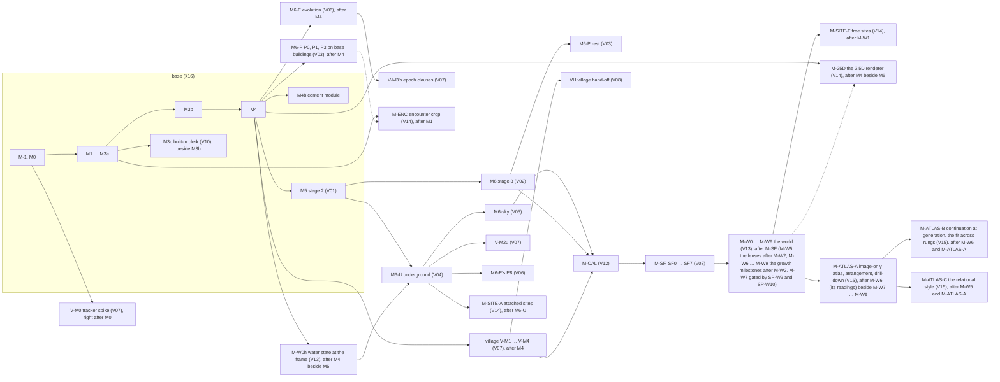

# Index of the design volumes — the product map, the wiring, the build order

> PENDING FABLE REVIEW — written by opus standing in for the Fable seat volumes/_finalize; covered by the whole-design retrovalidation (J84).
> PENDING FABLE REVIEW — the rows for volumes 13 and 14 written by the session's integration seat volumes/_integrate-world-sites under the owner's delegation (J339; 2026-10-17); covered by the whole-design retrovalidation (J84).
> PENDING FABLE REVIEW — the rows for volume 15 written by the session's seam seat volumes/seam-world-growth under the owner's delegation (J392; 2026-10-23; file r items 1018–1025); covered by the whole-design retrovalidation (J84).

**What this file is.** The one map of the whole design: the base (`docs/ARCHITECTURE.md`) and the fifteen design volumes
(`docs/volumes/V01`–`V15`) that take every subject the base carries at hook depth to build depth. It states no mechanism
of its own — every fact below points at its home (single source) — and it is the second source of the generated bundle
`docs/ARCHITECTURE-FULL.md` (`tools/bundle_architecture.py`; J89), read after the base and before the volumes. The base
carries files f (`docs/AMENDMENTS-2026-09-28f.md`, items 200–585, the volumes' base change requests) and g
(`docs/AMENDMENTS-2026-09-28g.md`, file g's items, the owner's rules), applied by the coherence pass
(`workflows/18-coherence.js`); files j (`docs/AMENDMENTS-2026-10-16j.md`, items 131–141, the owner's rules on the world,
sites, encounters, hydrology and the 2.5D view) and k (`docs/AMENDMENTS-2026-10-16k.md`, items 600–647, volumes 13
and 14's base change requests) are applied — file j's rules cited by number in the base's §0.2 and its base change requests superseded by file k's (J374), file k applied by the coherence pass `coherence/world-sites-k` (J376; `docs/validation/coherence/world-sites-k.md`) —, as are file l (items 648–658, the VTT export profile re-verified; J376) and files m–r (items 659–1032: the realm review of the host's simulator, the lens design and its closing passes, and the world-growth rules F1–F9 and F16 with the seams owed to volume 15; J385 – J388 for files m–p, J392 – J394 for file r), each applied by the record its status line names under `docs/validation/coherence/` (file r's `world-growth-r.md`, 2026-10-23; file s, the critic's gaps closed, `world-growth-s.md`). The plain-language account for the owner is `docs/volumes/SUMMARY.md`.

## 1 The product map

The base, **PLAT**, is an original settlement-map generator — the MFCG/FTG-fused town and city generator of PART I,
built to depth — and the settlement map layer of SettlementForge (the owner's definition, `docs/DEFINITION.md`). The base
builds to depth: the site, the backbone, growth, districts, the plot model and placement, fortification, the ground
datum, buildings as footprints and heights, rendering, labels, exports, editing (item 101's authoring vocabulary), the
dossier port's creation and absorb halves, and the verification rig; its milestones are M-1 to M4b and stage 2's M5
(§16). Everything the owner's roadmap stages is hooked in the base and built by a volume:

| volume | file | the subject it takes to build depth | base hooks it deepens | where it is built (§16) | price (person-weeks, the volume's own) |
|---|---|---|---|---|---|
| V01 | `V01-neighbourhoods.md` | stage 2 — neighbourhood composition inside each district: templates as fabric strategies, local places and pins, the close-up workflow, the `hatched` family, item 110's terraced wards, the district supply term, quarter records owning their members | PART II (II.1–II.4), §4.5 S6/S7b, §4.7 S9–S11, §8.5 | **M5** (its early pieces inside M1 – M3b, V01 §8.1) | 27.5–36.75 |
| V02 | `V02-buildings.md` | stage 3 — building massing and composition: wings, towers, courts, roofs, the crypt ladder, stepped massing (temples, terraced palaces, tiered towers), deck-plot buildings, works-and-shop splits | §2.6's stage-3 building hook, §4.7 S11, §8.4 | **M6** (M6a–M6c), with its item-110 building part at **M3a** | 23–33.5 (M6 21–30.75 with spikes; 2–2.75 at M3a) |
| V03 | `V03-interiors.md` | the plan rung — floor plans of every building: rooms, stairs, doors, basements and crypts, plans of tiers, stored plans and their re-cuts | §2.6's plan rung, the transient arena, O9 | **M6-P**; its eager plan facts (PE) inside M2b and M3a | 19–26 (M6-P 18.25–25; PE 0.75–1) |
| V04 | `V04-underground.md` | the underground layer — sewers (II.7), caverns and fissures, underground ruins (item 109), catacombs and crypt joins (109 (k)), access and excavation, the undercity, vaults under raised ways | II.6–II.7, §2.7's staged records, §4.11's decline hook | **M6-U** | 28.5–39.5 |
| V05 | `V05-sky.md` | the sky layer — floating islands: placement, the underside profile and its shadow under the three suns (J98), the rim as a sheer barrier, access, and the island's unit inputs to the neighbourhood run | II.6, §8.4 | **M6-sky** | 18–24.75 |
| V06 | `V06-evolution.md` | the evolution engine — epochs: decline and regrowth, uses and the supply web over time, walls over time, ladder steps, hazards, shade and siting drift, catacomb growth, raised ways and terraces over time, history and forks | §4.11's evolution hook (one path built in the base: grow-by-stage) | **M6-E** (E0–E9) | 31–44 |
| V07 | `V07-village.md` | the village product — thorp, hamlet, village and the small-town edge: trackers, tofts, fields, the palisade's barrier closure, village institutions and ladders, hand-offs up and down, voids under villages | PART III, §1.1's ladder ends, §4.11, §7.7 | **V-M0 – V-M4** and **V-M2u** | 30.5–43 |
| V08 | `V08-settlementforge.md` | the SettlementForge connection — the host client, the port leader and adapters, custom content and chains, ladders, the dossier's ruin, magic, mining, cathedral and cemetery facts, persistence in the host, the players' view | §7.7 (the dossier), §11.2–§11.3 (the embed and host bridge), §14 | **SF0 – SF7** and **VH** (M-SF) | 18.5–25.25 (map side; SettlementForge's own side 1.5–2.5, the owner's program) |
| V09 | `V09-application.md` | the application — the shell, every tool of item 101 on the canvas, the message catalogue and its buttons, time, host mode, the layers' and the building band's screens, the roster reader | §9.5, §11.2, §14, §7.1 | inside the base's milestones (its line 16.0–23.5); staged screens with their layers (AP5 at M6-E, AP6 at M6-U, AP7 at M6-sky, AP8 at M3c, AP10 at M6); AP11 with the owner items' engines (V09 §8.1) | 23.75–34.75 |
| V10 | `V10-clerk.md` | the clerk — the oracle at depth and the built-in assistant: tools, proposals, bends and refusals, explanations ("why is this here"), critique, transcripts, the host seam | §11.2, §7.1, item 101 | C1 inside **M3a**; **M3c** (C0, C2–C5) beside M3b, C4's Find content (the find form and read) at M5's exit | 14.75–20.25 (15.25–20.75 with the command-line clerk) |
| V11 | `V11-content.md` | the content — the registry, the class rows and profiles, the siting rulebook (item 103), custom-content rows (104), goods and orientation (105), wall rows (106), balance (107), ladders (108), caverns, ruins and catacombs (109), item 110's rows, naming | §10.2, §7.6, §14 | C0–C3b, C4a (the wall rows) and C5–C7 inside M0–M4b, C4a at M2b; C8 at M6-U; C9 beside each owner item's base milestone; C4b (the dossier rows) with the SettlementForge stage (V11 §8) | 13.6–19.1 |
| V12 | `V12-calibration.md` | calibration — the capture plan, parity, the owner's panels, tuning runs, the register of every provisional number, the corpus reconciliation | §13 (all), §7.6, §17.1 | base side M-1 – M4, W6 at M6-U's U3 – U5, W7 with each owner item's milestone (V12 §8.2); **M-CAL** staged | 7.25–11 base side; M-CAL 4.75–8; each later corpus run 0.25–0.75 |
| V13 | `V13-world.md` | the world regime, placement and hydrology — a world document of its own (W0–W9: the terrain recipe, features and surfaces, climate, hydrology with groundwater and springs, biomes and resources, suitability, routes, polity, labels and the settlement glyph); the placement of settlements both ways (P1–P5, the frame charter as S1's one input, the coherence cost, the blend band, the precedence stamp); water as a consequence system at both scales (surfaces as dated records, the one water class test, the two verbs and the cascade, the counterfactual fork); reason records; the world port; the sway and patrols (the owner's territory rules, V13 §3.9); the lenses over the host's simulated systems (V13 §5.8, §5.9); the world's growth (file r, the owner's rules F1–F9: the formation op — tectonics and erosion once, baked —, the monthly climate with its currents, potential vegetation and the derived land cover, the requirement solver with the generated-first dialog, the conflict list and the dossier request, the two verbs on every layer and the physics pass, sail routing by direction and month, the seams owed to V15; V13 §3.0–§3.2.1, §3.4–§3.6, §3.11, §3.14.1, §4.1–§4.2, §5.8 (9)); the map-import adapter and the ecosystem-shaped exports | §2.3, §2.6 *Basements*, §2.8–§2.9, §4.2 S1, §4.12, §6.1, §6.3, §7.1, §7.3, §7.7, §8.4, §9.5, §11.1, §14 | **M-W0h** (the water state at the frame: after M4 beside M5, exiting before M6-U's U3b); **M-W0 – M-W9** after M-SF (M-W5 the lenses, after M-W2; M-W6 – M-W9 the growth milestones after M-W2, M-W7 gated by SP-W9 and SP-W10), the host's own changes a parallel track (V13 §8) | 51–66 as one staged row (M-W0h ≈ 4 inside it; 37–45 by BCR-V13-37, file o item 877; 14–21 added by BCR-V13-46, file r item 985) |
| V14 | `V14-sites.md` | world sites, encounter crops and the 2.5D view — the site card, its request, programme and complexity vector; admissibility by context; topology-first unit graphs embedded on the kernel (natural caves, rock-cut rooms, mines, built levels, the ground by the hinterland unit); water classes per unit; condition as a transform over a persisted plan; the anchor, the one access record and the three secret states; adoption into a settlement; the encounter crop (extent by table, completion by the plan rung, the occupancy abstraction, the transient layer, promotion, the VTT crop scope and stable grid origin); the 2.5D projection family with z-completeness, hit testing back to the 2D address and the raise-or-lower edit | §2.1–§2.2, §2.5, §2.7–§2.9, §3.4, §4.12, §6.1, §7.1, §7.6–§7.7, §8.1–§8.2, §8.4, §8.8, §9.2, §9.5, §11.1–§11.2, §14, II.7.4, II.7.6 | **M-ENC** after M1 (its interiors with M6-P's P1); **M-SITE-A** after M6-U; **M-SITE-F** after M-W1; **M-25D** after M4 beside M5 (V14 §8) | 25.75–36.25 (M-ENC 4.25–5.75; M-SITE 13–18.5; M-25D 7.75–11; content 0.75–1) |
| V15 | `V15-atlas.md` | the atlas — the owner's "world map" (F11–F15): an individual save of finished world maps held by reference, arranged by the user (direct placement and described relations solved by the requirement engine at atlas scale, layout presets, warnings never refusals), rendered at one pixel resolution per level with seams softened along shared stretches, detail steps eased or framed as insets, continued into its voids at the next map's generation through V13's world edge charters (the neighbour's present ground, never a record; locked), a child fitted into a parent through V13's rung-general placement or derived from it through the world subject of `requestCharter`, each member a microcosm at its own present with its date, drift read and never corrected, deletion leaving a marked gap, sharing imagery only for shareable members, drill-down to the live member; and the relational historical style (F10): a view over an atlas or one world — an adjacency-preserving flow-based cartogram with a centre magnification and an orientation, a slider to the true map, true distance and travel time on hover, the distortion from facts (centre, importance, orientation, knowledge) read through V13's `viewFacts`, embellishments derived from the fictional cultures' facts and never real-world peoples, viewpoints (an audience plus a culture), three presets (mappa mundi, portolan, itinerary strip) | §2.9 (`Recipe.product` `'atlas'`, `Recipe.atlas`, `atlasImagery`, the atlas's view keys), §4.12, §5.2, §5.4, §6.1, §7.1, §7.6, §8.4, §9.5, §11.1, §11.2, §11.5, §12.8, §12.10, §13.2, §14, §16 (BCR-V15-1 – BCR-V15-15, pending the coherence pass) | **M-ATLAS-A** after M-W6 (`renderAt`, `edgeCharter`, `solve`; file r item 1015) beside M-W7 – M-W9; **M-ATLAS-B** after M-W6 and M-ATLAS-A; **M-ATLAS-C** after M-W5 and M-ATLAS-A (V15 §8) | 7–10 (M-ATLAS-A 2.5–3.75; M-ATLAS-B 2–3; M-ATLAS-C 2–3; content 0.5–0.75; the art library the owner's own line) |

**Base change requests.** 407 requests in volumes 1–12's `## 10` sections are carried by the 386 items of file f (200–585;
137 BASE — built inside the base's milestones — and 249 STAGED — applied to the design now, built with the named staged
milestone); 0 uncarried, 0 duplicated, no gap. Volumes 13 and 14's 54 requests (BCR-V13-1 – 29, BCR-V14-1 – 25) are
carried by the 48 items of file k (600–647; 38 base items, 10 cross-volume items; the gate's rows K1, K5, K6, K9 and
M1–M11 reserved BASE at M1's API pass, the mechanisms STAGED with their milestones); 0 uncarried, 0 duplicated, no
gap, 0 conflicts; one mechanism question open for reconciliation round 1 (`docs/volumes/_integrate-world-sites.md`
§1.4). In all: 461 requests, 434 items. Files m–r since added seventeen requests to V13 §10, outside those totals (BCR-V13-30 – BCR-V13-46): BCR-V13-37 is carried by file o item 877, BCR-V13-38 by file p item 890, BCR-V13-40 by file q items 916 and 917, BCR-V13-44 (V09) by file r items 990–993 and BCR-V13-45 by file r item 998; BCR-V13-30 – BCR-V13-36, BCR-V13-41 – BCR-V13-43 and BCR-V13-46 (the base) and BCR-V13-39 (V09) stand with no admission item, each for the coherence pass to admit by an item of its own (J387's and J388's pending ledger). Volume 15 (2026-10-23) adds fifteen requests to the base (BCR-V15-1 – BCR-V15-15) and eleven to the siblings (RQ-V15-1 – RQ-V15-11, the first six V13's spine §14 seams, each defined by file r items 1006–1017 as V13's own; an H-row, H35, appended to V13 §8.5 by file r item 1015), each base request for the world-growth coherence pass to admit by an item from 1033; none is applied yet.

## 2 The wiring — base hooks and what each volume feeds

Each volume's **§1b wiring table** is the authoritative list of every piece it adds, what feeds it, what it feeds, the
base hook it plugs into and the dossier field it reads (the owner's rule of 2026-09-28: every piece wired both ways). The
table below is the index of those tables: the base hooks each volume plugs into and the main flows between volumes.
Every dossier fact reaches a volume through volume 8's digest and derivation rows (DR-n; V08 §2.6, V08 §2.6a), never raw.

| volume | plugs into (base) | fed by (other volumes) | feeds |
|---|---|---|---|
| V01 | S6/S7b districts and the context vector (§4.5), S9 corridors and S9b dispatch, S10–S11 plots and placement (§4.7), the stage-2 seam (PART II), the reservation and allocation records (§2.5) | V11 (templates' rows, profiles, naming), V05 (islands handed to the unit run), V04 (the opening pass reads its voids), V06 (shade and siting drift), V02 (building massing on the close-up) | V02 and V03 (the close-up's plots and fronts), V04 (`fabricSignature`, `districtsAbove`, the opening pass: W15), V06 (fabric participants over epochs), V09 (the close-up tools), V10 (why rows), V12 (its bars) |
| V02 | §2.6's stage-3 interface, §4.7 S11 site plans, the ground datum and `Heights`, §8.4 casters | V11 (composition rows, the `crypt` column, deck rows), V01 (the close-up), V03 (the stair-entered reading of a crypt, the basement's extent: S23R6-02) | V03 (wings, levels, the crypt seed and ladder), V04 (the crypt basement, vaults), V05, V06 (mutations over epochs), V09, V10, V12 |
| V03 | §2.6's plan rung and `Basement.crypt` (BCR-V3-20), §3.x's facilities, the transient arena, §7.4 stored plans | V02 (wings, stacks, the crypt ladder and lift), V11 (room programme rows), V04 (access records, crypt joins) | V04 (the crypt derivation at M6-U, the door off the vault), V01 (the entrance reserve), V09 (the plan panel), V10 (why), V12 (the B-PLAN bars) |
| V04 | II.7 (sewers, undercity, catacombs, caverns), §2.7's staged records, §4.11's decline hook, S1's outfalls | V01 (W15 services), V02 and V03 (crypts and basements), V08 (ruin, magic, mining, cathedral, cemetery facts), V11 (cavern, ruin, catacomb and dig rows) | V06 (the `under.*` participants), V07 (voids under villages), V09 (Below), V10 (why), V12 (the underground's harness) |
| V05 | II.6 (floating islands), §2.1–§2.4 (the sky arena and roles), §4.5, §8.4 (shadows) | V11 (island rows), V01 (the unit run on an island) | V01 (the island's unit inputs), V06 (islands over epochs, shade), V09 (Sky screens), V10, V12 |
| V06 | §4.11's evolution hook: `EvolutionStrategy`, grow-by-stage, the decline table; §2.9 history; §7.3 locality | every generation volume's functions (V01, V02, V04, V05, V07), V08 (dossier events at an epoch), V11 (evolution, supply and ladder rows) | every layer's state over time; V09 (timeline, history panel, forks), V10 (history why), V12 (its bars on V6-E7) |
| V07 | PART III's hooks, §1.1's ladder ends, `StrategyRegistry.products` (file f item 202), §4.11's grow path (item 202's call points; TX-02), §7.7's *One path* placement | V11 (`v.` rows' siting through the base rows, presets `VG`), V08 (small dossiers, `LadderRouter`), V04 (V-M2u), V06 (M6-E's steps for V-M3's epoch clauses; TX-01) | V08 (village hand-off VH), V09 (village tools), V06 (the village's participants and phases), V12 (VG parity) |
| V08 | §7.7 (the dossier as the sole truth), §11.2 embed API, §11.3 host bridge, §14's `@plat/port` | SettlementForge's dossier (read only through its adapters), V11 (kinds, ladders, custom-content rows) | every volume through the digest and its DR rows; V09 (host mode), V10 (the host clerk seam), V06 (dossier events per epoch) |
| V09 | §9.5 furniture and tools, §7.1's edit events, §11.2, §14's `@plat/app` | every volume's records and bends (through one projection each), V10 (`TurnView`), V11 (labels, synonyms, icons), V08 (host mode) | the user; V10 (the canvas's buttons read by the clerk), V12 (the first-five-minutes panels) |
| V10 | §11.2 (the worker boundary), §7.1 (events as the only write), item 101's vocabulary | V09 (the message catalogue and buttons), every volume's why providers, V08 (host clerk) | V09 (the drawer), V08 (the host's assistant seam) |
| V11 | §10.2 roster, §7.6 editable tables, §14's `@plat/tables`, every stage's rows | the owner's rules (file g), V08 (the catalogue kinds) | every volume's tables; V12 (the register of every calibratable cell) |
| V12 | §13 (benches, goldens, parity, the D-5 panel, CI tiers, the corpus interface), §7.6 | every volume's bars and calibratable cells (their register lines) | every volume's provisional numbers (confirmed, tuned, or `not-achieved`) |
| V13 | §2.3 `Terrain` (the carve delta, the surfaces, the groundwater field; `datumOf`, `windOf`), §2.6's basement gate (`waterTableAt`), §2.8's reason record and registry rows, §2.9 (`Document.worldRef`, `Recipe.charter`, `namespace`, the `world` product, the world's view keys), §4.2 S1 (the charter as its one input), §4.12 `StrategyRegistry.products`, §6.1's concerns and stage ids, §6.3's namespace segment, §7.1's `verb` and edit kinds, §7.3's cascade rows, §7.7's world port, §8.4's layers and `sunAt`, §9.5's compass, §11.1's exports, §14 `@plat/world` (the lifted hydro core) | V04 (its elements as water units), V06 (`terrainWater` ops at an epoch, the history frames), V08 (the host's seats, cost law and events; DR1/DR29 facts as placement constraints), V10 (`why` queries), V11 (the climate rows, naming, the registry), V12 (the register), V14 (`WorldSite.attraction` and `routed`, the site's glyph marks, its `placementRef`) | the frame's S0/S1 (through the charter; `datumOf`, `windOf`, `sunAt`), V04 (`waterTableAt`, `classifyWater`, `routeClass`, the connected-set walk), V06 (dated surfaces, the waterlogged decay), V08 (`SettlementMapRecord`, the per-campaign charter, proposals, routes), V09 (the world view, the placement tool, the water overlays), V10 (reason records, the four readers), V14 (`FrameCharter`, `Placement`, the suitability slot, `worldFactsAt` and `WorldEvent`, the transient `charterFor`, the `site` `WaterSurface`, `world.placed`), V02 (the per-storey water class), V12 (B-WORLD, the drift tests) |
| V14 | §2.1–§2.2 (the `site` layer, the `passage` role), §2.5's `worldSite` reservation, §2.7's staged records (`SiteAnchor`, `WorldSite`, `verticalEnds`), §2.8's `ZDecl` column, §2.9 (`nextSitePart`; the `projection`, `encounter`, `siteOpen` and `party` keys), §3.4's owner-less transient arena, §4.12's `site` product and `worldSite` destination, §6.1's `site` concern, §7.1's site edit kinds and `raiseLower`, §7.6's site tables, §7.7's `Assignment.site`, §8.1–§8.2 and §8.8 (the projected tiles and style family), §9.2 (the secret states), §11.1 (the VTT crop scope and grid origin), §11.2 (`PlatApi.encounter.*`), §14 `@plat/sites`, II.7.4 (`AccessPoint.under` as `SiteReach`), II.7.6 | V13 (the charter, the placement, the suitability score and context, the water class test, `ReasonRecord`, the verbs and the cascade, `worldFactsAt`), V01 (local places; a close-up's context), V02 (massing; the storey ranges), V03 (plans, storeys, the `secret` stair core, the programme override), V04 (records, programs, dig generators, the figure-ground, the overlap test), V05 (islands), V06 (`decayLevel`, the ops, robbing), V07 (the village's siting), V08 (the site record, reveal and reach), V09 (tools, panels, the switch), V10 (sections), V11 (rows), V12 (fixtures, panel, pins) | V13 (the seventeen purpose-term plug-ins, `attraction` and `routed`, the site's glyph marks, `adoptSite` on `world.placed`), V04 (`siteEnvelopes`, breach links, `site` parts in the connection graph), V06 (G7's transforms under an epoch, the material rate), V07 (the `worldSite` reservation), V08 (a site's derived capacity), V09 (the icon, the crop, the 2.5D view, the hit stack), V10 (the `site` and `encounter` sections), V11 (the rows, the naming slice), V12 (B-SITE, B-CROP, B-25D, V14-P, the no-op pins), the DM (the crop at the table, the VTT scenes) |
| V15 | §2.9 (`Recipe.product` `'atlas'` and `Recipe.atlas`; `Document.atlasImagery`; the atlas's view keys), §4.12's `atlas` product, §5.2 F-ATLAS, §5.4's `W_ATLAS_*`, §6.1's `atlas` concern and stage ids `A1`–`A7`, §7.1's atlas edit kinds and conflict actions, §7.6's `atlas.*` tables, §8.4's atlas layers, §9.5 (the legend's note, the true scale bar, the compass under a viewpoint), §11.1's atlas exports and the refusal of the world shapes, §11.2 `PlatApi.atlas.*`, §11.5's member resolution and the shared atlas, §12.8's atlas line, §12.10's `ATLAS-n`, §13.2's T-V15 rows, §14 `@plat/atlas` and `@plat/render/atlas`, §16's M-ATLAS rows | V13 (`WorldHeader`, the rungs and size rows, `edgeCharter` and `WorldEdgeCharter`, `renderAt` with the placed labels and the known sets, the rung-general placement, the world subject of `requestCharter` and the transient world-rung charter, `viewFacts` over the lens plates, `solve` with its registered evaluators, `derivedTime`, `worldFactsAt`, the conflict list and the fork preview), V09 (the atlas page, Open / recent / new, the share sheet, the catalogue), V10 (the parse of a described relation; the `atlas` why section), V11 (the `atlas.*` rows, the figure glyphs, the blocklist, the lettering faces), V12 (B-ATLAS, V15-P, the pin, the register), V14 (the drill's last rungs; the `ZDecl` reason `imagery`) | the user (the atlas page, the pictures, the shared atlas); V13 (a continuation's `WorldRequest` with locked edge charters; a fit's placement request on a parent; a re-match's regenerate under a charter — each the user's act on the member's page); V09 (the page's rows and keys); V10 (the section); V12 (the fixtures and measures) |

**How dense the wiring is** (citations of other volumes in each volume's text, counted by script;
row cites column): the heaviest seams are V09–V10 (685/738), V03–V02 (522), V07–V11 (420), V08–V09 (407), V12–V11
(400), V05–V01 (396), V06–V07 (253) and V04–V01 (329); the six seam checks of §7 were drawn along exactly these pairs.
Volumes 13 and 14 (counted 2026-10-17): V14–V13 386, V13–V14 151 — the `seam-world-sites` check's pair. Volume 15 (2026-10-23) cites V13 in every section and V13 cites V15 only in the readings file r's items 942 and 1006–1017 define for it (the one-way seam the spine §14 names: V13 supplies, V15 consumes); the `seam-world-growth` check's pair (`critique/seam-world-growth-r0.md`).

## 3 The dependency graph

| milestone | may start after | runs beside | its hard dependencies inside (the volume's own §8) |
|---|---|---|---|
| M5 (V01) | M4 | the village, M6-E, M6-P's first rungs | W15's V04-reading parts land inert until M6-U |
| V-M0 (V07) | M0, on M0's kernel, M0 (b)'s tables and its own fixtures (no M2b input) | M1 | none from M2b |
| the village, V-M1 – V-M4 (V07) | M4 | M5, M6-E, M6-P's first rungs | V-M1 file g's barrier closure (fallback: VG's water cut); V-M2 file f item 202's registration hooks (fallback: V07 risk (9)); V-M3's epoch clauses exit with M6-E's E2–E4 |
| V-M2u (V07) | M6-U's tail | — | fallback: no cavern or ruin under a village until then |
| M6-E (V06) | M4 | M5, the village | E4 after item 105's S10b changes land; E8 after V04's U5; E7 after E1–E6; E9 after E8, V04's `BuriedFormer.lay` and V11's `history.*` cells |
| M6 (V02) | M5 | M6-U | volume 4's access draw and M6-U before T-V2-36's crypt part |
| M6-P (V03) | P0, P1 and P3 after M4 on the base's buildings; P2 once volume 4's access records exist; the rest after M6 | M5, M6 | P2 waits on V04's access records |
| M6-U (V04) | M5 — or beside it with a second pair, its U3 distinctness and U4 undercity parent then waiting on volume 1's W15 | M6 | U4 carries the crypt derivation |
| M6-sky (V05) | M6-U (its P0 spike may run beside M5) | — | V01's unit run |
| M3c (V10) | M3a (C1 is inside M3a) | M3b | V09's AP8 screens |
| M-CAL (V12) | M6-sky; its inputs M4, M5, M6 and V-M4 | — | the corpus interface (§13.9) |
| M-SF (V08) | M-CAL (SF0–SF3 may start earlier; VH when the village lands) | — | SettlementForge's own side (SettlementForge's program) |
| M-W0h (V13) | M4 | M5, the village, M6-E, M-25D | exits before M6-U's U3b; its only new dependency M4's render tier (the overlays); V04's water readers and V14's G6 switch to the one classifier at its landing (provisional readings before it) |
| M-W0 – M-W9 (V13) | M-SF (the host client); M-W0's spikes once M0 closes; M-W5 the lenses after M-W2; M-W6 the solver, the surface and the dossier seam after M-W2; M-W7 formation and the living physics after M-W6, gated by SP-W9 and SP-W10; M-W8 ecology and the physics pass after M-W7; M-W9 sail routing after M-W7 | the host's parallel track (V13 §8.5; Q2); M-W5 beside M-W3; M-W6 beside M-W3; M-W9 beside M-W8; V15's M-ATLAS-A and -B after M-W6's seams | M-W1 before M-SITE-F; M-W3's adapter and exports before the host's reference fork retires; M-W5 – M-W9 before M-W4, whose gate covers them |
| M-ENC (V14) | M1 | M2a – M4 | the interiors with M6-P's P1 and the occupancy with M4b (registry lookups: shells and `W_CROP_INCOMPLETE` until then); the world click after M-W1 |
| M-SITE-A (V14) | M6-U's U3b and V01's W15 (M5) | M6-P, M-W1 | G6 reads the classifier from M-W0h (provisional classes before it); the surface exception's programme override from M6-P |
| M-SITE-F (V14) | M-W1 | M-W2 | a free-standing drop takes a point only until M-W1; adoption through `adoptSite` on V13's `placed` outcome |
| M-25D (V14) | M4 | M5 | its world rows after M-W1 and the islands' slabs after M6-sky (registry lookups) |
| M-ATLAS-A (V15) | M-W6 (`renderAt` with its label boxes and `atlas` layer set, `edgeCharter`, `solve` with the registered evaluators; file r item 1015) and V09's world page | M-W7 – M-W9; M-SITE-F | the atlas in host mode a file until H35; the members' fields and scars join the picture at M-W8 (the `atlas` set's cover overlay, V13 §8.2) |
| M-ATLAS-B (V15) | M-W6 (the solver, the edge charter, the rung-general placement and the world subject of `requestCharter`) and M-ATLAS-A | M-W7 – M-W9 | the charter carries formation's bedrock and soils once M-W7 lands; a continuation owned by a campaign in host mode waits on H35 |
| M-ATLAS-C (V15) | M-W5 (the lenses, read through `viewFacts` from M-W6) and M-ATLAS-A | M-ATLAS-B | the art library lands on the owner's budget, replacing the line-art figures row by row (content only) |

## 4 The combined build order after M5, with estimates

The order is the owner's delegation's (J122: `docs/OWNER-DECISIONS-DELEGATED-2026-09-29.md`) and is stated once, in
§16's staged-milestones table: V-M0 right after M0; M3c beside M3b; after M4 four streams side by side — M5 (V01), the
village V-M1 – V-M4 (V07), M6-E (V06) and the plan rung's P0, P1 and P3 on the base's buildings (V03); then M6 (V02)
and M6-U (V04) after M5, M6-U beside M5 where a second pair is free; then M6-P's rest and M6-sky (V05); then M-CAL
(V12); then M-SF (V08; VH with the village). Volumes 13 and 14 (2026-10-17; the owner deferred their decisions to
the session, each vetoable) add, as their §8 states and file k item 635 writes into §16: M-ENC right after M1; M-W0h
and M-25D after M4 beside M5; M-SITE-A after M6-U; M-W0 – M-W9 after M-SF (M-W5 the lenses after M-W2, beside M-W3; file o item 877; M-W6 – M-W9 the world's growth after M-W2, file r item 985); M-SITE-F after M-W1. Volume 15 (2026-10-23; the owner's rules F10–F15 under the spine, each decision vetoable) adds, as its §8 states and BCR-V15-11 asks of §16: M-ATLAS-A after M-W6 beside M-W7 – M-W9; M-ATLAS-B after M-W6 and M-ATLAS-A; M-ATLAS-C after M-W5 and M-ATLAS-A. Every milestone's
price is its volume's own §8 estimate, and §16 computes
the two totals once (file f item 568) — the base with stage 2, and the whole program — with the lines outside both
(later corpus runs, the command-line clerk, SettlementForge's own side). Staffing per the owner: architecture and
rulings on Fable seats; build, verification and measurement on Opus seats (§16).

## 5 Risks and spikes across volumes

Every volume's §8 lists its risks in order, each with a spike or a measurement and a **pre-decided fallback** (the owner's
"fix down the line": no risk stalls a milestone). The ones that cross volumes:

| # | risk (where it bites) | spike or measurement | pre-decided fallback |
|---|---|---|---|
| 1 | cost at METROPOLIS — the underground's tail (V04 risk 1), the epoch's use phase and link re-binding (V06 risk 1), the sky's light pass (V05), the clerk's scratch memory (V10 risk 4) | U0, E0, P0/P3, C0's S2 | per-volume budget fallbacks in each §6 (coarser rasters, batched re-binding, half resolution, overlay mode) |
| 2 | a staged volume landing before the one it reads — the village before M6-E (V07 risks 6–10), the drawer before the clerk (V09 risk 5), V06's E4/E8 before V11's rows and V04's U5 (V06 risks 4–7), U3/U4 before V01's W15 (V04 risk 9) | none needed: each order is written out | the reader runs on defaults or inert hooks, reported, and the dependent test clauses move to the first exit after the provider (each named in its volume) |
| 3 | statistical bars needing rule changes, not only rates (V06 risk 3; V12 risks 1–3) | V12's S-V12-1 (bootstrap) and S-V12-2 at M-1, S-V12-3 and S-V12-4 at M2b; V06's E7 bench | one pre-decided fallback move per register line, a second miss `not-achieved`, reported as a table defect — never a moved threshold (V12 §3.11) |
| 4 | legibility — the VILLAGE top (V07 risk 1), the dark underground and the ruin program (V04 risk 4), the building band (V03), `hatched` at district scale (V01 risk 4) | V-M0's 20 renders, the owner's panels, S-V1-c | the nucleated law and bent-cut lanes (V07); the plan lines' rules and the panel (V04); the pitch fallback (V01) |
| 5 | the owner's panel time (V01 risk 5, V12 Q-V12-2) | — | an unrated sitting never stops the build and never lets a gate be claimed (§13.6 (7)) |
| 6 | the base's own changes (files g and f) landing late or in another shape (V07 risks 6, 8, 9; V09 risk 7; V11 C3b) | — (files f and g are applied) | each reader goes through one request's text; the named fallbacks (VG's water cut, item-110 rows off, the palisade's plain enceinte) |
| 7 | SettlementForge's frame policy and conditional write (V08 risks 1–2) | SF0 | a same-site path or a message-port worker; a 30-s renewable lease |
| 8 | the model provider — direct browser calls, cost, retirement (V10 risks 1, 3, 6) | C0's S1 | the drawer shown unavailable with its reason and the host path kept open; the owner's spending limit; the model id is one table cell re-evaluated before any switch |
| 9 | content effort and balance — the family weights (V11 R1), aqueducts too rare or common (R5), an ancient culture too like the town (V04 risk 6, V11 R6) | V11's C2 and C3b spikes; T-V4-45, T-V11-24 | halve every family weight; the `perHeadL` fallback; the pre-decided refit |
| 10 | the default map's look changing at M5 (V01 risk 6) | the M5 panel | the parity presets do not move; the change is declared once (Q-V1-1) |
| 11 | the new regimes' budgets — W4 and W1 at the continent rung (V13 §8.4), the crop's completion where twelve plans are absent (V14 risk 1), the 2.5D frame at the metropolis cap (V14 risk 4) | SP-W1, SP-W6, SP-W7 (M-W0); SE0 (M-ENC); V0 (M-25D) | the continent's cell to 1 250 m or the noise capped at four octaves; `maxBuildings` 8; the city band's trees off and the terrain's cell doubled (each a table value with a declared shift) |
| 12 | a reader landing before V13 — V04's water readers and V14's G6 (provisional classes until M-W0h), the world click (refused), a free-standing drop (a point only until M-W1), the host's track (Q2) | none needed: each order is written out | the named fallbacks (BCR-V13-21's order clause; V14 §1b.6's rows; T-V13-37's mock host) |
| 13 | the atlas's readings landing late — `renderAt`, `edgeCharter`, `solve` with its evaluator registration, the rung-general placement and the world subject of `requestCharter` (all M-W6; file r item 1015), the lens readings (`viewFacts` over M-W5's lenses); the host's atlas store (H35) | none needed: each order is written out (V15 §8) | nothing of the atlas ships before M-W6; image-only nesting with the mismatch warning until the fit lands; the relational terms neutral with the legend saying so; the atlas a file in host mode (V15 §8's risks 3–5) |

**Spikes, in the order they run** (each as its volume's §8 states it): V12's S-V12-1 and S-V12-2 (M-1); V07's V-M0 (the
tracker spike, right after M0); V09's S-A1 and S-A2 (M2a); V12's S-V12-3 and S-V12-4 and V11's family-weight spike at C2
(M2b); V09's S-A3 and S-A4 and V11's aqueduct bench at C3b (M3a); V10's C0 (S1 – S4, M3c); after M4, V01's S-V1-a – c
(M5's first weeks), V03's P0 and V06's E0; V05's P0 (beside M5); V04's U0, then its risk spikes at U3's and U3b's starts
(M6-U); V02's SP-V2-1 (before M6a), SP-V2-2 (in M6a), SP-V2-4 (before M6c) and SP-V2-3 (in M6c); V08's SF0 (M-SF, or
earlier on the frozen fixtures); V14's SE0 (M-ENC's start, after M1) and V0 (M-25D's start, after M4); V13's
SP-W1 – SP-W7 (M-W0, once M0 closes; before M-W1), SP-W9 and SP-W10 (M-W7's gate; file r item 985); V15's SA0 (M-ATLAS-A's start), SA3 (M-ATLAS-C's start) and its fit spike (c) at M-ATLAS-B's start. The first-five-minutes sessions (§13.4) measure the tools at M2a, M3a and M3c.

## 6 Owner questions with recommendations

Every question the volumes put to the owner is answered but one: those that belong to SettlementForge follow its own
decisions (J121: the map is a SettlementForge module), and every other is decided under the owner's delegation (J122:
`docs/OWNER-DECISIONS-DELEGATED-2026-09-29.md`), each vetoable. Each volume's §11 marks its questions answered and its
body reads the decision. Volumes 13 and 14's nine questions (V13's Q5 from file r) and volume 15's four carry the session's recommendation: the owner deferred
every decision on them to the session (2026-10-16: "i defer all decisiosn to you"), so each stands as **recommended;
vetoable** until the owner rules — save V13 Q4, which waits on the owner's own word, the one decision the delegation
cannot reach: J86's door 1 opens only on the owner's explicit word (base §11.4; J388), and until Q4 is answered the
host's builder over the canon (V13 §8.5's H5) and every new campaign's birth canon (H22) stay dark.

| volume | question | answer |
|---|---|---|
| V01 | Q-V1-1 — the default map changes at M5 to show its neighbourhoods | yes, the parity presets unchanged (J122) |
| V02 | Q-V2-1 — SettlementForge prescribing a building's shape | not now: one-way truth, and SettlementForge has no shape data (J122) |
| V03 | Q1 — floor plans on the base's buildings right after M4 | yes: P0, P1 and P3 after M4, P2 with V04's access records (J122) |
| V04 | Q1 — the underground as M6-U right after M5, beside it with a second pair | yes (J122) |
| V04 | Q2 — the underground's cost (V04 §8's total) | accepted (J122) |
| V05 | Q1 — the underground before the sky | yes (J122) |
| V06 | Q1 — when the evolution engine is built | (a) right after M4 (J122) |
| V07 | Q1 — when the village is built | (a) right after M4, parallel with M5, its tracker spike V-M0 right after M0 (J122) |
| V08 | Q1 — the module's web origin | follows SettlementForge (J121) |
| V08 | Q2 — plans, save limits, backups | follows SettlementForge (J121) |
| V08 | Q3 — scene files inside SettlementForge's export bundle | yes, from M-SF, the bytes passed unread; until then maps export on their own (J122) |
| V08 | Q4 — M-SF after M-CAL | yes (J122) |
| V08 | Q5 — a live party map | pictures and player views now; a live shared map after M-SF (J122) |
| V09 | Q1 — a private preview host | follows SettlementForge's staging (J121) |
| V09 | Q2 — first-five-minutes participants and any thank-you | five SettlementForge users per round from its community, thanked by credit and early access, no payments (J122) |
| V09 | Q3 — the product's public name | follows SettlementForge (J121) |
| V10 | Q1 — the user's own API key or a relay | follows SettlementForge's AI setup (J121) |
| V10 | Q2 — SettlementForge's assistant or ours | SettlementForge's, driving our tool API (J121, J122) |
| V10 | Q3 — the model tier | follows SettlementForge (J121); a cheaper tier evaluated before any switch |
| V10 | Q4 — the built-in clerk as M3c beside M3b | yes (J122) |
| V10 | Q5 — the clerk's live-evaluation spend | a budget cap of about US$790–1 190 through M3c, spent in stages — the smallest tier first, the full suite at M3c's exit — each spend shown to the owner first (J122) |
| V11 | Q-V11-1 — the sensitive catalogue kinds | kept, concealed by default in player views, shown as SettlementForge's own settings show them (J122) |
| V12 | Q-V12-1 — one month of FTG's premium tier | no (J122); reversed by the owner on 2026-10-03 (J164): one month bought for the METROPOLIS reference |
| V12 | Q-V12-2 — the owner's sittings | only at M1 (the look check), M2b, M4 and M5, batched, about an hour each; a staged milestone's panel joins the next of them when its build has landed, else stays *provisional — not rated* (J122; §13.6 (1)) |
| V12 | Q-V12-3 — historical layers as defaults | only where the owner's sitting passes them (J122) |
| V13 | Q1 — existing campaigns: whether a living campaign is offered the elective rebase onto a world from this module (the transition otherwise ruled: every frozen record kept, the import on request, a legacy world view with no write; J-V13.81) | offer it per campaign, premium, default keep, the full forecast diff shown before confirmation; never automatic (recommended; vetoable) |
| V13 | Q2 — the host's schedule (V13 §8.5's H1–H34) against M-W1 – M-W3 and M-W5 – M-W9, and whether the realm map's replacement is part of the map module's post-launch disposition | class it with the post-launch disposition; H1–H3 before the host's launch, H4–H11 with M-W1, H12–H17 and H22 with M-W2, H23–H30 with M-W5, H18–H20 after M-W3, H31 and H32 with M-W6, H34 with M-W8, H33 with M-W9; the standalone world ships either way (recommended; vetoable) |
| V13 | Q3 — a placed settlement's share code: embed the charter or name the world (refined by file r: a formed world's code carries its baked payload's hashes, re-fetched never re-run, so the world code stays a line plus its hashes under either answer) | embed the charter, so a settlement replays from its own code (recommended; vetoable) |
| V13 | Q4 — J86's door 1 and the world canon: is the canon (reaching the host's simulation only through its receipted canonize — H22's birth canon or a re-canonize, the additive one included) outside door 1? | confirm — the owner's own word, which base §11.4 reserves to the owner (J388): until it is answered the host's builder over the canon (H5) and every new campaign's birth canon (H22) stay dark (recommended; awaiting the owner) |
| V13 | Q5 — who may generate with what (file r item 988): the world dialog is layered and hides nothing, the gate checked once at the generate action; which account kinds may generate with a scenario, with an included campaign, with the Advanced or Deep layers set or with a `weather` pass, and who may share a preset, is the owner's | every layer free to read, set and preview; one-click generation free at every rung; a scenario and an included campaign gated as the host gates its own premium acts, the weather depth the DM's; presets saved by anyone, shared by the DM (recommended; vetoable) |
| V14 | Q1 — the in-town encounter crop ships after M1 or waits whole for M6-P | ship after M1 with shells and the VTT crop; the interiors arrive with V03's P1 by a registry lookup (recommended; vetoable) |
| V14 | Q2 — a host record for world sites in the dossier (a capability across the SettlementForge boundary) | yes, scheduled with V13's host changes; until it lands every site is map-tier and nothing of the map is lost (recommended; vetoable) |
| V14 | Q3 — the cost, 25.75–36.25 person-weeks across three milestones | accept (recommended; vetoable) |
| V14 | Q4 — a vendor block in the VTT export carrying each unit's reason and the anchor's knowledge state | yes, as an optional namespaced block off by default; the common fields unchanged (recommended; vetoable) |
| V15 | Q1 — the product label for the atlas ("World map" is admitted; the architecture's word stays "atlas") | "World map" in every user-facing string, "atlas" in every record and test (recommended; the owner's word) |
| V15 | Q2 — sharing and privacy across campaigns: may an atlas show, share or publish a member world of another campaign, and under which gallery rule (a capability across the host's boundary; H35) | a member's imagery travels only where that world's own sharing allows it; across campaigns the host's gallery rule once H35 lands, until then the user's own worlds only (recommended; vetoable) |
| V15 | Q3 — money: the art library for the relational style (monsters, vignettes, cartouches, lettering), outside the volume's line | fund it after the owner's sitting on the line-art presets at M-ATLAS-C; the mechanism ships without it (recommended; vetoable) |
| V15 | Q4 — money: the cost, 7–10 person-weeks across three milestones (V15 §8) | accept; M-ATLAS-A's 2.5–3.75 pw buys F11, F12 and F15 in hand, M-ATLAS-B's 2–3 pw F13 narrowed by F14, M-ATLAS-C's 2–3 pw F10 (recommended; vetoable) |

## 7 How the volumes were reconciled, and the fix list

The volumes were reconciled by the integration lane (`docs/volumes/_integrate.md`), seven seam rounds and six
reconciliation rounds, and the coherence pass (`workflows/18-coherence.js`); their records — the seam checks, the
reconciliation notes and every finding's disposition — are kept under `docs/validation/`. No item stays open: every
entry of the round-6 fix list was routed by the coherence canon (`docs/validation/coherence/canon.md`) to the unit that
owns it and fixed there. Volumes 13 and 14 (2026-10-17) were critiqued (`critique/V13.md`, `critique/V14.md`), revised,
checked against each other by one seam round (`critique/seam-world-sites-r0.md`: 37 findings — 1 blocker, 15 major,
21 minor), reconciled under the chief architect's rulings (J-V13.51–62, J-V14.49–55) and integrated
(`_integrate-world-sites.md`: seam round 1 confirmed 36 of 37, 12 wording residuals fixed in place, one mechanism
question open for reconciliation round 1 — the import's markers, R1-1); their coherence pass applied file k (J376;
`docs/validation/coherence/world-sites-k.md`, 48 of 48 items), the M0 gate (`docs/build/checks/M0-world-sites-gate.md`,
item 140) ran as a separate lane and holds (J376), and files m–q carried the realm review and the lens design into
them, each applied by its record (`docs/validation/coherence/realm-m.md`, `lens-n.md`, `lens-o.md`, `lens-p.md` and
`lens-q.md`, each named by its file's status line). Volume 15 (2026-10-23) was written under the spine `docs/design/spine-world-growth-2026-10-23.md` beside amendments r (`docs/AMENDMENTS-2026-10-23r.md`, applied 2026-10-23 by its record `docs/validation/coherence/world-growth-r.md`) and reconciled with it by the world-growth seam check (`critique/seam-world-growth-r0.md`: every finding fixed in place in V15 or carried as an item of file r, 1006–1028); its critique round (`critique/V15.md`, `critique/world-growth-r-science-host.md`) is carried by the reviser (file r items 1029–1032 and its edits; V15 §14). The critic's completeness check of the applied texts (`docs/validation/coherence/world-growth-r-critic.md`: nineteen gaps, none blocking) is closed by amendments s (`docs/AMENDMENTS-2026-10-23s.md`, items 1033–1051 and its in-place edits to V15 and the spine; record `docs/validation/coherence/world-growth-s.md`).

## 8 CONFIRMED versus PLAUSIBLE

**CONFIRMED (executed):** the request census of §1 (407 requests carried by the 386 items of file f, 0 uncarried, no
gap or duplicate; 137 BASE and 249 STAGED; volumes 13 and 14's 54 requests carried by file k's 48 items, every quote
verified by fragment search) and the wiring density of §2, both by script; each volume's §8 total
re-summed from its rows by the coherence pass's verifiers. The finalization lane's own record — its ledger, its in-place edits with their asserted match
counts, its clean-room and document checks — stands in the archived index
(`docs/archive/volumes-pre-coherence-2026-09-28/INDEX.md`) and the lane log.

**PLAUSIBLE (reasoned, not executed):** every price of §1 (each volume's own §8 estimate; volumes 13 and 14's
51–66 and 25.75–36.25 pw among them, PLAUSIBLE until their spikes report; the world's 51–66 is 37–45 by file o plus 14–21 by file r; volume 15's 7–10 likewise, PLAUSIBLE until SA0 and SA3 report) and the two totals §16
computes once from them (file f item 568) — expert estimates until the milestones run; that the pairs no seam read
together hold no semantic conflict sharing no name (J-VI.29). The order of §3 and §4 is a decision under the owner's
delegation (J122), not a measurement.
