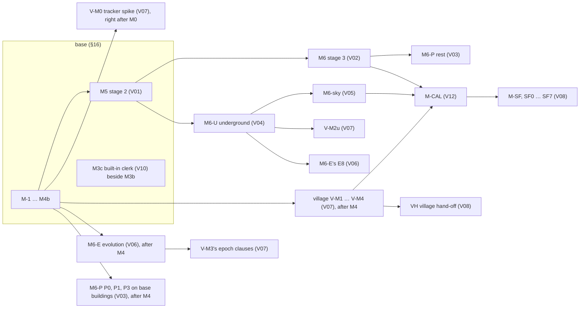

# Index of the design volumes — the product map, the wiring, the build order

> PENDING FABLE REVIEW — written by opus standing in for the Fable seat volumes/_finalize; covered by the whole-design retrovalidation (J84).

PROGRESS (lane `volumes/_finalize`, 2026-09-29)
- F1 The round-6 material issues fixed in their volumes (14): done
- F2 File f refreshed (items 202, 226, 244, 245, 317, J-RF2.4; its *Finalization* section): done
- §1 The product map: done
- §2 The wiring — base hooks and what each volume feeds: done
- §3 The dependency graph: done
- §4 The combined build order after M5, with estimates: done
- §5 Risks and spikes across volumes: done
- §6 Owner questions with recommendations: done
- §7 How the volumes were reconciled, and the fix list: done
- §8 CONFIRMED versus PLAUSIBLE: done
- SUMMARY.md (the owner's plain-language summary): done
- The bundle (tools/bundle_architecture.py, then --check): done

**What this file is.** The one map of the whole design: the base (`docs/ARCHITECTURE.md`) and the twelve design volumes
(`docs/volumes/V01`–`V12`) that take every subject the base carries at hook depth to build depth. It states no mechanism
of its own — every fact below points at its home (single source) — and it is the second source of the generated bundle
`docs/ARCHITECTURE-FULL.md` (`tools/bundle_architecture.py`; J89), read after the base and before the volumes. The base
changes the volumes need are consolidated in `docs/AMENDMENTS-2026-09-28f.md` (file f, items 200–585, not yet applied);
the owner rules of 2026-09-28 are `docs/AMENDMENTS-2026-09-28g.md` (file g, items 102–113). Both are applied to the base by
the coherence pass (`workflows/18-coherence.js`), file g first. The plain-language account for the owner is
`docs/volumes/SUMMARY.md`.

## 1 The product map

The base, **PLAT**, is an original settlement-map generator — the MFCG/FTG-fused town and city generator of PART I,
built to depth — and the settlement map layer of SettlementForge (the owner's definition, `docs/DEFINITION.md`). The base
builds to depth: the site, the backbone, growth, districts, the plot model and placement, fortification, the ground
datum, buildings as footprints and heights, rendering, labels, exports, editing (item 101's authoring vocabulary), the
dossier port's creation and absorb halves, and the verification rig; its milestones are M-1 to M4b and stage 2's M5
(§16). Everything the owner's roadmap stages is hooked in the base and built by a volume:

| volume | file | the subject it takes to build depth | base hooks it deepens | where it is built (§16) | price (person-weeks, the volume's own) |
|---|---|---|---|---|---|
| V01 | `V01-neighbourhoods.md` | stage 2 — neighbourhood composition inside each district: templates as fabric strategies, local places and pins, the close-up workflow, the `hatched` family, item 110's terraced wards, the district supply term, quarter records owning their members | PART II (II.1–II.4), §4.5 S6/S7b, §4.7 S9–S11, §8.5 | **M5** (replacing the base's 14–18 pw M5 row) | 27.25–36.25 |
| V02 | `V02-buildings.md` | stage 3 — building massing and composition: wings, towers, courts, roofs, the crypt ladder, stepped massing (temples, terraced palaces, tiered towers), deck-plot buildings, works-and-shop splits | §2.6's stage-3 building hook, §4.7 S11, §8.4 | **M6** (M6a–M6c), with its item-110 building part at **M3a** | 22.5–32.5 (M6 20.5–29.75 with spikes; 2–2.75 at M3a) |
| V03 | `V03-interiors.md` | the plan rung — floor plans of every building: rooms, stairs, doors, basements and crypts, plans of tiers, stored plans and their re-cuts | §2.6's plan rung, the transient arena, O9 | **M6-P**; its eager plan facts (PE) inside M2b and M3a | 18.5–25.25 (M6-P 17.75–24.25; PE 0.75–1) |
| V04 | `V04-underground.md` | the underground layer — sewers (II.7), caverns and fissures, underground ruins (item 109), catacombs and crypt joins (109 (k)), access and excavation, the undercity, vaults under raised ways | II.6–II.7, §2.7's staged records, §4.11's decline hook | **M6-U** | 28.25–39.25 |
| V05 | `V05-sky.md` | the sky layer — floating islands: placement, the underside profile and its shadow under the three suns (J98), the rim as a cliff barrier, access and hand-over to the neighbourhood run | II.6, §8.4 | **M6-sky** | 17.25–23.25 |
| V06 | `V06-evolution.md` | the evolution engine — epochs: decline and regrowth, uses and the supply web over time, walls over time, ladder steps, hazards, shade and siting drift, catacomb growth, raised ways and terraces over time, history and forks | §4.11's evolution hook (one path built in the base: grow-by-stage) | **M6-E** (E0–E8) | 25.25–35.75 |
| V07 | `V07-village.md` | the village product — thorp, hamlet, village and the small-town edge: trackers, tofts, fields, the palisade's barrier closure, village institutions and ladders, hand-offs up and down, voids under villages | PART III, §1.1's ladder ends, §4.11, §7.7 | **V-M0 – V-M4** and **V-M2u** | 26.5–36.5 |
| V08 | `V08-settlementforge.md` | the SettlementForge connection — the host client, the port leader and adapters, custom content and chains, ladders, the dossier's ruin, magic, mining, cathedral and cemetery facts, persistence in the host, the players' view | §7.7 (the dossier), §11.2–§11.3 (the embed and host bridge), §14 | **SF0 – SF7** and **VH** (M-SF) | 15.75–21.5 (map side; SettlementForge's own side 1.5–2.5, the owner's program) |
| V09 | `V09-application.md` | the application — the shell, every tool of item 101 on the canvas, the message catalogue and its buttons, time, host mode, the layers' and the building band's screens, the roster reader | §9.5, §11.2, §14, §7.1 | inside the base's milestones (its line 16.75–24.75); staged screens with their layers (AP6 at M6-U, AP7 at M6-sky, AP8 at M3c, AP10 at M6) | 19.5–29 |
| V10 | `V10-clerk.md` | the clerk — the oracle at depth and the built-in assistant: tools, proposals, bends and refusals, explanations ("why is this here"), critique, transcripts, the host seam | §11.2, §7.1, item 101 | C1 inside **M3a**; **M3c** (C0, C2–C5) beside M3b | 13.5–18.5 (14–19 with the command-line clerk) |
| V11 | `V11-content.md` | the content — the registry, the class rows and profiles, the siting rulebook (item 103), custom-content rows (104), goods and orientation (105), wall rows (106), balance (107), ladders (108), caverns, ruins and catacombs (109), item 110's rows, naming | §10.2, §7.6, §14 | C0–C7 inside M0–M4b; C8 at M6-U; the dossier rows with the SettlementForge stage | 12.25–17.0 |
| V12 | `V12-calibration.md` | calibration — the capture plan, parity, the owner's panels, tuning runs, the register of every provisional number, the corpus reconciliation | §13 (all), §7.6, §17.1 | base side inside M-1–M4 (+6–9); **M-CAL** staged | 6–9 base side; M-CAL 4.75–8; each later corpus run 0.25–0.75 |

**Base change requests.** 407 requests in the volumes' `## 10` sections are carried by the 386 items of file f (200–585;
137 BASE — built inside the base's milestones — and 249 STAGED — applied to the design now, built with the named staged
milestone). The census was re-run at this lane's close: 0 uncarried, 0 duplicated, no gap.

## 2 The wiring — base hooks and what each volume feeds

Each volume's **§1b wiring table** is the authoritative list of every piece it adds, what feeds it, what it feeds, the
base hook it plugs into and the dossier field it reads (the owner's rule of 2026-09-28: every piece wired both ways). The
table below is the index of those tables: the base hooks each volume plugs into and the main flows between volumes.
Every dossier fact reaches a volume through volume 8's digest and derivation rows (DR-n; V08 §2.6, V08 §2.6a), never raw.

| volume | plugs into (base) | fed by (other volumes) | feeds |
|---|---|---|---|
| V01 | S6/S7b districts and the context vector (§4.5), S9 corridors and S9b dispatch, S10–S11 plots and placement (§4.7), the stage-2 seam (PART II), the reservation and allocation records (§2.5) | V11 (templates' rows, profiles, naming), V05 (islands handed to the unit run), V04 (the opening pass reads its voids), V06 (shade and siting drift), V02 (building massing on the close-up) | V02 and V03 (the close-up's plots and fronts), V04 (`fabricSignature`, `districtsAbove`, the opening pass: W15), V06 (fabric participants over epochs), V09 (the close-up tools), V10 (why rows), V12 (its bars) |
| V02 | §2.6's stage-3 interface, §4.7 S11 site plans, the ground datum and `Heights`, §8.4 casters | V11 (composition rows, the `crypt` column, deck rows), V01 (the close-up), V03 (the stair-entered reading of a crypt, the basement's extent: S23R6-02) | V03 (wings, levels, the crypt seed and ladder), V04 (the crypt basement, vaults), V05, V06 (mutations over epochs), V09, V10, V12 |
| V03 | §2.6's plan rung and `Basement.crypt` (BCR-V3-20), §3.x's sub-locations, the transient arena, §7.4 stored plans | V02 (wings, stacks, the crypt ladder and lift), V11 (room programme rows), V04 (access records, crypt joins) | V04 (the crypt derivation at M6-U, the door off the vault), V01 (the entrance reserve), V09 (the plan panel), V10 (why), V12 (the B-PLAN bars) |
| V04 | II.7 (sewers, undercity, catacombs, caverns), §2.7's staged records, §4.11's decline hook, S1's outfalls | V01 (W15 services), V02 and V03 (crypts and basements), V08 (ruin, magic, mining, cathedral, cemetery facts), V11 (cavern, ruin, catacomb and dig rows) | V06 (the `under.*` participants), V07 (voids under villages), V09 (Below), V10 (why), V12 (the underground's harness) |
| V05 | II.6 (floating islands), §2.1–§2.4 (the sky arena and roles), §4.5, §8.4 (shadows) | V11 (island rows), V01 (the unit run on an island) | V01 (hand-over), V06 (islands over epochs, shade), V09 (Sky screens), V10, V12 |
| V06 | §4.11's evolution hook: `EvolutionStrategy`, grow-by-stage, the decline table; §2.9 history; §7.3 locality | every generation volume's functions (V01, V02, V04, V05, V07), V08 (dossier events at an epoch), V11 (evolution, supply and ladder rows) | every layer's state over time; V09 (timeline, history panel, forks), V10 (history why), V12 (its bars on V6-E7) |
| V07 | PART III's hooks, §1.1's ladder ends, `StrategyRegistry.products` (file f item 202), §4.11's grow path (item 202's call points; TX-02), §7.7's *One path* placement | V11 (`v.` rows' siting through the base rows, presets `VG`), V08 (small dossiers, `LadderRouter`), V04 (V-M2u), V06 (M6-E's steps for V-M3's epoch clauses; TX-01) | V08 (village hand-off VH), V09 (village tools), V06 (the village's participants and phases), V12 (VG parity) |
| V08 | §7.7 (the dossier as the sole truth), §11.2 embed API, §11.3 host bridge, §14's `@plat/port` | SettlementForge's dossier (read only through its adapters), V11 (kinds, ladders, custom-content rows) | every volume through the digest and its DR rows; V09 (host mode), V10 (the host clerk seam), V06 (dossier events per epoch) |
| V09 | §9.5 furniture and tools, §7.1's edit events, §11.2, §14's `@plat/app` | every volume's records and bends (through one projection each), V10 (`TurnView`), V11 (labels, synonyms, icons), V08 (host mode) | the user; V10 (the canvas's buttons read by the clerk), V12 (the first-five-minutes panels) |
| V10 | §11.2 (the worker boundary), §7.1 (events as the only write), item 101's vocabulary | V09 (the message catalogue and buttons), every volume's why providers, V08 (host clerk) | V09 (the drawer), V08 (the host's assistant seam) |
| V11 | §10.2 roster, §7.6 editable tables, §14's `@plat/tables`, every stage's rows | the owner's rules (file g), V08 (the catalogue kinds) | every volume's tables; V12 (the register of every calibratable cell) |
| V12 | §13 (benches, goldens, parity, the D-5 panel, CI tiers, the corpus interface), §7.6 | every volume's bars and calibratable cells (their register lines) | every volume's provisional numbers (confirmed, tuned, or `not-achieved`) |

**How dense the wiring is** (citations of other volumes in each volume's text, counted by script at this lane's close;
row cites column): the heaviest seams are V09–V10 (685/738), V03–V02 (522), V07–V11 (420), V08–V09 (407), V12–V11
(400), V05–V01 (396), V06–V07 (253) and V04–V01 (329); the six seam checks of §7 were drawn along exactly these pairs.

## 3 The dependency graph

| milestone | may start after | runs beside | its hard dependencies inside (the volume's own §8) |
|---|---|---|---|
| M5 (V01) | M4 | the village, M6-E, M6-P's first rungs | W15's V04-reading parts land inert until M6-U |
| V-M0 (V07) | M0, on M0's kernel, M0 (b)'s tables and its own fixtures | M1 | none from M2b |
| V-M1 (V07) | M4 | M5 | file g's barrier closure (fallback: VG's water cut) |
| V-M2 (V07) | V-M1 | M5 | file f item 202's registration hooks (fallback: V07 risk (9)) |
| V-M3 (V07) | V-M2 | — | its epoch clauses exit with M6-E's E2–E4 |
| V-M2u (V07) | V04's tail (M6-U) | — | fallback: no cavern or ruin under a village until then |
| M6-E (V06) | M4 | M5, the village | E4 after item 105's S10b changes land; E8 after V04's U5; E7 after E1–E6 |
| M6 (V02) | M5 | M6-U | volume 4's access draw and M6-U before T-V2-36's crypt part |
| M6-P (V03) | P0, P1, P3 after M4 on base buildings; the rest after M6 | M6 | P2 once V04's access records exist |
| M6-U (V04) | M5 (or beside it with a second pair: U3's distinctness and U4's undercity parent wait on V01's W15) | M6 | U4 carries the crypt derivation |
| M6-sky (V05) | M6-U; its P0 spike may run beside M5 | — | V01's unit run |
| M3c (V10) | M3a (C1 inside M3a) | M3b | V09's AP8 screens |
| M-CAL (V12) | M6-sky; its inputs M4, M5, M6 and V-M4 | — | the corpus interface (§13.9) |
| M-SF (V08) | M-CAL (SF0–SF3 may start earlier; VH when the village lands) | — | SettlementForge's own side (SettlementForge's program) |

## 4 The combined build order after M5, with estimates

The order is the owner's delegation's (J122: `docs/OWNER-DECISIONS-DELEGATED-2026-09-29.md`) and is stated once, in
§16's staged-milestones table: V-M0 right after M0; M3c beside M3b; after M4 four streams side by side — M5 (V01), the
village V-M1 – V-M4 (V07), M6-E (V06) and the plan rung's P0, P1 and P3 on the base's buildings (V03); then M6 (V02)
and M6-U (V04) after M5, M6-U beside M5 where a second pair is free; then M6-P's rest and M6-sky (V05); then M-CAL
(V12); then M-SF (V08; VH with the village). Every milestone's price is its volume's own §8 estimate, and §16 computes
the two totals once (file f item 568) — the base with stage 2, and the whole program — with the lines outside both
(later corpus runs, the command-line clerk, SettlementForge's own side). Staffing per the owner: architecture and
rulings on Fable seats; build, verification and measurement on Opus seats (§16).

## 5 Risks and spikes across volumes

Every volume's §8 lists its risks in order, each with a spike or a measurement and a **pre-decided fallback** (the owner's
"fix down the line": no risk stalls a milestone). The ones that cross volumes:

| # | risk (where it bites) | spike or measurement | pre-decided fallback |
|---|---|---|---|
| 1 | cost at METROPOLIS — the underground's tail (V04 risk 1), the epoch's use phase and link re-binding (V06 risk 1), the sky's light pass (V05), the clerk's scratch memory (V10 risk 4) | U0, E0, P0/P3, C0's S2 | per-volume budget fallbacks in each §6 (coarser rasters, batched re-binding, half resolution, overlay mode) |
| 2 | a staged volume landing before the one it reads — the village before M6-E (V07 risks 6–10), the drawer before the clerk (V09 risk 5), V06's E4/E8 before V11's rows and V04's U5 (V06 risks 4–7), U3/U4 before V01's W15 (V04 risk 9) | none needed: each order is written out | the reader runs on defaults or inert hooks, reported, and the dependent test clauses move to the first exit after the provider (each named in its volume) |
| 3 | statistical bars needing rule changes, not only rates (V06 risk 3; V12 risks 1–3) | V12's S-V12-1 (bootstrap), S-V12-2, S-V12-3 at M-1 and M2b; V06's E7 bench | one pre-decided fallback move per register line, a second miss `not-achieved`, reported as a table defect — never a moved threshold (V12 §3.11) |
| 4 | legibility — the VILLAGE top (V07 risk 1), the dark underground and the ruin program (V04 risk 4), the building band (V03), `hatched` at district scale (V01 risk 4) | V-M0's 20 renders, the owner's panels, S-V1-c | the nucleated law and bent-cut lanes (V07); the plan lines' rules and the panel (V04); the pitch fallback (V01) |
| 5 | the owner's panel time (V01 risk 5, V12 Q-V12-2) | — | an unrated sitting never stops the build and never lets a gate be claimed (§13.6 (7)) |
| 6 | the base's own changes (files g and f) landing late or in another shape (V07 risks 6, 8, 9; V09 risk 7; V11 C3b) | the coherence pass applies g, then f, before the staged work | each reader goes through one request's text; the named fallbacks (VG's water cut, item-110 rows off, the palisade's plain enceinte) |
| 7 | SettlementForge's frame policy and conditional write (V08 risks 1–2) | SF0 | a same-site path or a message-port worker; a 30-s renewable lease |
| 8 | the model provider — direct browser calls, cost, retirement (V10 risks 1, 3, 6) | C0's S1 | the drawer shown unavailable with its reason and the host path kept open; the owner's spending limit; the model id is one table cell re-evaluated before any switch |
| 9 | content effort and balance — the family weights (V11 R1), aqueducts too rare or common (R5), an ancient culture too like the town (V04 risk 6, V11 R6) | V11's C2 and C3b spikes; T-V4-45, T-V11-24 | halve every family weight; the `perHeadL` fallback; the pre-decided refit |
| 10 | the default map's look changing at M5 (V01 risk 6) | the M5 panel | the parity presets do not move; the change is declared once (Q-V1-1) |

**Spikes, in the order they run:** V12's S-V12-1 and S-V12-2 (M-1); V01's S-V1-a–c (M5's first weeks); V02's spikes
(2.25 pw, before M6a); V03's P0; V04's U0; V05's P0 (may run beside M5); V06's E0; V07's V-M0 (the tracker spike); V08's
SF0; V09's storage and first-five-minutes checks (S-A2, §13.4); V10's C0 (S1, S2); V11's family-weight spike at C2 and the
aqueduct bench at C3b.

## 6 Owner questions with recommendations

Every question the volumes put to the owner is answered: those that belong to SettlementForge follow its own decisions
(J121: the map is a SettlementForge module), and every other is decided under the owner's delegation (J122:
`docs/OWNER-DECISIONS-DELEGATED-2026-09-29.md`), each vetoable. Each volume's §11 marks its questions answered and its
body reads the decision.

| volume | question | answer |
|---|---|---|
| V01 | Q-V1-1 — the default map changes at M5 to show its neighbourhoods | yes, the parity presets unchanged (J122) |
| V02 | Q-V2-1 — SettlementForge prescribing a building's shape | not now: one-way truth, and SettlementForge has no shape data (J122) |
| V03 | Q1 — floor plans on the base's buildings right after M4 | yes: P0, P1 and P3 after M4, P2 with V04's access records (J122) |
| V04 | Q1 — the underground as M6-U right after M5, beside it with a second pair | yes (J122) |
| V04 | Q2 — the underground's cost, 28.25–39.25 pw | accepted (J122) |
| V05 | Q1 — the underground before the sky | yes (J122) |
| V06 | Q1 — when the evolution engine is built | (a) right after M4 (J122) |
| V07 | Q1 — when the village is built | (a) right after M4, parallel with M5, its tracker spike V-M0 right after M0 (J122) |
| V08 | Q1 — the module's web origin | follows SettlementForge (J121) |
| V08 | Q2 — plans, save limits, backups | follows SettlementForge (J121) |
| V08 | Q3 — scene files inside SettlementForge's export bundle | yes, from M-SF, the bytes passed unread; until then maps export on their own (J122) |
| V08 | Q4 — M-SF after M-CAL | yes (J122) |
| V08 | Q5 — a live party map | pictures and player views now; a live shared map after M-SF (J122) |
| V09 | Q1 — a private preview host | follows SettlementForge's staging (J121) |
| V09 | Q2 — first-five-minutes participants and any thank-you | five SettlementForge users per round from its community, thanked by credit and early access, no payments (J122) |
| V09 | Q3 — the product's public name | follows SettlementForge (J121) |
| V10 | Q1 — the user's own API key or a relay | follows SettlementForge's AI setup (J121) |
| V10 | Q2 — SettlementForge's assistant or ours | SettlementForge's, driving our tool API (J121, J122) |
| V10 | Q3 — the model tier | follows SettlementForge (J121); a cheaper tier evaluated before any switch |
| V10 | Q4 — the built-in clerk as M3c beside M3b | yes (J122) |
| V10 | Q5 — the clerk's live-evaluation spend | a budget cap of about US$790–1 190 through M3c, spent in stages — the smallest tier first, the full suite at M3c's exit — each spend shown to the owner first (J122) |
| V11 | Q-V11-1 — the sensitive catalogue kinds | kept, concealed by default in player views, shown as SettlementForge's own settings show them (J122) |
| V12 | Q-V12-1 — one month of FTG's premium tier | no (J122) |
| V12 | Q-V12-2 — the owner's sittings | only at M1 (the look check), M2b, M4 and M5, batched, about an hour each; a staged milestone's panel joins the next of them when its build has landed, else stays *provisional — not rated* (J122; §13.6 (1)) |
| V12 | Q-V12-3 — historical layers as defaults | only where the owner's sitting passes them (J122) |

## 7 How the volumes were reconciled, and the fix list

The volumes were reconciled by the integration lane (`docs/volumes/_integrate.md`), seven seam rounds and six
reconciliation rounds, and the coherence pass (`workflows/18-coherence.js`); their records — the seam checks, the
reconciliation notes and every finding's disposition — are kept under `docs/validation/`. No item stays open: every
entry of the round-6 fix list was routed by the coherence canon (`docs/validation/coherence/canon.md`) to the unit that
owns it and fixed there.

## 8 CONFIRMED versus PLAUSIBLE

**CONFIRMED (executed in this lane):** every in-place edit of the finalization an exact-match replacement with its match
count asserted, on files whose md5 was checked unchanged since the round-6 landings (V01 85b488b3 untouched; V02 65e5ea63,
V03 eb01b7dc, V04 9cae4284, V06 412a7418, V07 215e9cae, V08 e41d8fb7, V09 9cdc1965, V10 c78aac11, V11 08477df8, V12
95778f4d, file f 839ccce5 before; backups in this session's `scratchpad/volumes/fin/pre/`); every new decision, test and
cross-volume row defined exactly once (J-V2.108, J-V3.128–129, J-V6.126, X49, J-V9.125, T-V9-70, J-V10.110, J-V12.82–83,
X-V12-19); the request census (407 requests, 0 uncarried; items 200–585, 386, no gap or duplicate); the clean-room check
of the 160 tokens this lane added against the 3 193 reference identifiers (0 hits); the round tallies of §7 (from the
lane log's landing lines); the wiring density of §2 (a citation count by script); the BASE and STAGED counts of file f (137 and 249, by script); the table-shape check of every changed file (no row off its header's column count, before or after); and `doc_checks.py --heads docs/ARCHITECTURE.md` on each changed file before and after this lane (outputs in this session's `scratchpad/volumes/fin/dc/`): C1, C2 and S1 unchanged (0, except V09's one pre-existing C2 row), C3 up by 1–8 per file (section-number digit runs and ordinary phrases of the new sentences), C4 unchanged except V06's 3 → 5 (ordinary building words — church, hall, house, market, tower — in the rewritten REPLACEMENT row, T-V6-45 and J-V6.125, reviewed: not a copied list), S2 up by 0–5 per file (volume-local pointers such as V6 §2.1 and V9 §4.16 that resolve in their volumes, not the base).

**PLAUSIBLE (reasoned, not executed):** the prices and totals of §1 and §4 (each volume's own estimate, summed here by the
rule file f item 568 states; no milestone has run); that the fix list's items are immaterial as argued (each read in its
seam's text, none re-traced into untouched text beyond the passages named); that the pairs no seam read together hold no
semantic conflict sharing no name (J-VI.29; the round-6 seams swept every line changed since round 5, not the whole six
megabytes again); that the recommended order of §4 is the one the owner will choose.
